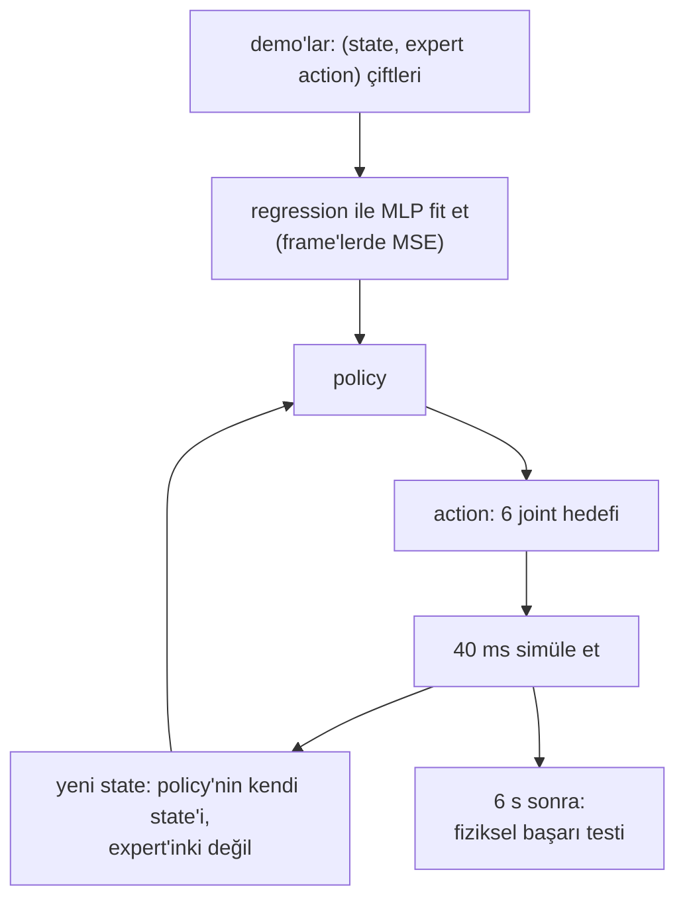

# 28 · Behavior cloning

<!-- meta -->
| | |
|---|---|
| **Bölüm** | [7 · Learning from demonstration](README.md) |
| **Çalışma türü** | CPU · Mac ya da Colab CPU |
| **Önkoşul** | [27](27-robot-datasets.md) |
| **Önce öğren** | [Multi-Layer Networks and Forward Pass](https://aiengineeringfromscratch.com/lesson?path=phases/03-deep-learning-core/02-multi-layer-networks) · [Loss Functions](https://aiengineeringfromscratch.com/lesson?path=phases/03-deep-learning-core/05-loss-functions) · [Introduction to PyTorch](https://aiengineeringfromscratch.com/lesson?path=phases/03-deep-learning-core/11-intro-to-pytorch) |
| **Süre** | ~60 dk |
| **Kod** | [`experiments/28-behavior-cloning/experiment.py`](../../experiments/28-behavior-cloning/experiment.py) |
| **Durum** | ✅ tam |
<!-- /meta -->

> Behavior cloning, state'lerden expert'in action'larına supervised regression'dır. Loss'u frame'ler üzerinde, başarısı yalnız closed loop'ta ölçülür ve ikisi birbirini tutmayabilir.

## Problem

Ders 26–27 bize 120 scripted demonstration ve temiz bir dataset bıraktı. Bunları bir policy'ye çevirmenin en basit yolu behavior cloning (BC): $\pi_\theta(o) \approx a$'yı regression ile fit etmek; kamera ve lazer mesafe görüntülerinden bir aracı sürmeyi öğrenen ALVINN'in arkasındaki tarif (Pomerleau, NIPS 1988). Bir robotik mühendisinin ona güvenmeden önce cevaplaması gereken sorular somut. Bir SO-101 pick'i kaç demonstration ister? Daha düşük bir validation loss daha fazla başarılı pick demek mi? Ve veriyi neredeyse kusursuz fit eden bir network'ü yine de küpü düşüren şey ne?

## Ana fikir

### Sade anlatımla

Bir video oyununu oynayan bir bot istediğini düşün. İyi bir oyuncuyu kaydedersin: her frame'de ekranı ve bastığı tuşu; sonra bu çiftler üzerinde sıradan bir supervised model eğitirsin: ekran girer, tuş çıkar. Behavior cloning budur: reward yok, deneme-yanılma yok, yalnız kaydedilmiş çiftler. Robotumuz için "ekran" joint açıları artı küp konumu, "tuş" ise bir sonraki joint hedefleridir.

İki şey ters gider. Bot hiçbir zaman oyuncuyla birebir aynı oynamaz; birkaç frame sonra oyuncunun hiç üretmediği, verisi olmayan ekranlar görür ve her küçük hata onu biraz daha uzağa iter. Bazen de ekran tek başına ne yapılacağını söylemez: oyuncu bekledi, sonra zıpladı; o karardan hemen önceki ve sonraki ekranlar aynı görünür. Son olarak, training sırasında izlediğin skor (kaydedilmiş frame'lerdeki hata) önemli olan skor değildir (bot tek başına oynarken küp kalkıyor mu); bu ders ikisini de ölçüyor.

### Frame'lerde eğit, loop'ta çalıştır



### Behavior cloning, kod olarak

```python
# Training: ordinary supervised regression on (observation, expert action) pairs
for step in range(4000):
    x, a = sample_batch(demos, 256)           # x: 9 state values + clock t, a: expert action (6)
    x_in = x + noise_like(x)                  # 0.02 rad on joints and jaw, 1 mm on the cube, 0 on t
    pred = policy(normalize(x_in))            # MLP 2 x 256, MEAN_STD from lesson 27
    loss = ((pred - normalize_a(a)) ** 2).mean()  # MSE against the clean expert targets
    loss.backward(); opt.step(); opt.zero_grad()

# Run time: the policy feeds itself (closed loop)
for k in range(150):                          # 6 s at 25 Hz
    x = concat(scene.obs(), min(k / 25, 4.52))   # clock clipped to the last demo timestamp
    a = unnormalize_a(policy(normalize(x)))
    scene.apply(a); scene.step(20)            # hold 40 ms
```

| Büyüklük | Formül |
|---|---|
| BC amacı | $\theta^* = \arg\min_\theta \; \mathbb E_{(o,a) \sim \mathcal D}\, \big\| \pi_\theta(o) - a \big\|^2$ |
| girdi gürültüsüyle | $\mathbb E_{(o,a) \sim \mathcal D,\ \epsilon}\, \big\| \pi_\theta(o + \epsilon) - a \big\|^2$ |
| open-loop RMSE | dışarıda tutulan demo frame'leri üzerinde $\sqrt{\operatorname{mean}\big(\pi_\theta(o) - a\big)^2}$ |
| closed-loop başarı | [ders 25](25-evaluating-policies.md)'in fiziksel testinden $k/n$ |

Burada $\theta$ network ağırlıkları, $\pi_\theta$ policy, $\mathcal D = \{(o_t, a_t)\}$ expert $\pi^*$'ın demonstration'ları, $o$ bir observation (9 state değeri artı saat), $a$ expert'in action'ı (6 joint hedefi) ve $\epsilon$ Gauss gürültüsüdür (joint başına 0,02 rad, küpte 1 mm). Püf noktası training dağılımı: $o$, *expert*'in ziyaret ettiği state'lerden geliyor; çalışma anında ise policy kendine kendi state'lerini veriyor. Ders 29 bu boşlukla uğraşıyor.

### Policy'miz

| Parça | Seçim |
|---|---|
| girdi | 5 kol joint'i, çene, küp xyz (9) + episode saati $t$ (son demo timestamp'i olan 4,52 s'de kırpılmış) |
| çıktı | sonraki 6 joint hedefi [rad], 40 ms (20 fizik adımı) tutuluyor |
| network | MLP 2 × 256 ReLU, ders 27'den MEAN_STD normalization'ı |
| training | Adam, lr 1e-3, batch 256, 4000 adım, MSE |
| augmentation | her batch'in girdilerine Gauss gürültüsü: joint'lerde 0,02 rad, küpte 1 mm; hedefler değişmiyor |

**Neden saat ve neden gürültü.** Scripted expert, zamanlı segmentleri olan bir state machine. İnişin dibinde "çeneler açık, küpte", expert kapatmaya karar vermeden hemen önce ve hemen sonra aynı görünüyor; ikisini saat ayırıyor. Demonstration'lar 10 boyutlu girdi uzayında gürültüsüz eğriler ve bu eğrilerin dışında network'ün çıktısı kısıtsız. Hafifçe bozulmuş girdiler üzerinde, expert'in temiz action'larıyla eğitmek yakın state'leri expert'in hedeflerine eşliyor; hedefler mutlak joint pozisyonları olduğu için aynı hedef kaymış kolu geri çekiyor. İkisi de BC'nin parçası değil, bu dersin tasarım seçimleri; Boz bunları ölçüyor (50 demo, seed 0): ikisiyle 20/20, gürültüsüz 0/20, saatsiz 4/20.

**Closed-loop evaluation.** Her 40 ms'de policy simüle state'i okuyor ve SO-101 position servoları için joint hedefleri veriyor; 6 s sonra [ders 25](25-evaluating-policies.md)'in fiziksel testi karar veriyor. Her konfigürasyon aynı 20 test konumunda (seed 28, training'de hiç kullanılmadı) 3 training seed'iyle koşuluyor; her seed'in k/20'sini ve birleşik k/60'ı Wilson aralığıyla raporluyoruz.

<details>
<summary>Matematik ayrıntısı: MSE regression ne öğrenir ve loop neyi değiştirir</summary>

**MSE ortalama action'ı öğrenir.** Sabit bir girdi $o$ için, o girdiyle görülen action'lar üzerinde $\mathbb E\,\|\hat a - a\|^2$'yi en küçük yapan $\hat a$ değeri onların ortalaması $\mathbb E[a \mid o]$'dur. Bir state'i çoğu frame'de "açık tut", birkaçında "kapatmaya başla" izliyorsa regression "açık tut"a yakın bir şey verir. Saati eklemek bu frame'leri farklı girdiler yapar; her biri kendi ortalamasını alır.

**Training ve çalışma anı girdileri farklıdır.** Training, $o$'yu expert'in state dağılımından çeker. Çalışma anında $o_{t+1}$'i simülatör $o_t$'den ve policy'nin kendi action'ı $\pi_\theta(o_t)$'den üretir; yani her action hatası bir sonraki girdiyi kaydırır. Network yalnız expert'in state'lerinde doğruysa, küçük bir hata onu daha az doğru olduğu bir state'e götürür ve hatalar bir episode'un 150 adımı boyunca birikir.

**Girdi gürültüsü burada neden işe yarar.** $\mathbb E\,\|\pi_\theta(o + \epsilon) - a\|^2$'yi küçültmek, network'ten yalnız eğrilerin üzerinde değil, demonstration'ların küçük bir komşuluğundaki her state için expert'in action'ını vermesini ister. $a$ mutlak bir joint hedefi olduğundan, onu hafifçe kaymış bir state'ten vermek gösterilen yola doğru geri dönen bir hareket komutlar. Bu bizim action uzayımızın bir özelliği; hız ya da fark (delta) action'larında bu argüman doğrudan geçerli değildir.

Daha derine: [Multi-Layer Networks and Forward Pass](https://aiengineeringfromscratch.com/lesson?path=phases/03-deep-learning-core/02-multi-layer-networks), [Loss Functions](https://aiengineeringfromscratch.com/lesson?path=phases/03-deep-learning-core/05-loss-functions), [Introduction to PyTorch](https://aiengineeringfromscratch.com/lesson?path=phases/03-deep-learning-core/11-intro-to-pytorch); aşağıdaki kaynaklarda Pomerleau (1988) ve UC Berkeley CS 285, ders 2–3.

</details>

## Sıfırdan yaz

Şimdi behavior cloning'i kendin yazacaksın: normalization, network'ün forward pass'i, training loop ve closed-loop rollout; her biri bir sonrakine geçmeden kontrol ediliyor. Veri ders 26'nın demonstration'ları, feature'lar bu dersinkiler (state artı saat); ikisi de Deney script'inden yükleniyor, böylece ikisi aynı hikâyeyi anlatıyor. Bu Deney'den küçük bir koşu: tek training seed'i ve 20 demonstration, CPU'da yaklaşık 6 s.

Adımları kopyalamak yerine kendi dosyana yaz. Bitmiş fonksiyonlar [`physai/imitation.py`](../../physai/imitation.py) içinde; `uv run python experiments/28-behavior-cloning/build.py` dört adımın hepsini koşturur (çıktı [`build_output.txt`](../../experiments/28-behavior-cloning/build_output.txt) dosyasında).

### Adım 1 · Normalize et

Joint açıları 1 rad civarında, küp koordinatları birkaç santimetre, saat 4,52 s'ye kadar. Her girdi ortalaması kadar kaydırılıp standart sapmasına bölünüyor (MEAN_STD, ders 27); action'lar da aynı işlemden geçiyor:

```python
def fit_mean_std(x, eps=1e-6):
    """MEAN_STD normalization statistics per feature (lesson 27): shift and scale."""
    x = np.asarray(x, np.float32)
    return x.mean(0), x.std(0) + eps
```

Kontrol, istatistikleri ders 27'nin trainer'ının `train_mlp` içinde hesapladıklarıyla karşılaştırır:

```text
== Step 1. Normalization statistics, 20 demonstrations ==
2280 frames, 10 inputs (5 joints, jaw, cube xyz, clock), 6 actions
mean   -0.010  -0.256   0.221   1.375   1.623   0.731   0.221   0.014   0.036   2.260
std     0.204   0.508   0.387   0.202   0.204   0.505   0.035   0.045   0.032   1.316
max |ours - lesson 27| = 0.0e+00
```

Küpün x'inin standart sapması 0,035 m, z'sininki 0,032 m; normalization olmadan bu girdiler joint'lerden yaklaşık 6 ila 16 kat küçük olur ve network onları neredeyse görmez.

### Adım 2 · Forward pass

Policy, 256'lık iki ReLU katmanı ve doğrusal bir çıktı. NumPy'da bu, katmanlar üzerinde bir döngü:

```python
def mlp_forward(layers, x):
    """ReLU MLP in NumPy: layers = [(W, b), ...] with W of shape (out, in); no activation on the last layer."""
    h = np.asarray(x, np.float64)
    for i, (W, b) in enumerate(layers):
        h = h @ W.T + b
        if i < len(layers) - 1:
            h = np.maximum(h, 0.0)
    return h
```

Rastgele başlatılmış bir `torch.nn.Sequential`'ın ağırlıklarını listeye kopyala ve çıktıları karşılaştır:

```text
== Step 2. Forward pass: NumPy vs torch.nn.Sequential (float64, random weights) ==
500 inputs: max |mlp_forward - torch| = 4.4e-16
```

Fark yuvarlama (4,4e-16). Policy'yi NumPy'da çalıştırmak PyTorch'u 25 Hz'lik kontrol döngüsünün dışında tutuyor.

### Adım 3 · Training loop

Training, rastgele frame batch'leri üzerinde sıradan bir regression. Robotiğe özgü tek satır girdilere Gauss gürültüsü ekliyor ve label olarak expert'in temiz action'ını tutuyor:

```python
def train_bc(X, Y, hidden=256, steps=4000, batch=256, lr=1e-3, seed=0, obs_noise=None):
    """Behavior cloning: MSE regression from observations X to expert actions Y with a 2 x hidden ReLU MLP (Adam).

    Inputs and targets are MEAN_STD-normalized; obs_noise (raw units, one std per input feature) is added to the
    inputs of every batch, the targets stay clean. Returns (layers, x_stats, y_stats) for `bc_policy`.
    """
    import torch
    import torch.nn as nn
    torch.manual_seed(seed)
    g = torch.Generator().manual_seed(seed)
    X, Y = np.asarray(X, np.float32), np.asarray(Y, np.float32)
    (xs, xk), (ys, yk) = fit_mean_std(X), fit_mean_std(Y)
    xt, yt = torch.tensor(X), torch.tensor((Y - ys) / yk, dtype=torch.float32)
    XS, XK = torch.tensor(xs, dtype=torch.float32), torch.tensor(xk, dtype=torch.float32)
    NZ = None if obs_noise is None else torch.tensor(obs_noise, dtype=torch.float32)
    net = nn.Sequential(nn.Linear(X.shape[1], hidden), nn.ReLU(), nn.Linear(hidden, hidden), nn.ReLU(),
                        nn.Linear(hidden, Y.shape[1]))
    opt = torch.optim.Adam(net.parameters(), lr)
    for _ in range(steps):
        idx = torch.randint(0, len(xt), (batch,), generator=g)        # a random batch of frames
        x = xt[idx]
        if NZ is not None:
            x = x + torch.randn(x.shape, generator=g) * NZ           # perturb the input, keep the label
        loss = ((net((x - XS) / XK) - yt[idx]) ** 2).mean()         # MSE in normalized action units
        opt.zero_grad()
        loss.backward()
        opt.step()
    layers = [(m.weight.detach().double().numpy(), m.bias.detach().double().numpy()) for m in net if isinstance(m, nn.Linear)]
    return layers, (xs.astype(np.float64), xk.astype(np.float64)), (ys.astype(np.float64), yk.astype(np.float64))
```

```python
def bc_policy(layers, x_stats, y_stats):
    """The trained network as a function raw observation(s) -> raw action(s): normalize, forward, unnormalize."""
    (xs, xk), (ys, yk) = x_stats, y_stats
    return lambda x: mlp_forward(layers, (np.atleast_2d(x) - xs) / xk) * yk + ys
```

İlk kontrol, senin fonksiyonunla ve ders 27'nin `train_mlp`'siyle 200 adım eğitir (aynı seed, aynı gürültü) ve ağırlıkları karşılaştırır. İkincisi tam 4000 adımı eğitir ve dışarıda tutulan 20 episode'da open-loop hatayı ölçer:

```text
== Step 3. Training: ours vs lesson 27's train_mlp, then the full run ==
200 steps, same seed: max |weights ours - lesson 27| = 0.0e+00
4000 steps, seed 0: open-loop RMSE on episodes 100-119 = 0.883 deg (predicting the mean action: 23.753 deg)
```

Ağırlıkların aynı olması senin loop'unun Deney'in loop'u olduğu demek. Seed 0'ın open-loop RMSE'si 0,883°, Deney'in üç seed ortalaması olan 0,945°'ye yakın; her yerde ortalama action'ı tahmin etmek 23,753° verirdi.

### Adım 4 · Loop'u kapat

Artık policy sürüyor: her 40 ms'de simüle state'i okuyor, servolar 20 fizik adımı boyunca onun altı joint hedefinin peşinden gidiyor ve 6 s sonra ders 25'in fiziksel testi karar veriyor.

```python
pi = bc_policy(layers, x_stats, y_stats)
outs = [exp.rollout(scene, lambda o, t: pi(exp.features(o, t))[0], xy) for xy in exp.TEST_XY]
```

```text
== Step 4. Closed loop: 20 test positions (seed 28), 6 s each ==
success 20/20, Wilson 95% [0.84, 1.00]; outcomes: held 20
```

20/20, Deney'in 20 demonstration'daki seed 0 girdisi. Tek seed ve 20 konumdan gelen [0,84, 1,00] Wilson aralığı hâlâ geniş; Deney bu yüzden üç seed'i birleştiriyor.

### Elinde kalan

`physai.imitation` artık `fit_mean_std`, `mlp_forward`, `train_bc` ve `bc_policy` içeriyor. [Ders 29](29-dagger.md) aynı modüle DAgger'ı ekliyor, ders 30'un flow matching sampler'ı ise demonstration'lar birbirini tutmadığında regression'ın yerini alıyor. [`tests/test_28_behavior_cloning.py`](../../tests/test_28_behavior_cloning.py) bunları NumPy'a ve ders 27'nin trainer'ına sabitliyor; bir şey değiştirdikten sonra `uv run pytest tests/test_28_behavior_cloning.py` çalıştır.

## Kütüphaneyle kullan

Gerçek bir kolda BC ailesinden bir policy eğitmenin kütüphane yolu LeRobot. Bir policy sınıfı bir `LeRobotDataset` okur, dataset'in `meta/stats.json`'ıyla normalize eder, komut satırından eğitilir ve evaluate edilir ([il_robots](https://huggingface.co/docs/lerobot/il_robots)):

```bash
lerobot-train --dataset.repo_id=<user>/<dataset> --policy.type=act   # or diffusion, ...
lerobot-rollout ...                                                  # evaluate on the robot
```

Sıra senin kurduğun sıra: önce istatistikler, sonra network, sonra closed-loop evaluation. Araçtan araca değişen, her parçanın nerede durduğu:

| Parça | Bu ders / physai | LeRobot ACT | Elle PyTorch |
|---|---|---|---|
| normalization | `fit_mean_std`, MEAN_STD | `normalization_mapping`, varsayılan olarak state, action ve görüntüler için MEAN_STD | kendi `(x - mean) / std`'n |
| policy çıktısı | sonraki 6 joint hedefi | `chunk_size` action'lık bir chunk (varsayılan 100) | son katman ne veriyorsa |
| çalışma anı | NumPy'da `bc_policy`, 25 Hz | `n_action_steps` action'ı kuyruğa alan `select_action` | `net.eval()` ve `torch.no_grad()` |

Kaynak: LeRobot'un [`configuration_act.py`](https://github.com/huggingface/lerobot/blob/main/src/lerobot/policies/act/configuration_act.py) ve [`modeling_act.py`](https://github.com/huggingface/lerobot/blob/main/src/lerobot/policies/act/modeling_act.py) dosyaları.

Üç tuzak:

- **Yanlış split'ten istatistik.** Ortalama ve standart sapmayı yalnız training episode'larında hesapla ve ağırlıklarla birlikte gönder; farklı istatistiklerle çalıştırılan bir policy kaymış girdiler görür ve hata vermeden başarısız olur.
- **Zamana bağlı demonstration'lar.** Yalnız state kullanan bir policy, state'in göstermediği bir kararın "öncesi"ni "sonrası"ndan ayıramaz (Boz: saatsiz 4/20). Network'ü suçlamadan önce expert'inde gizli fazlar olup olmadığına bak.
- **Düşük bir validation loss bir başarı oranı değildir.** Adım 3'ün 0,883°'si Adım 4 hakkında pek bir şey söylemiyor; bunu yalnız closed-loop test söyler (Deney A: RMSE düşmeye devam ediyor, başarı etmiyor).

## Deney

Tam script: [`experiments/28-behavior-cloning/experiment.py`](../../experiments/28-behavior-cloning/experiment.py), çıktı: [`output.txt`](../../experiments/28-behavior-cloning/output.txt). MuJoCo 3.17.0, NumPy 2.5.4, PyTorch 2.14.1 (CPU, 1 thread), Apple Silicon Mac (Apple M5), deterministik, yaklaşık 1 dk CPU.

```python
def train_policy(obs, act, t, seed=0, sigma_rad=0.02, clock=True, steps=4000):
    X = features(obs, t, clock)                        # [joints, jaw, cube xyz, t]
    return train_mlp(X, act, steps=steps, seed=seed,   # MEAN_STD inside
                     obs_noise=noise_vector(sigma_rad, clock))

for k in range(150):                                   # 6 s at 25 Hz
    a = policy(scene.obs(), k / 25)
    scene.apply(a); scene.step(20)                     # hold 40 ms
success = scene.success()                              # lifted >= 4 cm, both jaws touching
```

*Tahmin et:* 20/20 için kaç demonstration gerekir ve open-loop hata başarı oranını tahmin eder mi?

**A. Demonstration sayısı.**

| Demo | frame | seed 0 / 1 / 2 | birleşik | Wilson %95 | open-loop RMSE [derece] | başarısız test konumları (×seed) |
|---|---|---|---|---|---|---|
| 5 | 570 | 12 / 11 / 13 | 36/60 | [0,47, 0,71] | 4,138 | 9 konum, hepsi "kapandı, küp yerde" |
| 10 | 1140 | 19 / 19 / 19 | 57/60 | [0,86, 0,98] | 2,282 | #4 (16,6, −6,6) cm ×3 |
| 20 | 2280 | 20 / 20 / 20 | 60/60 | [0,94, 1,00] | 0,945 | – |
| 50 | 5700 | 20 / 20 / 20 | 60/60 | [0,94, 1,00] | 0,408 | – |
| 100 | 11400 | 18 / 18 / 19 | 55/60 | [0,82, 0,96] | 0,360 | #19 (16,2, 2,7) cm ×3, #3, #7 ×1 |

Open-loop RMSE, görülmemiş 20 demo episode'unda (100–119) ölçülüyor. Üç şey göze çarpıyor:

- **Başarı loss'tan çok önce doyuyor.** 20 demoda 60/60; 20'den 100 demoya RMSE hâlâ 0,945°'den 0,360°'ye düşüyor.
- **Daha fazla veri monoton biçimde daha iyi değildi.** 100 demoda birleşik oran 55/60'a düşüyor; 50 ve 100 demonun %95 aralıkları ancak sınırda örtüşüyor ([0,94, 1,00] ve [0,82, 0,96]). 60/60 ile 55/60 üzerinde iki taraflı Fisher testi p = 0,057 veriyor ve 60 rollout'u bağımsız sayıyor, oysa değiller (aynı demolar, aynı 20 konum). Başarısızlıklar, gösterilen alanın yakın kenarı x = 16,2 cm'deki test konumu #19'da yoğunlaşıyor; orada üç seed de başarısız. Düşüş istatistiksel olarak kanıtlanmış değil, ama göz ardı edilebilecek bir gürültü de değil. Sabit 4000 training adımıyla 100 demo, her episode üzerinden daha az geçiş demek; sebebi ayırmadık.
- **Başarısızlıklar sayısal değil fiziksel.** 5 demoyla kol çeneleri kapatıyor ama küp yerde kalıyor (24 başarısızlığın 24'ü): nişan, ders 26'nın grasp toleransından fazla sapıyor.


## Boz

İki düğme, 50 demonstration, seed 0 (gürültü 0, küpteki 1 mm gürültüyü de kapatıyor; diğer satırlar onu koruyor):

| Girdi gürültüsü [rad] | saat | başarı | Wilson %95 | başarısızlıklar |
|---|---|---|---|---|
| 0 | var | 0/20 | [0,00, 0,16] | kapandı, küp yerde 20 |
| 0,005 | var | 0/20 | [0,00, 0,16] | hiç kapanmadı 20 |
| 0,01 | var | 7/20 | [0,18, 0,57] | kapandı, küp yerde 6; kalktı, tutulmadı 7 |
| 0,02 | var | 20/20 | [0,84, 1,00] | – |
| 0,04 | var | 20/20 | [0,84, 1,00] | – |
| 0,02 | yok | 4/20 | [0,08, 0,42] | hiç kapanmadı 16 |

Girdi gürültüsü olmadan policy demonstration'ları fit ediyor ve her testte başarısız oluyor: 0 ve 0,005 rad'da 0/20. Ders 29'da ölçülen sapmayla tutarlı yorumumuz: her 40 ms'lik adım küçük bir hata ekliyor, sonraki girdi gösterilmiş state'lerin dar tüpünün biraz dışında kalıyor, oradaki çıktı extrapolation oluyor ve hatalar birikiyor. Bunun yerine saati kaldır: 20 episode'un 16'sı çeneler hiç kapanmadan bitiyor. "Kol küpte, çeneler açık"ı çoğu frame'de "açık tut", birkaçında "kapatmaya başla" izliyor; yalnız state'e bakan bir regression "açık tut"a doğru ortalıyor (Matematik ayrıntısındaki gibi, yorumumuz).

## Gerçek robotta

- LeRobot BC ailesinden policy'leri kaydedilmiş bir dataset üzerinde `lerobot-train --policy.type=act` (ve diğerleri) ile eğitir ve `lerobot-rollout` ile evaluate eder ([il_robots](https://huggingface.co/docs/lerobot/il_robots)). Onun policy'leri kamera görüntüsü alır; bizim yalnız state kullanan policy'miz küp konumunu simülatörden okuyor, gerçek bir kol bunu kameralardan tahmin etmek zorunda (Bölüm 5).
- Gerçek kolda henüz ölçülmedi. Prosedür: aynı küp alanında 10, 20 ve 50 teleoperate edilmiş episode kaydet, her büyüklük için bir policy eğit, her birini ders 25'teki gibi aynı 20 işaretli konumda evaluate et ve k/20'yi Wilson aralıkları ve başarısızlık türleriyle raporla. Farklı bir eğri bekle: insan demonstration'ları scripted olanlardan daha gürültülü ve daha az tutarlı; bu kısmen yukarıdaki girdi gürültüsü gibi, kısmen label gürültüsü gibi davranır.
- Girdi gürültüsü hilesinin donanımda bir karşılığı var: zaten küçük düzeltmeler içeren demonstration'lar. DAgger'ın ([ders 29](29-dagger.md)) bilinçli olarak topladığı şey bu.

## Kendini dene

1. **Kolay.** 5 demoyla hangi başarısızlık türü baskın ve bu policy'nin nişanı hakkında ne söylüyor?
2. **Orta.** 50 demoda RMSE 0,408°, 100'de 0,360°, ama başarı 60/60'tan 55/60'a indi. Open-loop bir metriğin closed-loop başarıyla neden çelişebileceğine iki sebep ver.
3. **Zor.** Saati, policy'nin gerçek bir robotta zamanlayıcı olmadan gözleyebileceği bir faz değişkeniyle değiştir (ipucu: çene açısı ve küp yüksekliği). 50 demoyla yeniden eğit ve saatsiz satırın 4/20'siyle karşılaştır.

### Cevaplar

1. "Kapandı, küp yerde" (24 başarısızlığın 24'ü): çeneler küpün yanında kapanıyor, yani nişan grasp toleransından fazla sapıyor; 5 demoda open-loop RMSE 4,138°.
2. RMSE demonstration state'leri üzerinde ortalanıyor, başarı ise birkaç belirleyici state'e (grasp) ve expert'in hiç ziyaret etmediği state'lere bağlı; oradaki küçük hatalar başka yerlerdeki büyük hatalardan daha önemli. Ayrıca metrik birikmeyi yok sayıyor: closed loop'ta her hata bir sonraki girdiyi değiştiriyor.
3. Burada hesaplanmadı; çalıştır.

## Akılda kalanlar ve kaynaklar

- Simülasyonda, saat girdili ve 0,02 rad girdi gürültülü BC küpü 10 demonstration'la 57/60, 20 ve 50 ile 60/60 aldı (3 seed × 20 test konumu).
- Open-loop RMSE iyileşmeye devam etti (20'den 100 demoya 0,945° → 0,360°), başarı etmedi; closed loop evaluate et.
- Girdi gürültüsü olmadan aynı network 0/20, saatsiz 4/20 yaptı: BC, demonstration'ların kapsamadığı state'lerde ve state'in belirlemediği kararlarda bozulur.

Sonraki: [ders 29 · Distribution shift ve DAgger](29-dagger.md).

Kaynaklar:
- D. A. Pomerleau, ["ALVINN: An Autonomous Land Vehicle in a Neural Network"](https://proceedings.neurips.cc/paper/1988/hash/812b4ba287f5ee0bc9d43bbf5bbe87fb-Abstract.html), NIPS 1, 1988.
- UC Berkeley [CS 285 Deep Reinforcement Learning](https://rail.eecs.berkeley.edu/deeprlcourse/), ders 2–3 "Behavioral Cloning" (slaytlar ders sayfasında).
- LeRobot, [Imitation learning on real-world robots](https://huggingface.co/docs/lerobot/il_robots).
- Ölçülen tüm sayılar: [`experiments/28-behavior-cloning/output.txt`](../../experiments/28-behavior-cloning/output.txt).
