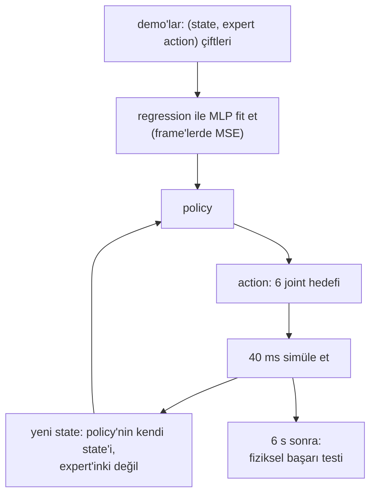

# 28 · Behavior cloning

<!-- meta -->
| | |
|---|---|
| **Bölüm** | [7 · Learning from demonstration](README.md) |
| **Çalışma türü** | CPU · Mac ya da Colab CPU |
| **Önkoşul** | [27](27-robot-datasets.md) |
| **Önce öğren** | [Multi-Layer Networks and Forward Pass](https://aiengineeringfromscratch.com/lesson?path=phases/03-deep-learning-core/02-multi-layer-networks) · [Loss Functions](https://aiengineeringfromscratch.com/lesson?path=phases/03-deep-learning-core/05-loss-functions) · [Introduction to PyTorch](https://aiengineeringfromscratch.com/lesson?path=phases/03-deep-learning-core/11-intro-to-pytorch) |
| **Süre** | ~60 dk |
| **Kod** | [`experiments/28-behavior-cloning/experiment.py`](../../experiments/28-behavior-cloning/experiment.py) |
| **Durum** | ✅ tam |
<!-- /meta -->

> Behavior cloning, state'lerden expert'in action'larına supervised regression'dır. Loss'u frame'ler üzerinde, başarısı yalnız closed loop'ta ölçülür ve ikisi birbirini tutmayabilir.

## Problem

Ders 26–27 bize 120 scripted demonstration ve temiz bir dataset bıraktı. Bunları bir policy'ye çevirmenin en basit yolu behavior cloning (BC): $\pi_\theta(o) \approx a$'yı regression ile fit etmek; kamera ve lazer mesafe görüntülerinden bir aracı sürmeyi öğrenen ALVINN'in arkasındaki tarif (Pomerleau, NIPS 1988). Bir robotik mühendisinin ona güvenmeden önce cevaplaması gereken sorular somut. Bir SO-101 pick'i kaç demonstration ister? Daha düşük bir validation loss daha fazla başarılı pick demek mi? Ve veriyi neredeyse kusursuz fit eden bir network'ü yine de küpü düşüren şey ne?

## Ana fikir

### Sade anlatımla

Bir video oyununu oynayan bir bot istediğini düşün. İyi bir oyuncuyu kaydedersin: her frame'de ekranı ve bastığı tuşu. Sonra bu (ekran, tuş) çiftleri üzerinde sıradan bir supervised model eğitirsin: ekran girer, tuş çıkar. Behavior cloning budur. Training sırasında reward'a da deneme-yanılmaya da ihtiyaç duymaz, yalnız kaydedilmiş çiftlere. Robotumuz için "ekran" joint açıları artı küp konumu, "tuş" ise bir sonraki joint hedefleridir.

İki şey ters gider. Birincisi, bot hiçbir zaman oyuncuyla birebir aynı oynamaz; birkaç frame sonra oyuncunun hiç üretmediği ekranlar görür ve orada verisi yoktur; her küçük hata onu biraz daha uzağa iter. İkincisi, bazen ekran tek başına ne yapılacağını söylemez: oyuncu bekledi, sonra zıpladı; o karardan hemen önceki ve hemen sonraki ekranlar aynı görünür.

Üstelik training sırasında izlediğin skor (kaydedilmiş frame'lerdeki hata), önemli olan skor değildir (bot kendi başına oynarken küp kalkıyor mu). Bu ders ikisini de ölçüyor ve birbirini tutmayabildiklerini gösteriyor.

### Frame'lerde eğit, loop'ta çalıştır



### Behavior cloning, kod olarak

```python
# Training: ordinary supervised regression on (observation, expert action) pairs
for step in range(4000):
    x, a = sample_batch(demos, 256)           # x: 9 state values + clock t, a: expert action (6)
    x_in = x + noise_like(x)                  # 0.02 rad on joints and jaw, 1 mm on the cube, 0 on t
    pred = policy(normalize(x_in))            # MLP 2 x 256, MEAN_STD from lesson 27
    loss = ((pred - normalize_a(a)) ** 2).mean()  # MSE against the clean expert targets
    loss.backward(); opt.step(); opt.zero_grad()

# Run time: the policy feeds itself (closed loop)
for k in range(150):                          # 6 s at 25 Hz
    x = concat(scene.obs(), min(k / 25, 4.52))   # clock clipped to the last demo timestamp
    a = unnormalize_a(policy(normalize(x)))
    scene.apply(a); scene.step(20)            # hold 40 ms
```

| Büyüklük | Formül |
|---|---|
| BC amacı | $\theta^* = \arg\min_\theta \; \mathbb E_{(o,a) \sim \mathcal D}\, \big\| \pi_\theta(o) - a \big\|^2$ |
| girdi gürültüsüyle | $\mathbb E_{(o,a) \sim \mathcal D,\ \epsilon}\, \big\| \pi_\theta(o + \epsilon) - a \big\|^2$ |
| open-loop RMSE | dışarıda tutulan demo frame'leri üzerinde $\sqrt{\operatorname{mean}\big(\pi_\theta(o) - a\big)^2}$ |
| closed-loop başarı | [ders 25](25-evaluating-policies.md)'in fiziksel testinden $k/n$ |

Burada $\theta$ network ağırlıkları, $\pi_\theta$ policy network'ü, $\mathcal D = \{(o_t, a_t)\}$ expert $\pi^*$'tan gelen demonstration'lar, $o$ bir observation (9 state değeri artı saat), $a$ expert'in action'ı (6 joint hedefi) ve $\epsilon$ de standart sapması joint başına 0,02 rad, küpte 1 mm olan Gauss gürültüsüdür. Amaç sıradan bir MSE regression'ı (bkz. AIEFS: [Multi-Layer Networks](https://aiengineeringfromscratch.com/lesson?path=phases/03-deep-learning-core/02-multi-layer-networks), [Loss Functions](https://aiengineeringfromscratch.com/lesson?path=phases/03-deep-learning-core/05-loss-functions), [Introduction to PyTorch](https://aiengineeringfromscratch.com/lesson?path=phases/03-deep-learning-core/11-intro-to-pytorch)). Püf noktası training dağılımı: $o$, *expert*'in ziyaret ettiği state'lerden çekiliyor; çalışma anında ise policy kendine kendi state'lerini veriyor. Ders 29 bu boşlukla uğraşıyor; bu ders onun BC'ye ne yaptığını ölçüyor.

### Policy'miz

| Parça | Seçim |
|---|---|
| girdi | 5 kol joint'i, çene, küp xyz (9) + episode saati $t$ (son demo timestamp'i olan 4,52 s'de kırpılmış) |
| çıktı | sonraki 6 joint hedefi [rad], 40 ms (20 fizik adımı) tutuluyor |
| network | MLP 2 × 256 ReLU, ders 27'den MEAN_STD normalization'ı |
| training | Adam, lr 1e-3, batch 256, 4000 adım, MSE |
| augmentation | her batch'in girdilerine Gauss gürültüsü: joint'lerde 0,02 rad, küpte 1 mm; hedefler değişmiyor |

**Neden saat ve neden gürültü.** Scripted expert, zamanlı segmentleri olan bir state machine. İnişin dibinde "çeneler açık, küpte" kol state'i, expert kapatmaya karar vermeden hemen önce ve hemen sonra aynı; yani tek başına state bir sonraki action'ı söylemiyor, saat söylüyor. Gürültü önemli, çünkü demonstration'lar 10 boyutlu girdi uzayında gürültüsüz eğriler: bu eğrilerin dışında network'ün çıktısı kısıtsız ve öğrenen ilk adımlarda onlardan ayrılıyor. Hafifçe bozulmuş girdiler üzerinde, expert'in bozulmamış action'larıyla eğitmek ona yakın state'leri expert'in hedeflerine eşlemeyi öğretiyor; hedefler mutlak joint pozisyonları olduğu için aynı hedef kaymış kolu geri çekiyor. İkisi de BC'nin parçası değil, bu dersin tasarım seçimleri. Boz bunları ölçüyor (50 demo, seed 0): ikisiyle 20/20, gürültüsüz 0/20, saatsiz 4/20.

**Closed-loop evaluation.** Her 40 ms'de policy simüle state'i okuyor ve joint hedefleri veriyor; SO-101 position servoları onları takip ediyor. 6 s sonra [ders 25](25-evaluating-policies.md)'in fiziksel testi başarıya karar veriyor. Her konfigürasyon aynı 20 test konumunda (seed 28, training'de hiç kullanılmadı) 3 training seed'iyle koşuluyor; her seed'in k/20'sini ve birleşik k/60'ı (üç seed'in denemeleri toplanmış hâlde) Wilson aralığıyla raporluyoruz.

<details>
<summary>Matematik ayrıntısı: MSE regression ne öğrenir ve loop neyi değiştirir</summary>

**MSE ortalama action'ı öğrenir.** Sabit bir girdi $o$ için, o girdiyle görülen action'lar üzerinde $\mathbb E\,\|\hat a - a\|^2$'yi en küçük yapan $\hat a$ değeri onların ortalaması $\mathbb E[a \mid o]$'dur. Bir state'i çoğu frame'de "açık tut", birkaçında "kapatmaya başla" izliyorsa regression "açık tut"a yakın bir şey verir. Saati eklemek bu frame'leri farklı girdiler yapar; her biri kendi ortalamasını alır.

**Training ve çalışma anı girdileri farklıdır.** Training, $o$'yu expert'in state dağılımından çeker. Çalışma anında $o_{t+1}$'i simülatör $o_t$'den ve policy'nin kendi action'ı $\pi_\theta(o_t)$'den üretir; yani her action hatası bir sonraki girdiyi kaydırır. Network yalnız expert'in state'lerinde doğruysa, küçük bir hata onu daha az doğru olduğu bir state'e götürür ve hatalar bir episode'un 150 adımı boyunca birikir.

**Girdi gürültüsü burada neden işe yarar.** $\mathbb E\,\|\pi_\theta(o + \epsilon) - a\|^2$'yi küçültmek, network'ten yalnız eğrilerin üzerinde değil, demonstration'ların küçük bir komşuluğundaki her state için expert'in action'ını vermesini ister. $a$ mutlak bir joint hedefi olduğundan, onu hafifçe kaymış bir state'ten vermek gösterilen yola doğru geri dönen bir hareket komutlar. Bu bizim action uzayımızın bir özelliği; hız ya da fark (delta) action'larında bu argüman doğrudan geçerli değildir.

**Open loop ve closed loop.** Open-loop RMSE tüm demonstration frame'leri üzerinde eşit ağırlıkla ortalanır. Closed-loop başarı ise birkaç belirleyici frame'e (grasp) ve expert'in hiç ziyaret etmediği state'lere bağlıdır; bu yüzden ikisinin birlikte hareket etmesi gerekmez.

Daha derine: [Multi-Layer Networks and Forward Pass](https://aiengineeringfromscratch.com/lesson?path=phases/03-deep-learning-core/02-multi-layer-networks), [Loss Functions](https://aiengineeringfromscratch.com/lesson?path=phases/03-deep-learning-core/05-loss-functions), [Introduction to PyTorch](https://aiengineeringfromscratch.com/lesson?path=phases/03-deep-learning-core/11-intro-to-pytorch); aşağıdaki kaynaklarda Pomerleau (1988) ve UC Berkeley CS 285, ders 2–3.

</details>

## Deney

Tam script: [`experiments/28-behavior-cloning/experiment.py`](../../experiments/28-behavior-cloning/experiment.py), çıktı: [`output.txt`](../../experiments/28-behavior-cloning/output.txt). MuJoCo 3.17.0, NumPy 2.5.4, PyTorch 2.14.1 (CPU, 1 thread), Apple Silicon Mac (Apple M5), deterministik, yaklaşık 1 dk CPU.

```python
def train_policy(obs, act, t, seed=0, sigma_rad=0.02, clock=True, steps=4000):
    X = features(obs, t, clock)                        # [joints, jaw, cube xyz, t]
    return train_mlp(X, act, steps=steps, seed=seed,   # MEAN_STD inside
                     obs_noise=noise_vector(sigma_rad, clock))

for k in range(150):                                   # 6 s at 25 Hz
    a = policy(scene.obs(), k / 25)
    scene.apply(a); scene.step(20)                     # hold 40 ms
success = scene.success()                              # lifted >= 4 cm, both jaws touching
```

*Tahmin et:* 20/20 için kaç demonstration gerekir ve open-loop hata başarı oranını tahmin eder mi?

**A. Demonstration sayısı.**

| Demo | frame | seed 0 / 1 / 2 | birleşik | Wilson %95 | open-loop RMSE [derece] | başarısız test konumları (×seed) |
|---|---|---|---|---|---|---|
| 5 | 570 | 12 / 11 / 13 | 36/60 | [0,47, 0,71] | 4,138 | 9 konum, hepsi "kapandı, küp yerde" |
| 10 | 1140 | 19 / 19 / 19 | 57/60 | [0,86, 0,98] | 2,282 | #4 (16,6, −6,6) cm ×3 |
| 20 | 2280 | 20 / 20 / 20 | 60/60 | [0,94, 1,00] | 0,945 | – |
| 50 | 5700 | 20 / 20 / 20 | 60/60 | [0,94, 1,00] | 0,408 | – |
| 100 | 11400 | 18 / 18 / 19 | 55/60 | [0,82, 0,96] | 0,360 | #19 (16,2, 2,7) cm ×3, #3, #7 ×1 |

Open-loop RMSE, görülmemiş 20 demo episode'unda (100–119) ölçülüyor. Üç şey göze çarpıyor:

- **Başarı loss'tan çok önce doyuyor.** Başarı 20 demoda zaten 60/60; 20'den 100 demoya RMSE 0,945°'den 0,360°'ye düşmeye devam ediyor ama başarıda hiçbir kazanç yok.
- **Daha fazla veri monoton biçimde daha iyi değildi.** 100 demoda birleşik oran 55/60'a düşüyor; 50 ve 100 demonun %95 aralıkları ancak sınırda örtüşüyor ([0,94, 1,00] ve [0,82, 0,96]). 60/60 ile 55/60 üzerinde iki taraflı Fisher testi p = 0,057 veriyor; bu bile 60 rollout'u bağımsız sayıyor, oysa değiller: üç seed aynı 100 demoyu ve aynı 20 test konumunu paylaşıyor. Başarısızlıklar, gösterilen alanın yakın kenarı x = 16,2 cm'deki test konumu #19'da yoğunlaşıyor; orada üç seed de başarısız. Yani düşüş istatistiksel olarak kanıtlanmış değil, ama göz ardı edilebilecek bir gürültü de değil. Sabit 4000 training adımıyla 100 demo, her episode üzerinden daha az geçiş demek; sebebi ayırmadık.
- **Başarısızlıklar sayısal değil fiziksel.** 5 demoyla kol çeneleri kapatıyor ama küp yerde kalıyor (24 başarısızlığın 24'ü): nişan, ders 26'nın grasp toleransından fazla sapıyor.


## Boz

İki düğme, 50 demonstration, seed 0 (gürültü 0, küpteki 1 mm gürültüyü de kapatıyor; diğer satırlar onu koruyor):

| Girdi gürültüsü [rad] | saat | başarı | Wilson %95 | başarısızlıklar |
|---|---|---|---|---|
| 0 | var | 0/20 | [0,00, 0,16] | kapandı, küp yerde 20 |
| 0,005 | var | 0/20 | [0,00, 0,16] | hiç kapanmadı 20 |
| 0,01 | var | 7/20 | [0,18, 0,57] | kapandı, küp yerde 6; kalktı, tutulmadı 7 |
| 0,02 | var | 20/20 | [0,84, 1,00] | – |
| 0,04 | var | 20/20 | [0,84, 1,00] | – |
| 0,02 | yok | 4/20 | [0,08, 0,42] | hiç kapanmadı 16 |

Girdi gürültüsü olmadan policy demonstration'ları fit ediyor ve her testte başarısız oluyor: 0 ve 0,005 rad'da 0/20. Ders 29'da ölçülen sapmayla tutarlı yorumumuz: öğrenen, gösterilmiş state'lerin dar tüpünden çıkıyor. Her 40 ms'lik adım küçük bir hata ekliyor, sonraki girdi demonstration'ların biraz dışında kalıyor, oradaki çıktı extrapolation oluyor ve hatalar birikiyor. Bunun yerine saati kaldır: 20 episode'un 16'sı çeneler hiç kapanmadan bitiyor. Burada da yorumumuz: demonstration'larda "kol küpte, çeneler açık" state'ini çoğu frame'de "açık tut", yalnız birkaçında "kapatmaya başla" izliyor; yalnız state'e bakan bir regression "açık tut"a doğru ortalıyor ve kol durunca state'te hiçbir şey değişmiyor.

## Gerçek robotta

- LeRobot BC ailesinden policy'leri kaydedilmiş bir dataset üzerinde `lerobot-train --policy.type=act` (ve diğerleri) ile eğitir ve `lerobot-rollout` ile evaluate eder ([il_robots](https://huggingface.co/docs/lerobot/il_robots)). Onun policy'leri kamera görüntüsü alır; bizim yalnız state kullanan policy'miz küp konumunu simülatörden okuyor, gerçek bir kol bunu kameralardan tahmin etmek zorunda (Bölüm 5).
- Gerçek kolda henüz ölçülmedi. Prosedür: aynı küp alanında 10, 20 ve 50 teleoperate edilmiş episode kaydet, her büyüklük için bir policy eğit, her birini ders 25'teki gibi aynı 20 işaretli konumda evaluate et ve k/20'yi Wilson aralıkları ve başarısızlık türleriyle raporla. Farklı bir eğri bekle: insan demonstration'ları scripted olanlardan daha gürültülü ve daha az tutarlı; bu kısmen yukarıdaki girdi gürültüsü gibi, kısmen label gürültüsü gibi davranır.
- Girdi gürültüsü hilesinin donanımda bir karşılığı var: zaten küçük düzeltmeler içeren demonstration'lar. DAgger'ın ([ders 29](29-dagger.md)) bilinçli olarak topladığı şey bu.

## Kendini dene

1. **Kolay.** 5 demoyla hangi başarısızlık türü baskın ve bu policy'nin nişanı hakkında ne söylüyor?
2. **Orta.** 50 demoda RMSE 0,408°, 100'de 0,360°, ama başarı 60/60'tan 55/60'a indi. Open-loop bir metriğin closed-loop başarıyla neden çelişebileceğine iki sebep ver.
3. **Zor.** Saati, policy'nin gerçek bir robotta zamanlayıcı olmadan gözleyebileceği bir faz değişkeniyle değiştir (ipucu: çene açısı ve küp yüksekliği). 50 demoyla yeniden eğit ve saatsiz satırın 4/20'siyle karşılaştır.

### Cevaplar

1. "Kapandı, küp yerde" (24 başarısızlığın 24'ü): çeneler küpün yanında kapanıyor, yani nişan grasp toleransından fazla sapıyor; 5 demoda open-loop RMSE 4,138°.
2. RMSE demonstration state'leri üzerinde ortalanıyor, başarı ise birkaç belirleyici state'e (grasp) ve expert'in hiç ziyaret etmediği state'lere bağlı; oradaki küçük hatalar başka yerlerdeki büyük hatalardan daha önemli. Ayrıca metrik birikmeyi yok sayıyor: closed loop'ta her hata bir sonraki girdiyi değiştiriyor.
3. Burada hesaplanmadı; çalıştır.

## Akılda kalanlar ve kaynaklar

- Simülasyonda, saat girdili ve 0,02 rad girdi gürültülü BC küpü 10 demonstration'la 57/60, 20 ve 50 ile 60/60 aldı (3 seed × 20 test konumu).
- Open-loop RMSE iyileşmeye devam etti (20'den 100 demoya 0,945° → 0,360°), başarı etmedi; closed loop evaluate et.
- Girdi gürültüsü olmadan aynı network 0/20, saatsiz 4/20 yaptı: BC, demonstration'ların kapsamadığı state'lerde ve state'in belirlemediği kararlarda bozulur.

Sonraki: [ders 29 · Distribution shift ve DAgger](29-dagger.md).

Kaynaklar:
- D. A. Pomerleau, ["ALVINN: An Autonomous Land Vehicle in a Neural Network"](https://proceedings.neurips.cc/paper/1988/hash/812b4ba287f5ee0bc9d43bbf5bbe87fb-Abstract.html), NIPS 1, 1988.
- UC Berkeley [CS 285 Deep Reinforcement Learning](https://rail.eecs.berkeley.edu/deeprlcourse/), ders 2–3 "Behavioral Cloning" (slaytlar ders sayfasında).
- LeRobot, [Imitation learning on real-world robots](https://huggingface.co/docs/lerobot/il_robots).
- Ölçülen tüm sayılar: [`experiments/28-behavior-cloning/output.txt`](../../experiments/28-behavior-cloning/output.txt).
