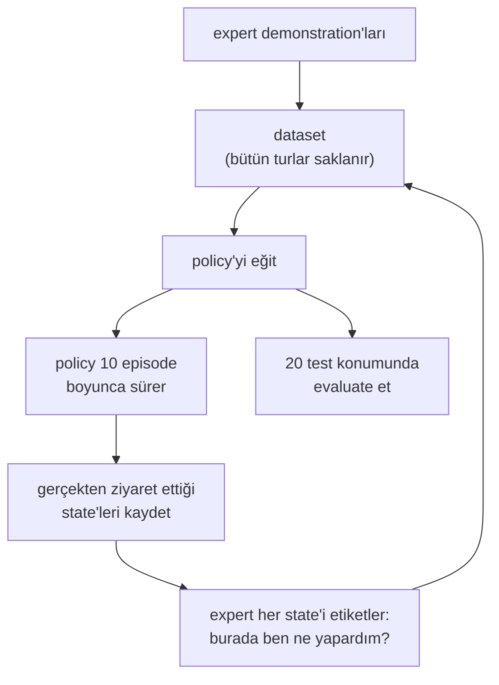

# 29 · Distribution shift ve DAgger

<!-- meta -->
| | |
|---|---|
| **Bölüm** | [7 · Learning from demonstration](README.md) |
| **Çalışma türü** | CPU · Mac ya da Colab CPU |
| **Önkoşul** | [28](28-behavior-cloning.md) |
| **Önce öğren** | [Bias-Variance Tradeoff](https://aiengineeringfromscratch.com/lesson?path=phases/02-ml-fundamentals/10-bias-variance) |
| **Süre** | ~45 dk |
| **Kod** | [`experiments/29-dagger/experiment.py`](../../experiments/29-dagger/experiment.py) |
| **Durum** | ✅ tam |
<!-- /meta -->

> Behavior cloning expert'in state'lerinde eğitilir ve kendi state'lerinde çalışır. DAgger bu boşluğu, öğrenenin gerçekten ulaştığı state'lerde ne yapılacağını expert'e sorarak kapatır.

## Problem

Ders 28, 50 demonstration'la eğitilen ve girdi gürültüsü olmadan 0/20 yapan bir network'le bitti. Regression'da bir sorun yok; başarısızlıklar closed loop'ta oluyor: policy'nin çıktısı robotu hareket ettiriyor, yeni state de onun bir sonraki girdisi oluyor. Ross ve Bagnell (2010) sebebi adlandırdı: imitation'ı i.i.d. supervised learning gibi ele almak, öğrenenin kendi action'larının bir sonra hangi state'leri göreceğine karar verdiğini yok sayar ve regret görev süresinde karesel büyür. Eğitimde görülen state'lerle çalışırken karşılaşılan state'ler arasındaki bu farka **distribution shift** denir. Bu ders onu SO-101 pick'inde ölçüyor ve standart çözümü, DAgger'ı (Ross, Gordon, Bagnell 2011), expert olarak ders 16'nın scripted pick'iyle uyguluyor.

## Ana fikir

### Sade anlatımla

Araba kullanmayı, şeridin hep tam ortasında kalan bir eğitmeni izleyerek öğreniyorsun. Yarım metre soldayken ne yapılacağını hiç görmedin, çünkü eğitmen oraya hiç gitmedi. İlk tek başına sürüşünde küçük bir hata seni tam oraya götürüyor, bir sonraki kararın bir tahmin ve araba hiç görmediğin yerlere doğru daha da kayıyor. Hatalar birikir. Distribution shift budur.

İyi bir eğitmen bunu başka türlü çözer: arabayı sana verir, yanına oturur ve her an, arabanın *gerçekten* bulunduğu yerden *kendisinin* ne yapacağını söyler. Bu düzeltmeleri bildiğin her şeyin üstüne eklersin, hepsiyle çalışırsın ve yeniden sürersin; birkaç turdan sonra notların *senin* kaydığın yerleri kapsar. DAgger (Dataset Aggregation) budur. Her state için "burada sen ne yapardın?" sorusunu cevaplayabilen bir expert'e ihtiyaç duyar ve önceki bütün notları saklar (Boz onları atıyor).



### DAgger kod olarak

```python
def dagger(expert, demos, n_iters, m):
    data = list(demos)                       # (state, action) pairs recorded while the expert drove
    policy = train(data)                     # iteration 0: this is plain behavior cloning
    policies = [policy]
    for i in range(n_iters):
        for _ in range(m):                   # m episodes per iteration (here 10)
            for s in rollout(policy):        # the LEARNER drives, so it picks the states...
                data.append((s, expert(s)))  # ...and the EXPERT picks the action label
        policy = train(data)                 # retrain on everything, not only the newest round
        policies.append(policy)
    return best_on_validation(policies)      # success is not monotonic in the iteration

def drift_deg(q, demo_frames):               # q: 5 joints + jaw of one visited state, in degrees
    return min(max(abs(q - f)) for f in demo_frames)   # 0 = a state the dataset contains
```

| Ne | Formül |
|---|---|
| BC maliyet sınırı | $J(\hat\pi_{\text{BC}}) \le J(\pi^*) + T^2 \epsilon$ |
| DAgger maliyet sınırı | $J(\hat\pi_{\text{DAgger}}) \le J(\pi^*) + u\,T\,\epsilon_N + O(1)$ |
| Kayma ölçüsü | $\min_j \max_i \lvert q_i - q_i^{(j)}\rvert$ |

$J$, $T$ adımlık bir episode boyunca beklenen maliyet (bizde $T = 150$ policy adımı); $\pi^*$ expert, $\hat\pi$ öğrenilmiş bir policy; $\epsilon$, BC'nin expert'in state'lerinde hata yapma olasılığı; $\epsilon_N$, öğrenilen policy'lerin ziyaret ettiği state'lerde geriye dönük en iyi policy'nin loss'u; $u$, tek bir hatanın (ardından expert devam ederken) kalan maliyete ne kadar ekleyebileceğinin sınırı; $q_i$ ziyaret edilen bir state'in $i$. joint'i, $q^{(j)}$ ise $j$. demonstration frame'i. Kısacası: BC'nin ek maliyeti episode uzunluğunun karesiyle büyüyebilir, DAgger'ınki yalnızca doğrusal.

<details>
<summary>Matematik ayrıntısı: BC'nin hatası neden T² ile, DAgger'ınki neden T ile büyür</summary>

**İki state dağılımı.** BC loss'u $d_{\pi^*}$ altında, expert'in state'lerinde minimize eder; çalışma anında policy $d_{\pi_\theta}$ ile, kendi state'leriyle karşılaşır. 0-1 loss, adım başına [0, 1] içinde bir maliyet ve expert state'lerinde $\epsilon$ hata olasılığı varsay.

**$T^2$ sezgisi.** Tek bir hata öğreneni hiçbir şeyin eğitilmediği yere taşıyabilir ve en kötü durumda o andan sonra en yüksek maliyeti öder. Hata $T$ adımın herhangi birinde başlayabilir (her birinde yaklaşık $\epsilon$ olasılıkla) ve $T$'ye kadar maliyet çıkarabilir; ek maliyet bu yüzden $T \cdot \epsilon T = T^2\epsilon$ mertebesindedir. DAgger makalesi bu BC sınırını ve sıkılığını veriyor (Ross & Bagnell 2010 ona ulaşan bir örnek veriyor).

**DAgger sınırı.** Algoritma 3.1, $i$. iterasyonda $\pi_i = \beta_i \pi^* + (1-\beta_i)\hat\pi_i$ karışımını koşar, ziyaret edilen state'leri $\pi^*(s)$ ile etiketler, $\mathcal D \leftarrow \mathcal D \cup \{(s, \pi^*(s))\}$ diye biriktirir ve $\hat\pi_{i+1}$'i $\mathcal D$'nin tamamında eğitir. Bütün turların birleşiminde eğitmek, no-regret bir online öğrenici olan Follow-The-Leader'dır; $T^2$'yi $u\,T\,\epsilon_N$'ye çeviren budur. Sınır, $N$ $uT$ mertebesine ulaşınca $\hat\pi_{1:N}$ içindeki bir policy için geçerli (Teorem 2.1 ve 3.2); algoritmanın "validation'da en iyi policy'yi döndür" ile bitmesinin sebebi bu.

**Bizim programımız.** $\beta_i = \mathbb 1(i = 1)$: ilk veri expert'ten gelir, sonra öğrenen tek başına sürer; makalenin parametresiz versiyonu.

Daha derine: [Bias-Variance Tradeoff](https://aiengineeringfromscratch.com/lesson?path=phases/02-ml-fundamentals/10-bias-variance) (AIEFS); [Ross, Gordon, Bagnell 2011](https://arxiv.org/abs/1011.0686), Algoritma 3.1 ve Teorem 2.1, 3.2; [Ross & Bagnell 2010](https://proceedings.mlr.press/v9/ross10a.html); [CS 285](https://rail.eecs.berkeley.edu/deeprlcourse/), ders 2–3.

</details>

<!-- figure: 29-dagger-drift -->

### Etiketleyici olarak expert

DAgger, expert'in hiç ziyaret etmediği state'lerde $\pi^*(s)$'e ihtiyaç duyar. Bizim expert'imiz ders 16'nın zaman indeksli state machine'i; bu yüzden policy adımı $k$'deki bir öğrenen state'inin etiketi, scripted pick'in küpün şu anki konumu için $k$ adımında komutladığı action. Öğrenen küpü 1 cm'den fazla ittiyse expert yeni konum için yeniden planlıyor (planlar küp konumlarının 2 mm'lik bir ızgarasında önbelleğe alınıyor). Bu etiketleyici zamanında doğru, öğrenen geç ya da erken kaldığında daha zayıf; bir insan operatörün de farklı biçimde aynı sınırı var.

## Sıfırdan yaz

Deney 4,5 dakika CPU istiyor, çünkü her tur bir MLP'yi yeniden eğitiyor ve SO-101 pick'ini rollout ediyor. Döngünün kendisini görmek için onu yaklaşık 3 s'de koşan daha küçük bir görevde kuracaksın: Ana fikir'deki şerit. Bir araba eğri bir şerit boyunca ($y = \sin(x/2)$, yarı genişlik 0,5 m) 1 m/s ile gidiyor; state $(x, y, \psi)$, action bir direksiyon hızı. Expert bir geri besleme yasası, bu yüzden *her* state'i etiketleyebiliyor. Demonstration'lar sakin bir günde kaydediliyor; test sırasında ve DAgger'ın rollout'larında bir rüzgâr arabayı adım başına 0,04 rad (standart sapma) döndürüyor. Öğrenen kendi verisinde kesin, başka yerde kör: saklanan en yakın state'in action'ı.

Fonksiyonlar [`physai/imitation.py`](../../physai/imitation.py) içinde; `uv run python experiments/29-dagger/build.py` dört adımı koşturur (çıktı [`build_output.txt`](../../experiments/29-dagger/build_output.txt) dosyasında).

### Adım 1 · Görev ve expert

```python
yc, pc = lane(x)                                            # centre line y = sin(x/2) and its heading
u = np.clip(2.0 * (pc - psi) - 3.0 * (y - yc), -2.0, 2.0)   # the expert's steering rate [rad/s]
```

```text
== Step 1. The task and the expert ==
lane y = sin(x/2), half-width 0.5 m, 1 m/s, 200 steps of 0.05 s; gust std 0.04 rad per step
20 noise-free demonstrations: 4000 states, lateral offset from the centre at most 8.0 cm
expert with gusts: 50/50 episodes stay in the lane
```

Expert rüzgârlı 50 episode'un 50'sinde şeritte kalıyor ve 20 demonstration'ı merkezin etrafındaki 8,0 cm'lik bandın hiç dışına çıkmıyor: eğitmen hep ortadan sürdü.

### Adım 2 · Düz BC ve kayma ölçüsü

Öğrenen ve dersin kayma ölçüsü $\min_j \max_i |s_i - f_{ji}|$, ikisi de bir k-d tree kullanıyor:

```python
def knn_policy(X, Y):
    """A learner that is exact on its data and blind elsewhere: the action of the nearest stored state."""
    tree = cKDTree(np.atleast_2d(X))
    return lambda S: Y[tree.query(np.atleast_2d(S))[1]]
```

```python
def nearest_distance(states, frames):
    """Distance of each state to its nearest frame, max-abs over the coordinates: min_j max_i |s_i - f_ji|."""
    d, _ = cKDTree(np.atleast_2d(frames)).query(np.atleast_2d(states), p=np.inf)
    return d
```

```text
== Step 2. Plain BC: a 1-nearest-neighbour learner on the demonstrations ==
nearest_distance vs brute force on 200 points: max diff 0.0e+00
  demos  success   dist to demos [m] in 0-2.5 / 2.5-5 / 5-7.5 / 7.5-10 s
     20     3/50    0.080  0.171  0.176  0.226
     40     4/50    0.084  0.214  0.140  0.198
     60     4/50    0.071  0.176  0.166  0.166
 expert    50/50    0.021  0.035  0.028  0.032
```

Expert'i klonlamak 3/50 veriyor ve daha fazla demonstration işe yaramıyor (40 ya da 60 ile 4/50): her yenisi yine şeridin ortasında. Expert'in kendi rüzgârlı episode'ları demonstration'lardan 0,021–0,035 m uzakta kalıyor; öğreneninkiler ilk 2,5 s'de 0,080 m, sonra 0,171–0,226 m uzakta. Bir rüzgâr onu bandın dışına itiyor, saklanan en yakın state "ortadaki gibi dön" diyor ve sonraki rüzgâr hataya ekleniyor: Deney A'daki düz BC'nin 22–29°'sinin örüntüsü.

### Adım 3 · DAgger

Bütün algoritma birkaç satır: öğrenen sürüyor, expert öğrenenin gördüklerini etiketliyor, her şey saklanıyor ve öğrenen yeniden fit ediliyor.

```python
def dagger(fit, expert, rollout, X, Y, starts, aggregate=True):
    """DAgger (Ross, Gordon, Bagnell 2011) with beta = 1 only for the initial demonstrations.

    fit(X, Y) -> policy; expert(states) -> action labels; rollout(policy, start) -> states the policy visited.
    starts: one list of start states per iteration. Returns the policies of iterations 0, 1, ..., len(starts).
    """
    policies = [fit(X, Y)]                                   # iteration 0 is plain behavior cloning
    for batch in starts:
        S = np.concatenate([rollout(policies[-1], s0) for s0 in batch])   # the learner drives ...
        A = expert(S)                                                   # ... the expert labels
        X, Y = (np.concatenate([X, S]), np.concatenate([Y, A])) if aggregate else (S, A)
        policies.append(fit(X, Y))
    return policies
```

```text
== Step 3. DAgger: 10 learner episodes per iteration, labelled by the expert, all data kept ==
 iter  expert-labelled episodes  success   dist to demos [m] per window
    0                        20     3/50    0.080  0.171  0.176  0.226
    1                        30    36/50    0.025  0.053  0.084  0.109
    2                        40    50/50    0.023  0.041  0.036  0.043
    3                        50    50/50    0.022  0.040  0.032  0.038
    4                        60    50/50    0.022  0.038  0.030  0.036
```

Bir tur başarıyı 3/50'den 36/50'ye, iki tur 50/50'ye çıkarıyor; düz BC'yi 4/50'de bırakan aynı expert bütçesiyle. Kayma expert'in kendi düzeyine iniyor (0,022–0,043 m): öğrenenin verisi artık gerçekten kaydığı yerleri kapsıyor. Bu oyuncak monoton iyileşiyor; SO-101 koşusu iyileşmedi (iterasyon 3'te 50/60, iterasyon 4'te 45/60).

### Adım 4 · Boz: yalnız en yeni turu sakla

```text
== Step 4. Break it: train each iteration only on its newest 10 learner episodes ==
success per iteration 0..4: 3/50 2/50 0/50 40/50 50/50
```

Aggregation olmadan iterasyon 1 ve 2 kötüleşiyor (2/50, sonra 0/50), Deney'deki gibi. Koldakinden farklı olarak iterasyon 3 ve 4 toparlanıyor (40/50, 50/50): en yakın komşu öğrenicisi kendisine ne verildiyse onda kesin, bu yüzden bir tur şeride yakın kalınca sonraki turun verisi iyi veri oluyor. Pick'teki MLP bu kadar şanslı değildi (her iterasyonda 0/20). Matematik ayrıntısındaki garanti biriktirilmiş dataset içindir; o olmadan sonuç öğreniciye ve göreve bağlı.

### Elinde kalan

`physai.imitation` artık `nearest_distance`, `knn_policy` ve `dagger` de içeriyor. `dagger` herhangi bir `fit`, `expert` ve `rollout` alıyor, böylece aynı döngü Deney'in MLP'sini ve scripted etiketleyicisini de sürüyor. [`tests/test_29_dagger.py`](../../tests/test_29_dagger.py) kayma ölçüsünü kaba kuvvete karşı ve DAgger'ın öğrenenin state'lerini etiketleyip biriktirdiğini kontrol ediyor; `uv run pytest tests/test_29_dagger.py` çalıştır.

## Kütüphaneyle kullan

Simülasyonda döngüyü, Adım 3'teki gibi, kendi trainer'ının etrafına kendin yazarsın; öğrenenin ziyaret ettiği her state'te çağrılan scripted ya da modele dayalı bir expert'le (Deney scripted expert'i 1327 kez koşturdu). Gerçek SO-101'de expert sensin ve LeRobot döngüyü bir rollout stratejisi olarak sunuyor ([Human-In-the-Loop Data Collection](https://huggingface.co/docs/lerobot/hil_data_collection)):

```bash
lerobot-rollout --strategy.type=dagger --policy.path=<trained policy> \
    --robot.type=so_follower --teleop.type=so_leader \
    --dataset.repo_id=<user>/<hil dataset> --strategy.num_episodes=50 ...
```

Policy sürüyor; başarısızlık yakın göründüğünde onu durduruyorsun, leader kolla kontrolü alıyorsun, toparlayıp düzeltiyorsun ve kontrolü geri veriyorsun. Sonra demonstration'lar ve yeni veri birleştirilmiş hâlde fine-tune ediyor ve tekrarlıyorsun. Önkoşul aktif motorlu bir leader kol (durdurduğunda follower'ı yansıtmak için kendini hareket ettirebilmeli); `so_leader` dokümantasyonun listesinde. Parçalar şöyle eşleşiyor:

| DAgger parçası | Adım 3 / Deney | LeRobot `--strategy.type=dagger` |
|---|---|---|
| state'leri kim seçiyor | öğrenen, simülasyonda | policy, robotta |
| expert etiketleri | ziyaret edilen her state, scripted | yalnız operatörün müdahale ettiği yerler (HG-DAgger kapılaması) |
| aggregation | bütün turlar art arda eklenmiş | demonstration'lar + HIL verisi birleştirilip fine-tune |
| sonraki tur | yeniden fit, 10 yeni episode rollout | fine-tune edilmiş policy'yi çalıştır, yeniden topla |

Üç tuzak:

- **Etiket zamanlaması.** Zaman indeksli bir expert, öğrenen geç ya da erken kaldığında yanlış etiket verir (yukarıda, Etiketleyici olarak expert); bir insan tepki süresi gecikmesiyle düzeltir.
- **Dataset'in üzerine yazmak.** Yalnız en yeni turda eğitmek Boz'daki durumdur; her turu sakla.
- **Son iterasyonu seçmek.** Başarı monoton değil (Deney'de 50/60'tan sonra 45/60); her turu aynı dışarıda tutulan konumlarda evaluate et ve en iyisini sakla.

## Deney

Kurulum: ders 28'in feature'ları (state + saat) ve MLP'si, girdi gürültüsü **olmadan** eğitilmiş ("düz BC"), 20 demonstration, aynı 20 test konumu, 3 seed. DAgger her iterasyonda yeni küp konumlarında 10 öğrenen episode'u ekliyor, 4 iterasyon; karşılaştırma, aynı sayıda scripted demonstration'la düz BC. Tam script: [`experiments/29-dagger/experiment.py`](../../experiments/29-dagger/experiment.py), çıktı: [`output.txt`](../../experiments/29-dagger/output.txt). MuJoCo 3.17.0, NumPy 2.5.4, PyTorch 2.14.1 (CPU), Apple Silicon Mac (Apple M5), deterministik, yaklaşık 4,5 dk CPU (yaklaşık; çok yüklü bir makinede duvar saati süresi birkaç kat uzundu).

```python
for it in range(1, ITERS + 1):
    for xy in L26.sample_positions(ROLLOUTS, seed=1000 * seed + it):
        _, x, y, _ = run_episode(scene, labeler, pol, xy, label=True)   # learner drives
        nx += x; ny += y                                                # expert labels
    X, Y = np.concatenate([X, nx]), np.concatenate([Y, ny])             # aggregate
    pol = L28.train_mlp(X, Y, seed=seed)                                # retrain on all
```

*Tahmin et:* düz BC 20 demonstration'da başarısız. 40 ya da 60 demonstration'la toparlanır mı? Aynı sayıda expert etiketli episode'la DAgger toparlanır mı?

**B. DAgger ve düz BC.** "Birleşik" üç seed'in toplamı; "uzaklık", ziyaret edilen kol state'lerinin 20 başlangıç demonstration'ının en yakın frame'ine ortalama uzaklığı (40 ve 60 ile eğitilen BC satırlarında da).

| İterasyon | expert etiketli episode | DAgger, seed 0/1/2 | birleşik | Wilson %95 | uzaklık [derece] | düz BC, seed 0/1/2 | birleşik | uzaklık [derece] |
|---|---|---|---|---|---|---|---|---|
| 0 | 20 | 0/0/0 | 0/60 | [0,00, 0,06] | 29,35 | 0/0/0 | 0/60 | 29,35 |
| 1 | 30 | 3/18/5 | 26/60 | [0,32, 0,56] | 15,79 | – | – | – |
| 2 | 40 | 19/11/12 | 42/60 | [0,57, 0,80] | 12,59 | 0/0/0 | 0/60 | 26,75 |
| 3 | 50 | 19/16/15 | 50/60 | [0,72, 0,91] | 6,09 | – | – | – |
| 4 | 60 | 15/15/15 | 45/60 | [0,63, 0,84] | 7,50 | 0/0/0 | 0/60 | 24,76 |


(Düz BC, CPU'dan tasarruf için yalnız 40 ve 60 episode'da yeniden eğitildi.) Demonstration'ları üç katına çıkarmak düz BC'ye hiçbir şey kazandırmıyor: 20, 40 ve 60 episode'da 0/60, state'leri başlangıç demonstration'larından 25–29° uzakta. Aynı expert bütçesini öğrenenin kendi state'lerine harcayan DAgger üç iterasyon sonra başarıyı 50/60'a çıkarıyor ve uzaklık yaklaşık 6°'ye iniyor. İterasyon 4 daha düşük (45/60, örtüşen aralıklar): DAgger monoton iyileşmiyor; "validation'da en iyi policy'yi döndür" adımı bu yüzden var. Etiketler bedava değil: scripted expert 1327 kez koştu; bunların en fazla 180'i yeni başlangıç konumu (20 test + 160 toplama episode'u), kalanı öğrenen küpü 1 cm'den fazla ittikten sonraki yeniden planlamalar.

**A. Öğrenen nereye gidiyor.** Zaman penceresi başına en yakın demonstration frame'ine ortalama uzaklık [derece], seed 0:

| Policy | 0–1 s | 1–2 s | 2–3 s | 3–4,5 s | 4,5–6 s | başarı | expert trajectory'sinden ortalama maksimum sapma [derece] |
|---|---|---|---|---|---|---|---|
| düz BC, 20 demo | 22,44 | 29,05 | 28,96 | 28,94 | 28,87 | 0/20 | 62,6 |
| BC + girdi gürültüsü (ders 28), 20 demo | 1,80 | 4,52 | 4,94 | 4,46 | 3,85 | 20/20 | 10,7 |
| 4 iterasyon sonra DAgger | 2,27 | 4,97 | 7,38 | 15,10 | 15,95 | 15/20 | 19,0 |

Düz BC ilk saniyede gösterilmiş her kol konfigürasyonundan 22° uzakta, sonrasında yaklaşık 29°: birikme ilk 25 policy adımında oluyor. İki çözüm de yaklaşma sırasında 5°'nin altında kalıyor. DAgger'ın state'leri daha sonra kayıyor (3 s'den sonra 15°), ama dataset'i bu state'leri expert etiketleriyle içeriyor; *demonstration'lardan* uzak olmak *training verisinden* uzak olmak değil. Burada en iyisi ders 28'in gürültüyle eğitilmiş policy'si, ek expert sorgusu olmadan 20/20: girdi gürültüsü on-policy verinin ucuz, yerel bir ikamesi ve öğrenenin hataları küçük kaldıkça yetiyor.

## Boz

DAgger'daki "Agg" aggregation'dır. Her iterasyonu yalnız en yeni 10 öğrenen episode'unda eğit (demonstration'ları ve önceki turları atarak), seed 0:

| İterasyon | 0 | 1 | 2 | 3 | 4 |
|---|---|---|---|---|---|
| aggregation olmadan başarı | 0/20 | 0/20 | 0/20 | 0/20 | 0/20 |
| aggregation ile başarı | 0/20 | 3/20 | 19/20 | 19/20 | 15/20 |

Aggregation olmadan her iterasyon başarısız. Bizim yorumumuz: her yeni dataset yalnız önceki, başarısız policy'nin ziyaret ettiği state'leri, çoğunlukla hatalarından sonrakileri içeriyor. Yalnız bunlarla eğitilen bir policy yaklaşmanın doğru yapıldığını hiç görmemiş oluyor, bu yüzden yeni bir şekilde başarısız oluyor ve sonraki dataset yalnız o başarısızlığı kapsıyor. Makalenin garantisi bütün turların birleşiminde eğitmeye (Follow-The-Leader) dayanıyor; demonstration'lar policy'yi expert'in state'lerine bağlıyor, öğrenenin state'leri toparlanmayı öğretiyor. (Sıfırdan yaz'daki şerit oyuncağı, farklı bir öğrenicinin onsuz da toparlanabildiğini gösteriyor.)

## Gerçek robotta

- **LeRobot döngüyü insan bir expert'le koşar** (`lerobot-rollout --strategy.type=dagger`, bkz. Kütüphaneyle kullan). Dokümantasyon arkasındaki fikirler olarak DAgger, HG-DAgger ve RaC'yi adlandırıyor.
- **İnsan etiketleyiciyle ne değişir.** Human-in-the-loop (HIL) toplamada insan yalnızca başarısızlık yakın göründüğünde müdahale eder (HG-DAgger kapılaması); yani etiketler bizim döngümüzdeki gibi ziyaret edilen her state'i değil, öğrenenin başarısız olmak üzere olduğu state'leri kapsar. Etiketler ayrıca bir script'inkinden daha gürültülü ve daha yavaştır.
- Gerçek kolda henüz ölçülmedi. Prosedür: 20 teleoperate edilmiş episode üzerinde bir policy eğit, onu 20 işaretli konumda evaluate et (ders 25), her biri 10 episode'luk 2–3 tur `--strategy.type=dagger` koş, fine-tune et ve aynı konumlarda yeniden evaluate et; her turdan sonra k/20'yi ve Wilson aralıklarını, aynı sayıda düz teleoperate edilmiş episode'la eğitilmiş bir policy'nin yanında raporla.

## Kendini dene

1. **Kolay.** Yukarıdaki DAgger döngüsünde dataset'e giren state'leri kim, action'ları kim seçiyor?
2. **Orta.** Ders 28'in girdi gürültüsü de düz BC'yi 20 demonstration'da 20/20'ye çıkardı. Neden çalıştığını ve neden DAgger'ın genel bir ikamesi olmadığını açıkla.
3. **Zor.** Evaluation'a episode ortasında bir bozulma ekle (küpü t = 1,6 s'de 3 cm kaydır) ve DAgger döngüsünü toplama sırasında aynı bozulmayla tekrarla. Düz BC ile farkı tahmin et, sonra ölç.

### Cevaplar

1. State'leri öğrenen seçiyor (sürüyor); action'ları (etiketleri) expert seçiyor.
2. Gürültü, policy'yi demonstration'lara yakın state'lerde, yakındaki demonstration state'inden gelen expert action'ıyla eğitir; bu ancak doğru action o komşulukta az değişiyorsa iyi bir etikettir. DAgger öğrenenin gerçekten ulaştığı state'leri, ne kadar uzak olursa olsun, o state için expert'in action'ıyla etiketler.
3. Burada hesaplanmadı; çalıştır.

## Akılda kalanlar ve kaynaklar

- Simülasyonda düz BC (girdi gürültüsü yok) 20, 40 ve 60 demonstration'da 0/60 yaptı; aynı expert bütçesiyle DAgger üç iterasyon sonra 50/60'a ulaştı.
- Kayma ölçülebilir: düz BC'nin kol state'leri gösterilmiş her konfigürasyondan 22–29° uzaktaydı, DAgger'ınkiler üç–dört iterasyon sonra (ortalama) 6–8°.
- Aggregate et: yalnız en yeni öğrenen verisiyle yeniden eğitmek her iterasyonda 0/20 yaptı. Burada ders 28'in girdi gürültüsü (20/20, ek expert sorgusu yok) daha ucuz çözümdü; DAgger genel çözüm.

Sonraki: [ders 30 · Multimodal action'lar: diffusion ve flow policy'ler](30-diffusion-and-flow-policies.md).

Kaynaklar:
- S. Ross, G. J. Gordon, J. A. Bagnell, ["A Reduction of Imitation Learning and Structured Prediction to No-Regret Online Learning"](https://arxiv.org/abs/1011.0686), AISTATS 2011 (Algoritma 3.1, Teorem 2.1 ve 3.2).
- S. Ross, J. A. Bagnell, ["Efficient Reductions for Imitation Learning"](https://proceedings.mlr.press/v9/ross10a.html), AISTATS 2010.
- LeRobot, [Human-In-the-Loop Data Collection](https://huggingface.co/docs/lerobot/hil_data_collection) ve [Imitation learning on real-world robots](https://huggingface.co/docs/lerobot/il_robots) (okundu 2026-10-27).
- UC Berkeley [CS 285 Deep Reinforcement Learning](https://rail.eecs.berkeley.edu/deeprlcourse/), ders 2–3 "Behavioral Cloning".
- Ölçülen tüm sayılar: [`experiments/29-dagger/output.txt`](../../experiments/29-dagger/output.txt).
