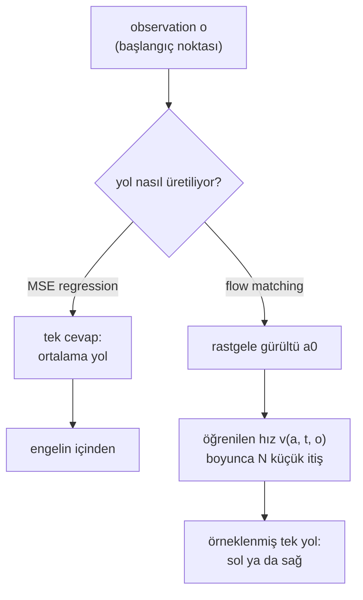

# 30 · Multimodal action'lar: diffusion ve flow policy'ler

<!-- meta -->
| | |
|---|---|
| **Bölüm** | [7 · Learning from demonstration](README.md) |
| **Çalışma türü** | CPU · Mac ya da Colab CPU |
| **Önkoşul** | [28](28-behavior-cloning.md) |
| **Önce öğren** | [Diffusion Models — DDPM from Scratch](https://aiengineeringfromscratch.com/lesson?path=phases/08-generative-ai/06-diffusion-ddpm-from-scratch) · [Flow Matching & Rectified Flows](https://aiengineeringfromscratch.com/lesson?path=phases/08-generative-ai/13-flow-matching-rectified-flows) · [Loss Functions](https://aiengineeringfromscratch.com/lesson?path=phases/03-deep-learning-core/05-loss-functions) |
| **Süre** | ~75 dk |
| **Kod** | [`experiments/30-diffusion-and-flow-policies/experiment.py`](../../experiments/30-diffusion-and-flow-policies/experiment.py) · [notebook](../../notebooks/30-diffusion-and-flow-policies.ipynb) |
| **Durum** | ✅ tam |
<!-- /meta -->

> Bir regression policy'si gösterimlerin ortalamasını döndürür. Gösterimler birbirini tutmuyorsa ortalama, kimsenin göstermediği tek hareket olabilir.

## Problem

Diffusion Policy ([Chi vd. 2023](https://arxiv.org/abs/2303.04137)) multimodal action'lardan yola çıkar: tek bir state'te birden fazla doğru hareket olabilir ve her biri bir "mode"dur. Push-T görevinde policy temas noktasına soldan ya da sağdan eşit olasılıkla yaklaşmayı öğrenir; LSTM-GMM ve IBC bir tarafa kayar, BET ise bir mode'a bağlanamaz (Böl. 5.3).

Bu hatanın en küçük hâli: bir nokta $(0,-1)$'den $(0,+1)$'e gidecek, orijinde yarıçapı 0,30 olan yuvarlak bir engel var. 200 gösterimin 100'ü engelin solundan, 100'ü sağından geçiyor, başlangıç ne olursa olsun. Bunlarla MSE ile eğitilmiş bir behavior cloning MLP'si (ders 28) simülasyonda **200 denemenin 200'ünde** engele çarpıyor. Neden, ve yerine ne geliyor?

## Ana fikir

### Sade anlatımla

Bir tarlanın etrafından dolaşan, eşit derecede iyi iki yol var, solda ve sağda; örnek aldığın sürücülerin yarısı birinden, yarısı diğerinden gidiyor. Bir navigasyona, sürücülerin yaptığına ortalamada olabildiğince yakın *tek* bir cevap vermeyi öğret; cevabı ortadaki nokta olur: dosdoğru tarlanın içinden. MSE loss'lu regression bunu yapar: gösterimlerin ortalamasını döndürür; hemfikirlerse iyi, ikiye ayrılıyorlarsa yanlış.

Çözüm bir cevap *örneklemeyi* öğrenmek: her sorgu makul bir yol döndürür, aşağı yukarı sürücülerin her birini seçtiği sıklıkta. Bir **mixture model** sabit sayıda aday ve olasılıklarını tahmin edip birini seçer. **Generative modeller** (diffusion, flow matching) sabit bir sayıya ihtiyaç duymaz: rastgele gürültüden başlar ve onu adım adım, bir gösterime benzeyene kadar iter; flow matching bu itişi bir hız alanı olarak öğrenir ve rastgele başlangıç yola karar verir. İtiş sayısı bir ayar düğmesidir: çok sayıda küçük itiş akışı izleyerek yollardan birine varır, tek büyük itiş ortalamaya iner, yine tarlanın içine.



### Flow matching kod olarak

```python
# MSE regression, for comparison: one answer per observation -> learns E[a1 | o]
loss_mse = ((net_mse(o) - a1) ** 2).mean()

# flow matching, one training step
a1, o = sample_demos(batch)               # demonstrated path (80 numbers) and its observation
a0 = torch.randn_like(a1)                 # pure noise with the same shape
t = torch.rand(batch, 1)                  # random time in [0, 1]
at = (1 - t) * a0 + t * a1                # a point on the straight line from noise to demo
target = a1 - a0                          # the velocity of that straight line
loss = ((net(at, t, o) - target) ** 2).mean()   # still MSE, but on velocities, not on paths

# sampling: Euler integration from noise (t = 0) to a path (t = 1)
def sample(net, o, n_steps):
    a = torch.randn(80)                   # a different random start can end on the other side
    for i in range(n_steps):
        a = a + net(a, i / n_steps, o) / n_steps   # one small push along the learned velocity
    return a
```

| Ne | Formül |
|---|---|
| MSE optimumu | $f^*(o) = \mathbb{E}[a \mid o]$; iki 50/50 mode $\tfrac12(a_L + a_R)$ verir |
| Mixture model | $p(a \mid o) = \sum_k \pi_k(o)\,\mathcal N(a;\mu_k(o), \sigma^2 I)$ |
| Flow matching loss'u | $a_t = (1-t)\,a_0 + t\,a_1, \quad \mathcal L = \mathbb{E}\,\bigl\lVert v_{\theta}(a_t, t, o) - (a_1 - a_0)\bigr\rVert^2$ |
| Örnekleme (Euler) | $a \leftarrow a_0, \quad a \leftarrow a + \tfrac1N\, v_{\theta}\!\left(a, \tfrac iN, o\right), \quad i = 0,\dots,N-1$ |

$o$ observation (burada başlangıç noktası), $a$ action (burada yolun tamamı), $a_L$ ve $a_R$ gösterilen sol ve sağ yollar, $\pi_k$, $\mu_k$ ve $\sigma$, $K$ bileşenin $k$. bileşeninin ağırlığı, ortalaması ve sabit yayılımı; $a_0 \sim \mathcal N(0, I)$ gürültü, $a_1$ bir gösterim, $t \sim U(0,1)$ gürültüden veriye giden yol üzerindeki zaman, $v_\theta$ öğrenilen hız ağı ve $N$ Euler adım sayısıdır (her adım bir ağ çağrısı).

<details>
<summary>Matematik ayrıntısı: MSE neden ortalar ve tek Euler adımı neden yine regression'dır</summary>

**MSE koşullu ortalamayı öğrenir.** Her $f$ için $\mathbb{E}\,\lVert a - f(o)\rVert^2 = \mathbb{E}\,\lVert a - \mathbb{E}[a\mid o]\rVert^2 + \mathbb{E}\,\lVert \mathbb{E}[a\mid o] - f(o)\rVert^2$; ilk terim $f$'ye bağlı değil, dolayısıyla minimize eden $f^*(o) = \mathbb{E}[a \mid o]$'dur (bkz. AIEFS: [Loss Functions](https://aiengineeringfromscratch.com/lesson?path=phases/03-deep-learning-core/05-loss-functions)). Eşit olasılıklı iki mode'la bu, engelin tam ortasıdır. L1 loss bunun yerine boyut boyut medyanı verir; mode'lar tam 50/50 iken aralarındaki her nokta bir medyandır, yani bu da daha iyi değildir (L1 [ders 31](31-act.md)'de geri dönecek).

**Mixture model.** Negatif log-likelihood ile eğit; çalışırken $\pi_k(o)$'dan $k$'yı örnekle, sonra $\mu_k$'yı ver. $K$'yı biliyorsan ve bileşenler çökmezse çalışır. **Generative action modelleri** $K$'yı sabitlemeden $p(a \mid o)$'dan örnekler; $a$ genellikle gelecekteki action'ların bütün bir chunk'ı, $o$ ise bir koşuldur. Biz düz yollu flow matching ($\sigma_{\min} = 0$) uyguluyoruz.

**Tek adım regression'dır.** $t = 0$'da $a_t = a_0$, $a_1$ hakkında hiçbir bilgi taşımaz; bu yüzden en iyi hız $v^*(a_0, 0, o) = \mathbb{E}[a_1 \mid o] - a_0$'dır. Tek bir Euler adımı $a_0 + v^* = \mathbb{E}[a_1 \mid o]$'ya, yani MSE cevabına iner. Sonraki adımlar zaten bir tarafa yatmış bir $a_t$ görür ve öğrenilen hız o tarafın mode'una doğru kıvrılır. Regression'ı örneklemeye çeviren şey integrasyon adımlarıdır.

Daha derine (AIEFS): [Diffusion Models — DDPM from Scratch](https://aiengineeringfromscratch.com/lesson?path=phases/08-generative-ai/06-diffusion-ddpm-from-scratch), [Flow Matching & Rectified Flows](https://aiengineeringfromscratch.com/lesson?path=phases/08-generative-ai/13-flow-matching-rectified-flows), [Loss Functions](https://aiengineeringfromscratch.com/lesson?path=phases/03-deep-learning-core/05-loss-functions). Birincil kaynaklar: [Lipman vd. 2023](https://arxiv.org/abs/2210.02747), [Ho vd. 2020](https://arxiv.org/abs/2006.11239), [Chi vd. 2023](https://arxiv.org/abs/2303.04137).

</details>

<!-- figure: 30-mean-vs-flow -->

### Bir action üretmenin dört yolu

| | neyi tahmin etmeye eğitilir | örnekleme | action başına maliyet |
|---|---|---|---|
| MSE regression | $\mathbb{E}[a\mid o]$ | yok | 1 ağ çağrısı |
| Mixture (MDN) | $\pi_k, \mu_k$ | $k$'yı seç, $\mu_k$'yı al | 1 çağrı |
| DDPM ([Ho vd. 2020](https://arxiv.org/abs/2006.11239)) | $(a_t, t, o)$ verilince $a$'ya eklenen gürültü $\epsilon$ | Gauss gürültüsünden başla, $N$ kez denoise et | $N$ çağrı |
| Flow matching ([Lipman vd. 2023](https://arxiv.org/abs/2210.02747)) | bir hız alanı $v_{\theta}(a_t, t, o)$ | gürültüden başlayıp bir ODE'yi $N$ adımda integre et | $N$ çağrı |

DDPM ("denoising diffusion") ve flow matching yakın akrabadır: ikisi de gürültüden başlar ve örnek başına $N$ ağ çağrısı ister; flow matching bir hızı, DDPM ise çıkarılacak gürültüyü regress eder.

## Sıfırdan yaz

Şimdi bir flow policy'nin üç parçasını yazacaksın: training çifti, hız alanı ve Euler sampler'ı; her birini Deney'in 200 gösterimi ve 200 denemesiyle kontrol edeceksin. Bir ağ eğitmek yerine, kusursuz bir ağın bu gösterimlerde öğreneceği alanı türeteceksin: PyTorch yok, yaklaşık 2 s, ve flow matching'in yaptığını öğrenilmiş bir ağın eklediğinden ayırıyor.

Fonksiyonlar [`physai/imitation.py`](../../physai/imitation.py) içinde; `uv run python experiments/30-diffusion-and-flow-policies/build.py` dört adımı koşturur (çıktı [`build_output.txt`](../../experiments/30-diffusion-and-flow-policies/build_output.txt) dosyasında).

### Adım 1 · En küçük kareler cevabı ortalamadır

Yolları başlangıç $x_0$'da doğrusal, en küçük kareler ile fit et; bu veri için en iyi MSE tahmincisi bu:

```python
F = np.c_[np.ones(len(X)), X[:, 0]]                 # 1 and the start x0 of each demonstration
coef = np.linalg.lstsq(F, Y, rcond=None)[0]         # 80 path numbers, linear in x0
```

```text
== Step 1. 200 demonstrations, half left, half right: the least-squares answer ==
demos pass the obstacle (y = 0) at x = -0.551 / +0.552
least-squares path from x0 = 0 passes at x = +0.000; max |intercept - mean of the 200 demos| = 7.5e-15
200 trials: collided 200/200, left 0, right 0
```

Kesişim 200 gösterimin ortalaması (fark 7,5e-15); yol engelden $x = +0{,}000$'da, tam ortadan geçiyor: 200/200 çarpma. Deney'in MSE ağı bu ortalamaya yaklaşıyor (200/200, yol $+0{,}030$'da).

### Adım 2 · Training çifti ve neyi regress ettiği

```python
def flow_matching_pair(a0, a1, t):
    """Training input and target of flow matching with straight paths: a_t on the line noise -> data, and its velocity."""
    t = np.reshape(t, (-1,) + (1,) * (np.ndim(a1) - 1))
    return (1 - t) * a0 + t * a1, a1 - a0
```

Bir ağ yalnız $a_t$'yi görür, onu hangi $a_0$ ve $a_1$'in ürettiğini görmez; bu yüzden öğrenebileceği en iyi şey $a_t$'den geçen bütün çiftler üzerinden ortalama hedeftir. Sonlu bir dataset için bu ortalamanın kapalı bir biçimi var: $j$. gösterim verilince $a_t$, $t\,a^{(j)}$ etrafında standart sapması $1 - t$ olan bir Gauss'tur; dolayısıyla $j$ üzerindeki posterior bir softmax'tır ve her gösterim $(a^{(j)} - a)/(1 - t)$ hızıyla çeker:

```python
def empirical_velocity(a, t, data):
    """The velocity field that minimizes the flow-matching loss on a finite dataset: E[a1 - a0 | a_t = a].

    Given a1 = data[j], a_t is Gaussian around t * data[j] with std (1 - t), so the posterior over j is a softmax.
    a: (n, D) points at time t (0 <= t < 1); data: (m, D) demonstrations.
    """
    a = np.atleast_2d(a)
    d2 = ((a[:, None, :] - t * data[None, :, :]) ** 2).sum(-1)      # (n, m) squared distances
    logw = -d2 / (2 * (1 - t) ** 2)
    w = np.exp(logw - logw.max(1, keepdims=True))
    w /= w.sum(1, keepdims=True)
    return (w @ data - a) / (1 - t)                                 # sum_j w_j (data_j - a) / (1 - t)
```

Kontrol, $\pm 1{,}1$'deki iki 1 boyutlu mode'dan (engel sapmaları $\pm 0{,}55$ çarpı Deney'in 2'lik ölçeği) 4 milyon çift çeker ve $t = 0{,}5$'te beş noktanın yakınında hedefin ortalamasını alır:

```text
== Step 2. The flow-matching pair and the field it regresses ==
t = 0.0: a_t = [0.3 0.3], target a1 - a0 = [ 0.8 -1.4]
t = 0.5: a_t = [ 0.7 -0.4], target a1 - a0 = [ 0.8 -1.4]
t = 1.0: a_t = [ 1.1 -1.1], target a1 - a0 = [ 0.8 -1.4]
t = 0.5     a    mean target near a (Monte Carlo)   empirical_velocity
         -0.8                          -0.467               -0.474
         -0.2                          -0.501               -0.510
         +0.0                          -0.001               +0.000
         +0.2                          +0.524               +0.510
         +0.8                          +0.478               +0.474
```

Monte Carlo ortalamaları yaklaşık 0,015 içinde, kendi örnekleme gürültüleri kadar, tutuyor. $a = 0$'da iki mode eşit çekiyor; iki yandan birine biraz gidince alan zaten o tarafın mode'unu gösteriyor.

### Adım 3 · Euler örneklemesi

```python
def euler_sample(velocity, a0, n_steps):
    """Integrate da/dt = velocity(a, t) from t = 0 (noise a0) to t = 1 in n_steps equal Euler steps."""
    a = np.array(a0, dtype=float)
    for i in range(n_steps):
        a = a + velocity(a, i / n_steps) / n_steps
    return a
```

200 gösterimin kesin alanını Deney'in denemeleriyle gürültüden integre et ve Deney'in öğrenilmiş ağıyla karşılaştır:

```text
== Step 3. Euler sampling along the exact field of the 200 demonstrations ==
steps  collided  left  right  mean |x| at y=0   (Experiment's network: collided, mean |x|)
    1   200/200     0      0            0.026   (200/200, 0.161)
    2    34/200    84     82            0.403   (95/200, 0.372)
    4     0/200    98    102            0.487   (17/200, 0.494)
    8     0/200    97    103            0.515   (7/200, 0.533)
   16     0/200    97    103            0.528   (5/200, 0.546)
   32     0/200    97    103            0.536   (3/200, 0.554)
1 step: max |sample - mean of the demos| = 3.0e-14
```

Tek adım tam olarak gösterimlerin ortalamasına iniyor (3,0e-14) ve 200/200 çarpıyor: "tek adım regression'dır" (Matematik ayrıntısı), ölçülmüş hâliyle. 2 adımda 34 örnek hâlâ iki mode'un arasında bitiyor (ağda: 95); 4 adımdan itibaren kesin alan hiç çarpmıyor, ağ ise hâlâ çarpıyor (17, 7, 5, 3). Bu fark flow matching'in değil, ağın hatası.

### Adım 4 · Kusursuz bir fit ne yapar

```text
== Step 4. Many steps: the exact field returns the training demonstrations ==
   8 steps: RMS distance of a sample to its nearest demonstration, median 0.0018, max 0.0158
  32 steps: RMS distance of a sample to its nearest demonstration, median 0.0009, max 0.0029
 128 steps: RMS distance of a sample to its nearest demonstration, median 0.0000, max 0.0010
demonstrations differ from each other by (median RMS, nearest pair) 0.0024
```

128 adımdan sonra her örnek 200 gösterimden birinin üstünde (medyan RMS uzaklık 0,0000; komşu gösterimler 0,0024 farklı): training loss'unun kesin minimize edicisi veriyi ezberliyor. Bir ağ bu alanı yumuşatır ve yakın gösterimlerin arasında yeni yollar üretir; genelleştirmesinin de birkaç örneği mode'ların arasında bırakmasının da sebebi bu.

### Elinde kalan

`physai.imitation` artık `flow_matching_pair`, `empirical_velocity` ve `euler_sample` de içeriyor; `euler_sample` herhangi bir hız fonksiyonu alıyor, böylece aynı sampler eğitilmiş bir ağı da koşturuyor. [Ders 31](31-act.md) chunk'lı action'ı tutuyor ve sampler'ı bırakıyor; [ders 41](../part-10-foundation-models-and-agents/41-vla.md) flow matching action head'leriyle vision-language-action modellerinde yeniden karşılaşıyor. [`tests/test_30_diffusion_and_flow_policies.py`](../../tests/test_30_diffusion_and_flow_policies.py) tek adımlık ortalamayı, tek bir gösterime her adım sayısında tam olarak ulaşıldığını ve çok adımın bir mode'a indiğini kontrol ediyor; `uv run pytest tests/test_30_diffusion_and_flow_policies.py` çalıştır.

## Kütüphaneyle kullan

Gerçek bir kol için LeRobot'un Diffusion Policy'si hazır: `lerobot-train --policy.type=diffusion`. Flow matching değil DDPM, ama ayar düğmeleri senin kurduklarınla aynı ([`configuration_diffusion.py`](https://github.com/huggingface/lerobot/blob/main/src/lerobot/policies/diffusion/configuration_diffusion.py)):

| Düğme | Bu ders | LeRobot `DiffusionConfig` varsayılanı |
|---|---|---|
| ağın tahmin ettiği | hız $a_1 - a_0$ | `prediction_type = "epsilon"` (eklenen gürültü) |
| örnek başına adım (ağ çağrısı) | `n_steps`, 1 ila 32 | `num_inference_steps`, varsayılanı `num_train_timesteps = 100` |
| sampler | Euler, $t$: 0 → 1 | `noise_scheduler_type = "DDPM"` |
| action chunk'ı | yolun tamamı, 40 ara nokta | `horizon = 64` tahmin, `n_action_steps = 32` uygulama |
| observation | başlangıç noktası | `n_obs_steps = 2` (şimdiki ve önceki adım) |
| action normalization'ı | `SCALE = 2`'ye böl | state ve action için `MIN_MAX`, ardından `clip_sample_range = 1.0` |

Üç tuzak:

- **Gürültü ve veri benzer ölçekte olmalı.** Sampler $\mathcal N(0, I)$'den başlıyor; Deney yolları 2 ile çarpıyor ki yaklaşık 0,5'lik sapmalar yaklaşık 1 olsun. Radyan ya da milimetre cinsinden normalize edilmemiş action'lar ilk adımları anlamsız kılar.
- **Zaman ters yönlerde akar.** Burada (ve Lipman vd.'de) $t = 0$ gürültü, $t = 1$ veri; DDPM timestep'lerini $T$'deki gürültüden 0'daki veriye doğru geri sayar. Konvansiyonları karıştırmak yanlış yöne integre eder.
- **Adımlar gecikmeye mal olur.** Her adım bir ağ çağrısı: LeRobot'un diffusion config'inde varsayılan 100, Deney'in küçük MLP'sinin 1–32 adımda sorgu başına 0,04–0,77 ms'sine karşı. Adım sayısını seçmeden önce bütçeyi kontrol hızına göre kontrol et.

## Deney

Script'in tamamı: [`experiments/30-diffusion-and-flow-policies/experiment.py`](../../experiments/30-diffusion-and-flow-policies/experiment.py). NumPy 2.5.4, PyTorch 2.14.1 (CPU, 2 thread), Apple Silicon Mac (Apple M5), sabit seed'ler, deterministik. A–B bölümleri önceki [notebook](../../notebooks/30-diffusion-and-flow-policies.ipynb)'un deneyini aktarır ve onun için kaydedilmiş sayıları aynen üretir; yalnız üç seed'li MSE kontrolü artık biraz farklı çarpma sayıları veriyor.

Observation başlangıç noktası $(x_0, y_0)$, $x_0 \in [-0{,}05;\ 0{,}05]$; action yolun tamamı, başlangıca göre 40 ara nokta (80 sayı). Bir deneme ya geçer ya engele çarpar; "sol/sağ" çarpmayan denemeleri geçtikleri tarafa göre sayar. Her satırda 200 deneme, %95 Wilson aralıkları (ders 25).

**Tahmin:** MSE yolu ortadan geçer; mixture model ve flow policy kabaca 50/50 bölünür.

```python
a0 = torch.randn(a1.shape)                          # noise
t = torch.rand(batch)
at = (1 - t[:, None]) * a0 + t[:, None] * a1        # point on the straight path
loss = ((net(at, t, o) - (a1 - a0)) ** 2).mean()    # regress the velocity, conditioned on o

a = torch.randn(n, 80)                              # sampling: Euler from t = 0 to 1
for i in range(n_steps):
    a = a + net(a, torch.full((n,), i / n_steps), o) / n_steps
```

**A bölümü.** NumPy MLP 64-64 tanh, 1.500 full-batch Adam epoch'u; mixture model $K = 2$, sabit $\sigma = 0{,}2$.

| model | çarptı | %95 GA | sol | sağ |
|---|---|---|---|---|
| MSE, gösterimler yarı sol / yarı sağ | **200/200** | %98,1–100 | 0 | 0 |
| MSE, gösterimlerin hepsi solda | 0/200 | %0–1,9 | 200 | 0 |
| Mixture (MDN, $K=2$) | **0/200** | %0–1,9 | 96 | 104 |

$y = 0$'da gösterimler $x = \pm 0{,}55$'ten, MSE yolu $x = +0{,}030$'dan, 0,30'luk yarıçapın içinden geçiyor. Üç farklı seed'le MSE modeli 200'de 193, 184 ve 200 kez çarptı, mixture model her birinde 0.

**B bölümü: daha çok veri işe yaramıyor.** Aynı MSE modeli, gösterimler yarı yarıya:

| gösterim | 10 | 20 | 50 | 100 | 200 | 500 |
|---|---|---|---|---|---|---|
| MSE çarpma | %8,0 | %46,0 | %85,0 | %91,5 | %100 | %100 |

Olası sebep (ayrıca ölçülmedi): 10 gösterimde ağ $x_0$'daki küçük farkları en yakın gösterimin tarafına bağlıyor; veri arttıkça koşullu ortalamaya yaklaşıyor.

**C bölümü: flow matching policy**, aynı 200 gösterimle: MLP 3×256 SiLU, girdi = gürültülü chunk + sinüzoidal zaman embedding'i + observation, 4.000 Adam adımı, batch 256. Euler adım sayısını tara.

| Euler adımı | çarptı | %95 GA | sol | sağ | tek sorgu süresi (ms) | $y=0$'da ortalama $\lvert x\rvert$ |
|---|---|---|---|---|---|---|
| 1 | 200/200 | %98,1–100 | 0 | 0 | 0,04 | 0,161 |
| 2 | 95/200 | %40,7–54,4 | 53 | 52 | 0,06 | 0,372 |
| 4 | 17/200 | %5,4–13,2 | 87 | 96 | 0,10 | 0,494 |
| 8 | 7/200 | %1,7–7,0 | 95 | 98 | 0,19 | 0,533 |
| 16 | 5/200 | %1,1–5,7 | 96 | 99 | 0,39 | 0,546 |
| 32 | **3/200** | %0,5–4,3 | 97 | 100 | 0,77 | 0,554 |


Süreler, ağır yüklü bir makinede 30 tek yörüngelik sorgunun en hızlısı (yaklaşık); makineden bağımsız maliyet adım sayısıdır. Flow policy, iki mode olduğu söylenmeden, mixture model gibi sola ve sağa bölünüyor ve yanal uzaklık adım arttıkça gösterimlerin 0,55'ine yaklaşıyor.

## Boz

İntegrasyon adımlarını azalt. 1 adımda flow policy MSE gibi **200/200** çarpıyor: orta çizgiden ortalama uzaklık 0,161, engelin içinde. $t = 0$ argümanı, ölçülmüş hâliyle; yollar tam olarak ortalama değil (Sıfırdan yaz, Adım 3'teki kesin alan 0,026 veriyor; bu yalnızca başlangıç noktalarının yayılımı), çünkü öğrenilen alan hâlâ biraz $a_0$'a bağlı. 2 adımda 95/200 hâlâ iki mode'un arasında bitiyor, 32 adımda bile 3/200 engele değiyor: kesin alan 4 adımdan itibaren 0/200'e ulaşıyor, yani kalan, öğrenilen alanın hatası.

İkinci bozma veride, MSE modeli için (200 gösterim, B taraması):

| soldan gösterim oranı | %50 | %60 | %70 | %80 | %90 | %100 |
|---|---|---|---|---|---|---|
| MSE çarpma | %100 | %91,5 | %63,0 | %36,5 | %0 | %0 |

MSE ancak neredeyse tek mode'lu veride güvenli: ortalama yanal uzaklık $0{,}55\,\lvert 2p_{\text{sol}} - 1\rvert$, 0,30'luk yarıçapı bir payla geçmeli.

## Gerçek robotta

- **Diffusion Policy**, observation'lar koşulundaki action dizisini, $p(A \mid O)$'yu bir DDPM ile modeller; ikisinin ortak dağılımını değil. CNN sürümü koşulu FiLM ile verir (observation'dan hesaplanan, kanal başına öğrenilmiş bir ölçek ve kaydırma). DDIM ile (daha hızlı bir DDPM sampler'ı) 100 eğitim ve 10 inference iterasyonu, gerçek dünya düzeneklerinde bir Nvidia 3080'de yaklaşık 0,1 s inference sağlar; test edilen görevlerin çoğunda 8 adımlık action horizon en iyisiydi; 4 benchmark'tan 15 görevde önceki yöntemlere göre ortalama %46,9 iyileşme raporlanıyor ([Chi vd. 2023](https://arxiv.org/abs/2303.04137)).
- **π0**, action'lar için conditional flow matching kullanır: 3B'lik bir vision-language modelinin üstünde 300M parametrelik bir "action expert" (toplam 3,3B), $H = 50$ action'lık chunk'lar, 10 integrasyon adımı. RTX 4090'da 10 action geçişi, 73 ms'lik robot üstü inference'ın 27 ms'sini alır ([Black vd. 2024](https://arxiv.org/abs/2410.24164)). C bölümündeki takasın gerçek ölçekteki hâli.
- **SO-101 prosedürü** (LeRobot'un varsayılanları Kütüphaneyle kullan'da). İki geçerli stratejisi olan bir görevin (küpü iki yandan birinden kavramak) teleop gösterimlerini kaydet; aynı episode'larla bir MSE behavior cloning baseline'ı ve bir diffusion policy eğit; her biri için en az 50 denemede iki stratejinin arasında biten kavramaları say. Gerçek kolda henüz ölçülmedi.

## Kendini dene

1. **Kolay.** 1 adımlık bir flow policy neden MSE regression gibi davranır?
2. **Orta.** Gösterimlerin %80'i soldan geçiyorsa MSE yolu $y = 0$'da nereden geçer ve neden bazı denemeler yine de çarpar?
3. **Zor.** Aynı gösterimlerle MSE ile eğitilmiş closed-loop, adım adım bir policy yaz (şimdiki konum → bir sonraki adım) ve çarpma oranını ölç. Orta çizgideki ortalama akış kararlı mı?

### Cevaplar

1. $t=0$'da girdi $a_0$ hedeften bağımsızdır; optimal hız $\mathbb{E}[a_1\mid o] - a_0$'dır ve tek Euler adımı $\mathbb{E}[a_1\mid o]$'yu döndürür. Ölçülen: MSE ile aynı, 200/200 çarpma.
2. Yaklaşık $0{,}8\cdot(-0{,}55) + 0{,}2\cdot 0{,}55 = -0{,}33$; 0,30'luk yarıçapın hemen dışı. Öğrenilen yoldaki ve $x_0$'daki oynama birçok denemeyi içeri itiyor. Ölçülen: 73/200 (%36,5).
3. Burada hesaplanmadı; koş ve gör.

## Akılda kalanlar ve kaynaklar

- MSE regression koşullu ortalamayı döndürür; iki 50/50 mode'la simülasyonda 200/200 çarptı ve daha çok veri (10 → 500 gösterim) çarpma oranını %8'den %100'e çıkardı.
- Mixture model (0/200, 96 sol / 104 sağ) ve flow matching policy (32 adımda 3/200, 97 / 100) iki mode'u da temsil ediyor; flow policy'nin mode sayısını bilmesi gerekmedi.
- Ayar düğmesi örnekleme adım sayısı: 1 adım ortalamayı üretti (200/200), 8 adım 7/200'e indi, maliyet adımla doğrusal artıyor.

Sonraki: [ders 31](31-act.md), gelecekteki action'ların chunk'larını tahmin edip uygulamak.

**Kaynaklar**

- C. Chi vd., "Diffusion Policy: Visuomotor Policy Learning via Action Diffusion", 2023. [arXiv 2303.04137](https://arxiv.org/abs/2303.04137).
- K. Black vd., "π0: A Vision-Language-Action Flow Model for General Robot Control", 2024. [arXiv 2410.24164](https://arxiv.org/abs/2410.24164).
- Y. Lipman, R. T. Q. Chen, H. Ben-Hamu, M. Nickel, M. Le, "Flow Matching for Generative Modeling", 2023. [arXiv 2210.02747](https://arxiv.org/abs/2210.02747).
- J. Ho, A. Jain, P. Abbeel, "Denoising Diffusion Probabilistic Models", 2020. [arXiv 2006.11239](https://arxiv.org/abs/2006.11239).
- LeRobot, [`configuration_diffusion.py`](https://github.com/huggingface/lerobot/blob/main/src/lerobot/policies/diffusion/configuration_diffusion.py).
- Tüm tablolar: [`experiments/30-diffusion-and-flow-policies/output.txt`](../../experiments/30-diffusion-and-flow-policies/output.txt) (27.10.2026).
