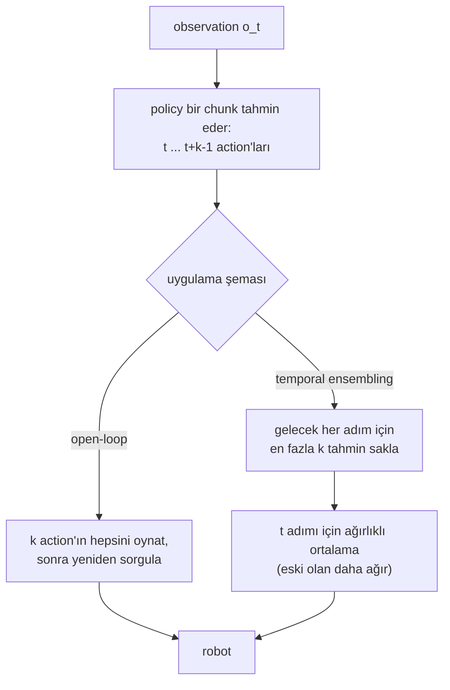

# 31 · Action chunking ve ACT

<!-- meta -->
| | |
|---|---|
| **Bölüm** | [7 · Learning from demonstration](README.md) |
| **Çalışma türü** | CPU · Mac ya da Colab CPU |
| **Önkoşul** | [28](28-behavior-cloning.md), [30](30-diffusion-and-flow-policies.md) |
| **Önce öğren** | [The Full Transformer — Encoder + Decoder](https://aiengineeringfromscratch.com/lesson?path=phases/07-transformers-deep-dive/05-full-transformer) · [Autoencoders & Variational Autoencoders (VAE)](https://aiengineeringfromscratch.com/lesson?path=phases/08-generative-ai/02-autoencoders-vae) |
| **Süre** | ~75 dk |
| **Kod** | [`experiments/31-act/experiment.py`](../../experiments/31-act/experiment.py) |
| **Durum** | ✅ tam |
<!-- /meta -->

> Bir sonraki action'ı değil, sonraki k action'ı tahmin et: chunk, observation'ın süresini ölçemediği bir beklemenin ötesine uzanabilir.

## Problem

Bir behavior cloning policy'si şimdiki observation'ı bir sonraki action'a eşler, ama gösterimlerde bazen observation aynı kalırken doğru action zamanla değişir: kol, gripper kapanırken bekler, sonra yoluna devam eder. ACT makalesi (Action Chunking with Transformers, [Zhao vd. 2023](https://arxiv.org/abs/2304.13705), Böl. I), action dizilerini tahmin etmenin "temporally correlated confounders" ile, örneğin gösterimlerdeki duraklamalarla başa çıkmaya yardım ettiğini söyler. Chunk boyutu ablation'ında (Şek. 8a, ensembling yok) başarı $k = 1$'de %1'den $k = 100$'de %44'e çıkıyor.

Bizim sürümümüz, simülasyonda: düzlemsel bir kol hedefe gider, 0,5 s hareketsiz bekler, sonra bir bırakma noktasına gider. 100 gösterimle eğitilmiş tek adımlık bir policy, **600 episode'un 543'ünde hedefte takılı**.

## Ana fikir

### Sade anlatımla

Geri sayımı olmayan bir kırmızı ışıkta bekleyen acemi bir sürücü düşün: beklemenin her saniyesi aynı görünür. Yalnızca "bu sahnede bir sonraki hamlem ne?" sorusunu öğrenen bir öğrenci örneklerin neredeyse hepsinde "bekle" görür, çünkü "git" bir kez, en sonda olur; ve sonsuza kadar beklemeyi öğrenir. Zamanlama şimdiki observation'da değil, geçmiştedir.

**Action chunking** sonraki $k$ hamleye birden bağlanır, örneğin "bekle, bekle, bekle, git, git"; plan ayrılış anını içerecek kadar uzunsa kol ayrılır. Daha az karar, hataların birikmesi için daha az fırsat da demektir ([ders 29](29-dagger.md)).

Bir chunk'ı uygulamanın iki yolu: **open-loop**, $k$ action'ın hepsini bakmadan oynat, sonra yeniden sor; **temporal ensembling**, her adımda sor ve örtüşen bütün planların *şimdi* için verdiği tavsiyeyi ortala, eski planlara biraz daha çok güvenerek. İlki bağlanır; ikincisi tepki verir ve yumuşatır, ama ortalama almak ayrılma kararını sulandırabilir.



### Chunking ve ensembling kod olarak

```python
# dataset: one observation -> the next k actions (episode end padded with the last action)
X = [o[t] for t in range(T)]
Y = [a_pad[t:t + k] for t in range(T)]           # shape (k, n_joints); trained with L1 loss

# open-loop: query once every k steps
if t % k == 0:
    chunk = policy(obs)
action = chunk[t % k]

# temporal ensembling: query every step, average every prediction made for step t
chunks[t] = policy(obs)                           # chunks[s][j] predicts step s + j
def ensembled_action(chunks, t, k, m=0.01):
    preds = [chunks[s][t - s] for s in range(max(0, t - k + 1), t + 1)]  # oldest first
    w = [exp(-m * i) for i in range(len(preds))]                          # i = 0 is the oldest
    return sum(wi * p for wi, p in zip(w, preds)) / sum(w)
```

| Ne | Formül |
|---|---|
| Tek adımlık policy | $\pi(a_t \mid o_t)$ |
| Chunk'lı policy | $\pi(a_{t:t+k} \mid o_t)$ |
| Temporal ensembling | $a_t = \dfrac{\sum_i w_i\, \hat a_t^{(i)}}{\sum_i w_i}, \qquad w_i = e^{-m i}$ |
| L1 optimumu | o observation için gösterilen action'ların boyut boyut medyanı |

$o_t$, $t$ adımındaki observation; $a_t$ action; $k$ chunk boyutu; $\hat a_t^{(i)}$, $t$ adımı için yapılmış $i$. tahmin ($i = 0$ en eskisi); $w_i$ onun ağırlığı ve $m$ ağırlığın ne kadar hızlı azaldığıdır ($m \to 0$ düz bir ortalamadır).

<details>
<summary>Matematik ayrıntısı: L1 neden sonsuza kadar bekletir ve chunk nasıl kurtulur</summary>

**Bekleme tek adımlık policy'yi neden bozar.** Bekleme boyunca observation neredeyse hiç değişmez ve bir sonraki action, sonuncusu hariç her bekleme adımında "bekle"dir. ACT'nin L1 loss'unu boyut boyut medyan minimize eder: bekle, sonsuza kadar. L2 ortalamayı, yani yavaş bir sürünmeyi verirdi ([ders 30](30-diffusion-and-flow-policies.md)).

**Chunk neden kurtulabilir.** O observation'dan tahmin edilen bir chunk'ın $i$. elemanı, gösterimlerin $i$ ile büyüyen bir kısmında "çoktan hareket ediyor"dur; bu kısım yarıyı geçince medyan hareket eder (Sıfırdan yaz, Adım 2).

**Daha az karar.** Her $k$ adımda bir sorgulamak görevin etkin ufkunu $k$ kat kısaltır (Böl. I): hataların birikebileceği daha az adım.

**Ensembling ağırlıkları.** $w_i = e^{-mi}$ ve $i = 0$ en eski tahmin olduğundan eski tahminler daha ağırdır; "a smaller m means faster incorporation", yani küçük $m$ yeni observation'ları daha hızlı dahil eder (Böl. IV-A). Makale $m$ için bir değer vermiyor; LeRobot'un config yorumu orijinalin $m = 0{,}01$ kullandığını söylüyor. Herhangi bir adım için en fazla $k$ tahmin vardır.

Daha derine (AIEFS): [The Full Transformer — Encoder + Decoder](https://aiengineeringfromscratch.com/lesson?path=phases/07-transformers-deep-dive/05-full-transformer), [Autoencoders & Variational Autoencoders (VAE)](https://aiengineeringfromscratch.com/lesson?path=phases/08-generative-ai/02-autoencoders-vae). Birincil kaynak: [Zhao vd. 2023](https://arxiv.org/abs/2304.13705), Böl. I ve IV.

</details>

<!-- figure: 31-action-chunks -->

### Bir chunk'ı uygulamanın iki yolu

| | open-loop chunk'lar | temporal ensembling |
|---|---|---|
| sorgu | her $k$ adımda | her adımda |
| $t$ adımındaki action | son chunk'ın $t \bmod k$. elemanı | $t$ için tahmin edilmiş tüm chunk elemanlarının ağırlıklı ortalaması |
| bozucuya tepki | chunk başına bir kez | her adımda |
| chunk sınırları | sıçrar | yumuşar |

### ACT'nin mimarisi

ACT bir transformer ve eğitim sırasında gösterilen chunk'ı küçük bir "stil" vektörü $z$'ye sıkıştıran bir CVAE (conditional variational autoencoder) ekler; amaç aynı işi yapmanın farklı yollarını temsil etmek (Böl. IV):

| parça | ne yapar |
|---|---|
| CVAE encoder (yalnız eğitimde) | [CLS], joint pozisyonları ve gösterilen chunk üzerinde transformer → bir "stil değişkeni" $z$ için diyagonal Gauss |
| backbone | kamera başına ResNet18; dört 480×640 görüntü → 2D sinüzoidal pozisyon embedding'li 15×20×512 feature map'ler |
| transformer encoder | görüntü feature'ları + joint pozisyonları + $z$, her biri 512 boyuta eşlenmiş |
| transformer decoder | cross-attention, $k \times 14$'lük bir chunk verir (iki 7-DoF kol) |
| loss, inference | L1 reconstruction + KL; test zamanında $z = 0$ (prior ortalaması), deterministik |

Yaklaşık 80M parametre, görev başına tek bir RTX 2080 Ti'da ~5 saat eğitim, 50 Hz, $k = 100$, gerçek görevlerin çoğunda 50 gösterim. CVAE hedefi olmadan başarı insan verisinde %35,3'ten %2'ye düştü, scripted veride pek değişmedi (Şek. 8c); ensembling %3,3 ekledi (Şek. 8b).

## Sıfırdan yaz

Şimdi ACT'nin Deney tablosunun dayandığı parçalarını yazacaksın: chunk hedefleri, bir beklemedeki L1 optimumu ve temporal ensembling. Ağ sıradan bir MLP, bu yüzden Sıfırdan yaz elle yapılmış chunk'larla çalışıyor; script bir saniyenin altında koşuyor.

Fonksiyonlar [`physai/imitation.py`](../../physai/imitation.py) içinde; `uv run python experiments/31-act/build.py` dört adımı koşturur (çıktı [`build_output.txt`](../../experiments/31-act/build_output.txt) dosyasında).

### Adım 1 · Chunk hedefleri

Her observation hedef olarak sonraki $k$ action'ı alır; episode'un sonundan sonra son action tekrarlanır:

```python
def chunk_targets(actions, k):
    """Training targets of a chunked policy: for every step t the next k actions, padded with the last action."""
    actions = np.asarray(actions)
    padded = np.concatenate([actions, np.repeat(actions[-1:], k - 1, axis=0)])
    return np.stack([padded[t:t + k] for t in range(len(actions))])
```

Beş rastgele episode'da Deney'in `chunk_dataset`'iyle karşılaştırılınca:

```text
== Step 1. Chunk targets ==
k =  1: targets (750, 1, 2), max |ours - Experiment| = 0.0e+00
k =  4: targets (750, 4, 2), max |ours - Experiment| = 0.0e+00
k = 32: targets (750, 32, 2), max |ours - Experiment| = 0.0e+00
last step's chunk repeats the last action: True
```

### Adım 2 · Bir beklemedeki L1 optimumu

İdealleştirilmiş bir bekleme: kol 25 "bekle" komutu boyunca hedefte duruyor, sonra ilk "hareket et" (adım başına 0,12 rad) kol hâlâ durağanken geliyor. Yani 26 adım tek bir observation'ı paylaşıyor ve chunk'ları yalnız ayrılışın nereye düştüğünde farklı. L1'i eleman başına medyan, MSE'yi ortalama minimize eder:

```python
traj = np.r_[np.zeros(25), 0.12 * np.arange(1, 41)]        # target relative to the goal, from the first pause step
chunks = np.stack([chunk_targets(traj[:, None], 32)[j, :, 0] for j in range(26)])
med, mean = np.median(chunks, 0), chunks.mean(0)
```

```text
== Step 2. An idealized pause: 25 hold commands, then a move, all seen from the same resting observation ==
entry i          0      4      8     12     13     16     24     31
moving %        4     19     35     50     54     65     96    100
median      0.000  0.000  0.000  0.060  0.180  0.540  1.500  2.340
mean        0.005  0.069  0.208  0.420  0.485  0.706  1.500  2.340
single-step policy (entry 0): median 0.000 rad = hold forever, mean 0.0046 rad = a creep
first entry whose median departs: 12; chunks of k <= 12 are all 'hold'
```

Eleman 0 tek adımlık policy'dir: medyan 0, sonsuza kadar bekle; ortalama 0,0046 rad, bir sürünme (Matematik ayrıntısı). $i$. eleman 26 chunk'ın $(i+1)$'inde ayrılıyor, bu yüzden medyanı yarıda döner: eleman 12'de yarım adım, 13'ten itibaren tam adım. $k \le 12$ olan bir chunk baştan sona "bekle"dir; daha uzun chunk'lar bekler, sonra ayrılır. Deney'in eğitilmiş policy'leri daha erken, eleman 8–9'da ayrılıyor. Olası bir sebep (ölçülmedi): gösterici sayacını hedefe 1 cm kala başlatıyor, bu yüzden ilk bekleme adımları "durağan" görünmüyor ve medyanı daha az observation paylaşıyor.

### Adım 3 · Temporal ensembling, iki yoldan

Ana fikir'deki formül, saklanan chunk'ların bir listesi için yazılmış hâliyle (`chunks[s][j]`, $s + j$ adımını tahmin eder):

```python
def ensembled_action(chunks, t, k, m=0.01):
    """Temporal ensembling (ACT): weighted mean of every prediction made for step t; chunks[s][j] predicts s + j.

    Weights w_i = exp(-m i) with i = 0 the oldest prediction, so older predictions weigh more for m > 0.
    """
    preds = [chunks[s][t - s] for s in range(max(0, t - k + 1), t + 1)]   # oldest first
    w = np.exp(-m * np.arange(len(preds)))
    return np.tensordot(w, np.array(preds), axes=1) / w.sum()
```

Bir robot aynı ortalamayı, her yeni chunk için bir güncellemeyle, birikimli bir toplam olarak tutar:

```python
class TemporalEnsembler:
    """The same ensembling as a running average (one new chunk per step, O(k) memory)."""

    def __init__(self, k, m=0.01):
        self.w = np.exp(-m * np.arange(k))       # w[i]: weight of the i-th prediction for a step, oldest first
        self.cum = np.cumsum(self.w)
        self.avg, self.count = None, None

    def update(self, chunk):
        """Add the chunk predicted now (shape (k, n)); return the action to execute now."""
        chunk = np.asarray(chunk, dtype=float)
        if self.avg is None:
            self.avg, self.count = chunk.copy(), np.ones(len(chunk), dtype=int)
        else:                                    # entries 0..k-2 of the stored average are steps 1..k-1 of the new chunk
            c = self.count
            self.avg = (self.avg * self.cum[c - 1, None] + chunk[:-1] * self.w[c, None]) / self.cum[c, None]
            self.avg = np.concatenate([self.avg, chunk[-1:]])
            self.count = np.concatenate([np.minimum(c + 1, len(self.w) - 1), [1]])
        action, self.avg, self.count = self.avg[0], self.avg[1:], self.count[1:]
        return action
```

Kontrol, $k = 32$'lik 60 rastgele chunk'ı ikisine ve Deney'in biriktiricilerine verir (chunk ofseti $j$ için ağırlık $e^{-m(k-1-j)}$, yani en eski tahmin en ağır):

```text
== Step 3. Temporal ensembling, k = 32, m = 0.01, 60 steps of random chunks ==
max |running average - list formula| = 2.8e-16
max |Experiment's accumulators - list formula| = 2.8e-16
full window: oldest weight 0.0363, newest 0.0266, ratio 1.363
```

Üçü yuvarlama düzeyinde tutuyor. $m = 0{,}01$ ile 32 tahminin en eskisi 0,0363, en yenisi 0,0266 ağırlık alıyor: eski planlara hafif bir tercih.

### Adım 4 · Ensembling bir ayrılışı neden sulandırabilir

Deney'in ölçtüğü ayrılış indekslerini al ($k = 16$'da 9, $k = 32$'de 8) ve durağanken yapılan her sorgunun aynı chunk'ı döndürdüğünü varsay: o elemana kadar bekle, sonra adım başına 0,12 rad. Open-loop chunk'ın tamamını oynatır; ensembling farklı zamanlarda tahmin edilmiş elemanları ortalar:

```text
== Step 4. A chunk that departs at entry i0, queried again and again at rest ==
(i0 = the Experiment's median first departure index; same chunk at every query; 0.12 rad per step after i0)
   k  i0  weight on departing entries  open-loop, entries i0 .. k-1  ensembled, at rest  [rad from the goal]
  16   9                         0.46          0.12 .. 0.84               0.222
  32   8                         0.78          0.12 .. 2.88               1.213
```

$k = 16$'da ağırlığın yalnız %46'sı ayrılan elemanlarda ve ensembled hedef 0,222 rad oynuyor, open-loop'ta ise 0,12 ila 0,84 rad; $k = 32$'de %78 ve 1,213 rad. Bu bir idealleştirme altında aritmetik, simülasyon değil, ama tabloyla tutarlı: $k = 16$ ensembled 600 episode'un 362'sinde takılı kaldı, $k = 32$ ensembled hiçbirinde.

### Elinde kalan

`physai.imitation` artık `chunk_targets`, `ensembled_action` ve `TemporalEnsembler` de içeriyor. [`tests/test_31_act.py`](../../tests/test_31_act.py) dolgulamayı, birikimli ortalamanın birkaç $k$ ve $m$ için liste formülüne eşit olduğunu ve $m > 0$'ın eski tahminleri kayırdığını kontrol ediyor; `uv run pytest tests/test_31_act.py` çalıştır.

## Kütüphaneyle kullan

LeRobot'un ACT'sinde iki şema da var ([`configuration_act.py`](https://github.com/huggingface/lerobot/blob/main/src/lerobot/policies/act/configuration_act.py), [`modeling_act.py`](https://github.com/huggingface/lerobot/blob/main/src/lerobot/policies/act/modeling_act.py)). Varsayılan olarak action kuyruğu boşaldığında modeli sorgular ve ilk `n_action_steps` action'ı oynatır: open-loop. Bir katsayı, her adımda sorguyla temporal ensembling'i açar:

```python
from lerobot.policies.act.configuration_act import ACTConfig
cfg = ACTConfig(temporal_ensemble_coeff=0.01, n_action_steps=1)   # query every step, ensemble the chunks
```

| | Bu ders | LeRobot ACT |
|---|---|---|
| chunk boyutu $k$ | 1 ila 32 | `chunk_size`, varsayılan 100 |
| sorgu başına open-loop adım | $k$ | `n_action_steps`, varsayılan 100 |
| ensembling hızı $m$ | 0,01 | `temporal_ensemble_coeff`, varsayılan `None` (kapalı); 0,01 "the value used in ACT" |
| ağırlıklar | $w_i = e^{-m i}$, $i = 0$ en eski | `exp(-temporal_ensemble_coeff * arange(chunk_size))`, $w_0$ en eski |
| birikimli güncelleme | `TemporalEnsembler` | ağırlıkların birikimli toplamıyla `ACTTemporalEnsembler.update` |
| CVAE | atıldı | `use_vae = True`, `kl_weight = 10.0` |

Üç tuzak:

- **Ensembling sorgu başına bir adım ister.** `temporal_ensemble_coeff`, `n_action_steps > 1` ile ayarlanırsa LeRobot hata verir.
- **$m$'nin işareti.** $w_0$ en eski tahmin olduğunda $m > 0$ eski planları kayırır; en yeniden indeksleyen bir port bunu sessizce tersine çevirir.
- **Chunk beklemeden uzun sürmeli.** Durağan bir observation'dan, beklemenin yaklaşık yarısından kısa bir chunk baştan sona "bekle"dir (Adım 2; Boz: 0,64 s'lik chunk'la 1,5 s beklemede 196/200 takılı). LeRobot'un 30 fps'teki 100 adımı yaklaşık 3,3 s sürer.

## Deney

Script'in tamamı: [`experiments/31-act/experiment.py`](../../experiments/31-act/experiment.py). MuJoCo 3.17.0, NumPy 2.5.4, PyTorch 2.14.1 (CPU, 2 thread), Apple Silicon Mac (Apple M5), deterministik seed'ler; `output.txt`'teki duvar saati süreleri yaklaşıktır.

**Görev.** 2 segmentli düzlemsel bir kol (0,30 m + 0,25 m, position servo'lar `kp=20`, `kv=1.5`), 50 Hz control, rastgele tork bozucusu (eklem başına 0,2 N·m standart sapma, her control adımında). Gösterici hedefin IK çözümüne doğru gider (öndelik 0,12 rad'da kırpılmış), 1 cm içinde sayacını başlatır, 25 adım (0,5 s) bekler, sonra sabit bir bırakma pozuna gider. Policy $(q, \dot q, q_{goal})$'ü görür, sayaç yok. 100 gösterim × 150 adım.

**ACT'den korunan:** mutlak joint hedeflerinden chunk'lar, L1 loss, $m = 0{,}01$ ile iki uygulama şeması da. **Atılan:** görüntüler, transformer, CVAE (en az scripted veride önemliydi, bizimki gibi). Policy: MLP 6-256-256-$2k$, 3.000 Adam adımı, her $k$ ve eğitim seed'i için bir model (3 seed).

```python
for t in range(len(o)):                                # dataset: o_t -> a_{t..t+k-1}
    X.append(o[t]); Y.append(a_pad[t:t + k].reshape(-1))

w = np.exp(-m * (k - 1 - np.arange(k)))                # chunk offset j: older prediction, larger weight
chunk = pol(obs)                                       # temporal ensembling: query every step
num[:, t:t + k] += w[None, :, None] * chunk
den[:, t:t + k] += w[None, :, None]
a = num[:, t] / den[:, t]
```

**Başarı:** en az 0,2 s hedefin 3 cm içinde kalmak, sonra 4,0 s'de bırakma noktasının 3 cm içinde olmak; seed başına 200 yeni hedef, satır başına 600 episode, her satırda aynı bozucular. Hatalar: *ıska* (hedefe hiç ulaşmadı), *kısa* (0,2 s dolmadan ayrıldı), *takılı* (4,0 s'de hâlâ hedefte). Bekleme: başarılı episode'larda hedefte kalınan en uzun sürenin medyanı. Jerk: komut edilen joint hedeflerinin üçüncü farkının RMS'i (rad/s³).

**Tahmin:** küçük $k$ takılır; büyük open-loop chunk'lar çok seyrek tepki verir; ensembling yumuşatır.

| policy | başarı | %95 GA | ıska | kısa | takılı | bekleme (s) | jerk |
|---|---|---|---|---|---|---|---|
| gösterici | 200/200 | %98,1–100 | 0 | 0 | 0 | 0,66 | 3506 |
| $k=1$ | 18/600 | %1,9–4,7 | 2 | 26 | **543** | 0,44 | 2443 |
| $k=4$ open-loop | 20/600 | %2,2–5,1 | 0 | 27 | 535 | 0,33 | 1734 |
| $k=4$ ensembled | 14/600 | %1,4–3,9 | 1 | 23 | 545 | 0,59 | 677 |
| $k=8$ open-loop | 32/600 | %3,8–7,4 | 3 | 25 | 534 | 0,37 | 1694 |
| $k=8$ ensembled | 23/600 | %2,6–5,7 | 2 | 34 | 538 | 0,82 | 376 |
| $k=16$ open-loop | 431/600 | %68,1–75,3 | 62 | 87 | 6 | 0,48 | 3085 |
| $k=16$ ensembled | 160/600 | %23,3–30,3 | 5 | 1 | 362 | 0,81 | 543 |
| $k=32$ open-loop | 297/600 | %45,5–53,5 | 200 | 103 | 0 | 0,38 | 3875 |
| $k=32$ ensembled | **552/600** | %89,6–93,9 | 39 | 9 | 0 | 0,58 | **433** |


8 ile 16 arasındaki sıçrama neden? Her policy'yi (seed 0) 200 hedef için hedefin üstünde durağanken sorgula ve ondan 0,02 rad'dan fazla ayrılan ilk chunk elemanını bul:

| $k$ | 1 | 4 | 8 | 16 | 32 |
|---|---|---|---|---|---|
| ayrılış içeren chunk'lar | 0/200 | 0/200 | 8/200 | 200/200 | 200/200 |
| medyan ilk ayrılış indeksi | – | – | 6,0 | 9,0 | 8,0 |

Bekleme state'inden tahmin edilen chunk yaklaşık 8–9 adım bekliyor, sonra ayrılıyor (bir medyanın neden önce beklediğini Sıfırdan yaz, Adım 2 açıklıyor). Daha kısa bir chunk baştan sona "bekle"dir: $k \le 8$, iki şemada da 600 episode'un 534–545'inde takılı kalıyor. Bunun üstünde şema belirleyici:

- **$k=16$ open-loop (%71,8)** chunk'ın tamamına bağlı kalır, ayrılış elemanları uygulanır. **$k=16$ ensembled (%26,7)** ayrılan elemanları (eski sorgular) bekleyen elemanlarla (aynı durağan state'teki yeni sorgular) ortalar. 362 takılı episode'la ve Sıfırdan yaz'ın Adım 4 hesabıyla tutarlı ama ölçülmemiş bir hipotez: ortalanmış komut bekleme state'inden çıkmaya yetecek kadar oynamıyor, sonraki sorgular yine "bekle" diyor.
- **$k=32$ open-loop (%49,5)** 600 episode'un 200'ünde hedefi ıskalıyor: kör uygulanan 0,64 s'lik komut, 3 cm'de bozucuyu düzeltemiyor. Aynı modelleri ensembling ile kullanmak **%92,0** veriyor, en iyi satır.
- **Jerk.** Ensembling komut jerk'ünü her $k$'da düşürüyor ($k=4$'te 1734 → 677, $k=32$'de 3875 → 433), göstericinin (3506) bile altında.

## Boz

Beklemeyi uzat; $k = 32$ ensembled kalsın (seed 0, 200 episode, bütçe = bekleme + 3,5 s):

| bekleme | 0,5 s | 1,0 s | 1,5 s | 2,0 s |
|---|---|---|---|---|
| başarı | 185/200 | 65/200 | 2/200 | 0/200 |
| takılı | 0 | 1 | 196 | 154 |

Chunk 0,64 s'yi kapsıyor. Medyan argümanıyla tutarlı olarak: durağandan tahmin edilen bir chunk'ın sonunda gösterimlerin çoğu hâlâ bekliyorsa chunk baştan sona "bekle" olur ve kol hiç ayrılmaz (1,5 s'de 196/200 takılı). 1,0 s'de 200 episode'un 126'sı hedeften ayrıldı ama bütçe içinde bırakma noktasını ıskaladı (daha fazla ayrıştırılmadı). Chunk, gösterimlerdeki en uzun gözlenemeyen beklemeye göre uzun olmalı ya da eksik state (bir sayaç, gripper sinyali, geçmiş) observation'a girmeli.

## Gerçek robotta

- **LeRobot.** `lerobot-train --policy.type=act --dataset.repo_id=...` ACT'yi eğitir. Dokümantasyon onu denenecek ilk policy olarak öneriyor (~80M parametre, tek GPU'da 100k eğitim adımı için birkaç saat); SO-101'de değerlendirme `lerobot-rollout --robot.type=so101_follower ...` ile ([LeRobot ACT dokümanı](https://huggingface.co/docs/lerobot/act)). Varsayılanları Kütüphaneyle kullan'da; config yorumundan bir tane daha: `n_decoder_layers=1`, çünkü orijinal 7 ayarlıyor ama bir bug yüzünden yalnızca ilki kullanılıyor.
- **SO-101 prosedürü.** Gripper kapanırken bilerek beklenen bir pick görevinin 50 episode'unu kaydet. ACT'yi varsayılanlarla eğit ve üç ayarı aynı 20+ nesne yerleşiminde değerlendir: varsayılanlar, `temporal_ensemble_coeff=0.01` ile `n_action_steps=1` ve kısa bir `chunk_size`. Başarıları ve takılı episode'ları Wilson aralıklarıyla say (ders 25). Gerçek kolda henüz ölçülmedi.

## Kendini dene

1. **Kolay.** $k=1$ policy'si neden geç ayrılmak yerine hedefte kalıyor?
2. **Orta.** Ölçülen ayrılış indeksi yaklaşık 9 iken $k = 16$ ensembled neden takılabiliyor da $k = 16$ open-loop ayrılıyor?
3. **Zor.** Observation'a varıştan beri geçen süreyi ekle ve $k = 1$'i yeniden koş. Takılı sayısı düşüyor mu? O zaman chunking ne zaman gerekir?

### Cevaplar

1. Hedefin üstünde durağanken gösterilen bir sonraki action, sonuncusu hariç her bekleme adımında "bekle"dir; L1-optimal çıktı olan medyan da "bekle"dir. Ölçülen: 543/600 takılı.
2. Olası mekanizma (ölçülmedi): yalnızca en az ~9 adım önce yapılan tahminler ayrılışı içerir, bu yüzden ağırlıklı ortalama az oynar (Sıfırdan yaz, Adım 4: ağırlığın %46'sı, 0,222 rad) ve durağanken yapılan yeni sorgular "bekle" der. Open-loop ayrılışı karıştırmadan uygular. Ölçülen: 362/600'e karşı 6/600 takılı.
3. Burada hesaplanmadı; koş ve gör.

## Akılda kalanlar ve kaynaklar

- Observation'ın süresini ölçemediği bir bekleme, L1 ile eğitilmiş tek adımlık bir policy'yi sonsuza kadar bekletir (simülasyonda 543/600 takılı); chunk ancak $k$ öğrenilen beklemeyi (burada 8–9 adım) aşarsa onun ötesine uzanır.
- Open-loop chunk'lar bağlanır ($k=16$'da %71,8) ama seyrek tepki verir ($k=32$'de 200 ıska); $k=32$'de ensembling en iyi sonucu (%92,0) verdi ve jerk'ü her $k$'da düşürdü.
- Chunk, gözlenemeyen en uzun beklemeden uzun sürmeli: 0,64 s'lik chunk'la başarı 0,5 s beklemede 185/200'den 2,0 s'de 0/200'e düştü.

Sonraki: [ders 32](../part-8-rl-for-robots/32-rl-environment.md), bir MuJoCo görevini RL environment'ı olarak sarmak.

**Kaynaklar**

- T. Z. Zhao, V. Kumar, S. Levine, C. Finn, "Learning Fine-Grained Bimanual Manipulation with Low-Cost Hardware", 2023. [arXiv 2304.13705](https://arxiv.org/abs/2304.13705).
- LeRobot, [ACT dokümanı](https://huggingface.co/docs/lerobot/act) ve [`configuration_act.py`](https://github.com/huggingface/lerobot/blob/main/src/lerobot/policies/act/configuration_act.py).
- Tüm tablolar: [`experiments/31-act/output.txt`](../../experiments/31-act/output.txt) (27.10.2026).
