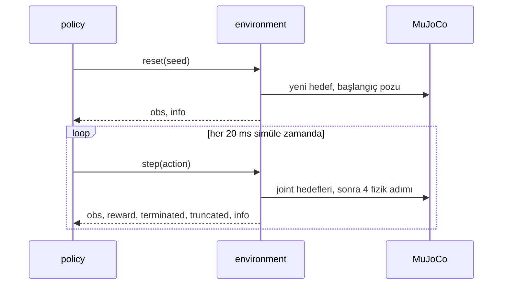

# 32 · Bir MuJoCo RL environment'ı

<!-- meta -->
| | |
|---|---|
| **Bölüm** | [8 · Robotlar için reinforcement learning](README.md) |
| **Çalışma türü** | CPU · Mac ya da Colab CPU |
| **Önkoşul** | [12](../part-4-dynamics-and-control/12-joint-control.md), [25](../part-7-learning-from-demonstration/25-evaluating-policies.md) |
| **Önce öğren** | [MDPs, States, Actions & Rewards](https://aiengineeringfromscratch.com/lesson?path=phases/09-reinforcement-learning/01-mdps-states-actions-rewards) |
| **Süre** | ~45 dk |
| **Kod** | [`experiments/32-rl-environment/experiment.py`](../../experiments/32-rl-environment/experiment.py) |
| **Durum** | ✅ tam |
<!-- /meta -->

> Öğrenmeden önce sözleşmeyi yazın: policy ne görüyor, sayıları motorlara ne yapıyor, episode ne zaman bitiyor ve ne sıklıkla karar veriyor.

## Problem

Bir RL algoritması yalnızca environment'ın verdiğini görür: bir observation, bir reward, iki episode sonu bayrağı. Bu arayüzdeki hatalar hiçbir şeyi çökertmez; training'i sessizce kötüleştirir. Klasik örnek: Gymnasium, v0.26'da tek `done` bayrağını `terminated` ve `truncated` ile değiştirdi ([Env API](https://gymnasium.farama.org/api/env/)), çünkü "episode zaman sınırına geldi" ile "episode terminal bir duruma ulaştı" farklı training hedefleri ister. Unitree'nin locomotion training kodu aynı ayrımı bir config anahtarı olarak taşır: `send_timeouts = True # send time out information to the algorithm` ([`legged_robot_config.py`](https://github.com/unitreerobotics/unitree_rl_gym/blob/main/legged_gym/envs/base/legged_robot_config.py)). Bu derste 33–35. derslerde kullanılan SO-101 reach environment'ını kuruyor ve ileride "öğrendi" demenin ne anlama geldiğini söyleyecek baseline'ları ölçüyoruz.

## Ana fikir

### Sade anlatımla

Bir RL environment'ı iki endpoint'i olan bir API'dir. `reset()` yeni bir deneme başlatır ve robotun ne gördüğünü söyler. `step(action)` tek bir kararı uygular, simülasyonu biraz ilerletir ve robotun şimdi ne gördüğünü, o adımın puanını (**reward**) ve iki bayrağı döndürür. `reset()`'ten sona kadarki bir koşu bir **episode**'dur; robotun gördüğünü bir action'a çeviren fonksiyon ise **policy**'dir.

İki bayrak farklı soruları cevaplar. `terminated` "görevin kendisi bitti" der: hedefe varıldı ya da robot düştü. `truncated` ise "izlemeyi bıraktık" der: saat doldu, ama robot sıradan bir durumdadır ve reward toplamaya devam ederdi. İkisini karıştıran bir öğrenen, dünyanın her 1,6 s'de bir sona erdiğini öğrenir; bu yanlıştır.

Sözleşmenin üçüncü parçası zamanlamadır. Fizik küçük adımlarla ilerler (burada 5 ms), ama policy yalnızca birkaç adımda bir karar verir; tıpkı fiziği 200 Hz'de güncelleyip kumandayı 50 Hz'de okuyan bir oyun gibi. Bu orana **frame skip** denir (Unitree buna `decimation` diyor).

### Agent–environment döngüsü



### Sözleşme, kod olarak

```python
obs, info = env.reset(seed=k)            # seed k -> the same target and start pose every time
while True:
    action = policy(obs)                 # 4 numbers in [-1, 1]
    obs, reward, terminated, truncated, info = env.step(action)
    if terminated or truncated:          # either flag ends the episode ...
        break

def value_target(r, v_next, terminated, gamma):
    # ... but only "terminated" removes the future.
    # r:      reward of this step
    # v_next: the critic's estimate of all future reward from the next state
    # gamma:  discount, how much one step later counts (lesson 33)
    return r + gamma * (1 - terminated) * v_next

policy_period = frame_skip * h           # 4 * 5 ms = 20 ms, i.e. 50 decisions per second
```

| Büyüklük | Formül |
|---|---|
| value hedefi | $y_t = r_t + \gamma\,(1 - \text{terminated}_t)\, V(s_{t+1})$ |
| policy periyodu | $\Delta t = k\,h$ |

$r_t$ $t$ adımındaki reward, $\gamma$ discount, $V(s_{t+1})$ bir sonraki durum $s_{t+1}$'den itibaren gelecek reward'un öğrenilmiş tahmini, $k$ frame skip ve $h$ fizik timestep'idir.

<details>
<summary>Matematik ayrıntısı: truncation'da neden bootstrap gerekir</summary>

Value tabanlı bir öğrenen, beklenen discount'lu return'ü $V(s) = \mathbb E\big[\sum_{l\ge0}\gamma^l r_{t+l} \mid s_t = s\big]$ fit eder (bkz. AIEFS: [MDPs, States, Actions & Rewards](https://aiengineeringfromscratch.com/lesson?path=phases/09-reinforcement-learning/01-mdps-states-actions-rewards)). Bu toplamın kuyruğunu güncel tahmin $V(s_{t+1})$ ile değiştirmeye **bootstrapping** denir.

- **Terminal durum.** Ondan sonra tanım gereği her reward 0'dır; doğru hedef $y_t = r_t$'dir.
- **Zaman sınırı.** Son durum sıradan bir durumdur; gerçek return devam eder. Orada $y = r$ kullanmak hedefi saate bağımlı yapar. Saat 15 sayılık observation'ımızda yok; dolayısıyla aynı kol pozu iki farklı hedef alır (gelecekli ve geleceksiz) ve value fonksiyonu ikisini birden fit edemez. Bootstrap hedefi yalnızca durumun bir fonksiyonu olarak tutar.

**Seeding.** `reset(seed=k)`, environment'ın kendi üreteci `self.np_random`'ı yeniden seed'ler. Episode'lar ancak *tüm* rastgelelik (hedef, başlangıç pozu) bu üreteçten geliyorsa yeniden üretilebilir. Evaluation da sabit bir seed listesi kullanır.

**Frame skip.** Action $k$ fizik adımı boyunca sabit tutulur; servonun PD döngüsü ise her fizik adımında çalışır. Go2 training config'i $h = 5$ ms ve `decimation = 4` kullanır: 20 ms'lik (50 Hz) bir policy ([`legged_robot_config.py`](https://github.com/unitreerobotics/unitree_rl_gym/blob/main/legged_gym/envs/base/legged_robot_config.py), [`go2_config.py`](https://github.com/unitreerobotics/unitree_rl_gym/blob/main/legged_gym/envs/go2/go2_config.py)). Menagerie SO-101 de $h = 5$ ms kullandığından biz de $k = 4$ alıyoruz.

Daha derine: [MDPs, States, Actions & Rewards](https://aiengineeringfromscratch.com/lesson?path=phases/09-reinforcement-learning/01-mdps-states-actions-rewards); [Gymnasium · `Env` API](https://gymnasium.farama.org/api/env/) (terminated ve truncated, seeding).

</details>

| Çağrı | Döndürdüğü | Robotta anlamı |
|---|---|---|
| `reset(seed=None)` | `obs, info` | robotu bir başlangıç durumuna koy, yeni bir görev örnekle (burada: bir hedef nokta) |
| `step(action)` | `obs, reward, terminated, truncated, info` | action'ı bir policy periyodu boyunca uygula, fiziği ilerlet |
| `observation_space`, `action_space` | `Box` boyutları ve sınırları | policy'nin girdi ve çıktı boyutları |

### Reach görevi

33–35. derslerin environment'ı, [`reach_env.py`](../../experiments/32-rl-environment/reach_env.py) içinde:

| Öğe | Tanım |
|---|---|
| Robot | Menagerie `robotstudio_so101`; kontrol edilen 4 eklem (shoulder pan, shoulder lift, elbow, wrist flex), wrist roll ve gripper 0'da tutulur |
| Action | $a \in [-1,1]^4$, joint hedefi $q^* = q_{\text{home}} + 1{,}0\,\text{rad} \cdot a$, modelin servo PD'si tarafından takip edilir (ders 34 bunu değiştirir) |
| Observation (15) | $q - q_{\text{home}}$, $0{,}1\,\dot q$, $p_{\text{target}} - p_{\text{gripper}}$, önceki action |
| Hedef | her episode'da: $q_{\text{home}} + U(\pm[1{,}0;\ 0{,}6;\ 0{,}6;\ 0{,}6])$ rad'ın forward kinematics'i; 4 cm'nin altındaysa ya da contact varsa reddedilir, böylece her hedef ulaşılabilirdir |
| Başlangıç | $q_{\text{home}} + U(\pm 0{,}1)$ rad, durağan |
| Reward | her adımda $r_t = -\lVert p_{\text{target}} - p_{\text{gripper}} \rVert$ (metre) |
| Episode | 1,6 s = 80 policy adımı, sonra `truncated` |
| Başarı | zaman sınırında gripper hedefe 2 cm'den yakın |

Hedefleri joint uzayında örnekleyip forward kinematics'ten ([ders 08](../part-3-kinematics/08-forward-kinematics.md)) geçirmek, %0 başarının görevin değil policy'nin suçu olduğunu garanti etmenin ucuz bir yoludur.

## Sıfırdan yaz

Şimdi reach environment'ını kendin yazacaksın: MuJoCo'nun üzerine yaklaşık 70 satır. Her adımda onu dersin [`reach_env.py`](../../experiments/32-rl-environment/reach_env.py) dosyasıyla karşılaştıracaksın: aynı seed'ler, aynı hedefler, aynı observation'lar, aynı reward'lar. Gymnasium yalnızca sonda, bir hakem olarak giriyor.

Sınıf [`physai/rl.py`](../../physai/rl.py) içinde; `uv run python experiments/32-rl-environment/build.py` beş adımın hepsini koşturur (çıktı [`build_output.txt`](../../experiments/32-rl-environment/build_output.txt) dosyasında).

### Adım 1 · Sınıf ve zamanlaması

Constructor her şeyi modelden okur: joint ve actuator indeksleri, servo aralıkları, gripper site'ı ve görevi tanımlayan iki süre, fizik adımı $h$ ve policy periyodu $k h$.

```python
class ReachTask:
    """SO-101 reach with the Gymnasium API: position actions around a home pose, frame skip, time limit.

    Observation (15): q - q_home, 0.1 * qdot, target - gripper, previous action. Reward: -distance [m].
    """
    JOINTS = ("shoulder_pan", "shoulder_lift", "elbow_flex", "wrist_flex")
    Q_HOME = np.array([0.0, -1.0, 1.0, 0.5])
    SPREAD = np.array([1.0, 0.6, 0.6, 0.6])        # targets = FK(q_home + U(-spread, spread)), always reachable

    def __init__(self, model_path, frame_skip=4, episode_seconds=1.6, scale=1.0, radius=0.02,
                 terminate_on_success=False):
        self.model = mujoco.MjModel.from_xml_path(model_path)
        self.data, self._fk = mujoco.MjData(self.model), mujoco.MjData(self.model)
        self.frame_skip, self.scale, self.radius = frame_skip, scale, radius
        self.terminate_on_success = terminate_on_success
        self.dt = self.model.opt.timestep * frame_skip                 # policy period
        self.max_steps = int(round(episode_seconds / self.dt))
        self.qadr = np.array([self.model.joint(j).qposadr[0] for j in self.JOINTS])
        self.vadr = np.array([self.model.joint(j).dofadr[0] for j in self.JOINTS])
        self.act = np.array([self.model.actuator(j).id for j in self.JOINTS])
        self.site = self.model.site("gripperframe").id
        self.lo, self.hi = self.model.actuator_ctrlrange[self.act].T.copy()
        self.np_random = None

    def _sample_target(self):
        while True:                                                    # rejection sampling in joint space
            q = np.clip(self.Q_HOME + self.np_random.uniform(-self.SPREAD, self.SPREAD), self.lo * 0.95, self.hi * 0.95)
            self._fk.qpos[:] = 0.0
            self._fk.qpos[self.qadr] = q
            mujoco.mj_forward(self.model, self._fk)
            p = self._fk.site_xpos[self.site].copy()
            if p[2] > 0.04 and self._fk.ncon == 0:                     # above the floor, nothing in contact
                return p

    def _obs(self):
        q = self.data.qpos[self.qadr] - self.Q_HOME
        qd = self.data.qvel[self.vadr]
        ee = self.data.site_xpos[self.site]
        return np.concatenate([q, 0.1 * qd, self.target - ee, self.prev_a]).astype(np.float32)

    def reset(self, seed=None, options=None):
        if seed is not None or self.np_random is None:
            self.np_random = np.random.default_rng(seed)               # all randomness comes from this generator
        mujoco.mj_resetData(self.model, self.data)
        self.target = self._sample_target()
        q0 = self.Q_HOME + self.np_random.uniform(-0.1, 0.1, size=4)
        self.data.qpos[self.qadr] = q0
        self.data.ctrl[:] = 0.0
        self.data.ctrl[self.act] = q0                                  # the servos hold the start pose
        mujoco.mj_forward(self.model, self.data)
        self.t, self.prev_a = 0, np.zeros(4)
        self.dist = float(np.linalg.norm(self.target - self.data.site_xpos[self.site]))
        return self._obs(), {"dist": self.dist}

    def step(self, action):
        a = np.clip(np.asarray(action, dtype=np.float64), -1.0, 1.0)
        self.data.ctrl[self.act] = np.clip(self.Q_HOME + self.scale * a, self.lo, self.hi)
        mujoco.mj_step(self.model, self.data, nstep=self.frame_skip)  # hold the action for frame_skip steps
        self.t += 1
        self.dist = float(np.linalg.norm(self.target - self.data.site_xpos[self.site]))
        self.prev_a = a
        success = self.dist < self.radius
        terminated = bool(self.terminate_on_success and success)       # the task itself is over
        truncated = (not terminated) and self.t >= self.max_steps      # we stopped watching
        info = {"dist": self.dist}
        if terminated or truncated:
            info["is_success"] = success
        return self._obs(), -self.dist, terminated, truncated, info
```

Kontrol: dört tekli `mj_step` çağrısı ile bir `mj_step(nstep=4)` aynı state'i veriyor ve periyot Ana fikir'deki 20 ms.

```text
== Step 1. Timing ==
physics step h = 5 ms, frame_skip 4 -> policy period 20 ms (50 Hz), 80 steps = 1.6 s
4 x mj_step vs mj_step(nstep=4): max |qpos diff| = 0.0e+00, time 0.020 s vs 0.020 s
```

### Adım 2 · `reset(seed)`

Tüm rastgelelik, hedef ve başlangıç pozu, seed'den oluşturulan tek bir üreteçten geliyor. `np.random.default_rng(seed)`, Gymnasium'un `super().reset(seed=seed)` çağrısıyla aynı üreteci kurar; böylece senin hedeflerin `ReachEnv`'inkilerle sayısı sayısına karşılaştırılabilir:

```text
== Step 2. reset(seed) vs the lesson's ReachEnv, seeds 0-199 ==
max |target ours - ReachEnv| = 0.0e+00 m, max |first observation diff| = 0.0e+00
reset(seed=7), reset(seed=8), reset(seed=7): same target True, target [0.273 0.098 0.153] m, start distance 0.113 m
reset() without a seed continues the generator: new target [0.238 0.105 0.143] m
```

200 seed'in hepsinde aynı. Seed'siz `reset()` aynı üretecten devam eder; böylece bir training koşusu her episode'da yeni bir hedef görürken evaluation sabit bir seed listesini yeniden oynatabilir.

### Adım 3 · `step(action)`

```text
== Step 3. step(action) vs ReachEnv, and the zero-action baseline ==
5 episodes of random actions: max |obs or reward diff| = 0.0e+00
zero action, 200 episodes: return -12.87 +- 4.92, median final distance 170.8 mm, success 1/200
```

Aynı rastgele action'lar aynı observation'ları ve reward'ları veriyor (fark 0.0e+00) ve sıfır action baseline'ı Deney'deki satırı yeniden üretiyor: −12,87 ± 4,92, 170,8 mm, 1/200.

### Adım 4 · terminated, truncated ve value hedefi

```python
def value_target(r, v_next, terminated, gamma):
    """One-step value target: bootstrap from the next state unless the episode terminated (truncation bootstraps)."""
    return r + gamma * (1.0 - terminated) * v_next
```

Deney'in scripted IK controller'ını senin sınıfınla çalıştır, bir kez `terminate_on_success=True` ile, bir kez onsuz:

```text
== Step 4. terminated vs truncated ==
scripted IK, terminate_on_success=True, 50 episodes: terminated 50, truncated 0, mean length 11.4 steps
last episode with terminate_on_success=False: terminated False, truncated True, t = 80
V(s) = r / (1 - gamma) = -0.200; target at the time limit: bootstrap -0.200, treated as terminal -0.010
```

Termination açıkken her episode ortalama 11,4 adımdan sonra `terminated` ile bitiyor, Deney'deki 50/0; kapalıyken episode 80. adıma kadar sürüyor ve `truncated` ile bitiyor. Son satır, Matematik ayrıntısı'ndaki argümanın sayılarla hâli. Sonsuza kadar her adımda −1 cm ödeyen bir durumun değeri $-0{,}01/(1-0{,}95) = -0{,}200$'dür. Zaman sınırında bootstrap −0,200 hedefini verir, durumun gerçek değerini; sınırı terminal saymak ise dünya bitmiş gibi −0,010 verir.

### Adım 5 · Gymnasium'un checker'ı

Gymnasium yalnızca iki ek attribute, yani space'leri, ve sınıfın `gymnasium.Env`'den türemesini ister:

```python
from gymnasium import spaces

class GymReach(ReachTask, gym.Env):                     # physai's reset/step, Gymnasium's base class
    def __init__(self, **kw):
        super().__init__(SO101, **kw)
        self.action_space = spaces.Box(-1.0, 1.0, shape=(4,), dtype=np.float32)
        self.observation_space = spaces.Box(-np.inf, np.inf, shape=(15,), dtype=np.float32)
```

```text
== Step 5. Gymnasium's env_checker ==
check_env passed, 2 warnings
  warning: WARN: A Box observation space minimum value is -infinity. This is probably too low.
  warning: WARN: A Box observation space maximum value is infinity. This is probably too high.
```

Checker geçiyor: seeding, dönüş tipleri ve space'ler Gymnasium'un beklediği gibi. İki uyarısı sınırsız observation kutusuyla ilgili; dersin `ReachEnv`'i de onu aynı şekilde tanımlıyor. Observation'ın kesin sınırları yok, bu yüzden böyle bırakıyoruz.

### Elinde kalan

`physai.rl` artık `ReachTask` ve `value_target` içeriyor. [Ders 33](33-ppo.md) aynı modüle PPO parçalarını ekliyor ve bu görevde training yapıyor; ders 34 ve 35 görevin action'larını ve reward'larını değiştiriyor. [`tests/test_32_rl_environment.py`](../../tests/test_32_rl_environment.py) seeding'i, iki bayrağı, frame skip'i ve `ReachEnv` ile eşitliği kontrol ediyor; `uv run pytest tests/test_32_rl_environment.py` çalıştır.

## Kütüphaneyle kullan

Gymnasium'un MuJoCo görevleri için bir base class'ı var: `gymnasium.envs.mujoco.MujocoEnv`. Ona model dosyasını ve `frame_skip`'i verirsin; modeli yükler, `dt = model.opt.timestep * frame_skip` tanımlar ve sana `do_simulation(ctrl, n_frames)` verir: kontrolleri set eder ve fiziği `n_frames` kez adımlar. `reset_model`, `step` ve observation'ı yine sen yazarsın. Zaman sınırı genellikle environment'ın içinde değil, adım sayısı `max_episode_steps`'e ulaştığında `truncated`'ı set eden bir wrapper'dadır:

```python
from gymnasium.wrappers import TimeLimit
from gymnasium.utils.env_checker import check_env

env = TimeLimit(GymReach(episode_seconds=1e9), max_episode_steps=80)   # the wrapper owns truncation
check_env(env.unwrapped)                                                # check the raw env, not the wrapper
```

| Parça | Bu ders / physai | Gymnasium | Go2 training (`legged_gym`) |
|---|---|---|---|
| karar başına fizik adımı | `frame_skip = 4` | `frame_skip` (`MujocoEnv`) | `decimation = 4` |
| policy periyodu | `dt = h * frame_skip` | `dt` property'si, aynı formül | `sim.dt * decimation` = 0,02 s |
| fiziği adımla | `mj_step(..., nstep=k)` | `do_simulation(ctrl, n_frames)` | PD torku her alt adımda yeniden hesaplanır |
| zaman sınırı | env içinde `max_steps` | `TimeLimit(max_episode_steps=...)` | `send_timeouts = True` |

Kaynaklar: Gymnasium 1.4.0'ın [`mujoco_env.py`](https://github.com/Farama-Foundation/Gymnasium/blob/main/gymnasium/envs/mujoco/mujoco_env.py) ve [`TimeLimit`](https://github.com/Farama-Foundation/Gymnasium/blob/main/gymnasium/wrappers/common.py) dosyaları (yukarıdaki snippet çalışıyor: sarılmış env 80. adımda truncate ediyor); Go2 config linkleri Problem ve Matematik ayrıntısı bölümlerinde.

Üç tuzak:

- **Öğrenen bayrağı görmeli.** Stable-Baselines3'ün PPO'su bir zaman sınırı adımını yalnızca info sözlüğü `TimeLimit.truncated` diyorsa ve `terminal_observation`'ı taşıyorsa bootstrap eder ([`on_policy_algorithm.py`](https://github.com/DLR-RM/stable-baselines3/blob/master/stable_baselines3/common/on_policy_algorithm.py), "Handle timeout by bootstrapping with value function"); bayrakları `done` içinde birleştiren kendi yazdığın bir döngü bu ayrımı sessizce kaybeder.
- **`np_random` dışında rastgelelik.** `reset` içinde tek bir `np.random.uniform` ya da Python `random` çağrısı yeniden üretilebilirliği bozar; Adım 2'nin eşitlik testi bunu yakalamanın en ucuz yolu.
- **`frame_skip`'i değiştirmek görevi değiştirir.** Policy periyodu, adım cinsinden episode uzunluğu ve $\gamma$'nın anlamı onunla birlikte kayar (ders 34 etkisini ölçüyor).

## Deney

`ReachEnv`'in `reset` ve `step` metodları Sıfırdan yaz'da yazdıklarınla aynı; üstüne 34–35. derslerin action modları ve takılabilir reward'ları ekleniyor.

[`experiment.py`](../../experiments/32-rl-environment/experiment.py) API'yi kontrol eder, üç **baseline**'ı (karşılaştırma için sabit referans policy'ler) her biri 200 episode (seed 0–199) çalıştırır ve `frame_skip` sweep'i yapar. Scripted controller her policy adımında bir damped least-squares IK adımı atar ([ders 10](../part-3-kinematics/10-inverse-kinematics.md)): $\Delta q = J^\top (J J^\top + 0{,}05^2 I)^{-1} e$, $q^* = q + \Delta q$ olarak gönderilir. Jacobian'ı modelden okur; bir policy bunu yapamaz.

**Tahmin edin:** 2 cm yarıçapla rastgele bir policy ne kadar başarı alır?

MuJoCo 3.17.0, NumPy 2.5.4, Gymnasium 1.4.0, Apple Silicon Mac (Apple M5), tek thread. Script'in tamamı yüklü bir makinede 54 s duvar saati sürdü; `python experiment.py --quick` (satır başına 50 episode, throughput satırı başına 1 s) bir smoke test'tir ve tabloları yeniden üretmez. A, B ve D bölümleri deterministik (tekrar çalıştırma aynı sayıları verdi); C bölümü bir zaman ölçümüdür ve her çalıştırmada değişir.

- Arada `reset(seed=8)` ile iki kez `reset(seed=7)` aynı hedefi veriyor: `True`.
- `terminate_on_success=True` iken scripted controller'ın 50 episode'unun hepsi `terminated` ile bitti (50), hiçbiri `truncated` değil.

**Baseline'lar** (her biri 200 episode; Wilson %95 aralığı, gerçek başarı oranının makul olarak bulunabileceği aralıktır, bkz. [ders 25](../part-7-learning-from-demonstration/25-evaluating-policies.md)):

| policy | return (ortalama ± std) | medyan son mesafe | başarı | Wilson %95 |
|---|---|---|---|---|
| rastgele | −14,37 ± 5,10 | 185,7 mm | 1/200 | %0,1–2,8 |
| sıfır action (home'da dur) | −12,87 ± 4,92 | 170,8 mm | 1/200 | %0,1–2,8 |
| scripted IK | −1,16 ± 0,68 | 0,2 mm | 200/200 | %98,1–100,0 |

Rastgele action'lar yerinde durmaktan iyi değil (medyan son mesafe 185,7 ve 170,8 mm). Scripted IK tavanı belirliyor; −1,16'lık return'ü kol hareket ederken biriken mesafedir, kalan bir hata değil (medyan son mesafe 0,2 mm). Bu bölümdeki her öğrenilmiş policy bu satırların arasına yerleşecek.

**frame_skip'e göre throughput** (rastgele action'lar, tek env, tek thread; process CPU süresi, böylece makinedeki diğer işler daha az bozar; yaklaşık):

| frame_skip | policy hızı | env adımı / CPU s | fizik adımı / CPU s | sim s / CPU s |
|---|---|---|---|---|
| 1 | 200 Hz | 22595 | 22595 | 113,0 |
| 2 | 100 Hz | 22316 | 44631 | 223,2 |
| 4 | 50 Hz | 14809 | 59235 | 296,2 |
| 8 | 25 Hz | 10900 | 87203 | 436,0 |
| 16 | 12,5 Hz | 6224 | 99585 | 497,9 |
| 32 | 6,25 Hz | 3357 | 107417 | 537,1 |


Doğrusal bir fit, `env.step()` başına **31,0 µs + 8,3 µs × frame_skip** CPU süresi veriyor. Bir SO-101 fizik adımı yaklaşık 8 µs tutuyor; adımın Python tarafı (clip, observation, reward, kayıt) yaklaşık dört fizik adımı kadar tutuyor. frame_skip 1'de env zamanının çoğunu Python'da geçiriyor; Python çağrısı başına çok sayıda environment'ı batch'lemenin bir sebebi bu (ders 36). frame_skip 4'te CPU saniyesi başına 296,2 simüle saniye koşuyor.

## Boz

Truncation görev tanımının parçasıdır. Zaman sınırını kısaltın ve 1,6 s'de kusursuz olan scripted controller'ı çalıştırın:

| zaman sınırı | adım | başarı | Wilson %95 | medyan son mesafe |
|---|---|---|---|---|
| 0,08 s | 4 | 11/200 | %3,1–9,6 | 120,1 mm |
| 0,16 s | 8 | 43/200 | %16,4–27,7 | 50,7 mm |
| 0,24 s | 12 | 81/200 | %33,9–47,4 | 23,1 mm |
| 0,32 s | 16 | 160/200 | %73,9–85,0 | 7,9 mm |
| 0,48 s | 24 | 199/200 | %97,2–99,9 | 1,0 mm |
| 1,60 s | 80 | 200/200 | %98,1–100,0 | 0,2 mm |

Yaklaşık 0,5 s'nin altında model tabanlı controller bile ıskalıyor: torku sınırlı servolar (±2,94 N·m) ve 20 ms'de bir IK adımıyla neredeyse her uzanma için 0,32 ile 0,48 s arasına ihtiyacı var. Zaman açısından optimal değil (bir policy daha büyük hedef sıçramaları komut edebilir), bu yüzden 0,24 s'deki 81/200 kesin bir tavan değil, bir referanstır. Yine de 0,24 s'lik episode verilen bir öğrenen, model tabanlı bir controller'ın bile çoğunlukla başaramadığı bir görevle puanlanır ve düşük başarısı bir öğrenme problemi gibi görünür. Öğreneni ayarlamadan önce aynı zaman sınırı altında scripted ya da oracle bir baseline ölçün.

## Gerçek robotta

- Donanımda `step()` gerçek zamanı bekler: 20 ms'lik bir policy adımı 20 ms sürer. Simülasyonda aynı env CPU saniyesi başına 296,2 simüle saniye koştu (C bölümü, frame_skip 4). Policy'lerin simülasyonda eğitilmesinin sebebi bu orandır.
- Gerçek kolda `reset()` bir atama değil bir harekettir: kol $q_{\text{home}}$'a geri sürülmeli, hedef yerleştirilmeli ya da işaretlenmelidir; bu episode başına saniyeler alır ve güvenli bir trajectory gerektirir ([ders 15](../part-4-dynamics-and-control/15-safety.md)).
- Observation robotun ölçtüklerinden kurulmalıdır: servo encoder konumları, sonlu farkla hızlar ve kameradan bir hedef konumu ([ders 20](../part-5-perception-and-estimation/20-pixels-to-table.md)). Bunların her birinde bu simüle environment'ta olmayan gürültü ve gecikme vardır (Bölüm 9).
- SO-101 için prosedür: scripted IK baseline'ını 20 sabit ulaşılabilir hedefte çalıştır, son gripper konumunu kamerayla ölç, $k/n$'yi Wilson aralığıyla raporla. **Gerçek kolda henüz ölçülmedi.**

## Kendini dene

1. **Kolay.** Scripted controller hedefe ulaşıyor ve env `terminate_on_success=True` ile kurulu. Hangi bayrak set edilir ve öğrenen o adımdan neyi bootstrap eder?
2. **Orta.** Bir kural ekleyin: kolun herhangi bir geom'u zemine değerse episode biter. Bu `terminated` mı olmalı, `truncated` mı? `step()` içinde uygulayın ve rastgele policy'nin 200 episode'da bunu kaç kez tetiklediğini sayın.
3. **Zor.** Env'in 16 kopyasını `gymnasium.vector.SyncVectorEnv` ve `AsyncVectorEnv` ile sarın ve toplam env adımı/s'yi tek env'e karşı ölçün. Fark nereden geliyor?

### Cevaplar

1. `terminated = True`, `truncated = False`; hedef $\gamma V(s')$ terimi olmadan $y = r$'dir, çünkü görevin tanımı gereği hedef durumu terminaldir.
2. `terminated`: zemine değmek görevin dinamiğinin parçasıdır (bir başarısızlık durumu), dış bir saat değil. Sayıyı siz ölçeceksiniz; biz çalıştırmadık.
3. Açık; çalıştırmadık. `SyncVectorEnv` 16 kopyayı yine aynı Python process'inde sırayla adımlar, bu yüzden aşağı yukarı tek env hızını bekleyin. `AsyncVectorEnv` her kopyayı ayrı bir subprocess'te çalıştırır; kazanç ek çekirdeklerden gelir, eksi adım başına process'ler arası iletişim maliyeti; bu maliyet bir adımın kısa olduğu küçük frame_skip'te en çok hissedilir (C bölümü).

## Akılda kalanlar ve kaynaklar

- Environment bir sözleşmedir: `reset(seed)` episode'ları yeniden üretir, `step()` beş değer döndürür ve `terminated` (görev bitti) `truncated`'dan (saat bitti) ayrı tutulmalıdır.
- Baseline'lar görevi iki yandan sınırlar: rastgele ve sıfır action 200'de 1, scripted IK 200'de 200 başarılı; öğrenilmiş bir policy ikisine göre okunmalıdır.
- Frame skip hem kontrol hızını hem simülatörün hızını belirler; episode uzunluğu (truncation) neyin başarılabilir olduğunu baştan tanımlar.

Sıradaki: [ders 33](33-ppo.md), bu environment'ta PPO ile bir policy eğitmek.

**Kaynaklar**

- [Gymnasium · `Env` API](https://gymnasium.farama.org/api/env/) (`reset`, `step`, terminated ve truncated, seeding).
- [MuJoCo dokümantasyonu · Python bindings](https://mujoco.readthedocs.io/en/stable/python.html).
- [`unitree_rl_gym` · `legged_robot_config.py`](https://github.com/unitreerobotics/unitree_rl_gym/blob/main/legged_gym/envs/base/legged_robot_config.py), [`go2_config.py`](https://github.com/unitreerobotics/unitree_rl_gym/blob/main/legged_gym/envs/go2/go2_config.py) (BSD-3-Clause).
- [MuJoCo Menagerie · `robotstudio_so101`](https://github.com/google-deepmind/mujoco_menagerie/tree/f3b6013/robotstudio_so101) (Apache-2.0).
- Kod: [`reach_env.py`](../../experiments/32-rl-environment/reach_env.py), [`experiment.py`](../../experiments/32-rl-environment/experiment.py), [`output.txt`](../../experiments/32-rl-environment/output.txt); şekil [`plot.py`](../../experiments/32-rl-environment/plot.py) ile üretildi.
