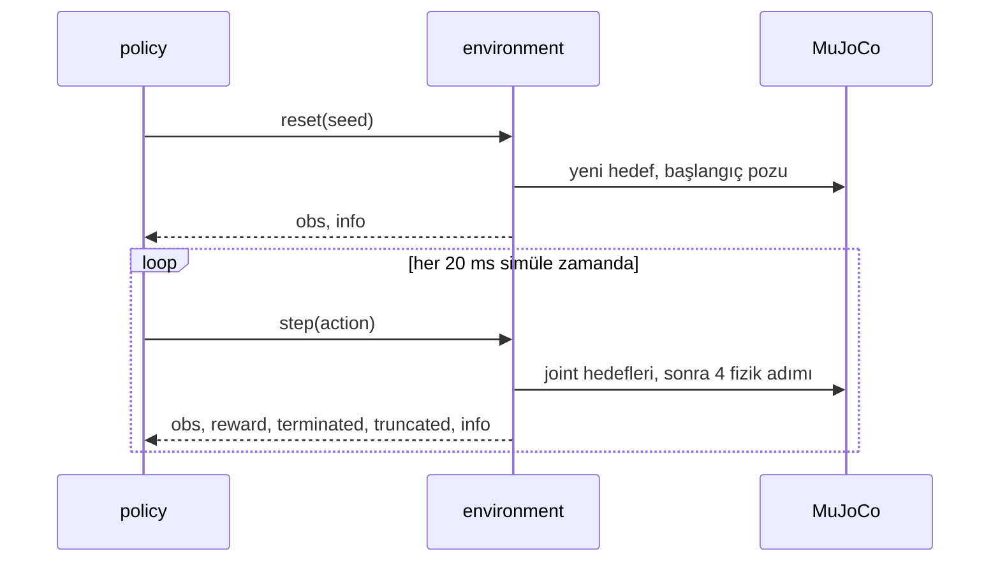

# 32 · Bir MuJoCo RL environment'ı

<!-- meta -->
| | |
|---|---|
| **Bölüm** | [8 · Robotlar için reinforcement learning](README.md) |
| **Çalışma türü** | CPU · Mac ya da Colab CPU |
| **Önkoşul** | [12](../part-4-dynamics-and-control/12-joint-control.md), [25](../part-7-learning-from-demonstration/25-evaluating-policies.md) |
| **Önce öğren** | [MDPs, States, Actions & Rewards](https://aiengineeringfromscratch.com/lesson?path=phases/09-reinforcement-learning/01-mdps-states-actions-rewards) |
| **Süre** | ~45 dk |
| **Kod** | [`experiments/32-rl-environment/experiment.py`](../../experiments/32-rl-environment/experiment.py) |
| **Durum** | ✅ tam |
<!-- /meta -->

> Öğrenmeden önce sözleşmeyi yazın: policy ne görüyor, sayıları motorlara ne yapıyor, episode ne zaman bitiyor ve ne sıklıkla karar veriyor.

## Problem

Bir RL algoritması yalnızca environment'ın verdiğini görür: bir observation, bir reward, iki episode sonu bayrağı. Bu arayüzdeki hatalar hiçbir şeyi çökertmez; training'i sessizce kötüleştirir. Klasik örnek: Gymnasium, v0.26'da tek `done` bayrağını `terminated` ve `truncated` ile değiştirdi ([Env API](https://gymnasium.farama.org/api/env/)), çünkü "episode zaman sınırına geldi" ile "episode terminal bir duruma ulaştı" farklı training hedefleri ister. Unitree'nin locomotion training kodu aynı ayrımı bir config anahtarı olarak taşır: `send_timeouts = True # send time out information to the algorithm` ([`legged_robot_config.py`](https://github.com/unitreerobotics/unitree_rl_gym/blob/main/legged_gym/envs/base/legged_robot_config.py)). Bu derste 33–35. derslerde kullanılan SO-101 reach environment'ını kuruyor ve ileride "öğrendi" demenin ne anlama geldiğini söyleyecek baseline'ları ölçüyoruz.

## Ana fikir

### Sade anlatımla

Bir RL environment'ı iki endpoint'i olan bir API'dir. `reset()` yeni bir deneme başlatır ve robotun ne gördüğünü söyler. `step(action)` tek bir kararı uygular, simülasyonu biraz ilerletir ve robotun şimdi ne gördüğünü, o adımın puanını (**reward**) ve iki bayrağı döndürür. `reset()`'ten sona kadarki bir koşu bir **episode**'dur; robotun gördüğünü bir action'a çeviren fonksiyon ise **policy**'dir.

İki bayrak farklı soruları cevaplar. `terminated` "görevin kendisi bitti" der: hedefe varıldı ya da robot düştü. `truncated` ise "izlemeyi bıraktık" der: saat doldu, ama robot sıradan bir durumdadır ve reward toplamaya devam ederdi. İkisini karıştıran bir öğrenen, dünyanın her 1,6 s'de bir sona erdiğini öğrenir; bu yanlıştır.

Sözleşmenin üçüncü parçası zamanlamadır. Fizik küçük adımlarla ilerler (burada 5 ms), ama policy yalnızca birkaç adımda bir karar verir; tıpkı fiziği 200 Hz'de güncelleyip kumandayı 50 Hz'de okuyan bir oyun gibi. Bu orana **frame skip** denir (Unitree buna `decimation` diyor).

### Agent–environment döngüsü



### Sözleşme, kod olarak

```python
obs, info = env.reset(seed=k)            # seed k -> the same target and start pose every time
while True:
    action = policy(obs)                 # 4 numbers in [-1, 1]
    obs, reward, terminated, truncated, info = env.step(action)
    if terminated or truncated:          # either flag ends the episode ...
        break

def value_target(r, v_next, terminated, gamma):
    # ... but only "terminated" removes the future.
    # r:      reward of this step
    # v_next: the critic's estimate of all future reward from the next state
    # gamma:  discount, how much one step later counts (lesson 33)
    return r + gamma * (1 - terminated) * v_next

policy_period = frame_skip * h           # 4 * 5 ms = 20 ms, i.e. 50 decisions per second
```

| Büyüklük | Formül |
|---|---|
| value hedefi | $y_t = r_t + \gamma\,(1 - \text{terminated}_t)\, V(s_{t+1})$ |
| policy periyodu | $\Delta t = k\,h$ |

$r_t$ $t$ adımındaki reward, $\gamma$ discount, $V(s_{t+1})$ bir sonraki durum $s_{t+1}$'den itibaren gelecek reward'un öğrenilmiş tahmini, $k$ frame skip ve $h$ fizik timestep'idir.

<details>
<summary>Matematik ayrıntısı: truncation'da neden bootstrap gerekir</summary>

Value tabanlı bir öğrenen, beklenen discount'lu return'ü $V(s) = \mathbb E\big[\sum_{l\ge0}\gamma^l r_{t+l} \mid s_t = s\big]$ fit eder (bkz. AIEFS: [MDPs, States, Actions & Rewards](https://aiengineeringfromscratch.com/lesson?path=phases/09-reinforcement-learning/01-mdps-states-actions-rewards)). Bu toplamın kuyruğunu güncel tahmin $V(s_{t+1})$ ile değiştirmeye **bootstrapping** denir.

- **Terminal durum.** Ondan sonra tanım gereği her reward 0'dır; doğru hedef $y_t = r_t$'dir.
- **Zaman sınırı.** Son durum sıradan bir durumdur; gerçek return devam eder. Orada $y = r$ kullanmak hedefi saate bağımlı yapar. Saat 15 sayılık observation'ımızda yok; dolayısıyla aynı kol pozu iki farklı hedef alır (gelecekli ve geleceksiz) ve value fonksiyonu ikisini birden fit edemez. Bootstrap hedefi yalnızca durumun bir fonksiyonu olarak tutar.

**Seeding.** `reset(seed=k)`, environment'ın kendi üreteci `self.np_random`'ı yeniden seed'ler. Episode'lar ancak *tüm* rastgelelik (hedef, başlangıç pozu) bu üreteçten geliyorsa yeniden üretilebilir. Evaluation da sabit bir seed listesi kullanır.

**Frame skip.** Action $k$ fizik adımı boyunca sabit tutulur; servonun PD döngüsü ise her fizik adımında çalışır. Go2 training config'i $h = 5$ ms ve `decimation = 4` kullanır: 20 ms'lik (50 Hz) bir policy ([`legged_robot_config.py`](https://github.com/unitreerobotics/unitree_rl_gym/blob/main/legged_gym/envs/base/legged_robot_config.py), [`go2_config.py`](https://github.com/unitreerobotics/unitree_rl_gym/blob/main/legged_gym/envs/go2/go2_config.py)). Menagerie SO-101 de $h = 5$ ms kullandığından biz de $k = 4$ alıyoruz.

Daha derine: [MDPs, States, Actions & Rewards](https://aiengineeringfromscratch.com/lesson?path=phases/09-reinforcement-learning/01-mdps-states-actions-rewards); [Gymnasium · `Env` API](https://gymnasium.farama.org/api/env/) (terminated ve truncated, seeding).

</details>

| Çağrı | Döndürdüğü | Robotta anlamı |
|---|---|---|
| `reset(seed=None)` | `obs, info` | robotu bir başlangıç durumuna koy, yeni bir görev örnekle (burada: bir hedef nokta) |
| `step(action)` | `obs, reward, terminated, truncated, info` | action'ı bir policy periyodu boyunca uygula, fiziği ilerlet |
| `observation_space`, `action_space` | `Box` boyutları ve sınırları | policy'nin girdi ve çıktı boyutları |

### Reach görevi

33–35. derslerin environment'ı, [`reach_env.py`](../../experiments/32-rl-environment/reach_env.py) içinde:

| Öğe | Tanım |
|---|---|
| Robot | Menagerie `robotstudio_so101`; kontrol edilen 4 eklem (shoulder pan, shoulder lift, elbow, wrist flex), wrist roll ve gripper 0'da tutulur |
| Action | $a \in [-1,1]^4$, joint hedefi $q^* = q_{\text{home}} + 1{,}0\,\text{rad} \cdot a$, modelin servo PD'si tarafından takip edilir (ders 34 bunu değiştirir) |
| Observation (15) | $q - q_{\text{home}}$, $0{,}1\,\dot q$, $p_{\text{target}} - p_{\text{gripper}}$, önceki action |
| Hedef | her episode'da: $q_{\text{home}} + U(\pm[1{,}0;\ 0{,}6;\ 0{,}6;\ 0{,}6])$ rad'ın forward kinematics'i; 4 cm'nin altındaysa ya da contact varsa reddedilir, böylece her hedef ulaşılabilirdir |
| Başlangıç | $q_{\text{home}} + U(\pm 0{,}1)$ rad, durağan |
| Reward | her adımda $r_t = -\lVert p_{\text{target}} - p_{\text{gripper}} \rVert$ (metre) |
| Episode | 1,6 s = 80 policy adımı, sonra `truncated` |
| Başarı | zaman sınırında gripper hedefe 2 cm'den yakın |

Hedefleri joint uzayında örnekleyip forward kinematics'ten ([ders 08](../part-3-kinematics/08-forward-kinematics.md)) geçirmek, %0 başarının görevin değil policy'nin suçu olduğunu garanti etmenin ucuz bir yoludur.

## Deney

Önemli olan iki metod:

```python
def reset(self, seed=None, options=None):
    super().reset(seed=seed)                      # seeds self.np_random
    mujoco.mj_resetData(self.model, self.data)
    self.target = self._sample_target()           # FK of a random reachable joint vector
    q0 = Q_HOME + self.np_random.uniform(-0.1, 0.1, size=4)
    self.data.qpos[self.qadr] = q0
    self.data.ctrl[self.act] = q0                 # servos hold the start pose
    mujoco.mj_forward(self.model, self.data)
    ...
    return self._obs(), {"dist": self.dist}

def step(self, action):
    a = np.clip(action, -1.0, 1.0)
    self.data.ctrl[self.act] = np.clip(Q_HOME + self.scale * a, self.lo, self.hi)
    mujoco.mj_step(self.model, self.data, nstep=self.frame_skip)
    self.t += 1
    self.dist = float(np.linalg.norm(self.target - self._ee()))
    reward = self.reward_fn({"dist": self.dist, ...})
    terminated = bool(self.terminate_on_success and self.dist < self.radius)
    truncated = (not terminated) and self.t >= self.max_steps
    return self._obs(), reward, terminated, truncated, info
```

[`experiment.py`](../../experiments/32-rl-environment/experiment.py) API'yi kontrol eder, üç **baseline**'ı (karşılaştırma için sabit referans policy'ler) her biri 200 episode (seed 0–199) çalıştırır ve `frame_skip` sweep'i yapar. Scripted controller her policy adımında bir damped least-squares IK adımı atar ([ders 10](../part-3-kinematics/10-inverse-kinematics.md)): $\Delta q = J^\top (J J^\top + 0{,}05^2 I)^{-1} e$, $q^* = q + \Delta q$ olarak gönderilir. Jacobian'ı modelden okur; bir policy bunu yapamaz.

**Tahmin edin:** 2 cm yarıçapla rastgele bir policy ne kadar başarı alır?

MuJoCo 3.17.0, NumPy 2.5.4, Gymnasium 1.4.0, Apple Silicon Mac (Apple M5), tek thread. Script'in tamamı yüklü bir makinede 54 s duvar saati sürdü; `python experiment.py --quick` (satır başına 50 episode, throughput satırı başına 1 s) bir smoke test'tir ve tabloları yeniden üretmez. A, B ve D bölümleri deterministik (tekrar çalıştırma aynı sayıları verdi); C bölümü bir zaman ölçümüdür ve her çalıştırmada değişir.

- Arada `reset(seed=8)` ile iki kez `reset(seed=7)` aynı hedefi veriyor: `True`.
- `terminate_on_success=True` iken scripted controller'ın 50 episode'unun hepsi `terminated` ile bitti (50), hiçbiri `truncated` değil.

**Baseline'lar** (her biri 200 episode; Wilson %95 aralığı, gerçek başarı oranının makul olarak bulunabileceği aralıktır, bkz. [ders 25](../part-7-learning-from-demonstration/25-evaluating-policies.md)):

| policy | return (ortalama ± std) | medyan son mesafe | başarı | Wilson %95 |
|---|---|---|---|---|
| rastgele | −14,37 ± 5,10 | 185,7 mm | 1/200 | %0,1–2,8 |
| sıfır action (home'da dur) | −12,87 ± 4,92 | 170,8 mm | 1/200 | %0,1–2,8 |
| scripted IK | −1,16 ± 0,68 | 0,2 mm | 200/200 | %98,1–100,0 |

Rastgele action'lar yerinde durmaktan iyi değil (medyan son mesafe 185,7 ve 170,8 mm). Scripted IK tavanı belirliyor; −1,16'lık return'ü kol hareket ederken biriken mesafedir, kalan bir hata değil (medyan son mesafe 0,2 mm). Bu bölümdeki her öğrenilmiş policy bu satırların arasına yerleşecek.

**frame_skip'e göre throughput** (rastgele action'lar, tek env, tek thread; process CPU süresi, böylece makinedeki diğer işler daha az bozar; yaklaşık):

| frame_skip | policy hızı | env adımı / CPU s | fizik adımı / CPU s | sim s / CPU s |
|---|---|---|---|---|
| 1 | 200 Hz | 22595 | 22595 | 113,0 |
| 2 | 100 Hz | 22316 | 44631 | 223,2 |
| 4 | 50 Hz | 14809 | 59235 | 296,2 |
| 8 | 25 Hz | 10900 | 87203 | 436,0 |
| 16 | 12,5 Hz | 6224 | 99585 | 497,9 |
| 32 | 6,25 Hz | 3357 | 107417 | 537,1 |


Doğrusal bir fit, `env.step()` başına **31,0 µs + 8,3 µs × frame_skip** CPU süresi veriyor. Bir SO-101 fizik adımı yaklaşık 8 µs tutuyor; adımın Python tarafı (clip, observation, reward, kayıt) yaklaşık dört fizik adımı kadar tutuyor. frame_skip 1'de env zamanının çoğunu Python'da geçiriyor; Python çağrısı başına çok sayıda environment'ı batch'lemenin bir sebebi bu (ders 36). frame_skip 4'te CPU saniyesi başına 296,2 simüle saniye koşuyor.

## Boz

Truncation görev tanımının parçasıdır. Zaman sınırını kısaltın ve 1,6 s'de kusursuz olan scripted controller'ı çalıştırın:

| zaman sınırı | adım | başarı | Wilson %95 | medyan son mesafe |
|---|---|---|---|---|
| 0,08 s | 4 | 11/200 | %3,1–9,6 | 120,1 mm |
| 0,16 s | 8 | 43/200 | %16,4–27,7 | 50,7 mm |
| 0,24 s | 12 | 81/200 | %33,9–47,4 | 23,1 mm |
| 0,32 s | 16 | 160/200 | %73,9–85,0 | 7,9 mm |
| 0,48 s | 24 | 199/200 | %97,2–99,9 | 1,0 mm |
| 1,60 s | 80 | 200/200 | %98,1–100,0 | 0,2 mm |

Yaklaşık 0,5 s'nin altında model tabanlı controller bile ıskalıyor: torku sınırlı servolar (±2,94 N·m) ve 20 ms'de bir IK adımıyla neredeyse her uzanma için 0,32 ile 0,48 s arasına ihtiyacı var. Zaman açısından optimal değil (bir policy daha büyük hedef sıçramaları komut edebilir), bu yüzden 0,24 s'deki 81/200 kesin bir tavan değil, bir referanstır. Yine de 0,24 s'lik episode verilen bir öğrenen, model tabanlı bir controller'ın bile çoğunlukla başaramadığı bir görevle puanlanır ve düşük başarısı bir öğrenme problemi gibi görünür. Öğreneni ayarlamadan önce aynı zaman sınırı altında scripted ya da oracle bir baseline ölçün.

## Gerçek robotta

- Donanımda `step()` gerçek zamanı bekler: 20 ms'lik bir policy adımı 20 ms sürer. Simülasyonda aynı env CPU saniyesi başına 296,2 simüle saniye koştu (C bölümü, frame_skip 4). Policy'lerin simülasyonda eğitilmesinin sebebi bu orandır.
- Gerçek kolda `reset()` bir atama değil bir harekettir: kol $q_{\text{home}}$'a geri sürülmeli, hedef yerleştirilmeli ya da işaretlenmelidir; bu episode başına saniyeler alır ve güvenli bir trajectory gerektirir ([ders 15](../part-4-dynamics-and-control/15-safety.md)).
- Observation robotun ölçtüklerinden kurulmalıdır: servo encoder konumları, sonlu farkla hızlar ve kameradan bir hedef konumu ([ders 20](../part-5-perception-and-estimation/20-pixels-to-table.md)). Bunların her birinde bu simüle environment'ta olmayan gürültü ve gecikme vardır (Bölüm 9).
- SO-101 için prosedür: scripted IK baseline'ını 20 sabit ulaşılabilir hedefte çalıştır, son gripper konumunu kamerayla ölç, $k/n$'yi Wilson aralığıyla raporla. **Gerçek kolda henüz ölçülmedi.**

## Kendini dene

1. **Kolay.** Scripted controller hedefe ulaşıyor ve env `terminate_on_success=True` ile kurulu. Hangi bayrak set edilir ve öğrenen o adımdan neyi bootstrap eder?
2. **Orta.** Bir kural ekleyin: kolun herhangi bir geom'u zemine değerse episode biter. Bu `terminated` mı olmalı, `truncated` mı? `step()` içinde uygulayın ve rastgele policy'nin 200 episode'da bunu kaç kez tetiklediğini sayın.
3. **Zor.** Env'in 16 kopyasını `gymnasium.vector.SyncVectorEnv` ve `AsyncVectorEnv` ile sarın ve toplam env adımı/s'yi tek env'e karşı ölçün. Fark nereden geliyor?

### Cevaplar

1. `terminated = True`, `truncated = False`; hedef $\gamma V(s')$ terimi olmadan $y = r$'dir, çünkü görevin tanımı gereği hedef durumu terminaldir.
2. `terminated`: zemine değmek görevin dinamiğinin parçasıdır (bir başarısızlık durumu), dış bir saat değil. Sayıyı siz ölçeceksiniz; biz çalıştırmadık.
3. Açık; çalıştırmadık. `SyncVectorEnv` 16 kopyayı yine aynı Python process'inde sırayla adımlar, bu yüzden aşağı yukarı tek env hızını bekleyin. `AsyncVectorEnv` her kopyayı ayrı bir subprocess'te çalıştırır; kazanç ek çekirdeklerden gelir, eksi adım başına process'ler arası iletişim maliyeti; bu maliyet bir adımın kısa olduğu küçük frame_skip'te en çok hissedilir (C bölümü).

## Akılda kalanlar ve kaynaklar

- Environment bir sözleşmedir: `reset(seed)` episode'ları yeniden üretir, `step()` beş değer döndürür ve `terminated` (görev bitti) `truncated`'dan (saat bitti) ayrı tutulmalıdır.
- Baseline'lar görevi iki yandan sınırlar: rastgele ve sıfır action 200'de 1, scripted IK 200'de 200 başarılı; öğrenilmiş bir policy ikisine göre okunmalıdır.
- Frame skip hem kontrol hızını hem simülatörün hızını belirler; episode uzunluğu (truncation) neyin başarılabilir olduğunu baştan tanımlar.

Sıradaki: [ders 33](33-ppo.md), bu environment'ta PPO ile bir policy eğitmek.

**Kaynaklar**

- [Gymnasium · `Env` API](https://gymnasium.farama.org/api/env/) (`reset`, `step`, terminated ve truncated, seeding).
- [MuJoCo dokümantasyonu · Python bindings](https://mujoco.readthedocs.io/en/stable/python.html).
- [`unitree_rl_gym` · `legged_robot_config.py`](https://github.com/unitreerobotics/unitree_rl_gym/blob/main/legged_gym/envs/base/legged_robot_config.py), [`go2_config.py`](https://github.com/unitreerobotics/unitree_rl_gym/blob/main/legged_gym/envs/go2/go2_config.py) (BSD-3-Clause).
- [MuJoCo Menagerie · `robotstudio_so101`](https://github.com/google-deepmind/mujoco_menagerie/tree/f3b6013/robotstudio_so101) (Apache-2.0).
- Kod: [`reach_env.py`](../../experiments/32-rl-environment/reach_env.py), [`experiment.py`](../../experiments/32-rl-environment/experiment.py), [`output.txt`](../../experiments/32-rl-environment/output.txt); şekil [`plot.py`](../../experiments/32-rl-environment/plot.py) ile üretildi.
