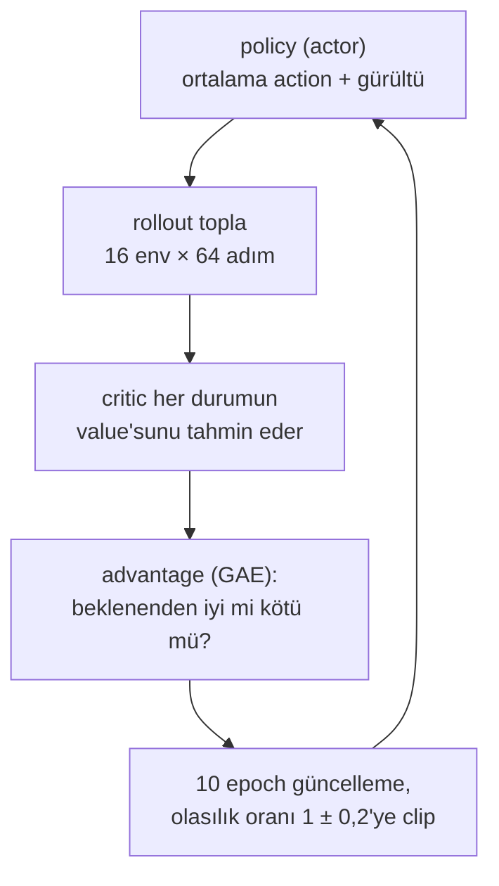
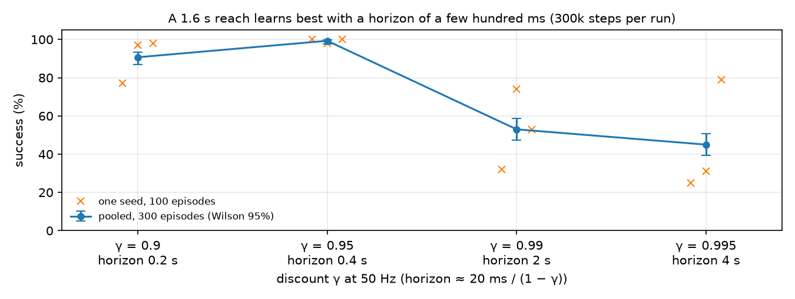

# 33 · Continuous control için PPO

<!-- meta -->
| | |
|---|---|
| **Bölüm** | [8 · Robotlar için reinforcement learning](README.md) |
| **Çalışma türü** | CPU · Mac ya da Colab CPU |
| **Önkoşul** | [32](32-rl-environment.md) |
| **Önce öğren** | [Policy Gradient — REINFORCE from Scratch](https://aiengineeringfromscratch.com/lesson?path=phases/09-reinforcement-learning/06-policy-gradients-reinforce) · [Actor-Critic — A2C and A3C](https://aiengineeringfromscratch.com/lesson?path=phases/09-reinforcement-learning/07-actor-critic-a2c-a3c) · [Proximal Policy Optimization (PPO)](https://aiengineeringfromscratch.com/lesson?path=phases/09-reinforcement-learning/08-ppo) |
| **Süre** | ~75 dk |
| **Kod** | [`experiments/33-ppo/experiment.py`](../../experiments/33-ppo/experiment.py) |
| **Durum** | ✅ tam |
<!-- /meta -->

> PPO'nun kendisi birkaç satır matematik. Robotta asıl iş, etrafındaki zaman ölçeklerini seçmek.

## Problem

[Ders 32](32-rl-environment.md)'de rastgele bir policy hedefe 200 episode'un 1'inde ulaştı, scripted IK controller ise 200'ünde de ulaştı; ama yalnızca Jacobian'ı modelden okuduğu için. Bir policy aynı uzanmayı yalnızca reward'dan, CPU'da, run başına yaklaşık bir dakikada öğrenebilir mi? Öğrenirse ne kadar emin olabiliriz? Tek bir training run'ı sonuç değildir: RL sonuçları seed'e göre değişir. Bu yüzden başarıyı sabit evaluation episode'ları üzerinden, Wilson %95 aralığıyla (bkz. [ders 25](../part-7-learning-from-demonstration/25-evaluating-policies.md)) ve üç seed için veriyoruz.

## Ana fikir

### Sade anlatımla

PPO (Proximal Policy Optimization) kendi denemelerinden öğrenir, ama bir seferde fazla değişmeyi reddeder. Policy görevi action'larına biraz rastgele gürültü ekleyerek defalarca dener. Her deneme grubundan sonra her action için şunu sorar: "bu, buradan genelde aldığım sonuçtan daha mı iyi gitti, daha mı kötü?" Bu farka **advantage** denir; "buradan genelde ne alırım" bilgisi ikinci bir ağdan, **critic**'ten gelir. Advantage'ı pozitif olan action'lar biraz daha olası, diğerleri biraz daha az olası hâle gelir.

"Bir seferde fazla değil" kısmı onu kararlı yapan şeydir. Batch eski policy ile toplandı; dolayısıyla yalnızca eskisine yakın policy'ler hakkında güvenilir bir şey söyler; tıpkı geçen haftanın build'inde kaydedilmiş bir benchmark'ın baştan yazılmış bir sürüm hakkında pek bir şey söylememesi gibi. Bu yüzden PPO, bir action'ı öncekinden %20'den fazla daha olası (ya da daha az olası) yapmaktan gelen kazancı yok sayar. Bu sınıra **clip** denir.

Robotta bir ayarın daha fiziksel bir anlamı vardır: **discount** $\gamma$, yani bir adım sonraki reward'un şimdiki reward'a göre ne kadar sayıldığı. Bir adım gerçek zamanda 20 ms olduğundan $\gamma$, policy'nin kaç saniye ilerisini önemsediğini sessizce belirler.

### Bir PPO iterasyonu



### PPO, kod olarak

```python
# One iteration, simplified (the full version is experiments/33-ppo/ppo.py)
batch = collect(policy, envs, steps=64)     # obs, actions, rewards, log-probs under the OLD policy
values = critic(batch.obs)                  # expected future reward from each state
adv = gae(batch.rewards, values, gamma=0.95, lam=0.95)   # better (+) or worse (-) than expected
for epoch in range(10):
    ratio = policy.prob(batch.actions) / batch.old_prob  # how much more likely each action is now
    clipped = ratio.clip(1 - 0.2, 1 + 0.2)               # changes beyond 20% earn nothing
    loss = -mean(min(ratio * adv, clipped * adv))        # raise good actions, lower bad ones
    optimize(loss + 0.5 * critic_loss)

horizon_s = dt / (1 - gamma)                # 0.02 / (1 - 0.95) = 0.4 s of look-ahead
```

| Parça | Formül |
|---|---|
| Gaussian policy | $a \sim \mathcal N(\mu_\theta(o), \mathrm{diag}\,\sigma^2)$ |
| TD hatası, GAE | $\delta_t = r_t + \gamma (1-d_t) V(s_{t+1}) - V(s_t), \quad \hat A_t = \sum_{l \ge 0} (\gamma\lambda)^l \delta_{t+l}$ |
| clipped surrogate | $L = -\mathbb E\big[\min(\rho_t \hat A_t,\ \mathrm{clip}(\rho_t, 1-\epsilon, 1+\epsilon)\hat A_t)\big] + c_v (V_\phi(s_t) - \hat R_t)^2 - c_e\, \mathcal H[\pi_\theta]$ |
| ufuk | $\tau \approx \Delta t/(1-\gamma)$ |

$\mu_\theta(o)$ actor'ün $o$ observation'ı için ortalama action'ı, $\sigma$ öğrenilen gürültüsüdür; $d_t$ episode'un bittiği adımda 1'dir; $\lambda$ advantage $\hat A_t$'de bias ile variance'ı dengeler; $\rho_t = \pi_\theta(a_t|s_t)/\pi_{\theta_{\text{old}}}(a_t|s_t)$ olasılık oranı, $\epsilon$ clip'tir; $\hat R_t$ critic'in hedefi, $c_v$ ve $c_e$ value loss'un ve entropy bonusu $\mathcal H$'nin ağırlıklarıdır; $\Delta t$ policy periyodudur.

<details>
<summary>Matematik ayrıntısı: continuous control'ün dört parçası</summary>

Policy gradient, actor-critic ve PPO türetmeleri AIEFS'te var; burada yalnızca continuous control için önemli olan kısımlar var.

**Gaussian policy.** Actor diagonal bir Gaussian'ın ortalamasını verir; $\log\sigma$ observation'a bağlı olmayan, öğrenilen bir vektördür. Environment $a$'yı $[-1, 1]$'e clip eder; log-probability clip edilmemiş örnek için hesaplanır, böylece $\rho_t$ oranı toplama ile güncelleme arasında tutarlı kalır.

**GAE** (Schulman vd., [arXiv 1506.02438](https://arxiv.org/abs/1506.02438)). $\lambda = 0$ yalnızca tek adımlık hata $\delta_t$'yi kullanır (düşük variance, critic yüzünden bias'lı); $\lambda = 1$ tüm gerçek reward'ları toplar (bias'sız, gürültülü). Makale $\gamma$'yı da aynı şekilde ele alır: gerçek amacın parçası olarak değil, bias getiren bir variance azaltma parametresi olarak.

**Clipped surrogate** (Schulman vd., [arXiv 1707.06347](https://arxiv.org/abs/1707.06347)). $\rho_t \hat A_t$, yeni policy'nin iyileşmesini eski policy'nin örneklerinden tahmin eder (importance sampling). Tahmin yalnızca $\rho = 1$ civarında güvenilirdir. Clip'li terimle minimum almak, $\rho$'yu $[1-\epsilon, 1+\epsilon]$ dışına çıkarma teşvikini ortadan kaldırır.

**Truncation, termination değildir.** 1,6 s'lik zaman sınırında kol terminal bir durumda değildir; bu yüzden son reward'a bootstrap eklenir, $r_T \leftarrow r_T + \gamma V(s_{T+1})$, episode ancak ondan sonra kesilir ($d_t = 1$). Gerçek bir terminal durum (ders 35) bootstrap almaz.

**Neden $\Delta t/(1-\gamma)$.** $\gamma^l$ ağırlıklarının toplamı $\sum_{l\ge0}\gamma^l = 1/(1-\gamma)$ adımdır; adım süresiyle çarpınca bir zaman olur. 50 Hz'de $\gamma = 0{,}99$ 2 s, $\gamma = 0{,}95$ 0,4 s demektir. Kontrol hızını değiştirirseniz görevin ufkunu sessizce değiştirmiş olursunuz.

Daha derine: [Policy Gradient — REINFORCE from Scratch](https://aiengineeringfromscratch.com/lesson?path=phases/09-reinforcement-learning/06-policy-gradients-reinforce), [Actor-Critic — A2C and A3C](https://aiengineeringfromscratch.com/lesson?path=phases/09-reinforcement-learning/07-actor-critic-a2c-a3c), [Proximal Policy Optimization (PPO)](https://aiengineeringfromscratch.com/lesson?path=phases/09-reinforcement-learning/08-ppo); yukarıdaki PPO ve GAE makaleleri.

</details>

<!-- figure: 33-discount-horizon -->

### Ayarlarımız ve gerçek bir robot config'i

| | Bu ders | Go2 training config'i (`unitree_rl_gym`) |
|---|---|---|
| paralel env × iterasyon başına adım | 16 × 64 | 4096 × 24 |
| iterasyon başına epoch / minibatch | 10 / 4 | 5 / 4 |
| clip $\epsilon$, $\gamma$, $\lambda$ | 0,2, 0,95, 0,95 | 0,2, 0,99, 0,95 |
| learning rate | 1e-3, sabit | 1e-3, `schedule = 'adaptive'`, `desired_kl = 0.01` |
| entropy katsayısı | 0 | 0,01 |
| policy ağı | 64-64 tanh | 512-256-128 elu |

Sağ sütun [`legged_robot_config.py`](https://github.com/unitreerobotics/unitree_rl_gym/blob/main/legged_gym/envs/base/legged_robot_config.py) (`LeggedRobotCfgPPO`) ve [`go2_config.py`](https://github.com/unitreerobotics/unitree_rl_gym/blob/main/legged_gym/envs/go2/go2_config.py) dosyalarından okundu.

## Deney

[`ppo.py`](../../experiments/33-ppo/ppo.py) algoritmanın tamamı (yaklaşık 200 satır, RL kütüphanesi yok); [`experiment.py`](../../experiments/33-ppo/experiment.py) onu çalıştırır. Environment, ders 32'deki reach görevinin aynısı: mutlak joint hedefleri, 50 Hz, reward $-d$, run başına 300.000 policy adımı. Güncellemenin özü:

```python
# GAE over a (T, N) rollout; buf_done = terminated OR truncated,
# truncated steps already got r += gamma * V(s_final)
for t in reversed(range(T)):
    nv = last_v if t == T - 1 else buf_v[t + 1]
    nonterm = 1.0 - buf_done[t]
    delta = buf_r[t] + gamma * nv * nonterm - buf_v[t]
    gae = delta + gamma * lam * nonterm * gae
    adv[t] = gae

# one minibatch step
ratio = (pi.dist(o).log_prob(a).sum(-1) - logp_old).exp()
A = (A - A.mean()) / (A.std() + 1e-8)
pg = -torch.min(ratio * A, ratio.clamp(1 - clip, 1 + clip) * A).mean()
loss = pg + 0.5 * ((pi.v(o).squeeze(-1) - ret) ** 2).mean() - ent_coef * entropy
```

Çalıştırmadan önce **tahmin edin**: $\gamma$ 0,9'dan 0,995'e giderken 1,6 s'lik bir uzanma için hangi ufuk en iyi çalışır?

MuJoCo 3.17.0, NumPy 2.5.4, PyTorch 2.14.1 (CPU, run başına bir thread), Apple Silicon Mac (Apple M5). Her run kendi seed'i için deterministik: tam bir tekrar çalıştırma, [`output.txt`](../../experiments/33-ppo/output.txt) içindeki her başarı sayısını, mesafeyi, return'ü ve KL değerini aynen üretti; yalnızca süreler değişti. Evaluation, seed'i 10000–10099 olan episode'larda ortalama action'la (gürültüsüz) yapılır.

**Referans config, üç seed:**

| seed | başarı | Wilson %95 | medyan son mesafe | training süresi |
|---|---|---|---|---|
| 0 | 100/100 | %96,3–100,0 | 6,6 mm | 61 s |
| 1 | 98/100 | %93,0–99,4 | 7,9 mm | 61 s |
| 2 | 100/100 | %96,3–100,0 | 8,0 mm | 60 s |
| toplam | 298/300 (%99,3) | %97,6–99,8 | | |

Training süreleri, paylaşılan bir Mac'te altı run paralel koşarken ölçülen duvar saati süreleridir: yaklaşık. Script'in tamamı (15 run) 222 s sürdü. `python experiment.py --quick` yalnızca seed 0'ı eğitir (5 run) ve her tablonun seed 0 girdilerini yeniden üretir, toplam sayıları değil.

Ortam adımına göre training başarısı (gürültülü policy, son 50 episode):

| seed | 50k | 100k | 150k | 200k | 250k | 299k |
|---|---|---|---|---|---|---|
| 0 | 0,20 | 0,14 | 0,18 | 0,68 | 0,96 | 1,00 |
| 1 | 0,16 | 0,22 | 0,28 | 0,40 | 0,92 | 0,96 |
| 2 | 0,16 | 0,20 | 0,28 | 0,88 | 0,94 | 0,98 |

İlk 150k adım boyunca training başarısı 0,14 ile 0,28 arasında kalıyor; sonra yaklaşık 100k adım içinde sıçrıyor. 150k'da durdurulan bir run başarısız görünürdü.

**$\gamma$ sweep'i** (her biri 3 seed, toplam 300 evaluation episode'u):

| $\gamma$ | 50 Hz'de ufuk | seed başına başarı | toplam | Wilson %95 |
|---|---|---|---|---|
| 0,9 | 0,2 s | 77 / 97 / 98 | 272/300 (%90,7) | %86,8–93,5 |
| **0,95** | **0,4 s** | 100 / 98 / 100 | 298/300 (%99,3) | %97,6–99,8 |
| 0,99 | 2,0 s | 32 / 74 / 53 | 159/300 (%53,0) | %47,3–58,6 |
| 0,995 | 4,0 s | 25 / 31 / 79 | 135/300 (%45,0) | %39,5–50,7 |



Yaygın varsayılan $\gamma = 0{,}99$ burada başarıyı yarıya indiriyor ve seed'ler arası fark büyüyor (0,995'te 100 üzerinden 25 ile 79): bu bütçede, birkaç yüz milisaniyelik bir uzanmaya en iyi aynı mertebede bir ufuk hizmet etti. Mekanizmayı ayrıştırmadık. Adaylar: daha uzun ufuklar uzak reward'ların gürültüsünü her advantage tahminine ekler (GAE makalesinin anlattığı bias-variance dengesi); ayrıca value hedefleri $1/(1-\gamma)$ gibi büyür, `ppo.py` ise return'leri normalize etmez ve actor ile critic gradient'lerini ayrı clip'lemez, yani büyüyen value loss policy adımını da küçültür. Çekinceler: sonuç bütçeyle sınırlı (300k adım; $\gamma = 0{,}99$'un daha fazla veriyle yetişip yetişmediğini test etmedik) ve Wilson aralıkları 300 evaluation episode'unu sayar ama yalnızca üç eğitilmiş policy'ye dayanır, bu yüzden seed'ler arası değişkenliği olduğundan küçük gösterir. 0,95 ile 0,99 arasındaki fark her seed'de geçerli; 0,99 ile 0,995 arasındaki fark değil.

## Boz

Aynı batch üzerinde on epoch'un policy'yi fazla uzağa yürütmesini engelleyen şey clip'tir. $\epsilon = 100$ yapın (pratikte clip yok) ve her batch'i 30 epoch tekrar kullanın. Son sütun, batch'i toplayan policy ile güncellenen policy arasındaki yaklaşık **KL divergence**'tır: "iki action dağılımı ne kadar farklı" sorusunun sayısı; 0,01 civarı küçük ve sağlıklı bir adımdır.

| seed | başarı | Wilson %95 | medyan son mesafe | güncelleme başına yaklaşık KL, iter 1 / 10 / 50 / 100 / 292 |
|---|---|---|---|---|
| 0 | 0/100 | %0,0–3,7 | 196,5 mm | 1,49 / 3,1 / 8,2 / 435 / 3780 |
| 1 | 0/100 | %0,0–3,7 | 272,5 mm | 1,58 / 4,16 / 17,5 / 46,6 / 125 |
| 2 | 1/100 | %0,2–5,4 | 144,2 mm | 1,94 / 3,04 / 7,78 / 392 / 1070 |
| referans ($\epsilon$ 0,2, 10 epoch) | | | | 0,00759 / 0,0201 / 0,0211 / 0,0259 / 0,0657 (3 seed ortalaması) |

Mekanizma: $\rho \hat A$ surrogate'ı yalnızca $\pi_{\theta_{\text{old}}}$ yakınında iyileşmenin geçerli bir tahminidir. Clip olmadan optimizer büyük advantage'lı örnekler için $\rho$'yu itmeye devam eder, ortalama ve $\log\sigma$ sıçrar, yaklaşık KL 0,01 civarından yüzlere çıkar. Sonraki batch, critic'in fit edildiği policy ile pek ilgisi kalmamış bir policy tarafından toplanır; böylece advantage'lar da yanlış olur. Son mesafeler (144,2–272,5 mm), ders 32'deki rastgele policy ile aynı mertebededir (medyan 185,7 mm). Güncelleme başına yaklaşık KL'yi ve clip oranını izlemek en ucuz erken uyarıdır; Unitree'nin config'i bir adım ileri gidip learning rate'i bir KL hedefine göre ayarlar (`desired_kl = 0.01`).

## Gerçek robotta

- Eğitilmiş actor 15 → 64 → 64 → 4'lük bir MLP; deploy etmek $\mu_\theta(o)$'yu 50 Hz'de çalıştırıp dört çıktıyı servo hedefi olarak göndermek demektir. Critic robotta gerekmez.
- SO-101'in STS3215 servoları Menagerie dosyasında `kp = 998.22`, `kv = 2.731` ve `forcerange = ±2.94` N·m'lik position actuator olarak modellenmiştir ([`so101.xml`](https://github.com/google-deepmind/mujoco_menagerie/tree/f3b6013/robotstudio_so101)). Gerçek servonun iç döngüsü, gecikmesi ve boşluğu (backlash) farklıdır; policy bunların hiçbiriyle eğitilmedi (Bölüm 9).
- Gerçek kol için prosedür: 20+ ulaşılabilir hedeften oluşan sabit bir liste, deterministik policy'yi çalıştır, son gripper konumunu [ders 20](../part-5-perception-and-estimation/20-pixels-to-table.md)'deki kalibre kamerayla ölç, $k/n$'yi Wilson aralığıyla raporla. **Gerçek kolda henüz ölçülmedi.**

## Kendini dene

1. **Kolay.** Go2 config'inin $\gamma = 0{,}99$'u, 50 Hz'lik policy hızında kaç saniyelik bir ufka karşılık gelir? 200 Hz'de aynı ufku hangi $\gamma$ verir?
2. **Orta.** `ppo.py`'de truncation bootstrap'ini silin (zaman sınırını terminal durum gibi ele alın). Çalıştırmadan önce: hangi durumlar yanlış bir value alır, bu value fazla yüksek mi fazla düşük mü? Üç seed çalıştırıp referans tabloyla karşılaştırın.
3. **Zor.** Sabit learning rate'i KL'ye uyarlanan kuralla değiştirin (bir iterasyonun ortalama KL'si $2 \times 0{,}01$'i aşınca lr'yi yarıya indir, $0{,}01/2$'nin altındaysa 1,5 kat büyüt). Boz ayarını kurtarıyor mu? Başarıyı üç seed için Wilson aralıklarıyla raporlayın.

### Cevaplar

1. $\tau = 0{,}02 / (1 - 0{,}99) = 2{,}0$ s. 200 Hz'de ($\Delta t = 5$ ms): $\gamma = 1 - 0{,}005/2 = 0{,}9975$.
2. Zaman sınırına yakın durumlar. Buradaki her reward $-d \le 0$ olduğundan geleceği kesmek bu durumların value hedeflerini bootstrap edilmiş hâllerinden fazla yüksek (sıfıra daha yakın) yapar; aynı kol durumu, observation'da olmayan saate göre farklı hedefler alır. Ölçün; bu varyantı biz çalıştırmadık.
3. Açık; çalıştırmadık. Başarıyla birlikte iterasyon başına KL'yi de raporlayın, yoksa işi schedule'ın mı şansın mı yaptığını ayırt edemezsiniz.

## Akılda kalanlar ve kaynaklar

- Kompakt bir PPO (Gaussian policy, GAE, clipped surrogate) SO-101 uzanmasını CPU'da öğreniyor: üç seed üzerinden 298/300 evaluation episode'u (Wilson %97,6–99,8), run başına yaklaşık bir dakika.
- $\gamma$ saniye cinsinden bir ufuktur, $\Delta t/(1-\gamma)$; 50 Hz'de aynı bütçeyle 0,95 (0,4 s) %99,3'e, varsayılan 0,99 (2 s) %53,0'a ulaştı.
- Clip olmadan ve verinin yoğun tekrar kullanımıyla KL patlıyor, başarı %0–1'e düşüyor; KL'yi ve clip oranını her güncellemede loglayın.

Sıradaki: [ders 34](34-observation-action-design.md), policy'nin ne gördüğü ve çıktılarının ne anlama geldiği.

**Kaynaklar**

- J. Schulman, F. Wolski, P. Dhariwal, A. Radford, O. Klimov, "Proximal Policy Optimization Algorithms", 2017. [arXiv 1707.06347](https://arxiv.org/abs/1707.06347)
- J. Schulman, P. Moritz, S. Levine, M. Jordan, P. Abbeel, "High-Dimensional Continuous Control Using Generalized Advantage Estimation", 2015. [arXiv 1506.02438](https://arxiv.org/abs/1506.02438)
- [Gymnasium `Env` API](https://gymnasium.farama.org/api/env/) (terminated ve truncated).
- [`unitree_rl_gym` · `legged_robot_config.py`](https://github.com/unitreerobotics/unitree_rl_gym/blob/main/legged_gym/envs/base/legged_robot_config.py), [`go2_config.py`](https://github.com/unitreerobotics/unitree_rl_gym/blob/main/legged_gym/envs/go2/go2_config.py) (BSD-3-Clause).
- [MuJoCo Menagerie · `robotstudio_so101`](https://github.com/google-deepmind/mujoco_menagerie/tree/f3b6013/robotstudio_so101) (Apache-2.0).
- Kod: [`experiments/33-ppo/ppo.py`](../../experiments/33-ppo/ppo.py), [`experiment.py`](../../experiments/33-ppo/experiment.py), [`output.txt`](../../experiments/33-ppo/output.txt); şekil [`plot.py`](../../experiments/33-ppo/plot.py) ile üretildi.
