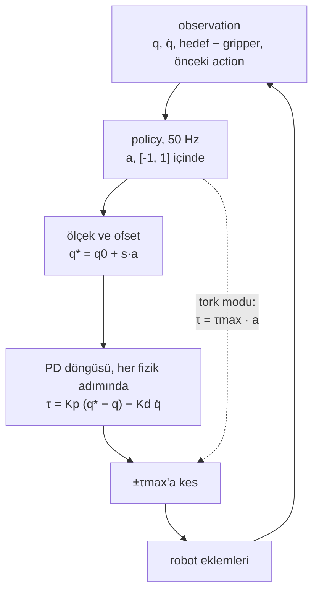
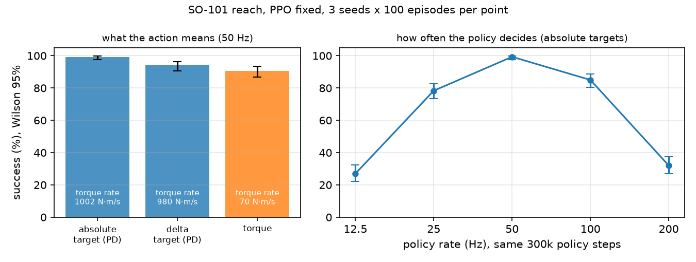

# 34 · Observation ve action tasarımı

<!-- meta -->
| | |
|---|---|
| **Bölüm** | [8 · Robotlar için reinforcement learning](README.md) |
| **Çalışma türü** | CPU · Mac ya da Colab CPU |
| **Önkoşul** | [33](33-ppo.md) |
| **Önce öğren** | [Proximal Policy Optimization (PPO)](https://aiengineeringfromscratch.com/lesson?path=phases/09-reinforcement-learning/08-ppo) |
| **Süre** | ~60 dk |
| **Kod** | [`experiments/34-observation-action-design/experiment.py`](../../experiments/34-observation-action-design/experiment.py) |
| **Durum** | ✅ tam |
<!-- /meta -->

> Robotu policy hareket ettirmez. Policy bir controller'la konuşur ve sayılarının ne anlama geldiği, ne öğrenebileceğinin çoğunu belirler.

## Problem

Unitree'nin Go2 policy'si tork vermez. 12 çıktısı 0,25 ile ölçeklenir, varsayılan bir joint açısına eklenir ve policy adımı başına dört kez çalışan bir PD döngüsüyle takip edilir ([`go2_config.py`](https://github.com/unitreerobotics/unitree_rl_gym/blob/main/legged_gym/envs/go2/go2_config.py), [`legged_robot.py` · `_compute_torques`](https://github.com/unitreerobotics/unitree_rl_gym/blob/main/legged_gym/envs/base/legged_robot.py)):

```python
torques = self.p_gains*(actions_scaled + self.default_dof_pos - self.dof_pos) - self.d_gains*self.dof_vel
```

`stiffness = 20`, `damping = 0.5`, `action_scale = 0.25`, `dt = 0.005`'te `decimation = 4` ile (50 Hz policy, 200 Hz PD). Neden tork değil de bu, ve neden bu sayılar? Ders 33'ün PPO'sunu sabit tutup SO-101 uzanmasında yalnızca arayüzü değiştiriyor; başarıyı, yumuşaklığı ve enerjiyi ölçüyoruz.

## Ana fikir

### Sade anlatımla

Policy, hızlı ve alt seviye bir servisi çağıran yavaş, üst seviye bir servistir. Onu üç şekilde çağırabilir. **Tork**: motor eforunu doğrudan yazar, donanım register'larını kurcalamak gibi; bu durumda tüm hızlı işi policy kendisi yapmak zorundadır, kolu yerçekimine karşı tutmak ve hareketini sönümlemek dahil. **Mutlak hedef**: istediği eklem açısını gönderir; bir PD döngüsü (yay ve sönümleyiciden oluşan bir controller, [ders 12](../part-4-dynamics-and-control/12-joint-control.md)) o açıyı saniyede yüzlerce kez kovalar. **Delta hedef**: önceki hedefi küçük bir adımla kaydırır.

Hedeflerle policy, bir setpoint'i saniyede yalnızca 50 kez kaydırır; gerisini alttaki sert döngü yapar. Bu çağrının etrafında üç tasarım seçimi daha vardır: **action ölçeği** (bir birimlik çıktının ne kadar uzağa uzandığı; keşif gürültüsünün radyan cinsinden büyüklüğünü de belirler), **policy hızı** (ne sıklıkla karar verdiği) ve **observation** (ne gördüğü ve hangi çerçevede: "hedef gripper'ımın biraz solunda" bilgisiyle hareket etmek, "hedef odanın şu koordinatlarında" bilgisiyle hareket etmekten kolaydır).

### Policy'den torka



### Üç arayüz, kod olarak

```python
def torque(a, q, qd, q_star_prev, mode, s):
    # a: policy output in [-1, 1]^4, q / qd: joint angles / velocities, s: action scale
    if mode == "torque":
        return TAU_MAX * a                          # policy is the controller; held for k physics steps
    if mode == "absolute":
        q_star = Q0 + s * a                         # setpoint around the default pose q0
    else:                                           # "delta"
        q_star = q_star_prev + s * a                # move the previous setpoint
    return clip(KP * (q_star - q) - KD * qd, -TAU_MAX, TAU_MAX)   # PD, every physics step

gamma = 1 - policy_dt / 0.4                         # keep a 0.4 s horizon when the rate changes
```

| Ad | Policy çıktısının anlamı | Her fizik adımında tork |
|---|---|---|
| tork | $\tau = \tau_{\max} a$ | $k$ adım boyunca tutulur |
| mutlak hedef | $q^* = q_0 + s\,a$ | $\tau = K_p (q^* - q) - K_d \dot q$, kesilmiş |
| delta hedef | $q^*_t = q^*_{t-1} + s\,a_t$ | aynı PD |

$a \in [-1,1]^n$ policy çıktısı, $q$ ve $\dot q$ eklem açıları ve hızları, $q^*$ joint hedefi, $q_0$ varsayılan poz, $s$ action ölçeği, $K_p$ ve $K_d$ PD gain'leri, $\tau_{\max}$ tork sınırı ve $k$ policy adımı başına $h = 5$ ms'lik fizik adımı sayısıdır.

<details>
<summary>Matematik ayrıntısı: servo, ölçek, hız ve observation ne yapar</summary>

**SO-101 servosu zaten bir PD döngüsüdür.** Her STS3215, `kp = 998.22`, `kv = 2.731`, `forcerange = ±2.94` N·m'lik bir MuJoCo position actuator'üdür; MuJoCo onu her fizik adımının içinde hesaplar ([XML referansı, actuator'ler](https://mujoco.readthedocs.io/en/stable/XMLreference.html#actuator)). Tork modumuz bu döngüyü kaldırır ve aynı actuator'leri $\tau_{\max} = 2{,}94$ N·m ile motor olarak sürer. Hedeflerle yerçekimi, bozucular ve damping fizik hızında halledilir; torkla policy bunları 50 Hz'de ve gürültüsü artık N·m cinsinden olan bir Gaussian üzerinden halletmek zorundadır.

**Action ölçeği.** $s$ iki şeyi birden belirler: ulaşılabilir aralığı ($q_0 \pm s$) ve fiziksel birimlerde keşif gürültüsünün büyüklüğünü (başlangıç policy std'si $e^{-1} \approx 0{,}37$, $0{,}37\,s$ rad olur). Go2 $s = 0{,}25$ rad kullanır; bir gait varsayılan poz yakınında kalır, çalışma alanı boyunca uzanan bir kol kalmaz.

**Policy hızı.** $\Delta t = k h$. Daha hızlı bir policy daha erken tepki verir ama her kararın ağırlığı azalır ve saniye cinsinden aynı ufku korumak için discount'u değişmelidir (ders 33): $\gamma = \lambda = 1 - \Delta t / 0{,}4\,\text{s}$ alıyoruz.

**Observation.** Go2 policy'si 48 sayı görür ([`legged_robot.py` · `compute_observations`](https://github.com/unitreerobotics/unitree_rl_gym/blob/main/legged_gym/envs/base/legged_robot.py)): gövdenin doğrusal ve açısal hızı, projected gravity, hız komutu, varsayılana göre joint konumları, joint hızları ve önceki action; her biri sabit bir ölçekle. Reach observation'ımız aynı yapıda: $q - q_0$, $0{,}1\,\dot q$, $p_{\text{target}} - p_{\text{gripper}}$, önceki action. İki değişikliği test ediyoruz: hızları çıkarmak ve hedefi gripper'a göre değil mutlak konum olarak vermek.

Daha derine: [Proximal Policy Optimization (PPO)](https://aiengineeringfromscratch.com/lesson?path=phases/09-reinforcement-learning/08-ppo); [MuJoCo · actuator'ler](https://mujoco.readthedocs.io/en/stable/XMLreference.html#actuator); [`legged_robot.py`](https://github.com/unitreerobotics/unitree_rl_gym/blob/main/legged_gym/envs/base/legged_robot.py).

</details>

## Deney

[`experiment.py`](../../experiments/34-observation-action-design/experiment.py) her hücre için ders 33'ün PPO'sunu (aynı config, 300k policy adımı) eğitir: 3 seed × 100 evaluation episode'u. Evaluation sırasında env, fizik hızında torkun ne kadar hızlı değiştiğini (sarsıntılı komutlar) ve eklemlerin ne kadar mekanik güç kullandığını kaydeder:

$$\text{tork hızı} = \sqrt{\tfrac{1}{N}\textstyle\sum_t \lVert (\tau_t - \tau_{t-1})/h \rVert^2}\ \ [\text{N·m/s}], \qquad \text{güç} = \tfrac{1}{N}\textstyle\sum_t \sum_i |\tau_{i,t}\,\dot q_{i,t}|\ \ [\text{W}]$$

```python
if self.mode == "position":
    self.data.ctrl[self.act] = np.clip(Q_HOME + self.scale * a, self.lo, self.hi)
elif self.mode == "delta":
    self.data.ctrl[self.act] = np.clip(self.data.ctrl[self.act] + self.scale * a, self.lo, self.hi)
else:  # torque: servo gains removed in __init__, actuators are plain motors
    self.data.ctrl[self.act] = TAU_MAX * self.scale * a
```

**Tahmin edin:** üç arayüzden hangisi 300k adımda en çok hedefe ulaşır, hangisi en yumuşaktır?

MuJoCo 3.17.0, NumPy 2.5.4, PyTorch 2.14.1 (CPU), Apple Silicon Mac (Apple M5). Başarı sayıları seed başına deterministik; training süreleri, yoğun yüklü paylaşılan bir makinede altı run paralel koşarken ölçülen duvar saati süreleridir (script'in tamamı, 30 run, 1190 s, yaklaşık 20 dakika sürdü). `python experiment.py --only A:torque,D:0.25` yalnızca o hücreleri üç seed'le eğitir; bu tekrar çalıştırma iki satırı da aynen üretti (süre sütunu hariç). `--quick` yalnızca seed 0'ı eğitir: her satırın ilk "seed başına başarı" girdisini yeniden üretir, toplam sütunlarını değil.

**A. Action parametrizasyonu** (50 Hz, 3 seed × 100 episode):

| action | seed başına başarı | toplam | Wilson %95 | son mesafe (mm) | tork hızı (N·m/s) | güç (W) |
|---|---|---|---|---|---|---|
| mutlak hedef $q_0 + 1{,}0\,a$ (PD) | 100 / 98 / 100 | 298/300 | %97,6–99,8 | 7,5 | 1002 | 9,66 |
| delta hedef $+0{,}1\,a$ (PD) | 95 / 88 / 99 | 282/300 | %90,7–96,2 | 8,7 | 980 | 8,81 |
| tork $2{,}94\,a$ N·m | 83 / 93 / 96 | 272/300 | %86,8–93,5 | 7,6 | 70 | 1,87 |

(Son mesafe: medyan son mesafenin seed'ler üzerinden ortalaması.) Bütçe içinde en iyi mutlak hedefler öğreniyor. Delta hedefler ve tork daha düşük çıkıyor ama aralıkları örtüşüyor, bu yüzden o ikisini sıralamıyoruz; hücre başına üç seed'le aralıklar seed'ler arası değişkenliği de olduğundan küçük gösterir. Tork policy'si bir mertebe daha yumuşak (70'e karşı 1002 N·m/s) ve çok daha az mekanik güç kullanıyor (1,87'ye karşı 9,66 W). Bu, policy'yi değil servoyu işaret ediyor: `kp = 998.22` ve 2,94 N·m'lik sınırla 3 mrad'lık bir konum hatası actuator'ü zaten doyuruyor; böylece 50 Hz'deki her yeni hedef neredeyse bang-bang bir tork basamağı üretiyor (önce bir yöne tam tork, sonra öbür yöne). Bir PD arayüzü ancak gain'leri kadar naziktir; Unitree'nin Go2'deki training PD'si buna kıyasla yumuşaktır ($K_p = 20$ N·m/rad).

**B. Policy hızı** (mutlak hedefler, $\gamma = \lambda = 1 - \Delta t/0{,}4$ s, aynı 300k policy adımı):

| frame_skip | policy hızı | $\gamma$ | seed başına başarı | toplam | Wilson %95 | tork hızı | güç | training s |
|---|---|---|---|---|---|---|---|---|
| 1 | 200 Hz | 0,9875 | 37 / 33 / 26 | 96/300 | %27,0–37,5 | 1720 | 6,33 | 100 |
| 2 | 100 Hz | 0,9750 | 71 / 84 / 100 | 255/300 | %80,5–88,6 | 1305 | 7,79 | 134 |
| **4** | **50 Hz** | 0,9500 | 100 / 98 / 100 | 298/300 | %97,6–99,8 | 1002 | 9,66 | 125 |
| 8 | 25 Hz | 0,9000 | 87 / 72 / 76 | 235/300 | %73,3–82,6 | 751 | 13,54 | 245 |
| 16 | 12,5 Hz | 0,8000 | 33 / 35 / 13 | 81/300 | %22,3–32,3 | 567 | 19,54 | 359 |



Bir optimum var ve Go2 config'inin durduğu yerde duruyor. İki etki buluşuyor. Sabit sayıda policy adımında 200 Hz'lik bir policy, 50 Hz'lik olanın simüle zamanının (ve episode'larının) yalnızca dörtte birini görür ve aynı ufuk için **credit assignment**'ı (sonraki bir reward'a hangi önceki action'ın yol açtığını çözmek) 4 kat daha fazla adıma yayılır. 12,5 Hz'de her karar 80 ms tutulur, policy bir hareketin içinde düzeltme yapamaz ve güç artar (19,54 W); bu, sert servonun daha büyük hedef sıçramalarını kovalamasıyla tutarlıdır. Bu bütçe policy adımı cinsinden; simüle saniye cinsinden bir bütçe 200 Hz'lik policy'ye dört kat daha fazla deneyim verirdi. O varyantı çalıştırmadık.

**C. Observation içeriği** (mutlak hedefler, 50 Hz):

| observation | seed başına başarı | toplam | Wilson %95 | son mesafe (mm) |
|---|---|---|---|---|
| tam: $q$, $\dot q$, hedef − gripper, önceki action | 100 / 98 / 100 | 298/300 | %97,6–99,8 | 7,5 |
| joint hızları olmadan | 77 / 68 / 80 | 225/300 | %69,8–79,6 | 14,4 |
| hedef − gripper yerine mutlak hedef | 26 / 40 / 35 | 101/300 | %28,6–39,2 | 27,7 |

En önemli tek girdi göreli hedef: mutlak hedef konumuyla policy, yalnızca hangi yöne gideceğini bilmek için forward kinematics öğrenmek zorunda kalıyor ve başarı üçte bire düşüyor. Hızları çıkarmak başarıların yaklaşık dörtte birine mal oluyor: $\dot q$ olmadan policy hareketi yalnızca dolaylı olarak (önceki action'ından) çıkarabilir, bu yüzden gelmekte olan bir eklemi uzaklaşmakta olandan güvenilir biçimde ayıramaz. Go2 observation'ı da gövde ve joint hızlarını içerir.

## Boz

Go2'nin action ölçeğini, 0,25 rad'ı kola kopyalayın:

| ölçek | seed başına başarı | toplam | Wilson %95 | son mesafe (mm) |
|---|---|---|---|---|
| 1,0 rad | 100 / 98 / 100 | 298/300 | %97,6–99,8 | 7,5 |
| 0,25 rad | 9 / 8 / 4 | 21/300 | %4,6–10,5 | 62,6 |

Aynı kesilmiş arayüzden gönderilen scripted IK controller, ölçek 1,0'da 100/100 hedefe, 0,25'te ise yalnızca **27/100** hedefe ulaşıyor. Yani başarısızlık PPO'nun değil: hedefler $q_0$'dan 0,6–1,0 rad uzağa kadar örnekleniyor ve $|a| \le 1$ ile policy en fazla $q_0 \pm 0{,}25$ rad komut edebiliyor; hedeflerin çoğu action uzayının dışında kalıyor. PPO, scripted controller'ın 27/100'üne karşı 21/300 alıyor; bu kesin bir tavan değil, bir referanstır (IK, clip altında optimal değildir). Go2'nin 0,25'i çalışır çünkü bir trot varsayılan poz yakınında kalır; ölçek görevin gerektirdiği hareketi kapsamalı, fazlasını değil, çünkü büyük ölçekler keşif gürültüsünü de çarpar.

## Gerçek robotta

- SO-101'deki STS3215 kendi konum döngüsünü çalıştırır; bu yüzden gerçek kolda "mutlak hedef" arayüzü doğal olanıdır: policy hedef konumları servo bus'ı üzerinden yazar. Modelin kendi yorumu, gain'lerinin gerçek kolda kullanılan servo gain'lerinin bire bir karşılığı olmadığını söyler ([`so101.xml`](https://github.com/google-deepmind/mujoco_menagerie/tree/f3b6013/robotstudio_so101)); yani simüle kapalı döngü bir yaklaşıklıktır. Tork modu akım kontrolü gerektirirdi; bu ders onu donanımda test etmedi.
- Go2 için training PD'si (20 / 0,5) ile Unitree'nin gerçek robot ayağa kalkma örneği (Kp 60, Kd 5, [`go2_stand_example.py`](https://github.com/unitreerobotics/unitree_sdk2_python/blob/master/example/go2/low_level/go2_stand_example.py)) farklıdır; bir gain setiyle eğitilen policy o kapalı döngü için eğitilmiştir ([ders 12](../part-4-dynamics-and-control/12-joint-control.md)).
- Buradaki yumuşaklık sayıları ideal bir actuator'le alınmış simülasyon sonuçlarıdır. Gerçek kolun tork hızı ölçülmedi.

## Kendini dene

1. **Kolay.** Go2 config'inde $a = 1$ action'ı, ön sol thigh için (varsayılan 0,8 rad) hangi joint hedefini verir? Eklem hâlâ 0,8 rad'da ve durağansa PD ne kadar tork üretir?
2. **Orta.** Env'de SO-101 servo gain'ini düşürün (ör. `kp = 100`, damping oranını korumak için `kv`'yi ölçekleyin) ve mutlak hedefler için A bölümünü tekrar çalıştırın. Çalıştırmadan önce tork hızının ve başarının yönünü tahmin edin.
3. **Zor.** B bölümünü policy adımı yerine simüle saniye cinsinden bir bütçeyle tekrarlayın (ör. her hız için 1500 s deneyim). 200 Hz'lik policy yetişiyor mu? Başarıyı 3 seed için Wilson aralıklarıyla raporlayın.

### Cevaplar

1. $q^* = 0{,}25 \cdot 1 + 0{,}8 = 1{,}05$ rad; $\tau = 20 \cdot (1{,}05 - 0{,}8) - 0{,}5 \cdot 0 = 5{,}0$ N·m.
2. Açık; çalıştırmadık. Daha düşük bir tork hızı bekleyin (hedef basamağı başına daha küçük tork); başarının korunup korunmayacağı, yumuşak servonun omuzdaki yerçekimini hâlâ yenip yenemeyeceğine bağlı.
3. Açık; çalıştırmadık.

## Akılda kalanlar ve kaynaklar

- PD döngüsüyle takip edilen joint hedefleri en iyi öğrenildi (298/300); ham torklar daha az öğrenildi (272/300) ama bir mertebe daha yumuşaktı, çünkü simüle servo çok sert. Arayüzü ve gain'leri birlikte seçin.
- Policy hızının bir optimumu var (burada 50 Hz: aynı adım bütçesiyle 298/300, 200 Hz'de 96/300, 12,5 Hz'de 81/300) ve hız değişince $\gamma$ yeniden ayarlanmalı.
- Görevin gerektirdiğini observation'a, policy'nin hareket ettiği çerçevede koyun: mutlak hedef yerine hedef − gripper başarıyı 101/300'den 298/300'e çıkardı. Action ölçeğini göreve göre seçin: 0,25 rad kolu 21/300'de tuttu.

Sıradaki: [ders 35](35-reward-design.md), reward'un ne istediği ve agent'ın onunla ne yaptığı.

**Kaynaklar**

- [`unitree_rl_gym` · `go2_config.py`](https://github.com/unitreerobotics/unitree_rl_gym/blob/main/legged_gym/envs/go2/go2_config.py), [`legged_robot.py`](https://github.com/unitreerobotics/unitree_rl_gym/blob/main/legged_gym/envs/base/legged_robot.py) (`_compute_torques`, `compute_observations`), [`legged_robot_config.py`](https://github.com/unitreerobotics/unitree_rl_gym/blob/main/legged_gym/envs/base/legged_robot_config.py) (BSD-3-Clause).
- [`unitree_sdk2_python` · `go2_stand_example.py`](https://github.com/unitreerobotics/unitree_sdk2_python/blob/master/example/go2/low_level/go2_stand_example.py).
- [MuJoCo · XML referansı, actuator'ler](https://mujoco.readthedocs.io/en/stable/XMLreference.html#actuator) (position actuator = fizik adımının içinde PD).
- [MuJoCo Menagerie · `robotstudio_so101`](https://github.com/google-deepmind/mujoco_menagerie/tree/f3b6013/robotstudio_so101) (Apache-2.0).
- J. Schulman vd., "Proximal Policy Optimization Algorithms", 2017. [arXiv 1707.06347](https://arxiv.org/abs/1707.06347)
- Kod: [`experiment.py`](../../experiments/34-observation-action-design/experiment.py), [`output.txt`](../../experiments/34-observation-action-design/output.txt); env ve PPO [ders 32](../../experiments/32-rl-environment/reach_env.py) ve [ders 33](../../experiments/33-ppo/ppo.py)'ten; şekil [`plot.py`](../../experiments/34-observation-action-design/plot.py) ile üretildi.
