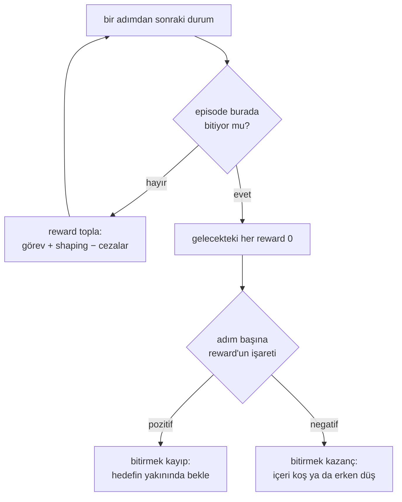

# 35 · Reward tasarımı ve reward hacking

<!-- meta -->
| | |
|---|---|
| **Bölüm** | [8 · Robotlar için reinforcement learning](README.md) |
| **Çalışma türü** | CPU · Mac ya da Colab CPU |
| **Önkoşul** | [33](33-ppo.md) |
| **Önce öğren** | [MDPs, States, Actions & Rewards](https://aiengineeringfromscratch.com/lesson?path=phases/09-reinforcement-learning/01-mdps-states-actions-rewards) |
| **Süre** | ~60 dk |
| **Kod** | [`experiments/35-reward-design/experiment.py`](../../experiments/35-reward-design/experiment.py) |
| **Durum** | ✅ tam |
<!-- /meta -->

> Agent kastettiğiniz görevi değil, yazdığınız reward'u optimize eder. Her terim ve bir episode'un bitebileceği her yol, yazdığınızın parçasıdır.

## Problem

Go2 training config'i ağırlığı sıfır olmayan on reward terimini toplar; `tracking_lin_vel = 1.0`'dan `action_rate = -0.01` ve `torques = -0.0002`'ye kadar. Ve yalnızca bir agent'ın reward'ları nasıl istismar ettiği yüzünden var olan bir satır taşır: `only_positive_rewards = True # if true negative total rewards are clipped at zero (avoids early termination problems)` ([`legged_robot_config.py`](https://github.com/unitreerobotics/unitree_rl_gym/blob/main/legged_gym/envs/base/legged_robot_config.py), [`go2_config.py`](https://github.com/unitreerobotics/unitree_rl_gym/blob/main/legged_gym/envs/go2/go2_config.py)). Bu ders SO-101 uzanmasında, sabit bir PPO ve bütçeyle reward şekillerini karşılaştırıyor, bilerek bir **reward hack**'i üretiyor (yazılan reward'da yüksek puan alıp görevi yapmayan bir policy) ve bir yumuşaklık cezasını sweep ediyor.

## Ana fikir

### Sade anlatımla

Reward bir metriktir ve RL onu hiç sağduyu kullanmadan optimize eder. Satır başına para öderseniz uzun kod alırsınız. Bir kola hedefe yakın olduğu için para öder ve oyunu vardığı anda bitirirseniz, kol hemen dışarıda beklemeyi öğrenir; çünkü varmak ödemeleri durdurur.

Dört tür yapı taşınız var. **Sparse** bir reward yalnızca başarıda öder: kesindir ama başta sessizdir; tek uçtan uca testi henüz hiç geçmeyen bir test paketi gibi. **Dense** bir reward her adımda yaklaştığı için biraz öder: bilgilendiricidir ama bir vekildir. **Shaping** ipuçları ekler; güvenli türü (potential-based) ilerleme için öder ve geri çekilmede bunu geri alır; böylece ileri geri gitmek, orijinal reward'un ödemeyeceği hiçbir şey kazandırmaz. **Düzenleyiciler** sarsıntılı ya da pahalı hareket için küçük cezalardır; başarıyı yumuşaklıkla takas ederler.

Bir episode'un nasıl bittiği de reward'un parçasıdır: bitişten sonra gelecekteki her reward sıfırdır. Adım başına reward pozitifse bitirmek bir kayıptır ve agent bundan kaçınır; negatifse bitirmek bir kazançtır ve agent onu arar.

### Termination teşviki nerede tersine çevirir



### Shaping ve termination, kod olarak

```python
# Potential-based shaping: F = gamma * Phi(s') - Phi(s), with Phi = -20 * distance
def shaping(dist, dist_prev, gamma=0.95):
    return gamma * (-20 * dist) - (-20 * dist_prev)   # > 0 when closer; also 20*(1-gamma)*dist when standing still

# It cannot be farmed: summed along any trajectory it telescopes to the two endpoints,
#   sum_t gamma^t * F_t = gamma^T * Phi(s_T) - Phi(s_0)

# What ending the episode costs: the discounted value of staying forever
def value_of_staying(r_per_step, gamma=0.95):
    return r_per_step / (1 - gamma)   # ending forfeits this: a relief if r < 0, a loss if r > 0
```

| Terim | Örnek (uzanma, $d$ metre cinsinden mesafe) | Rolü |
|---|---|---|
| sparse görev | $\mathbb 1[d < 0{,}02]$ | başarının tam olarak ne olduğunu söyler; başarı bulunana kadar hiç gradient vermez |
| dense görev | $-d$ | her adımda hedefi gösterir; "iyi"yi bir vekille tanımlar |
| potential-based shaping | $F = \gamma\Phi(s') - \Phi(s)$ | optimal policy'yi değiştirmeden yönlendirme ekler |
| düzenleyiciler | $-w\lVert a_t - a_{t-1}\rVert^2$, $-w\lVert\tau\rVert^2$ | görev performansını yumuşaklık ve enerjiyle takas eder |

$d$ gripper ile hedef arasındaki mesafe, $\mathbb 1[\cdot]$ koşul sağlanınca 1, aksi hâlde 0, $\Phi$ durumun herhangi bir fonksiyonu (potansiyel), $s$ ve $s'$ bir adımdan önceki ve sonraki durumlar, $\gamma$ discount, $w$ bir ceza ağırlığı, $a_t$ action ve $\tau$ eklem torkudur.

<details>
<summary>Matematik ayrıntısı: potential-based shaping neden güvenli, termination neden önemli</summary>

**Potential-based shaping.** Ng, Harada ve Russell, herhangi bir $\Phi$ potansiyeli için $F(s,s') = \gamma\Phi(s') - \Phi(s)$ eklemenin optimal policy'yi değiştirmediğini ve MDP hakkında başka bilgi yoksa bu biçimin o garanti için gerekli de olduğunu gösterdi ([ICML 1999, s. 278–287](https://mlanthology.org/icml/1999/ng1999icml-policy/)). Bir trajectory boyunca terimler teleskop gibi sadeleşir, $\sum_t \gamma^t F_t = \gamma^T \Phi(s_T) - \Phi(s_0)$; bu yalnızca uç noktalara bağlı bir bonustur, yani shaping neyin optimal olduğunu değil, ne kadar hızlı öğrenildiğini değiştirir. PPO discount'u $\gamma = 0{,}95$ ile $\Phi = -20\,d$ kullanıyoruz.

**Termination.** Bir durumda sonsuza kadar kalıp adım başına $r$ toplayabilen bir policy $\sum_{t\ge0}\gamma^t r = r/(1-\gamma)$ kazanırdı. Terminal bir duruma girmek bunu 0 ile değiştirir. $r > 0$ için bu, agent'ın kaçınmayı öğrendiği bir kayıptır; $r < 0$ için aramayı öğrendiği bir kazanç. Locomotion'da düşmek episode'u bitirir; bu yüzden çoğu negatif cezalardan oluşan bir toplam erken düşmeyi cazip kılar; Go2 config'i toplamı "early termination problems" için sıfırda keser. Ters durum bizim hack'imizdir.

Daha derine: [MDPs, States, Actions & Rewards](https://aiengineeringfromscratch.com/lesson?path=phases/09-reinforcement-learning/01-mdps-states-actions-rewards); Ng, Harada, Russell, ICML 1999 (yukarıdaki bağlantı).

</details>

<!-- figure: 35-termination-hack -->

## Sıfırdan yaz

Şimdi reward terimlerini yazacak, shaping'in bir SO-101 episode'unda teleskop gibi sadeleştiğini kontrol edecek, küçük bir koridoru tam olarak çözecek ve termination hack'ine sayı koyacaksın. Hiçbir şey eğitilmiyor: Adım 2, 4 ve 5 scripted IK controller'lı reach görevini, Adım 3 tablo tabanlı bir oyuncak problemi kullanıyor; yaklaşık 2 s.

Fonksiyonlar [`physai/rl.py`](../../physai/rl.py) içinde; `uv run python experiments/35-reward-design/build.py` beş adımın hepsini koşturur (çıktı [`build_output.txt`](../../experiments/35-reward-design/build_output.txt) dosyasında).

### Adım 1 · Reward terimleri

```python
def sparse_reward(d, radius=0.02):
    """1 inside the success ball, 0 elsewhere."""
    return float(d < radius)
```

```python
def closeness_reward(d, scale=0.05):
    """Positive at every step, 1 at the target: the reward behind the termination hack."""
    return 1.0 - np.tanh(d / scale)
```

```python
def potential_shaping(phi, phi_prev, gamma):
    """Potential-based shaping term F = gamma * Phi(s') - Phi(s) (Ng, Harada, Russell 1999)."""
    return gamma * phi - phi_prev
```

```python
def action_rate_penalty(a, a_prev, w):
    """Smoothness regularizer: -w * ||a_t - a_(t-1)||^2."""
    return -w * float(np.sum((np.asarray(a) - np.asarray(a_prev)) ** 2))
```

Deney'deki gibi birleştir (ör. sparse artı `potential_shaping(-20 * d, -20 * d_prev, 0.95)`) ve 1000 rastgele adımda Deney'in reward fonksiyonlarıyla karşılaştır:

```text
== Step 1. Reward terms vs the Experiment's reward functions, 1000 random steps ==
sparse 0.0e+00, pbrs 4.4e-16, closeness 0.0e+00, action rate 0.0e+00
closeness at d = 0, 2, 5, 30.8 mm: 1.000, 0.620, 0.238, 0.452
```

Closeness reward'u 2 cm yarıçapta 0,620, hack yapan policy'nin park ettiği 30,8 mm'de 0,452.

### Adım 2 · Shaping teleskop gibi sadeleşir

```python
def discounted_sum(rewards, gamma):
    """sum_t gamma^t r_t."""
    return float(np.sum(np.asarray(rewards) * gamma ** np.arange(len(rewards))))
```

Bir episode boyunca yalnız shaping terimini topla, bir kez scripted IK ile, bir kez rastgele action'larla:

```text
== Step 2. Shaping telescopes: sum_t gamma^t F_t = gamma^T Phi(s_T) - Phi(s_0), Phi = -20 d ==
   scripted IK: d  55.2 ->   0.2 mm, sum gamma^t F_t = +1.104336, gamma^T Phi_T - Phi_0 = +1.104336, diff 2.2e-16
random actions: d  55.2 -> 147.0 mm, sum gamma^t F_t = +1.055855, gamma^T Phi_T - Phi_0 = +1.055855, diff 4.4e-16
loop 10 cm -> 5 cm -> 10 cm, gamma 1.00: shaping earned +0.0000 (= (gamma^2 - 1) Phi = +0.0000)
loop 10 cm -> 5 cm -> 10 cm, gamma 0.95: shaping earned +0.1950 (= (gamma^2 - 1) Phi = +0.1950)
```

İki toplam da yuvarlama düzeyinde $\gamma^T\Phi(s_T) - \Phi(s_0)$'a eşit: bir trajectory'nin kazandığı shaping yalnızca uç noktalarına bağlı. 10 cm → 5 cm → 10 cm döngüsü $\gamma = 1$ ile 0, $\gamma = 0{,}95$ ile ise +0,1950 kazandırıyor; formüldeki $(\gamma^2 - 1)\Phi$. Bu bir açık değil: aynı uç noktalar arasındaki her yol aynı discount'lu bonusu kazanır, dolayısıyla döngü orijinal reward'un söylediği kadar değerlidir. Adım 3 bunu optimal policy'de kontrol ediyor.

### Adım 3 · Hangi reward'lar optimal policy'yi korur

1 cm aralıklı 11 hücrelik bir koridor, hedef 10. hücrede (oraya girmek episode'u bitirir), action'lar sol, dur, sağ, $\gamma = 0{,}95$. Value iteration bunu tam olarak çözer:

```python
def value_iteration(next_state, reward, terminal, gamma, iters=2000):
    """Optimal values and greedy actions of a deterministic tabular MDP.

    next_state[s, a] and reward[s, a] describe one step; entering a terminal state ends the episode (value 0 after).
    """
    V = np.zeros(next_state.shape[0])
    for _ in range(iters):
        Q = reward + gamma * np.where(terminal[next_state], 0.0, V[next_state])
        V = Q.max(1)
    return V, Q.argmax(1)
```

```text
== Step 3. A corridor of 11 cells, 1 cm apart; cell 10 is the target and ends the episode ==
reward                         greedy action in cells 0..9   value of cell 0
sparse: 1 on arrival             >>>>>>>>>>             0.630
sparse + gamma Phi' - Phi        >>>>>>>>>>             2.630
sparse + 0.5 per step closer     >>>>>>>>><             6.768
closeness 1 - tanh(d/5cm)        >>>>>>>>>o            12.251
(> right, < left, o stay)
shaped - sparse values, cells 0..9: max |difference - (-Phi(s))| = 3.3e-16
```

Sparse ve shaped reward'lar aynı policy'yi veriyor, her hücrede sağa; shaped değerler de Ng, Harada ve Russell'ın öngördüğü gibi sparse değerlerin $\Phi(s)$ eksiği (fark 3,3e-16). Eşit derecede makul görünen iki reward ise policy'yi değiştiriyor. Yaklaşılan her adım için 0,5 ödemek, geri almadan, 9. hücreyi *sola* adım attırıyor: ileri geri gitmek varmaktan fazla kazandırıyor. Termination'lı closeness reward'u 9. hücrede *durduruyor*, bir santimetre kala, sonsuza kadar: Deney B'nin hack'i, tam olarak çözülmüş hâli.

### Adım 4 · Sayılarla termination hack'i

```text
== Step 4. The termination hack in numbers ==
scripted IK, closeness reward, ends on success: written return 2.28, mean length 10.1 steps
parking at 30.8 mm for 80 steps: 0.452 per step, written return 36.13; discounted value of parking forever r / (1 - gamma) = 9.03
entering the ball pays at most 1.00 once, then nothing
```

Scripted controller her hedefe 10,1 adımda ulaşıyor ve 2,28 alıyor, Deney'deki sayı. 30,8 mm'de park etmek adım başına 0,452, 80 adımda 36,13, discount'lu değer olarak 9,03 ödüyor; varmak ise en fazla bir kez 1,00. Eğitilmiş policy'nin 22,67'si arada: episode'ların çoğunda park ediyor, hepsinde değil.

### Adım 5 · Bir yumuşaklık cezası ne kadar büyük?

$r = -d - w\lVert a_t - a_{t-1}\rVert^2$'nin iki terimini scripted controller'ın episode'larında ölç:

```text
== Step 5. Action-rate penalty vs the task term, scripted IK, 100 episodes ==
per step: mean d = 11.9 mm, mean ||a_t - a_t-1||^2 = 0.0082
w = 0.03: penalty / task term = 0.02
w = 0.1 : penalty / task term = 0.07
w = 0.3 : penalty / task term = 0.21
w = 1.0 : penalty / task term = 0.68
w = 3.0 : penalty / task term = 2.05
Go2 config: action_rate = -0.01 times dt 0.02 s -> 0.0002 per step
```

Bu action'lar için ceza, $w = 0{,}03$'te görev teriminin %2'si, 0,3'te %21'i, 1,0'da %68'i; Boz'daki başarı 0,1 ile 0,3 arasında çöküyor. IK'nın action'ları eğitilmiş policy'ninkiler değil, bu yüzden bu yalnızca ölçeği verir. Go2'nin `action_rate = -0.01`'i adım başına 0,0002 olur (0,02 s'lik periyotla çarpılarak).

### Elinde kalan

`physai.rl` artık `sparse_reward`, `closeness_reward`, `potential_shaping`, `action_rate_penalty`, `discounted_sum` ve `value_iteration`'ı da içeriyor. [Ders 36](36-legged-locomotion.md) bu türden terimlerden bir locomotion reward'u kuruyor. [`tests/test_35_reward_design.py`](../../tests/test_35_reward_design.py) teleskop sadeleşmesini ve 20 rastgele MDP'de potential-based shaping'in optimal policy'yi koruduğunu ve değerleri $-\Phi$ kadar kaydırdığını kontrol ediyor; `uv run pytest tests/test_35_reward_design.py` çalıştır.

## Kütüphaneyle kullan

Gymnasium reward'u environment'a bırakır; env'i düzenlemeden değiştirmek için onu sar. `gymnasium.wrappers.TransformReward(env, func)` her skaler reward'u dönüştürür (ölçekleme, kaydırma). Shaping state'e ihtiyaç duyar, bu yüzden bir wrapper'ın `step`'ine (ya da `ReachEnv`'in `reward_fn`'ine) öğrenenin $\gamma$'sıyla girer. Unitree'nin training kodu reward'u adlandırılmış terimlerin ağırlıklı toplamı olarak kurar, her ölçek policy periyoduyla çarpılır ([`legged_robot.py`](https://github.com/unitreerobotics/unitree_rl_gym/blob/main/legged_gym/envs/base/legged_robot.py)):

| Parça | Bu ders / physai | `legged_gym` |
|---|---|---|
| bir terim | `info`'nun bir fonksiyonu | `scales.<name>` ile ağırlıklandırılan bir `_reward_<name>` metodu |
| adım başına ağırlık | yazıldığı gibi $w$ | `self.reward_scales[key] *= self.dt` |
| action yumuşaklığı | `action_rate_penalty`: $-w\lVert a_t - a_{t-1}\rVert^2$ | `_reward_action_rate`: `torch.sum(torch.square(self.last_actions - self.actions), dim=1)` |
| pozitif kırpma | kullanılmıyor | `only_positive_rewards`: `torch.clip(self.rew_buf[:], min=0.)` |
| termination terimi | kullanılmıyor | `_reward_termination`: `self.reset_buf * ~self.time_out_buf`, kırpmadan sonra eklenir |

Son satır ders 32 ile 35'i bağlıyor: termination terimi time-out'larda değil gerçek termination'larda tetiklenir ve kırpmadan sonra eklenir; böylece bir termination cezası kırpmadan sağ çıkar.

Üç tuzak:

- **Termination teşviki tersine çevirir.** Pozitif adım reward'uyla bitirmek bir kayıptır (Adım 3: bir hücre kala), negatifle bir kazanç; terminal bir koşul eklemeden önce hangisini istediğine karar ver.
- **Yanlış $\gamma$ ile shaping potential-based değildir.** $\gamma' \ne \gamma$ ile $F = \gamma'\Phi(s') - \Phi(s)$, öğrenenin discount'lu return'ünde artık teleskop gibi sadeleşmez ve garanti gider.
- **Ağırlıklar görecelidir.** Bir ceza ağırlığı görev teriminin büyüklüğü olmadan hiçbir şey ifade etmez (Adım 5); kontrol hızı değişince `legged_gym`'in adım başına ağırlıkları da değişir, çünkü `dt` ile çarpılırlar.

## Deney

[`experiment.py`](../../experiments/35-reward-design/experiment.py) ders 33'teki her şeyi sabit tutar (mutlak joint hedefleri, 50 Hz, PPO referans config'i, 300k adım, 3 seed × 100 evaluation episode'u) ve env'e verilen reward fonksiyonunu değiştirir.

Reward'lar Sıfırdan yaz'ın Adım 1 terimlerinden kurulur: sparse, sparse + shaping, closeness ve $-d$ + action-rate cezası.

**Tahmin edin:** closeness reward'u ve gripper 2 cm'ye girdiği anda biten bir episode ile eğitilen kol ne yapacak?

MuJoCo 3.17.0, NumPy 2.5.4, PyTorch 2.14.1 (CPU), Apple Silicon Mac (Apple M5). Seed başına deterministik. Script'in tamamı (33 run, altısı paralel) yoğun yüklü bir makinede 1904 s sürdü. `python experiment.py --only close+end,pbrs` yalnızca o hücreleri üç seed'le eğitir; bu tekrar çalıştırma onların satırlarını aynen üretti. `--quick` yalnızca seed 0'ı eğitir: her satırın ilk "seed başına başarı" girdisini yeniden üretir, toplam sütunlarını değil.

**A. Reward şekli** (termination yok; başarı = 1,6 s'lik zaman sınırında 2 cm içinde):

| reward | seed başına başarı | toplam | Wilson %95 | medyan son mesafe |
|---|---|---|---|---|
| dense $-d$ | 100 / 98 / 100 | 298/300 | %97,6–99,8 | 7,5 mm |
| sparse $\mathbb 1[d < 2\,\text{cm}]$ | 8 / 0 / 0 | 8/300 | %1,4–5,2 | 117,8 mm |
| sparse + $0{,}95\,\Phi(s') - \Phi(s)$, $\Phi = -20d$ | 99 / 97 / 99 | 295/300 | %96,2–99,3 | 7,8 mm |

(Medyan son mesafe: üç seed üzerinden ortalama.) Sparse reward görevin dürüst tanımıdır ve başarısız olur: başlangıç policy'si nadiren 2 cm'ye yaklaşır (ders 32: rastgele action'lı 200 episode'un 1'i), bu yüzden training'in çoğunda her reward sıfırdır ve advantage'lar bilgi taşımaz. Potential-based bir terim öğrenmeyi dense reward düzeyine geri getirir (aralıklar örtüşüyor) ve hangi policy'nin optimal olduğunu değiştirmez (Sıfırdan yaz, Adım 3).

**B. Reward hacking.** Episode artık $d < 2$ cm olduğu anda biter (`terminated`); "ulaştı"yı tanımlamanın doğal bir yolu gibi görünür. Reward pozitif closeness terimidir, $1 - \tanh(d / 5\,\text{cm})$:

| reward, termination | seed başına başarı | toplam | Wilson %95 | yazılan return | episode uzunluğu | medyan son mesafe |
|---|---|---|---|---|---|---|
| closeness, başarıda biter | 23 / 43 / 29 | 95/300 | %26,7–37,1 | **22,67** | 62,3 adım | 28,8 mm |
| $-d$, başarıda biter | 99 / 100 / 98 | 297/300 | %97,1–99,7 | −0,72 | 9,2 adım | 14,7 mm |
| closeness, termination yok | 98 / 100 / 100 | 298/300 | %97,6–99,8 | 64,00 | 80,0 adım | 5,1 mm |

İki kontrol ölçümü hack'i açık hâle getirir:

- Her hedefe ulaşan scripted IK controller, closeness-artı-termination reward'u altında yalnızca **2,28** yazılan return alır (Sıfırdan yaz, Adım 4). Hack yapan policy 22,67 alır: kendi amacında, görevi daha az yaparak doğru controller'ı yener.
- Termination olmadan çalıştırıldığında aynı hack yapan policy hedeften medyan **30,8 mm** uzakta bitirir: gripper'ı yaklaşık 3 cm uzağa, başarı küresinin hemen dışına park eder ve episode'un geri kalanında adım başına kabaca 0,45 toplar.

Mekanizma diyagramdaki: küreye girmek gelecekteki tüm pozitif reward'u bitirir, bu yüzden agent yaklaşıp kısa durur (Sıfırdan yaz, Adım 3'teki koridor da aynısını yapıyor). 95 başarı, yine de kürenin içinde bittiği episode'lardır. Aynı termination kuralı negatif bir reward'la ($-d$) ters teşvik verir: her adım maliyetli olduğu için agent içeri acele eder (ortalama 9,2 adım). Termination olmadan pozitif reward da çalışır (298/300). Hack kombinasyonda yaşar; bu yüzden kazara yazmak kolaydır.

## Boz

Yumuşaklık cezaları, takasın bir uçuruma dönüştüğü yerdir. Action-rate teriminin $w$ ağırlığını sweep edin (Go2 config'i aynı terimi kullanır, `action_rate = -0.01`, [`legged_robot.py`](https://github.com/unitreerobotics/unitree_rl_gym/blob/main/legged_gym/envs/base/legged_robot.py)'de $\sum (a_{t-1} - a_t)^2$ olarak hesaplanır; oradaki `_prepare_reward_function` her ağırlığı policy periyoduyla, 0,02 s ile çarpar, yani adım başına ağırlık $0{,}01 \times 0{,}02 = 0{,}0002$'dir, hız takibi terimi ise adım başına en fazla $1{,}0 \times 0{,}02$'dir):

| $w$ | seed başına başarı | toplam | Wilson %95 | medyan son mesafe (mm) | tork hızı (N·m/s) | güç (W) |
|---|---|---|---|---|---|---|
| 0 | 100 / 98 / 100 | 298/300 | %97,6–99,8 | 7,5 | 1002 | 9,66 |
| 0,03 | 81 / 99 / 99 | 279/300 | %89,5–95,4 | 8,8 | 933 | 9,44 |
| 0,1 | 80 / 87 / 96 | 263/300 | %83,5–90,9 | 11,4 | 901 | 9,45 |
| 0,3 | 41 / 9 / 94 | 144/300 | %42,4–53,6 | 25,6 | 850 | 8,20 |
| 1,0 | 7 / 35 / 14 | 56/300 | %14,7–23,5 | 39,2 | 674 | 6,54 |
| 3,0 | 27 / 6 / 26 | 59/300 | %15,6–24,5 | 31,9 | 743 | 5,64 |


$w = 0{,}1$'e kadar policy başarıdan 6 ila 12 yüzde puanı kaybeder (298/300'e karşı 279/300 ve 263/300) ve çok az yumuşaklık kazanır (tork hızı 1002 → 901 N·m/s). $w = 0{,}3$'ten itibaren başarı çöker ve seed'ler arasında büyük fark oluşur (100 üzerinden 9'a karşı 94): ceza artık mesafe teriminin hatırı sayılır bir payıdır (Sıfırdan yaz, Adım 5: $w = 0{,}3$'te scripted controller'ın action'ları için yaklaşık beşte bir). Güç düşer (9,66 → 5,64 W), büyük ölçüde kol daha az hareket ettiği için: medyan son mesafe 25,6–39,2 mm'ye çıkar. İki ders: bir düzenleyicinin ağırlığını görev terimine göre ayarlayın ve sert bir servoyla policy'nin hedeflerini yumuşatmak torku pek yumuşatmaz. Amaç yumuşak torksa, $w$'yi büyütmeden önce arayüzü ya da gain'leri değiştirin (ders 34).

## Gerçek robotta

- Ceza ağırlıkları simülasyonda görev başarısını daha nazik hareketle takas eder; ölçülen tork hızı azalmasının gerçeğe taşınıp taşınmadığı gerçek actuator'e bağlıdır. SO-101'de ölçülmedi.
- Training için yazılan bir termination kuralı donanımda aynı zamanda bir güvenlik kuralıdır: gerçek robotta "episode biter", bir denetleyicinin hareketi durdurması demektir ([ders 15](../part-4-dynamics-and-control/15-safety.md)). Reward, bu durmayı policy'nin kendi başına aradığı ya da kaçındığı bir şey hâline getirmemelidir.
- Go2 config'inin ağırlıkları onun simülatörü ve PD gain'leri için ayarlandı; ikisinden birini değiştirirseniz başka bir anlam taşırlar.

## Kendini dene

1. **Kolay.** Closeness reward'unda hedeften 3 cm uzağa park etmiş bir gripper adım başına ne kadar reward toplar, başarı küresine girdikten sonra ne toplar?
2. **Orta.** Termination'ı kaldırmadan hack'i düzeltin: episode başarıyla bittiğinde bir terminal bonus $B$ ekleyin. Ulaşmayı, kalan ~60 adım boyunca havada beklemek kadar iyi yapan $B$'yi tahmin edin, sonra üç seed eğitip ölçün.
3. **Zor.** Action-rate cezasını env içinde fizik hızında hesaplanan bir tork hızı cezasıyla değiştirin ve sweep'i tekrarlayın. Kaybedilen başarı başına action-rate teriminden daha fazla yumuşaklık sağlıyor mu?

### Cevaplar

1. Adım başına $1 - \tanh(0{,}03/0{,}05) = 1 - \tanh(0{,}6) \approx 0{,}46$; başarıdan sonra episode biter, sonraki her reward 0'dır.
2. ~0,46 ile $n$ adım daha beklemek $0{,}46 \sum_{t<n} 0{,}95^t$ eder ve $0{,}46/(1-0{,}95) \approx 9{,}2$'ye yaklaşır (Sıfırdan yaz, Adım 4: 30,8 mm'de 9,03); bunun belirgin biçimde üstünde bir bonus teşviki ortadan kaldırır. Biz eğitmedik.
3. Açık; çalıştırmadık.

## Akılda kalanlar ve kaynaklar

- Sparse reward'lar görevi tam olarak tanımlar ama bütçe içinde 8/300 verdi; potential-based shaping optimal policy'yi değiştirmeden 295/300'ü geri getirdi.
- Termination artı pozitif adım reward'u ölçülmüş bir reward hack'idir: 95/300 başarı, ~3 cm uzağa park edilmiş gripper ve her hedefe ulaşan bir controller'ın (2,28) yaklaşık on katı yazılan return (22,67). Bir episode'un bitebileceği her yerde reward'un işaretini kontrol edin.
- Düzenleyici ağırlıklarında uçurum var: action-rate ağırlığı 0,1 12 yüzde puanına mal oldu (263/300), 0,3 başarıyı yarıya indirdi; ağırlıkları görev terimine göre ayarlayın ve gerçekte elde ettiğiniz yumuşaklığı ölçün.

Sıradaki: [ders 36](36-legged-locomotion.md), legged locomotion ve massively parallel training.

**Kaynaklar**

- A. Y. Ng, D. Harada, S. Russell, "Policy Invariance Under Reward Transformations: Theory and Application to Reward Shaping", ICML 1999, s. 278–287. [mlanthology](https://mlanthology.org/icml/1999/ng1999icml-policy/)
- [`unitree_rl_gym` · `legged_robot_config.py`](https://github.com/unitreerobotics/unitree_rl_gym/blob/main/legged_gym/envs/base/legged_robot_config.py), [`go2_config.py`](https://github.com/unitreerobotics/unitree_rl_gym/blob/main/legged_gym/envs/go2/go2_config.py), [`legged_robot.py`](https://github.com/unitreerobotics/unitree_rl_gym/blob/main/legged_gym/envs/base/legged_robot.py) (`_reward_action_rate`, `_reward_torques`) (BSD-3-Clause).
- J. Schulman vd., "Proximal Policy Optimization Algorithms", 2017. [arXiv 1707.06347](https://arxiv.org/abs/1707.06347)
- [Gymnasium · `Env` API](https://gymnasium.farama.org/api/env/) (terminated ve truncated).
- Kod: [`experiment.py`](../../experiments/35-reward-design/experiment.py), [`output.txt`](../../experiments/35-reward-design/output.txt); env ve PPO [ders 32](../../experiments/32-rl-environment/reach_env.py) ve [ders 33](../../experiments/33-ppo/ppo.py)'ten; şekil [`plot.py`](../../experiments/35-reward-design/plot.py) ile üretildi.
