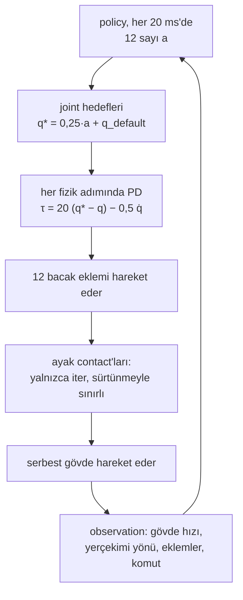

# 36 · Legged locomotion ve massively parallel training

<!-- meta -->
| | |
|---|---|
| **Bölüm** | [8 · Robotlar için reinforcement learning](README.md) |
| **Çalışma türü** | GPU · Colab GPU |
| **Önkoşul** | [34](34-observation-action-design.md), [35](35-reward-design.md) |
| **Önce öğren** | [Introduction to JAX](https://aiengineeringfromscratch.com/lesson?path=phases/03-deep-learning-core/12-intro-to-jax) · [Proximal Policy Optimization (PPO)](https://aiengineeringfromscratch.com/lesson?path=phases/09-reinforcement-learning/08-ppo) |
| **Süre** | ~90 dk |
| **Kod** | [`experiments/36-legged-locomotion/experiment.py`](../../experiments/36-legged-locomotion/experiment.py) |
| **Durum** | ✅ tam |
<!-- /meta -->

> Yürüyen bir policy yüz milyonlarca adım ister. Mühendislik sorusu, o adımların nereden geleceğidir.

## Problem

Ders 33 bir kol uzanmasını 300.000 policy adımıyla eğitti. Unitree'nin Go2 training konfigürasyonu başka bir mertebe ister: `num_envs = 4096` simüle robot, iterasyon başına `num_steps_per_env = 24` ve `max_iterations = 1500` ([`legged_robot_config.py`](https://github.com/unitreerobotics/unitree_rl_gym/blob/main/legged_gym/envs/base/legged_robot_config.py)); bu 147.456.000 policy adımı, `decimation = 4` ile 589.824.000 fizik adımı eder. Rudin vd., binlerce robotu tek bir workstation GPU'sunda paralel koşturmanın düz zeminde bir quadruped policy'sini dört dakikanın altında eğittiğini gösterdi ([arXiv 2109.11978](https://arxiv.org/abs/2109.11978), CoRL 2021). Bu ders, bacaklı bir robotun RL problemine ne eklediğini açıklıyor, Go2 modelinde bir CPU'nun ne kadar ilerleyebildiğini ölçüyor ve GPU yolunun MuJoCo Playground ile nasıl koşturulacağını gösteriyor.

## Ana fikir

### Sade anlatımla

Bir kol masaya cıvatalıdır; köpeğe benzeyen bir robot değildir. Gövdesi (**base**) serbesttir: onu hiçbir motor tutmaz ve yalnızca ayaklar zemine bastırdığı için hareket eder. Bir ayak itebilir ama asla çekemez; yana doğru da ancak sürtünmenin izin verdiği kadar itebilir, sonra kayar. Yürümek, hangi ayakların yerde, hangilerinin havada olduğunun bir zaman çizelgesidir; buna **gait** denir. Policy bu ayak kuvvetlerini hiçbir zaman komut etmez. Joint hedefleri gönderir, bir PD döngüsü onları torka çevirir ve contact fiziği torkları gövdeye etkiyen kuvvetlere çevirir.

Bunu deneme yanılmayla öğrenmek yüz milyon mertebesinde adım ister. PPO her güncelleme için mevcut policy'den taze denemeler ister ve tek bir robotun ardışık adımları neredeyse aynı veridir. Bu yüzden pratik soru throughput olur; cevap da stateless bir web servisi gibi yatay ölçeklemektir: binlerce bağımsız robot kopyasını aynı anda koşturup hepsini tek bir batch'li çağrıyla adımlamak.

### Policy'den hareket eden gövdeye



### Massively parallel PPO, kod olarak

```python
num_envs, steps_per_env = 4096, 24          # Go2 training config
obs = envs.reset()                          # shape (4096, obs_dim): one row per simulated robot
for t in range(steps_per_env):
    actions = policy(obs)                   # ONE batched network call for all robots
    obs, rewards, dones = envs.step(actions)   # ONE batched physics call (on a GPU with MJX)
samples = num_envs * steps_per_env          # 98,304 samples for this PPO update
seconds_per_robot = steps_per_env * 0.02    # while each robot advances only 0.48 s
```

| Büyüklük | Formül |
|---|---|
| contact yalnızca iter | $f_n \ge 0$ |
| sürtünme sınırı | $\lVert f_t \rVert \le \mu f_n$ |
| ayakta durmak | $\sum f_n = m g$ |
| güncelleme başına örnek | $N_{\text{env}} \times T$ |

$f_n$ ve $f_t$ bir ayağın contact kuvvetinin normal ve teğetsel (yana doğru) bileşenleri, $\mu$ sürtünme katsayısı, $m$ robotun kütlesi, $g$ yerçekimi, $N_{\text{env}}$ paralel robot sayısı ve $T$ her birinin iterasyon başına topladığı adım sayısıdır.

<details>
<summary>Matematik ayrıntısı: floating base, sürtünme konileri ve on-policy RL neden çok kopya ister</summary>

**Floating base.** Go2 modelinde `nq = 19`, `nv = 18`, `nu = 12`: 12 tahrikli eklem ve hiçbir motorun sürmediği 6-DoF'luk bir gövde (`nq`'nun `nv`'den bir fazla olmasının sebebi, gövde yöneliminin 4 sayılık bir quaternion olarak saklanmasıdır). Gövde yalnızca ayaklardaki contact kuvvetleriyle ivmelenir; bu kuvvetler sürtünme konisi $\lVert f_t \rVert \le \mu f_n$ içinde kalmalıdır ([ders 04](../part-1-simulation/04-friction.md)). Trot'ta çapraz ayak çiftleri stance (contact) ile swing arasında sırayla değişir.

**On-policy örnekleme.** PPO güncellemesi yalnızca (neredeyse) mevcut policy'den gelen örnekler için geçerlidir; eski veri iterasyonlar arasında tekrar kullanılamaz. Tek bir robotun örnekleri zamanda güçlü biçimde ilişkilidir; 4096 robot güncelleme başına 4096 bağımsız trajectory verir. Darboğaz ham simülasyon hızı olur; fizik, policy ve PPO güncellemesinin hepsinin GPU'da batch'li koşmasının sebebi budur.

**MJX ve MuJoCo Playground.** MJX, MuJoCo'yu JAX'te koşturur (NVIDIA GPU'lar için bir de Warp sürümü var); dokümantasyonu, binlerce sahne paralel simüle edildiğinde karşılığını verdiğini, tek bir sahnenin ise CPU MuJoCo'dan yaklaşık 10 kat yavaş olabileceğini söyler ([MJX dokümantasyonu](https://mujoco.readthedocs.io/en/stable/mjx.html)). MuJoCo Playground (Zakka vd., 2025, [arXiv 2502.08844](https://arxiv.org/abs/2502.08844), [playground.mujoco.org](https://playground.mujoco.org/)) environment'ları ve PPO training'ini MJX üzerine kurar ve "tek bir GPU'da dakikalar içinde" training bildirir. Varsayılan locomotion PPO config'i `num_envs = 8192` kullanır; `Go1JoystickFlatTerrain` için `num_timesteps = 200_000_000` ayarlar ([`locomotion_params.py`](https://github.com/google-deepmind/mujoco_playground/blob/main/mujoco_playground/config/locomotion_params.py)). Playground'un locomotion kaydında Go1, Spot ve Barkour quadruped'leri var, ama Go2 environment'ı yok ([`locomotion/__init__.py`](https://github.com/google-deepmind/mujoco_playground/blob/main/mujoco_playground/_src/locomotion/__init__.py)).

Daha derine: [Introduction to JAX](https://aiengineeringfromscratch.com/lesson?path=phases/03-deep-learning-core/12-intro-to-jax), [Proximal Policy Optimization (PPO)](https://aiengineeringfromscratch.com/lesson?path=phases/09-reinforcement-learning/08-ppo); Rudin vd. ([arXiv 2109.11978](https://arxiv.org/abs/2109.11978)); Zakka vd. ([arXiv 2502.08844](https://arxiv.org/abs/2502.08844)).

</details>

### Go2 config'inin ödüllendirdiği ve rastgeleleştirdiği şeyler

([`legged_robot_config.py`](https://github.com/unitreerobotics/unitree_rl_gym/blob/main/legged_gym/envs/base/legged_robot_config.py), [`go2_config.py`](https://github.com/unitreerobotics/unitree_rl_gym/blob/main/legged_gym/envs/go2/go2_config.py))

| Öğe | Değer |
|---|---|
| hız takibi | `tracking_lin_vel = 1.0`, `tracking_ang_vel = 0.5` |
| gait şekillendirme | `feet_air_time = 1.0` (yere basışta 0,5 s'yi aşan swing süresini ödüllendirir, yalnızca bir hız komut edildiğinde) |
| düzenleyiciler | `action_rate = -0.01`, `torques = -0.0002` (Go2), `dof_acc = -2.5e-7`, `collision = -1.` |
| işaret yönetimi | `only_positive_rewards = True` |
| sürtünme randomizasyonu | `randomize_friction = True`, `friction_range = [0.5, 1.25]` |
| itmeler | `push_robots = True`, her `push_interval_s = 15`, `max_push_vel_xy = 1.` |
| episode | `episode_length_s = 20`; gövde contact'ında (`terminate_after_contacts_on = ["base"]`) ya da roll 0,8 rad'ı veya pitch 1,0 rad'ı aşınca erken biter ([`legged_robot.py`](https://github.com/unitreerobotics/unitree_rl_gym/blob/main/legged_gym/envs/base/legged_robot.py) içinde `check_termination`) |

Her satır bir ders 34 ya da ders 35 kararıdır. Sürtünmeyi $[0{,}5;\ 1{,}25]$ aralığında rastgeleleştirmek, 4096 robotun her birinin biraz farklı bir zeminde öğrenmesi demektir (Bölüm 9).

## Sıfırdan yaz

Şimdi yukarıdaki "kod olarak" döngüsünün varsaydığı vectorized environment'ı yazacaksın: tek model, robot başına bir `MjData`, içeri batch'li action'lar, dışarı batch'li observation'lar, kendiliğinden biten ve yeniden başlayan episode'lar ve ne kadar simüle edildiğini söyleyen sayaçlar. Robot, Deney'in PD servolu Go2'si (`load_go2`). Burada hiçbir şey zaman ölçmüyor; onu Deney yapıyor. Kod [`physai/vecenv.py`](../../physai/vecenv.py) içinde; `uv run python experiments/36-legged-locomotion/build.py` adımları koşturur (çıktı [`build_output.txt`](../../experiments/36-legged-locomotion/build_output.txt) dosyasında).

### Adım 1 · Tek model, çok data

Bir `MjModel` hiç değişmeyeni tutar (kütleler, geometri, gain'ler); bir `MjData` bir robotun durumunu. N robot bu yüzden tek model ve N data ister ve batch adımı bunlar üzerinde bir döngüdür:

```python
class VecEnv:
    """N robots, one model. reset_fn(m, d, rng) puts one MjData into a start state."""

    def __init__(self, m, n, reset_fn, rng, decimation=4, max_steps=1000, max_roll=0.8, max_pitch=1.0,
                 min_height=0.15):
        self.m, self.n, self.reset_fn, self.rng = m, n, reset_fn, rng
        self.decimation, self.max_steps = decimation, max_steps
        self.max_roll, self.max_pitch, self.min_height = max_roll, max_pitch, min_height
        self.datas = [mujoco.MjData(m) for _ in range(n)]
        self.t = np.zeros(n, dtype=int)                # policy steps in the current episode, per robot
        self.policy_steps = self.physics_steps = self.episodes = 0

    def obs_one(self, d):
        """Base height, projected gravity, base velocity (6), joint angles and speeds."""
        return np.r_[d.qpos[2], projected_gravity(d.qpos[3:7]), d.qvel[:6], d.qpos[7:], d.qvel[6:]]

    def reset(self):
        for d in self.datas:
            self.reset_fn(self.m, d, self.rng)
        self.t[:] = 0
        return np.array([self.obs_one(d) for d in self.datas])

    def step(self, actions):
        """actions: (n, nu) control targets. Returns obs, fell, timed_out (one row / entry per robot)."""
        for d, a in zip(self.datas, actions):
            d.ctrl[:] = a
            mujoco.mj_step(self.m, d, nstep=self.decimation)
        self.t += 1
        self.policy_steps += self.n
        self.physics_steps += self.n * self.decimation
        fell, timed_out = np.zeros(self.n, bool), self.t >= self.max_steps
        for i, d in enumerate(self.datas):
            roll, pitch = roll_pitch(d.qpos[3:7])
            fell[i] = abs(roll) > self.max_roll or abs(pitch) > self.max_pitch or d.qpos[2] < self.min_height
        for i in np.flatnonzero(fell | timed_out):     # auto-reset in the same step
            self.reset_fn(self.m, self.datas[i], self.rng)
            self.t[i] = 0
            self.episodes += 1
        return np.array([self.obs_one(d) for d in self.datas]), fell, timed_out
```

```text
== Step 1. One model, 8 MjData: the batch vs 8 independent loops (100 policy steps) ==
max |qpos batch - qpos alone| over 8 robots: 0.0e+00
episodes ended: 0 (base heights 26.0, 26.1, 25.9, 26.3, 26.3, 26.2, 26.0, 26.5 cm)
```

Batch, sekiz ayrı simülasyonla bit bit aynı: aynı batch'teki robotlar etkileşmez, yalnızca modeli paylaşır. Küçük rastgele hedeflerle kimse düşmedi ve gövde yükseklikleri Deney'in 26,2 cm'sine yakın kalıyor.

### Adım 2 · Policy'nin gördüğü

Observation, gövde frame'inde yerçekimi yönünü taşır (policy dünya frame'ini göremez) ve roll ya da pitch legged_gym'in sınırlarını (0,8 ve 1,0 rad) aşınca episode biter. İkisi de gövde quaternion'undan, ders 06'nın `quat_to_mat`'i üzerinden gelir:

```python
def projected_gravity(quat):
    """Gravity direction (0, 0, -1) seen in the base frame: R^T g for the base quaternion (w, x, y, z)."""
    return quat_to_mat(quat).T @ np.array([0.0, 0.0, -1.0])
```

```python
def roll_pitch(quat):
    """Roll and pitch of the base (rad), from R = Rz(yaw) Ry(pitch) Rx(roll)."""
    R = quat_to_mat(quat)
    return np.arctan2(R[2, 1], R[2, 2]), np.arcsin(np.clip(-R[2, 0], -1.0, 1.0))
```

```text
== Step 2. Projected gravity and roll / pitch from the base quaternion ==
projected gravity vs MuJoCo xmat^T g: max diff 3.9e-16
roll, pitch vs SciPy as_euler('ZYX'): max diff 1.6e-15
standing start: projected gravity [ 0.  0. -1.], base height 27.0 cm
```

### Adım 3 · Auto-reset

```text
== Step 3. Auto-reset: 16 robots standing, a roll / pitch kick of up to 18 rad/s every 25 steps, episodes of at most 150 steps ==
300 policy steps (2.4 s per robot): 22 falls, 18 time-outs, episodes ended 40
first fall after 13 policy steps; every ended row came back at base height 27.0-27.0 cm (the keyframe height) in the same step
steps since reset now, per robot: [0, 0, 0, 12, 135, 0, 143, 22, 12, 48, 65, 108, 49, 35, 0, 121]
```

Yirmi iki düşme, her biri olduğu adımda reset ediliyor; yani dönen observation zaten taze başlangıç (27,0 cm, keyframe yüksekliği); ayakta kalan bir robot 150 adımdan sonra time-out alıyor. Düşmelerden sonra episode saatleri dağınık (12, 135, 143, …). Vectorized bir environment'ın normal hali bu: her robot kendi episode'unun farklı bir noktasında; 4096 robotu 4096 farklı örnek yapan da bu.

### Adım 4 · Muhasebe

```python
def samples_per_update(n_envs, steps_per_env):
    """On-policy batch size: every robot contributes steps_per_env transitions to one PPO update."""
    return n_envs * steps_per_env
```

```text
== Step 4. Accounting ==
Step 3 counters: policy steps 4,800 = 16 x 300, physics steps 19,200 = x4, simulated time 38.4 robot-seconds
Go2 training config: samples per update 98,304, policy steps 147,456,000, physics steps 589,824,000
each robot advances 24 x 0.02 s = 0.48 s per update
```

Sayaçlar tanım gereği kesin ve Problem'in aritmetiğini veriyor: PPO güncellemesi başına 98.304 örnek, config'in bir koşusu için 589.824.000 fizik adımı. Fiyatlamak için Deney'in Go2 adımı başına 11–17 µs CPU'suyla çarp.

### Elinde kalan

`physai.vecenv` artık `VecEnv`, `projected_gravity`, `roll_pitch` ve `samples_per_update` içeriyor. Bölüm 9 böyle bir batch'in model alanlarını randomize ediyor (ders 39). [`tests/test_36_legged_locomotion.py`](../../tests/test_36_legged_locomotion.py) onları SciPy ve `mujoco.rollout` ile kontrol eder: `uv run pytest tests/test_36_legged_locomotion.py`.

## Kütüphaneyle kullan

Open-loop batch'ler için MuJoCo'nun C rollout'u aynı döngüyü Python'suz, bir thread havuzu üzerinde koşturur; Gymnasium N environment'ı bir vector API ile sarar.

```python
state, _ = rollout.rollout(m, [mujoco.MjData(m) for _ in range(4)], x0, U)   # x0: (n, nstate), U: (n, steps, nu)
envs = gymnasium.vector.SyncVectorEnv([make_env] * n, autoreset_mode="SameStep")   # default is "NextStep"
```

```text
== Use it. mujoco.rollout: the same batch in C, open loop ==
rollout (4 threads) vs VecEnv after 100 policy steps: max |qpos diff| = 0.0e+00
```

| Araç | Episode bitince | O adımda dönen observation |
|---|---|---|
| physai `VecEnv` | aynı adımda reset | taze başlangıç |
| `unitree_rl_gym` | aynı adımda `reset_idx`, sonra `compute_observations` ([`legged_robot.py`](https://github.com/unitreerobotics/unitree_rl_gym/blob/main/legged_gym/envs/base/legged_robot.py)) | eklemler için taze başlangıç; gövde hızı ve projected gravity reset'ten önce hesaplanmış |
| Gymnasium 1.4 vector, varsayılan `NextStep` | *bir sonraki* `step()` çağrısında reset; o çağrının action'ı yok sayılır, reward'u 0 | son (terminal) observation |
| Gymnasium 1.4 vector, `SameStep` | aynı adımda reset | taze başlangıç; terminal olan `info["final_obs"]` içinde |

(İki Gymnasium satırı `CartPole-v1` ve Gymnasium 1.4.0 ile kontrol edildi; `mujoco.rollout` open loop'tur, observation'lara tepki veren bir policy Python döngüsüne ya da MJX'e ihtiyaç duyar.)

Tuzaklar:

- **Hangi observation terminal.** Sonraki adımda reset'te son geçişin value hedefi terminal observation'ı kullanmalı; aynı adımda reset'te dönen değil `final_obs` kullanılmalı.
- **Time-out başarısızlık değildir.** Time-out alan bir robot devam edebilirdi; PPO orada, düşmeden sonrakinin aksine, value'sunu bootstrap etmeli. `step`'in yaptığı gibi iki bayrağı ayrı tut.
- **`nq` mu `nv` mi.** Go2'nin 19 konumu ama 18 hızı var: gövde quaternion'u dört sayı, üç dönme hızı; eklemler için `qpos[7:]` ama `qvel[6:]` dilimle.

## Deney

### CPU kısmı (ölçüldü): saniyede kaç Go2 adımı?

[`experiment.py`](../../experiments/36-legged-locomotion/experiment.py) Menagerie Go2'yi yükler (2 ms timestep, elliptic sürtünme konileri, `impratio = 100`), 12 motorunu config'in varsayılan joint açıları etrafında training gain'leriyle (Kp 20, Kd 0,5, tork motor sınırlarında kesilir) PD servolara çevirir ve ayakta durdurur. PD MuJoCo'nun içinde yaşadığı için sabit bir kontrol vektörü geçerli bir kapalı döngü duruşudur; böylece robot batch'leri MuJoCo'nun C++ rollout modülü `mujoco.rollout` ile adımlanabilir ([Python dokümantasyonu](https://mujoco.readthedocs.io/en/stable/python.html)): thread başına bir `MjData`, serbest bırakılmış GIL, dahili bir thread havuzu.

```python
for i in range(m.nu):                     # motor -> PD servo, keep the torque limit
    m.actuator_gainprm[i, :3] = [KP, 0, 0]
    m.actuator_biasprm[i, :3] = [0, -KP, -KD]
    m.actuator_biastype[i] = mujoco.mjtBias.mjBIAS_AFFINE
    ...
datas = [mujoco.MjData(m) for _ in range(nthread)]
state, _ = rollout.rollout(m, datas, X0, U)   # X0: (nbatch, nstate), U: (nbatch, nstep, nu)
```

MuJoCo 3.17.0, NumPy 2.5.4, Apple Silicon Mac (Apple M5, 4 performans + 6 verimlilik çekirdeği). Makinede başka işler de çalışıyordu, bu yüzden tüm hızlar yaklaşıktır ve çalıştırmadan çalıştırmaya değişir; A ve B bölümleri deterministiktir ve load average (çekirdekler için yarışan process sayısı) çıktıda yazılıdır. Script 119 s sürdü; `python experiment.py --quick` hızları tabloları yeniden üretmeyen bir smoke test'tir.

**A. Contact temelleri.** 2 s ayakta durduktan sonra: gövde yüksekliği 26,2 cm, tam dört zemin contact'ı (FL, FR, RL, RR) ve contact normal kuvvetlerinin toplamı 149,2 N; $m g = 15{,}21\,\text{kg} \times 9{,}81 = 149{,}2$ N. Ağırlığın tamamını ayaklar taşıyor; zemine başka hiçbir şey değmiyor.

**B. Aynı fizik.** 500 adımdan sonra aynı durumdan başlayan `rollout.rollout` ile Python `mj_step` döngüsü arasındaki fark tam olarak 0,0: batch'leme hızı değiştirir, sonucu değil.

**C. Throughput** (Go2, oturmuş duruştan ayakta, çağrı başına ~5·10⁴ adım, 5 round-robin turun en iyisi; load average başta 19, sonda 24). Tek `MjData` üzerinde Python döngüsü: 66.222 adım/s.

Duvar saati adım/s:

| nbatch | 1 thread | 2 thread | 4 thread | 8 thread |
|---|---|---|---|---|
| 1 | 53.682 | 57.408 | 54.815 | 52.672 |
| 8 | 64.102 | 151.081 | 275.833 | 488.908 |
| 64 | 73.356 | 154.889 | 240.953 | **490.195** |
| 512 | 49.779 | 100.212 | 242.904 | 428.027 |
| 4096 | 33.881 | 85.478 | 180.025 | 272.937 |

CPU saniyesi başına adım (tüm thread'lerin CPU süresi toplamı):

| nbatch | 1 thread | 2 thread | 4 thread | 8 thread |
|---|---|---|---|---|
| 1 | 80.578 | 81.863 | 78.990 | 78.729 |
| 8 | 82.577 | 84.988 | 78.202 | 70.084 |
| 64 | 88.725 | 86.335 | 73.876 | 69.250 |
| 512 | 72.782 | 71.480 | 69.633 | 62.351 |
| 4096 | 61.348 | 61.575 | 58.368 | 58.883 |


İki tabloyu birlikte okuyun:

- **Bir Go2 adımının maliyeti kabaca sabit:** her hücrede CPU saniyesi başına 58.368–88.725 adım, yani adım başına yaklaşık 11–17 µs CPU. Thread'ler bir adımı ucuzlatmaz (8 thread'le biraz pahalılaşır: 62.351–78.729); aynı anda daha çok adım koşturur.
- **Thread'ler batch ister.** Tek robotla fazladan thread'ler bir şey kazandırmaz (53.682 → 52.672). 8 ile 4096 robot arasında 8 thread, tek thread'in duvar saati hızının 6,7–8,6 katını verir. 8 kat ve üstü oranlar büyük olasılıkla, ~20 başka çalışmaya hazır process'in olduğu bir makinede tek thread'li hücrenin daha küçük bir pay aldığı anlamına gelir; duvar saati tablosunu yaklaşık kabul edin.
- **Tek başına C++ kazandırmıyor.** `rollout` ile tek thread'de tek robot (53.682 adım/s), Python `mj_step` döngüsünden (66.222 adım/s) hızlı değil; en iyi hücre (Python döngüsünün 7,4 katı) bir batch'i thread'lere yaymaktan geliyor.
- **Çok büyük batch'ler adım başına daha pahalı** (4096 robot: CPU saniyesi başına 58.368–61.575 adım); muhtemelen `rollout` her robotun her durumunu sakladığı ve bellek trafiği batch'le büyüdüğü için; profile etmedik.
- **Aritmetik (E bölümü):** Go2 training config'i 589.824.000 fizik adımı ister. Buradaki en iyi hızla bu, bu CPU'da yalnızca fizik için 0,3 saat eder; policy çıkarımı ve öğrenme hariç, config'teki 5 ms yerine bizim 2 ms adımımızla. Ve o en iyi hız 8 çekirdek ve yerinde duran robotlar varsayıyor.

### GPU kısmı (prosedür; biz çalıştırmadık)

Resmi Playground locomotion notebook'u bir Go1 joystick policy'si eğitir:

1. [`locomotion.ipynb`'yi Colab'da](https://colab.research.google.com/github/google-deepmind/mujoco_playground/blob/main/learning/notebooks/locomotion.ipynb) açın.
2. *Runtime → Change runtime type → GPU*. Notebook bir GPU runtime'ının gerektiğini söyler ve bir kontrol hücresi `nvidia-smi` başarısız olursa hata verir.
3. Kurulum hücrelerini çalıştırın (`pip install mujoco`, `mujoco_mjx`, `brax`, `playground`, `mediapy`).
4. *Quadrupedal → Joystick* bölümünü çalıştırın (yükleme, config ve training hücreleri): `env_name = 'Go1JoystickFlatTerrain'`, `ppo_params = locomotion_params.brax_ppo_config(env_name)`.
5. Kendi raporunuz için kaydedin: GPU modeli (`nvidia-smi`), training hücresinin duvar saati süresi, son evaluation reward'u ve render edilen rollout. Sonra farklı bir seed'le tekrar çalıştırın.

Bu notebook'tan **hiçbir sayı** raporlamıyoruz: çalıştırmadık ve süre Colab'ın atadığı GPU'ya bağlıdır.

## Boz

C bölümü her robotu oturmuş bir duruştan başlattı. Aynı 512 robotluk batch'i, eklemleri ±0,1 rad bozulmuş Menagerie keyframe pozundan başlatın; böylece her robot önce ayaklarının üzerine oturur:

| başlangıç (512 robot × 25 adım, 8 thread) | adım/s | adım başına solver iterasyonu | contact |
|---|---|---|---|
| oturmuş duruş (+ küçük joint hızları) | 379.209 | 1,7 | 4,0 |
| keyframe pozundan bırakılmış, eklemler ±0,1 rad | 34.194 | 10,3 | 4,4 |

Aynı model, batch ve thread'ler yaklaşık on bir kat yavaş koşuyor. Contact sayısı neredeyse değişmiyor (4,0'a karşı 4,4), ama ayaklar yere basarken constraint solver (MuJoCo'nun contact kuvvetlerini hesaplayan kısmı) adım başına 1,7 yerine 10,3 iterasyon istiyor. Darbeler, kayan ve düşen robotlar, yani erken locomotion training'inin çoğu, ayakta durmaktan çok daha pahalı: sakin robotlarla yapılan bir benchmark training hızını olduğundan yüksek gösterir. Benchmark'ı training'inizin ziyaret edeceği durumlarla yapın (Sıfırdan yaz, Adım 3 bu düşmeleri bilerek üretiyor).

## Gerçek robotta

- `unitree_rl_gym`'deki Go2 policy'leri yukarıdaki gain'lerle simülasyonda eğitilir; Unitree'nin gerçek Go2 için düşük seviye örneği robotu bunun yerine Kp 60, Kd 5 ile ayağa kaldırır ([`go2_stand_example.py`](https://github.com/unitreerobotics/unitree_sdk2_python/blob/master/example/go2/low_level/go2_stand_example.py), bkz. [ders 12](../part-4-dynamics-and-control/12-joint-control.md)). Training ve deploy sayıları birbirinin yerine geçmez.
- Neyin aktarıldığını neyin rastgeleleştirildiği belirler: sürtünme aralığı, itmeler, observation gürültüsü (config'teki `noise_scales`). Bölüm 9 gecikmeyi, system identification'ı ve domain randomization'ı ele alır.
- Bu dersteki hiçbir şey gerçek bir Go2'de çalıştırılmadı. Yukarıdaki ayakta durma testi bir simülasyon sonucudur; gerçek robotun contact kuvvetleri ölçülmedi.

## Kendini dene

1. **Kolay.** Bir Go2 training iterasyonu kaç policy adımı toplar ve her robot bu sürede kaç simüle saniye ilerler?
2. **Orta.** C bölümündeki tablodan kendi satırınızı kullanarak Go2 training config'inin fiziğinin CPU'nuzda ne kadar süreceğini tahmin edin. Bu tahmin, gerçek maliyeti artıran hangi iki etkeni yok sayıyor?
3. **Zor.** Go2'yi port edin: Menagerie `go2_mjx.xml` / `scene_mjx.xml` dosyalarını içerir. Playground'un `Go1JoystickFlatTerrain` environment'ından başlayıp modeli ve varsayılan pozu Go2'ninkiyle değiştirin (Unitree config'i: hip ±0,1, thigh 0,8 / 1,0, calf −1,5 rad), Colab GPU'sunda eğitin ve 3 seed için duvar saati süresini ve evaluation reward'unu raporlayın.

### Cevaplar

1. $4096 \times 24 = 98.304$ policy adımı; her robot $24 \times 0{,}02$ s $= 0{,}48$ s ilerler.
2. Bu Mac'te en iyi hız yalnızca fizik için 0,3 saat veriyor (E bölümü). Yok sayılanlar: policy forward pass'i ile PPO güncellemesi ve ziyaret edilen durumlar: D bölümündeki oturma gibi darbeli durumlar adım başına ayakta durmaktan yaklaşık on bir kat pahalı. Ayrıca batch başına 4096 robot, en iyi hücreden daha düşük bir hızda koştu (272.937 adım/s).
3. Açık; çalıştırmadık.

## Akılda kalanlar ve kaynaklar

- Bacaklı bir robot, yalnızca tek yönlü ve sürtünmeyle sınırlı ayak contact'larıyla hareket eden bir floating base'dir; policy joint hedeflerini komut eder, gait contact fiziğinden ve reward terimlerinden ortaya çıkar.
- Locomotion PPO'su ~10⁸ policy adımı tüketir (Go2 config'i: 147.456.000); training'in dakikalar mı günler mi süreceğine algoritma değil throughput karar verir.
- CPU'da bir Go2 adımı kabaca sabit 11–17 µs CPU tutar; thread'ler yalnızca bölünecek bir batch varsa yardım eder ve darbeler adım başına ~11 kat pahalıdır. Bir sonraki mertebe GPU'da binlerce environment'tan gelir (MJX / Playground).

Sıradaki: [ders 37](../part-9-sim-to-real/37-latency.md), ilk sim-to-real boşluğu: gecikme.

**Kaynaklar**

- N. Rudin, D. Hoeller, P. Reist, M. Hutter, "Learning to Walk in Minutes Using Massively Parallel Deep Reinforcement Learning", CoRL 2021. [arXiv 2109.11978](https://arxiv.org/abs/2109.11978)
- K. Zakka vd., "MuJoCo Playground", 2025. [arXiv 2502.08844](https://arxiv.org/abs/2502.08844), [playground.mujoco.org](https://playground.mujoco.org/), [kod](https://github.com/google-deepmind/mujoco_playground)
- [MuJoCo · MJX dokümantasyonu](https://mujoco.readthedocs.io/en/stable/mjx.html); [Python bindings · rollout](https://mujoco.readthedocs.io/en/stable/python.html).
- [`unitree_rl_gym` · `legged_robot_config.py`](https://github.com/unitreerobotics/unitree_rl_gym/blob/main/legged_gym/envs/base/legged_robot_config.py), [`go2_config.py`](https://github.com/unitreerobotics/unitree_rl_gym/blob/main/legged_gym/envs/go2/go2_config.py) (BSD-3-Clause).
- [MuJoCo Menagerie · `unitree_go2`](https://github.com/google-deepmind/mujoco_menagerie/tree/f3b6013/unitree_go2) (BSD-3-Clause).
- Kod: [`experiment.py`](../../experiments/36-legged-locomotion/experiment.py), [`output.txt`](../../experiments/36-legged-locomotion/output.txt); şekil [`plot.py`](../../experiments/36-legged-locomotion/plot.py) ile üretildi.
