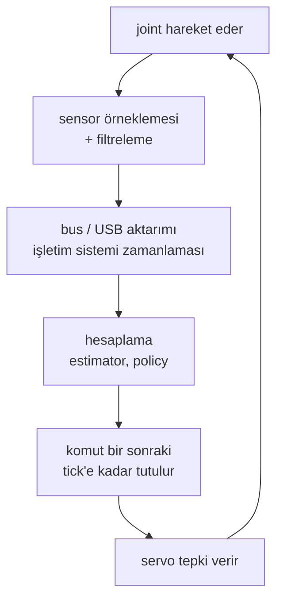

# 37 · Control rate ve end-to-end latency

<!-- meta -->
| | |
|---|---|
| **Bölüm** | [9 · Sim-to-real](README.md) |
| **Çalışma türü** | CPU · Mac ya da Colab CPU |
| **Önkoşul** | [12](../part-4-dynamics-and-control/12-joint-control.md), [17](../part-5-perception-and-estimation/17-sensors-noise-filtering.md) |
| **Önce öğren** | [Stochastic Processes](https://aiengineeringfromscratch.com/lesson?path=phases/01-math-foundations/22-stochastic-processes) |
| **Süre** | ~45 dk |
| **Kod** | [`experiments/37-latency/experiment.py`](../../experiments/37-latency/experiment.py) |
| **Durum** | ✅ tam |
<!-- /meta -->

> Bir feedback döngüsü gecikmenin nereden geldiğiyle ilgilenmez; yalnızca toplamı görür ve o toplamın, döngünün kendi hızının belirlediği kesin bir sınırı vardır.

## Problem

Simülasyonda ayarlanmış bir PD döngüsü ([ders 12](../part-4-dynamics-and-control/12-joint-control.md)) controller'ın joint'i *şu an* gördüğünü ve torkun *şu an* etki ettiğini varsayar. Gerçek robotta okuma, controller'a ulaştığında çoktan eskimiştir; komut bir saat tick'inde hesaplanır, bir bus üzerinden gönderilir ve bir sonraki tick'e kadar tutulur. LeRobot'un kayıt örnekleri robot döngüsünü 30 fps'de çalıştırır ([LeRobot imitation learning rehberi](https://huggingface.co/docs/lerobot/il_robots)); yani her frame'de bir action üreten bir policy, hesaplama süresi eklenmeden önce bile 33 ms'lik adımlarla çalışır. Bir döngü ne kadar gecikmeyi kaldırabilir, neden yalnızca "yavaşlamak" yerine kararsızlaşır ve buna karşı ne yapılabilir?

## Ana fikir

### Sade anlatımla

Yolu yarım saniye gecikmeli gösteren bir ekrana bakarak araba sürdüğünü düşün. Düz yolda, yumuşak düzeltmelerle idare edersin. Sert direksiyon kırarsan arabanın *olduğu* yere göre düzeltirsin: fazla dönersin, bunu geç görürsün, geri fazla düzeltirsin ve zikzak büyüyerek seni yoldan çıkarır. Gecikme seni yavaşlatmadı. Düzeltmelerinin yanlış anda gelmesine yol açtı.

Bir feedback controller'ı da aynısını yapar. Joint'i eski bir okumaya göre hedefe doğru iter. Yumuşak bir döngü bunu pek fark etmez. Sert ve hızlı bir döngü ise etkisini gördüğünde çoktan fazla itmiştir; belli bir gecikmeden sonra her düzeltme salınımı sönümlemek yerine bir sonrakini besler.

Buradan iki şey çıkar. Döngü yalnızca *toplam* gecikmeyi görür: sensor, filtre, bus, hesaplama ve bir sonraki tick'i beklemek hep toplanır. Bu toplamın bütçesini de döngünün kendisi belirler: döngü ne kadar hızlı tepki verirse o kadar az gecikmeyi kaldırabilir.

### Latency zinciri



End-to-end latency, bu zincirin bir turu, yani fiziksel bir olaydan actuator'ün ona tepki vermesine kadar geçen süredir:

| Aşama | Gecikme kaynağı |
|---|---|
| Algılama | pozlama / encoder örneklemesi, sensörün iç filtrelemesi |
| Filtreleme | moving average $\frac{N-1}{2}\Delta t$, low-pass $\approx\tau$ ([ders 17](../part-5-perception-and-estimation/17-sensors-noise-filtering.md)) |
| Hesaplama | state estimation, policy inference (büyük bir model bir tick'ten uzun sürebilir) |
| İletişim | USB / seri bus gidiş-dönüşleri, işletim sistemi zamanlaması |
| Örnekle ve tut | tick $k$'da hesaplanan komut $T$ süre boyunca tutulur: ortalamada $T/2$ eskidir |
| Actuation | servo'nun kendi tepki süresi, tork saturation'ı |

### Gecikme bütçesi, kod olarak

Kontrol mühendisleri bu bütçeyi *phase margin* ile ölçer. Her döngünün bir *crossover frekansı* $\omega_c$ vardır: kabaca ne kadar hızlı düzelttiği; bir düzeltmenin gittiği kadar büyük geri döndüğü frekans. Phase margin, o frekansta düzeltmeler tam ters zamanda gelip hatayı büyütmeye başlamadan önce kalan zamanlama payıdır. $d$ kadar bir gecikme bu paydan $\omega_c d$ yer. Tek bir joint üzerindeki PD döngüsü için:

```python
from math import atan, sqrt

# Total delay the loop sees (s): just add the stages
d = t_sense + t_filter + t_bus + t_compute + T / 2   # T = 1 / control rate; add T if applied a tick late

# PD on one joint: torque = kp * (target - q) - kd * qdot
I, kp, zeta = 0.0901, 20.0, 0.7         # inertia (kg m^2), stiffness, damping ratio
kd = 2 * zeta * sqrt(kp * I)            # damping gain for that ratio

# Crossover: |kp + j*kd*w| / (I*w^2) == 1 is a quadratic in w^2
w_c = sqrt((kd**2 + sqrt(kd**4 + 4 * I**2 * kp**2)) / (2 * I**2))   # 22.99 rad/s
pm = atan(kd * w_c / kp)                # phase margin, rad (65.2 deg)
d_max = pm / w_c                        # largest total delay before it oscillates: 49.5 ms
```

| Büyüklük | Formül |
|---|---|
| Döngü (eylemsizlik üzerinde PD) | $L(s) = \dfrac{K_p + K_d s}{I s^2}$ |
| Crossover | $I^2\omega_c^4 = K_p^2 + K_d^2\omega_c^2$ |
| Phase margin | $\mathrm{PM} = \arctan(K_d\omega_c/K_p)$ |
| Delay margin | $d_{\max} = \mathrm{PM}/\omega_c$ |
| $f$ hızındaki controller'ın eklediği gecikme | $T/2 = 1/(2f)$, her tick hesaplama için bir $T$ daha |

$I$ joint'in eylemsizliği, $K_p$ ve $K_d$ PD gain'leri, $s$ Laplace değişkeni ("frekans" diye oku), $\omega_c$ döngü kazancı $|L|$'nin 1 olduğu crossover frekansı, PM radyan cinsinden phase margin, $d_{\max}$ delay margin, $f$ control rate ve $T = 1/f$ periyodudur.

Üç sonuç: daha sert bir döngü (daha yüksek $\omega_c$) *daha az* gecikme kaldırır; sınırda döngü $\omega_c$ frekansında, $2\pi/\omega_c$ periyoduyla salınır; control rate ile latency de ayrı düğmelerdir: 50 ms kamera gecikmesi olan 1 kHz'lik bir döngü hâlâ 50 ms'lik bir döngüdür.

<details>
<summary>Matematik ayrıntısı: gecikme neden faz götürür ve T/2 nereden gelir</summary>

**Gecikme saf fazdır.** Bir sinyali $d$ kadar geciktirmek Laplace dönüşümünü $e^{-sd}$ ile çarpar. Frekans ekseninde $s = j\omega$ için $|e^{-j\omega d}| = 1$ ve açısı $-\omega d$'dir: her frekansta kazanç değişmez, faz $\omega d$ kadar düşer; yüksek frekanslarda daha çok.

**Phase margin.** Tek crossover'ı olan bir döngü, $\omega_c$'deki fazı $-180°$'nin üstünde kaldıkça kararlıdır; PM, $-180°$'ye olan uzaklıktır. Gecikme $\omega_c$'yi kaydırmaz (kazanç değişmez) ama orada $\omega_c d$ kadar faz çıkarır; dolayısıyla $\omega_c d = \mathrm{PM}$ olduğunda kararlılık kaybolur:

$$d_{\max} = \frac{\mathrm{PM}}{\omega_c}.$$

**Eylemsizlik üzerinde PD.** $|L(j\omega)| = \sqrt{K_p^2 + K_d^2\omega^2}/(I\omega^2) = 1$, koddaki $\omega^2$'ye göre ikinci derece denklemdir. Çift integrator $1/(Is^2)$ $-180°$ katkı yapar, PD payı ise $\arctan(K_d\omega/K_p)$ kadarını geri verir; bu, $\omega_c$'de PM'dir. Sabit ζ'da $K_d \propto \sqrt{K_p}$ ve $\omega_c \propto \sqrt{K_p}$ olur; PM aynı kalır, $d_{\max}$ ise $1/\sqrt{K_p}$ gibi küçülür (Boz: $K_p$ = 5'te 98,9 ms, $K_p$ = 20'de 49,5 ms).

**Örnekle ve tut.** Zero-order hold'un transfer fonksiyonu $(1 - e^{-sT})/(sT)$'dir ve fazı tam olarak $-\omega T/2$'dir: bir komutu bir periyot boyunca tutmak $T/2$'lik bir gecikme gibi davranır. Bir okumadan hesaplanan komut ancak bir sonraki tick'te uygulanıyorsa bir tam $T$ daha ekle: toplam $3T/2$.

**Varsayımlar.** Doğrusal döngü, tek crossover, actuator saturation'ı yok. D bölümü, saturation'a giren bir servo'nun bu tahmini nasıl bozduğunu gösteriyor.

Daha derine: [Stochastic Processes](https://aiengineeringfromscratch.com/lesson?path=phases/01-math-foundations/22-stochastic-processes) (AIEFS, zamana yayılan sinyaller); Lynch & Park, [*Modern Robotics*](https://hades.mech.northwestern.edu/index.php/Modern_Robotics), bölüm 11; Tan ve ark., [arXiv 1804.10332](https://arxiv.org/abs/1804.10332) (sim-to-real'de latency).

</details>

### Üç çare

1. **Döngü kazancını düşür**: daha yavaş ama daha çok margin.
2. **Tahmin et**: gecikmiş state'ten başlayıp gönderilmiş komutlarla bir modeli gecikme süresi boyunca ileri integre et ve tahmin edilen şimdiki state'i kontrol et (Smith predictor fikri; yalnızca model doğruysa tamdır, C bölümü).
3. **Open loop'ta önden planla**: action chunking her inference'ta gelecekteki bir action dizisini tahmin eder ([ders 31](../part-7-learning-from-demonstration/31-act.md)). LeRobot'un ACT'si varsayılan olarak `chunk_size = 100` ve `n_action_steps = 100` kullanır ([`configuration_act.py`](https://github.com/huggingface/lerobot/blob/main/src/lerobot/policies/act/configuration_act.py)) ve rollout aracı yavaş VLA model'leriyle akıcı çalışma için `--inference.type=rtc` seçeneği sunar ([LeRobot rehberi](https://huggingface.co/docs/lerobot/il_robots)). Chunking, akıcılık için tepki süresinden verir: bir chunk oynarken policy yeni gözlemlere tepki vermez.

## Deney

Tam script: [`experiments/37-latency/experiment.py`](../../experiments/37-latency/experiment.py). MuJoCo 3.17.0, NumPy 2.5.4, Python 3.14, Apple Silicon Mac (Apple M5), deterministik, bir dakikadan çok daha az CPU.

**A. Gecikme sweep'i.** Ders 12'deki gibi tek joint ($I$ = 0,0901 kg·m², yerçekimi yok), $K_p$ = 20, $K_d$ = 1,879 (ζ = 0,7), fizik ve kontrol 1 kHz'de, 0 → 0,5 rad step. Controller joint'i $d$ s geç okuyor:

```python
j = max(k - nd, 0)
q_m, v_m = hist_q[j], hist_v[j]          # what the controller sees
u = kp * (TARGET - q_m) - kd * v_m
```

Formülle *tahmin et*: $\omega_c$ = 22,99 rad/s, PM = 65,2°, dolayısıyla $d_{\max}$ = 49,5 ms.

| gecikme [ms] | 0 | 5 | 10 | 20 | 30 | 40 | 50 | 60–100 |
|---|---|---|---|---|---|---|---|---|
| overshoot % | 4,45 | 4,47 | 4,51 | 5,02 | 11,51 | 31,23 | 215,84 | ıraksıyor |
| %2 oturma [s] | 0,398 | 0,376 | 0,351 | 0,291 | 0,331 | 0,926 | hiç | hiç |


Tam milisaniyelerle bisection: 48 ms'de kararlı, 49 ms'de kararsız. 49 ms'deki salınımın periyodu 272 ms; $2\pi/\omega_c$ = 273 ms. Yaklaşık 20 ms'ye kadar gecikme neredeyse hiçbir şeye mal olmuyor (oturma süresini kısaltıyor bile); sınırdan önceki son 20 ms ise her şeye mal oluyor.

**B. Control rate.** Aynı joint, ek gecikme yok, controller zero-order hold ile $f$ Hz'de (fizik 1 kHz'de kalıyor). İkinci varyant: komut bir tick sonra hazır. Son iki sütun: A bölümünün $T/2$ ve $3T/2$ eşdeğer gecikmelerindeki overshoot'u.

| rate [Hz] | T [ms] | overshoot % | + 1 tick hesaplama | A, T/2'de | A, 3T/2'de |
|---|---|---|---|---|---|
| 1000 | 1,0 | 4,45 | 4,46 | 4,45 | 4,46 |
| 100 | 10,0 | 4,48 | 4,61 | 4,47 | 4,62 |
| 50 | 20,0 | 4,55 | 10,31 | 4,51 | 11,51 |
| 30 | 33,3 | 4,75 | 78,07 (kararsız) | 4,72 | 215,84 |
| 20 | 50,0 | 5,34 | ıraksıyor | 6,66 | ıraksıyor |
| 10 | 100,0 | ıraksıyor | ıraksıyor | 215,84 | ıraksıyor |

$T/2$ ve $3T/2$ kuralları eğilimi doğru tahmin ediyor: hemen uygulanan 30 Hz, 17 ms gecikme gibi davranıyor (sorun yok); aynı 30 Hz bir tick hesaplama gecikmesiyle 50 ms gibi davranıyor ve sınırın ötesinde.

**C. Tahmin.** $d$ = 40 ms'de şimdiki state'i, gecikmiş okumadan başlayıp gönderilmiş torklarla $I\ddot q = \tau$'yu gecikme boyunca integre ederek tahmin et:

| controller | overshoot % | %2 oturma [s] |
|---|---|---|
| gecikme yok (referans) | 4,45 | 0,398 |
| gecikme, tahmin yok | 31,23 | 0,926 |
| gecikme + tahmin, tam model | 4,45 | 0,398 |
| modelde eylemsizlik +%50 | 0,00 | 0,223 |
| modelde eylemsizlik −%30 | 9,44 | 0,491 |
| varsayılan gecikme 20 ms (gerçek 40) | 4,70 | 0,300 |

Tam model ve bozucu yokken tahmin gecikmeyi tamamen ortadan kaldırıyor. Yanlış modelle burada yine yardımcı oluyor ama kapalı döngü tepkisini değiştiriyor: tahmini güvenli kılan şey gecikmeyi ve dinamiği bilmektir (ders 38).

**D. 30 Hz'de SO-101.** Menagerie SO-101, `shoulder_pan` servo'su (2 ms step). 30 Hz'lik dış bir "policy" döngüsü servo hedefini gecikmiş okumalara göre kaydırıyor: `target += K*T*(goal - q_delayed)`, $K$ = 10 s⁻¹. İdeal bir servo için bu gecikmeli integrator $K(d + T/2) > \pi/2$ olduğunda, yani 140 ms'nin üstünde kararsızdır (tam discrete-time analiz: 5 tick = 167 ms'den itibaren). Modeldeki servo ideal değil: tek başına 0,02 / 0,10 / 0,50 rad'lık bir step'in %50'sine 18 / 44 / 110 ms'de ulaşıyor. Bu step'lerin her birinde *saturation*'a giriyor (tork limitine dayanıyor): $k_p$ = 998 N·m/rad ile yalnızca 2,94/998 ≈ 3 mrad hata bile tam 2,94 N·m istiyor. Hareket o zaman ivme sınırlı oluyor ve büyük step daha uzun sürüyor.

| gecikme [ms] | 0 | 33 | 50 | 67 | 100 | 117 | 133 |
|---|---|---|---|---|---|---|---|
| hedef 0,1 rad: overshoot % | 0,0 | 0,1 | 12,3 | 30,8 | 70,9 | 80,8 | 94,7 |
| hedef 0,1 rad: son \|e\|/hedef | 0,000 | 0,000 | 0,000 | 0,000 | 0,001 | 0,004 | 0,267 |
| hedef 0,5 rad: overshoot % | 36,3 | 69,1 | 146,9 | 290,3 | 290,0 | 289,7 | 289,9 |
| hedef 0,5 rad: son \|e\|/hedef | 0,000 | 0,000 | 1,744 | 2,903 | 3,391 | 3,493 | 2,899 |

Küçük düzeltmelerde döngü ancak 133 ms'de salınmaya devam ediyor; bu, ideal servo tahminine yakın. 0,5 rad'lık bir harekette ise 50 ms'de bile çöküyor: saturation'a giren servo, genliğe bağlı kendi gecikmesini ekliyor.

## Boz

Gecikmeyi 30 ms'de sabitle ve PD döngüsünü sabit ζ = 0,7'de sertleştir (yukarıdaki şeklin sağ paneli):

| $K_p$ | 5 | 10 | 20 | 40 | 80 | 160 |
|---|---|---|---|---|---|---|
| $\omega_c$ [rad/s] | 11,49 | 16,25 | 22,99 | 32,51 | 45,97 | 65,01 |
| $d_{\max}$ [ms] | 98,9 | 70,0 | 49,5 | 35,0 | 24,7 | 17,5 |
| overshoot % | 4,73 | 5,30 | 11,51 | 37,78 | ıraksıyor | ıraksıyor |

Damping ratio her satırda aynı, yine de döngü $K_p$ = 80'de ölüyor. Stiffness $\omega_c$'yi yükseltiyor ve aynı 30 ms bu kez $\omega_c \cdot d$ kadar faza mal oluyor. Formül çöken satırları tam olarak öngörüyor (24,7 ve 17,5 ms, 30 ms'nin altında). Sıfır gecikmeli bir simülasyonda ayarlanan gain'ler var olmayan bir döngü için ayarlanmıştır.

## Gerçek robotta

- **Latency'yi tahmin etme, ölç.** LeRobot'un SO-101 follower'ı `get_observation` içinde her `Present_Position` bus okumasının ve her kamera okumasının süresini ölçüp debug seviyesinde log'luyor ([`so_follower.py`](https://github.com/huggingface/lerobot/blob/main/src/lerobot/robots/so_follower/so_follower.py)). `max_relative_target` ayarlıysa `send_action` bir bus okuması daha ekliyor ve koddaki bir yorum daha yavaş bir döngü konusunda uyarıyor. End-to-end sayı için prosedür: bir joint'e step komutu ver, komut zamanını ve `Present_Position` zaman damgalarını log'la ve okumanın hareket etmeye başlamasına kadar geçen süreyi al. Gerçek kolda henüz ölçülmedi.
- **Servo kendi iç döngüsünü çalıştırır.** D bölümündeki gibi policy, hızlı bir position servo'nun etrafında yavaş bir dış döngü kapatır. Bu dış döngüdeki latency, mutlak pozisyon action'larında tepki süresine; policy kendi gecikmiş gözlemlerine tepki verdiğinde (visual servoing, düzeltmeler) ise kararlılığa mal olur.
- **Yaşayacağın latency'yi simüle et.** Tan ve arkadaşları dört bacaklı yürüyüşleri simülasyondan aktarmak için system identification ve bir actuator modeliyle birlikte latency'yi de simüle ediyor ([arXiv 1804.10332](https://arxiv.org/abs/1804.10332)). Sıfır gecikmede ayar yapmak yerine ölçülen gecikmeyi eğitim simülatörüne koy (ders 39).

## Kendini dene

1. **Kolay.** Bir kamera hattı 40 ms ekliyor, policy 20 Hz'de çalışıyor ve çıktısı frame'den bir tick sonra uygulanıyor. Toplam gecikmeyi $T/2$ kuralıyla tahmin et.
2. **Orta.** $d_{\max} = \mathrm{PM}/\omega_c$'yi kullanarak, B bölümündeki bir tick hesaplamalı 30 Hz döngünün neden çöktüğünü, A bölümünde 40 ms'nin ise neden ayakta kaldığını açıkla.
3. **Zor.** C bölümünde tam tahmincinin modelini motor komutunu yok sayan bir modelle değiştir (saf ekstrapolasyon $q + \dot q\,d$). Önce tahmin et, sonra çalıştır: 40 ms'de overshoot ne olur?

### Cevaplar

1. 40 ms + 50 ms (bir tick hesaplama) + 25 ms (tutma) = 115 ms.
2. 30 Hz'de bir tick hesaplama artı tutma yaklaşık $3T/2$ = 50 ms eder; bu 49,5 ms'lik margin'in ötesinde. A bölümündeki 40 ms margin'in içinde (%31,23 overshoot, kararlı).
3. %15,15 overshoot; tam tahminci (%4,45) ile tahminsiz durum (%31,23) arasında. Ama oturma 1,902 s sürüyor, tahminsiz durumdan (0,926 s) uzun: gecikmiş hızla ekstrapolasyon, controller'ın gecikme süresince kendi komut ettiği ivmeyi yok sayıyor. `output.txt`'de C bölümündeki "extrapolation" satırı.

## Akılda kalanlar ve kaynaklar

- Gecikme $\omega d$ kadar faz götürür; döngü $d_{\max} = \mathrm{PM}/\omega_c$'ye kadar ayakta kalır (tahmin 49,5 ms, ölçüm 48–49 ms, salınım tahmin edilen 273 ms periyotta).
- Control rate yaklaşık $T/2$ gecikme ekler, her tick hesaplama gecikmesi için bir $T$ daha: bu döngüde 30 Hz hemen uygulamayla sorunsuz, bir tick hesaplamayla kararsız.
- Doğru modelle tahmin gecikmeyi ortadan kaldırır (%31,23 → %4,45 overshoot); daha sert döngüler ve saturation'a giren actuator'ler daha az gecikme kaldırır.

Sonraki: [ders 38 · System identification](38-system-identification.md).

Kaynaklar:
- [LeRobot · Imitation learning on real-world robots](https://huggingface.co/docs/lerobot/il_robots) (30 fps örnekleri, `lerobot-rollout`, `--inference.type=rtc`; 2026-10-27'de okundu).
- LeRobot [`configuration_act.py`](https://github.com/huggingface/lerobot/blob/main/src/lerobot/policies/act/configuration_act.py), [`so_follower.py`](https://github.com/huggingface/lerobot/blob/main/src/lerobot/robots/so_follower/so_follower.py) (Apache-2.0).
- J. Tan ve ark., [Sim-to-Real: Learning Agile Locomotion For Quadruped Robots](https://arxiv.org/abs/1804.10332), 2018.
- T. Zhao ve ark., [Learning Fine-Grained Bimanual Manipulation with Low-Cost Hardware](https://arxiv.org/abs/2304.13705) (ACT), 2023.
- [MuJoCo Menagerie · robotstudio_so101](https://github.com/google-deepmind/mujoco_menagerie/tree/f3b6013/robotstudio_so101) (Apache-2.0).
- Lynch & Park, [*Modern Robotics*](https://hades.mech.northwestern.edu/index.php/Modern_Robotics), bölüm 11.
- Ölçülen bütün sayılar: [`experiments/37-latency/output.txt`](../../experiments/37-latency/output.txt).
