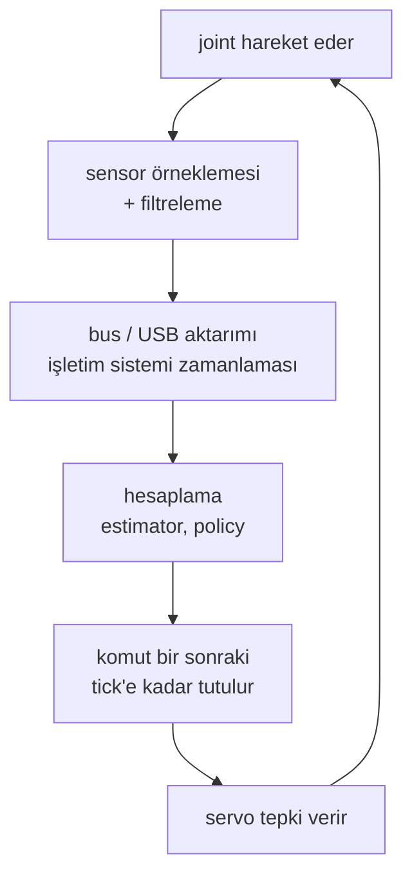

# 37 · Control rate ve end-to-end latency

<!-- meta -->
| | |
|---|---|
| **Bölüm** | [9 · Sim-to-real](README.md) |
| **Çalışma türü** | CPU · Mac ya da Colab CPU |
| **Önkoşul** | [12](../part-4-dynamics-and-control/12-joint-control.md), [17](../part-5-perception-and-estimation/17-sensors-noise-filtering.md) |
| **Önce öğren** | [Stochastic Processes](https://aiengineeringfromscratch.com/lesson?path=phases/01-math-foundations/22-stochastic-processes) |
| **Süre** | ~45 dk |
| **Kod** | [`experiments/37-latency/experiment.py`](../../experiments/37-latency/experiment.py) |
| **Durum** | ✅ tam |
<!-- /meta -->

> Bir feedback döngüsü gecikmenin nereden geldiğiyle ilgilenmez; yalnızca toplamı görür ve o toplamın, döngünün kendi hızının belirlediği kesin bir sınırı vardır.

## Problem

Simülasyonda ayarlanmış bir PD döngüsü ([ders 12](../part-4-dynamics-and-control/12-joint-control.md)) controller'ın joint'i *şu an* gördüğünü ve torkun *şu an* etki ettiğini varsayar. Gerçek robotta okuma geldiğinde eskimiştir; komut bir saat tick'inde hesaplanır, bus üzerinden gönderilir ve bir sonraki tick'e kadar tutulur. LeRobot'un kayıt örnekleri robot döngüsünü 30 fps'de çalıştırır ([rehber](https://huggingface.co/docs/lerobot/il_robots)): hesaplama eklenmeden önce bile 33 ms'lik adımlar. Bir döngü ne kadar gecikme kaldırır, neden "yavaşlamak" yerine kararsızlaşır ve ne işe yarar?

## Ana fikir

### Sade anlatımla

Yolu yarım saniye gecikmeli gösteren bir ekrana bakarak araba sürdüğünü düşün. Yumuşak düzeltmelerle idare edersin. Sert direksiyon kırarsan arabanın *olduğu* yere göre düzeltirsin: fazla dönersin, geç görürsün, geri fazla düzeltirsin ve zikzak büyüyerek seni yoldan çıkarır. Gecikme seni yavaşlatmadı; düzeltmelerinin yanlış anda gelmesine yol açtı.

Bir feedback controller'ı da aynısını yapar: joint'i eski bir okumaya göre iter. Yumuşak bir döngü pek fark etmez; sert ve hızlı bir döngü etkisini gördüğünde çoktan fazla itmiştir ve belli bir gecikmeden sonra her düzeltme bir sonraki salınımı besler. Döngü yalnızca *toplam* gecikmeyi görür (sensor, filtre, bus, hesaplama, bir sonraki tick'i beklemek) ve bu toplamın bütçesini döngünün kendisi belirler: ne kadar hızlı tepki verirse o kadar az gecikme kaldırır.

### Latency zinciri



End-to-end latency bu zincirin bir turudur: algılama (pozlama, encoder örneklemesi), filtreleme (moving average $\frac{N-1}{2}\Delta t$ ekler, [ders 17](../part-5-perception-and-estimation/17-sensors-noise-filtering.md)), hesaplama (büyük bir model bir tick'ten uzun sürebilir), bus gidiş-dönüşleri ve işletim sistemi zamanlaması, örnekle ve tut (ortalamada $T/2$) ve servo'nun kendi tepkisi.

### Gecikme bütçesi, kod olarak

Kontrol mühendisleri bu bütçeyi *phase margin* ile ölçer. Her döngünün bir *crossover frekansı* $\omega_c$ vardır: kabaca ne kadar hızlı düzelttiği; bir düzeltmenin gittiği kadar büyük geri döndüğü frekans. Phase margin, orada düzeltmeler tam ters zamanda gelip hatayı büyütmeden önce kalan zamanlama payıdır. $d$ kadar gecikme bu paydan $\omega_c d$ yer. Tek joint üzerindeki PD için (`pd_delay_margin`'i Sıfırdan yaz'da yazıyorsun):

```python
d = t_sense + t_filter + t_bus + t_compute + T / 2   # total delay (s); T = 1 / rate, add T if applied a tick late
kd = 2 * zeta * sqrt(kp * I)                         # I = 0.0901 kg m^2, kp = 20, zeta = 0.7 -> kd = 1.879
w_c, pm, d_max = pd_delay_margin(I, kp, kd)          # 22.99 rad/s, 65.2 deg, 49.5 ms
```

| Büyüklük | Formül |
|---|---|
| Döngü (eylemsizlik üzerinde PD) | $L(s) = \dfrac{K_p + K_d s}{I s^2}$ |
| Crossover | $I^2\omega_c^4 = K_p^2 + K_d^2\omega_c^2$ |
| Phase margin | $\mathrm{PM} = \arctan(K_d\omega_c/K_p)$ |
| Delay margin | $d_{\max} = \mathrm{PM}/\omega_c$ |
| $f$ hızındaki controller'ın eklediği gecikme | $T/2 = 1/(2f)$, her tick hesaplama için bir $T$ daha |

$I$ joint'in eylemsizliği, $K_p$, $K_d$ PD gain'leri, $s$ Laplace değişkeni ("frekans" diye oku), $\omega_c$ $|L| = 1$ olan frekans, PM radyan cinsinden, $f$ control rate ve $T = 1/f$.

Sonuçlar: daha sert bir döngü (daha yüksek $\omega_c$) *daha az* gecikme kaldırır; sınırda $2\pi/\omega_c$ periyoduyla salınır; 50 ms kamera gecikmesi olan 1 kHz'lik döngü hâlâ 50 ms'lik bir döngüdür.

<details>
<summary>Matematik ayrıntısı: gecikme neden faz götürür ve T/2 nereden gelir</summary>

**Gecikme saf fazdır.** $d$ kadar geciktirmek Laplace dönüşümünü $e^{-sd}$ ile çarpar; $s = j\omega$'da kazancı 1, açısı $-\omega d$'dir.

**Phase margin.** Tek crossover'lı bir döngü, $\omega_c$'deki fazı $-180°$'nin üstünde kaldıkça kararlıdır; PM, $-180°$'ye uzaklıktır. Gecikme $\omega_c$'yi kaydırmaz ama orada $\omega_c d$ faz çıkarır; $\omega_c d = \mathrm{PM}$ olduğunda kararlılık kaybolur:

$$d_{\max} = \frac{\mathrm{PM}}{\omega_c}.$$

**Eylemsizlik üzerinde PD.** $|L(j\omega)| = 1$, $\omega^2$'ye göre ikinci derece bir denklemdir. Çift integrator $-180°$ katkı yapar, PD payı $\arctan(K_d\omega/K_p)$ kadarını geri verir: $\omega_c$'de bu PM'dir. Sabit ζ'da $K_d \propto \sqrt{K_p}$ ve $\omega_c \propto \sqrt{K_p}$ olur; PM aynı kalır, $d_{\max}$ ise $1/\sqrt{K_p}$ gibi küçülür (Boz: $K_p$ = 5'te 98,9 ms, $K_p$ = 20'de 49,5 ms).

**Örnekle ve tut.** Zero-order hold, $(1 - e^{-sT})/(sT)$, tam olarak $-\omega T/2$ fazına sahiptir: $T/2$'lik bir gecikme. Komutu ancak bir sonraki tick'te uygulamak bir $T$ daha ekler: toplam $3T/2$.

**Varsayımlar.** Doğrusal döngü, tek crossover, saturation yok (D bölümü sonuncusunu bozuyor).

Daha derine: [Stochastic Processes](https://aiengineeringfromscratch.com/lesson?path=phases/01-math-foundations/22-stochastic-processes) (AIEFS, zamana yayılan sinyaller); Lynch & Park, [*Modern Robotics*](https://hades.mech.northwestern.edu/index.php/Modern_Robotics), bölüm 11; Tan ve ark., [arXiv 1804.10332](https://arxiv.org/abs/1804.10332) (sim-to-real'de latency).

</details>

<!-- figure: 37-latency -->

### Üç çare

1. **Döngü kazancını düşür**: daha yavaş ama daha çok margin.
2. **Tahmin et**: gecikmiş state'ten, gönderilmiş komutlarla bir modeli gecikme boyunca integre et ve tahmin edilen şimdiki state'i kontrol et (Smith predictor fikri; yalnızca model doğruysa tamdır, C bölümü).
3. **Open loop'ta önden planla**: action chunking her inference'ta birkaç gelecek action tahmin eder ([ders 31](../part-7-learning-from-demonstration/31-act.md)); LeRobot'un ACT'si varsayılan olarak `chunk_size = 100`, `n_action_steps = 100` kullanır ([`configuration_act.py`](https://github.com/huggingface/lerobot/blob/main/src/lerobot/policies/act/configuration_act.py)). Bir chunk oynarken policy yeni gözlemlere tepki vermez.

## Sıfırdan yaz

Şimdi gecikmeli döngüyü kendin yazacaksın. Joint, ders 12'nin [`physai/control.py`](../../physai/control.py) içindeki `simulate_joint`'i; böylece her yörünge Deney'in MuJoCo döngüsüyle örnek örnek karşılaştırılabiliyor. Bitmiş kod [`physai/sim2real.py`](../../physai/sim2real.py) içinde; `uv run python experiments/37-latency/build.py` beş adımı koşturur (çıktı [`build_output.txt`](../../experiments/37-latency/build_output.txt) dosyasında).

### Adım 1 · Gecikme hattı

Gecikme bir kuyruktur: en yeni okumayı it, en eskisini oku. Dolana kadar ilk değeri döndürür.

```python
class DelayLine:
    """Returns the value pushed n ticks ago (the first value until the line has filled)."""

    def __init__(self, n, x0):
        self.buf = deque([x0] * (n + 1), maxlen=n + 1)

    def __call__(self, x):
        self.buf.append(x)
        return self.buf[0]
```

```text
== Step 1. A delay line of 3 ticks ==
pushed  [1, 2, 3, 4, 5, 6, 7, 8]
read    [0, 0, 0, 1, 2, 3, 4, 5]
equals the history shifted by 3 (first value until filled): True
```

### Adım 2 · Gecikme bütçesi

```python
def pd_delay_margin(inertia, kp, kd):
    """Crossover w_c (rad/s), phase margin (rad) and delay margin PM / w_c (s) of PD on an inertia."""
    w_c = np.sqrt((kd**2 + np.sqrt(kd**4 + 4 * inertia**2 * kp**2)) / (2 * inertia**2))   # |L(j w_c)| = 1
    pm = np.arctan2(kd * w_c, kp)                  # the PD numerator's phase lead at w_c
    return w_c, pm, pm / w_c
```

```text
== Step 2. The delay budget of PD on an inertia ==
Kd = 1.879: w_c = 22.99 rad/s, PM = 65.2 deg, d_max = PM / w_c = 49.5 ms
|L(j w_c)| = 1.000000000000, phase of L = -114.8 deg = -180 + PM
np.roots of the crossover quartic: w = 22.9855 rad/s (ours 22.9855)
|characteristic equation| at s = j w_c, d = d_max: 7.3e-15 (a pole sits on the imaginary axis)
oscillation period at the boundary 2 pi / w_c = 273 ms
```

Kontrol simülasyon gerektirmiyor: $d = d_{\max}$'ta gecikmeli karakteristik denklem $Is^2 + (K_p + K_d s)e^{-sd} = 0$'ın $s = j\omega_c$'de bir kökü var, yani sanal eksen üzerinde bir kutup.

### Adım 3 · Geçmişi gören PD

Controller çağrılabilir bir nesne, bu yüzden `simulate_joint(torque_fn, …)` onu değiştirmeden koşturur. `see` controller'ın gördüğünü döndürür; saat Adım 4 için.

```python
class DelayedPD:
    """PD on one joint that sees it nd ticks late, recomputes every `period` s (None: every tick) and holds
    the command in between; late=True applies each command one controller tick after computing it."""

    def __init__(self, kp, kd, target, dt, nd=0, period=None, late=False):
        self.kp, self.kd, self.target, self.dt, self.nd = kp, kd, target, dt, nd
        self.period, self.late = period, late
        self.k, self.next_tick, self.u, self.queued, self.line, self.sent = 0, 0.0, 0.0, 0.0, None, []

    def see(self, q, qd):
        """What the controller sees at this tick: the reading from nd ticks ago."""
        if self.line is None:
            self.line = DelayLine(self.nd, (q, qd))
        return self.line((q, qd))

    def __call__(self, q, qd):
        q_m, qd_m = self.see(q, qd)
        if self.period is None or self.k * self.dt >= self.next_tick - 1e-12:   # a controller tick
            self.next_tick += self.period or 0.0
            u = self.kp * (self.target - q_m) - self.kd * qd_m
            self.u, self.queued = (self.queued, u) if self.late else (u, u)
        self.k += 1
        self.sent.append(self.u)                   # torque applied during this tick
        return self.u
```

Overshoot ve kararlılık Deney'in tanımlarını izliyor:

```python
def overshoot(q, target):
    """Overshoot past a positive step target in percent; None if the run diverged (|q| > 50)."""
    if not np.all(np.abs(q) < 50):
        return None
    return max(0.0, (q.max() - target) / target * 100)
```

```python
def is_stable(q, target):
    """Stable if the run stayed bounded and the late error (last quarter) is below 90% of the error in the
    second quarter, or below 1 mrad: a decaying response, not a sustained or growing oscillation."""
    if overshoot(q, target) is None:
        return False
    e, n = np.abs(q - target), len(q)
    late, early = e[3 * n // 4:].max(), e[n // 4:n // 2].max()
    return late < 0.9 * early or late < 1e-3
```

```text
== Step 3. Delayed PD by hand vs the Experiment's MuJoCo loop ==
delay ms    ours %  stable  max |q_ours - q_mujoco|
       0      4.45     yes                  1.1e-16
      10      4.51     yes                  2.1e-17
      20      5.02     yes                  1.1e-16
      30     11.51     yes                  5.6e-17
      40     31.23     yes                  5.6e-17
      50    215.84      NO                  7.3e-15
      60  diverges      NO                  5.7e-14
stability boundary: stable at 48 ms, unstable at 49 ms (predicted d_max 49.5 ms)
```

Senin döngün ile MuJoCo'nunki her gecikmede yuvarlama hatası düzeyinde örtüşüyor ve bisection Deney'inkiyle aynı yere düşüyor.

### Adım 4 · Control rate

`period` verildiğinde controller yalnızca kendi tick'lerinde yeniden hesaplar ve komutu tutar; `late=True` her komutu bir tick geç uygular. Son iki sütun $T/2$ ve $3T/2$'lik saf gecikmeler.

```text
== Step 4. Control rate: sample and hold, and one tick of compute ==
rate Hz   T ms    hold %  +1 tick %  delay T/2 %  delay 3T/2 %
   1000    1.0      4.45       4.46         4.45          4.46
    100   10.0      4.48       4.61         4.47          4.62
     50   20.0      4.55      10.31         4.51         11.51
     30   33.3      4.75      78.07         4.72        215.84
     20   50.0      5.34   diverges         6.66      diverges
     10  100.0  diverges   diverges       215.84      diverges
30 Hz hold, ours vs the Experiment's MuJoCo loop: max diff 1.1e-16 rad
```

### Adım 5 · Gecikme boyunca tahmin et

Tahminci `see`'yi ezer: gecikmiş okumadan başlayıp zaten gönderilmiş torklarla $I\ddot q = \tau$'yu integre eder.

```python
class PredictivePD(DelayedPD):
    """DelayedPD that integrates the model I qdd = tau over the assumed delay (model_nd ticks) from the delayed
    reading, with the torques it already sent, and controls that predicted present state."""

    def __init__(self, kp, kd, target, dt, nd, model_inertia, model_nd):
        super().__init__(kp, kd, target, dt, nd)
        self.model_inertia, self.model_nd = model_inertia, model_nd

    def see(self, q, qd):
        q_m, qd_m = super().see(q, qd)
        j = max(self.k - self.nd, 0)               # tick of the reading
        for i in range(j, min(j + self.model_nd, self.k)):
            qd_m += self.sent[i] / self.model_inertia * self.dt   # same semi-implicit Euler as the plant
            q_m += qd_m * self.dt
        return q_m, qd_m
```

```text
== Step 5. Predict the present state over a 40 ms delay ==
controller                         overshoot %
no delay                                  4.45
delay, no prediction                     31.23
prediction, exact model                   4.45
prediction, inertia +50%                  0.00
prediction, inertia -30%                  9.44
prediction, assumed delay 20 ms           4.70
exact prediction vs no delay: max |q difference| = 0.0e+00 rad
inertia +50%, ours vs the Experiment's MuJoCo loop: max diff 5.6e-17 rad
```

Tam modelle tahmin gerçek şimdiki state'tir, bu yüzden döngü gecikmesiz olanı bit bit tekrarlıyor; yanlış modeller C bölümünü yeniden üretiyor.

### Elinde kalan

`physai.sim2real` artık `DelayLine`, `pd_delay_margin`, `DelayedPD`, `PredictivePD`, `overshoot` ve `is_stable` içeriyor; ders 38 bir gecikmeyi identify ediyor, ders 39 bir gecikmenin içinden eğitiyor. [`tests/test_37_latency.py`](../../tests/test_37_latency.py) onları MuJoCo ve SciPy'a sabitler: `uv run pytest tests/test_37_latency.py`.

## Kütüphaneyle kullan

MuJoCo 3.17 gecikmeyi modelin içinde tutabiliyor: actuator'ler ve sensörler `nsample` örneklik bir history buffer'la `delay` kabul ediyor (`interp`: zero-order hold, doğrusal ya da kübik; [XML referansı](https://mujoco.readthedocs.io/en/stable/XMLreference.html)). SciPy'ın frequency response'u crossover'ı sayısal olarak veriyor.

```xml
<actuator><motor joint="j" delay="0.039" nsample="39"/></actuator>
<sensor><jointpos joint="j" delay="0.039" nsample="39"/></sensor>   <!-- or delay the readings -->
```

```python
loop = signal.TransferFunction([kd, kp], [I, 0, 0])
w_c = optimize.brentq(lambda w: abs(signal.freqresp(loop, [w])[1][0]) - 1, 1.0, 1000.0)
```

```text
== Use it. MuJoCo's own delay buffer, SciPy's frequency response ==
MuJoCo model                                 overshoot %  ours, delay  ours %
no delay attribute                                  4.46         1 ms    4.46
sensors delay="0.039" nsample="39"                 31.23        40 ms   31.23
motor delay="0.039" nsample="39"                   31.23        40 ms   31.23
sensor delay 39 ms + reading sensordata after mj_step vs ours at 40 ms: max diff 5.6e-17 rad
SciPy freqresp + brentq: w_c = 22.9855 rad/s, PM = 65.16 deg, d_max = 49.47 ms (ours 22.9855, 65.16, 49.47)
```

Neden 40 değil 39 ms: `mj_step`'ten sonra okunan `d.sensordata` zaten bir tick eski ("no delay attribute" satırı 1 ms gibi davranıyor). Geciktirilmiş bir motor bütün tepkiyi kaydırır; overshoot aynı kalır.

| Araç | Çağrı | Döndürdüğü |
|---|---|---|
| physai | `pd_delay_margin(I, kp, kd)` | $\omega_c$ (rad/s), PM (rad), $d_{\max}$ (s) |
| python-control | `margin(sys)` | gain margin, **derece cinsinden** PM, phase-crossover, gain-crossover frekansı ([doküman](https://python-control.readthedocs.io/en/latest/generated/control.margin.html)) |
| MATLAB | `allmargin(sys)` | `PhaseMargin` (derece), `PMFrequency`, `DelayMargin` (discrete-time modellerde örnek periyodu cinsinden) ([doküman](https://www.mathworks.com/help/control/ref/dynamicsystem.allmargin.html)) |

Tuzaklar:

- **Bayat sensörler.** `sensordata` integrasyondan önce hesaplanır; `mj_step`'ten sonra okunursa bir adım eskidir ve o tick bütçeye dahildir.
- **Derece mi radyan mı.** $d_{\max} = \mathrm{PM}/\omega_c$ için PM radyan olmalı.
- **Hangi crossover.** Delay margin *gain* crossover'ını ($|L| = 1$) kullanır; araçlar bir de phase crossover döndürür, çoğu zaman yan yuvada.

## Deney

Tam script: [`experiments/37-latency/experiment.py`](../../experiments/37-latency/experiment.py). MuJoCo 3.17.0, NumPy 2.5.4, Python 3.14, Apple Silicon Mac (Apple M5), deterministik, bir dakikadan çok daha az CPU.

**A. Gecikme sweep'i.** Ders 12'deki gibi tek joint ($I$ = 0,0901 kg·m², yerçekimi yok), $K_p$ = 20, $K_d$ = 1,879 (ζ = 0,7), fizik ve kontrol 1 kHz'de, 0 → 0,5 rad step. Controller joint'i $d$ s geç okuyor (Sıfırdan yaz, Adım 3'teki döngü). Formülle *tahmin et*: $\omega_c$ = 22,99 rad/s, PM = 65,2°, dolayısıyla $d_{\max}$ = 49,5 ms.

| gecikme [ms] | 0 | 5 | 10 | 20 | 30 | 40 | 50 | 60–100 |
|---|---|---|---|---|---|---|---|---|
| overshoot % | 4,45 | 4,47 | 4,51 | 5,02 | 11,51 | 31,23 | 215,84 | ıraksıyor |
| %2 oturma [s] | 0,398 | 0,376 | 0,351 | 0,291 | 0,331 | 0,926 | hiç | hiç |


Tam milisaniyelerle bisection: 48 ms'de kararlı, 49 ms'de kararsız; salınım periyodu 272 ms ($2\pi/\omega_c$ = 273 ms). Yaklaşık 20 ms'ye kadar gecikme neredeyse bedava; sınırdan önceki son 20 ms her şeye mal oluyor.

**B. Control rate.** Aynı joint, ek gecikme yok, controller zero-order hold ile $f$ Hz'de (fizik 1 kHz'de kalıyor). İkinci varyant: komut bir tick sonra hazır. Son iki sütun: A bölümü, $T/2$ ve $3T/2$'de.

| rate [Hz] | T [ms] | overshoot % | + 1 tick hesaplama | A, T/2'de | A, 3T/2'de |
|---|---|---|---|---|---|
| 1000 | 1,0 | 4,45 | 4,46 | 4,45 | 4,46 |
| 100 | 10,0 | 4,48 | 4,61 | 4,47 | 4,62 |
| 50 | 20,0 | 4,55 | 10,31 | 4,51 | 11,51 |
| 30 | 33,3 | 4,75 | 78,07 (kararsız) | 4,72 | 215,84 |
| 20 | 50,0 | 5,34 | ıraksıyor | 6,66 | ıraksıyor |
| 10 | 100,0 | ıraksıyor | ıraksıyor | 215,84 | ıraksıyor |

Kurallar eğilimi tahmin ediyor: hemen uygulanan 30 Hz 17 ms gecikme gibi (sorun yok), bir tick hesaplamayla 50 ms gibi davranıyor (sınırın ötesinde).

**C. Tahmin**, $d$ = 40 ms'de (Sıfırdan yaz, Adım 5'teki tahminci):

| controller | overshoot % | %2 oturma [s] |
|---|---|---|
| gecikme yok (referans) | 4,45 | 0,398 |
| gecikme, tahmin yok | 31,23 | 0,926 |
| gecikme + tahmin, tam model | 4,45 | 0,398 |
| modelde eylemsizlik +%50 | 0,00 | 0,223 |
| modelde eylemsizlik −%30 | 9,44 | 0,491 |
| varsayılan gecikme 20 ms (gerçek 40) | 4,70 | 0,300 |

Tam model ve bozucu yokken tahmin gecikmeyi tamamen kaldırıyor; yanlış model burada yine yardım ediyor ama tepkiyi değiştiriyor. Tahmini güvenli kılan, gecikmeyi ve dinamiği bilmektir (ders 38).

**D. 30 Hz'de SO-101.** Menagerie SO-101, `shoulder_pan` servo'su (2 ms step). 30 Hz'lik dış bir "policy" döngüsü servo hedefini gecikmiş okumalara göre kaydırıyor: `target += K*T*(goal - q_delayed)`, $K$ = 10 s⁻¹. İdeal bir servo için bu gecikmeli integrator $K(d + T/2) > \pi/2$ olduğunda, 140 ms'nin üstünde kararsızdır (discrete-time analiz: 5 tick = 167 ms'den itibaren). Modeldeki servo ideal değil: tek başına 0,02 / 0,10 / 0,50 rad'lık step'in %50'sine 18 / 44 / 110 ms'de ulaşıyor, çünkü her step'te *saturation*'a giriyor: $k_p$ = 998 N·m/rad ile 2,94/998 ≈ 3 mrad hata bile tam 2,94 N·m istiyor, bu yüzden büyük step daha uzun sürüyor.

| gecikme [ms] | 0 | 33 | 50 | 67 | 100 | 117 | 133 |
|---|---|---|---|---|---|---|---|
| hedef 0,1 rad: overshoot % | 0,0 | 0,1 | 12,3 | 30,8 | 70,9 | 80,8 | 94,7 |
| hedef 0,1 rad: son \|e\|/hedef | 0,000 | 0,000 | 0,000 | 0,000 | 0,001 | 0,004 | 0,267 |
| hedef 0,5 rad: overshoot % | 36,3 | 69,1 | 146,9 | 290,3 | 290,0 | 289,7 | 289,9 |
| hedef 0,5 rad: son \|e\|/hedef | 0,000 | 0,000 | 1,744 | 2,903 | 3,391 | 3,493 | 2,899 |

Küçük düzeltmeler ancak 133 ms'de salınmayı sürdürüyor, ideal servo tahminine yakın; 0,5 rad'lık hareket 50 ms'de çöküyor: saturation'a giren servo genliğe bağlı kendi gecikmesini ekliyor.

## Boz

Gecikmeyi 30 ms'de sabitle ve PD döngüsünü sabit ζ = 0,7'de sertleştir (yukarıdaki şeklin sağ paneli):

| $K_p$ | 5 | 10 | 20 | 40 | 80 | 160 |
|---|---|---|---|---|---|---|
| $\omega_c$ [rad/s] | 11,49 | 16,25 | 22,99 | 32,51 | 45,97 | 65,01 |
| $d_{\max}$ [ms] | 98,9 | 70,0 | 49,5 | 35,0 | 24,7 | 17,5 |
| overshoot % | 4,73 | 5,30 | 11,51 | 37,78 | ıraksıyor | ıraksıyor |

Damping ratio her satırda aynı, yine de döngü $K_p$ = 80'de ölüyor: stiffness $\omega_c$'yi yükseltiyor ve aynı 30 ms $\omega_c d$ kadar faza mal oluyor. Formül çöken satırları tam olarak öngörüyor (24,7 ve 17,5 ms, 30 ms'nin altında). Sıfır gecikmeli bir simülasyonda ayarlanan gain'ler var olmayan bir döngü için ayarlanmıştır.

## Gerçek robotta

- **Latency'yi tahmin etme, ölç.** LeRobot'un SO-101 follower'ı `get_observation` içinde her bus ve kamera okumasının süresini ölçüp debug seviyesinde log'luyor ([`so_follower.py`](https://github.com/huggingface/lerobot/blob/main/src/lerobot/robots/so_follower/so_follower.py)). Prosedür: bir joint'e step komutu ver, komut ve `Present_Position` zaman damgalarını log'la, okumanın hareket etmesine kadar geçen süreyi al. Gerçek kolda henüz ölçülmedi.
- **Servo kendi iç döngüsünü çalıştırır** (D bölümü): dış döngünün latency'si tepki süresine, policy kendi gecikmiş gözlemlerine tepki verdiğinde de kararlılığa mal olur.
- **Yaşayacağın latency'yi simüle et** ([Tan ve ark.](https://arxiv.org/abs/1804.10332) system identification ve bir actuator modeliyle bunu yaptı): ölçülen gecikmeyi eğitim simülatörüne koy (ders 39), örneğin MuJoCo'nun `delay` özelliğiyle.

## Kendini dene

1. **Kolay.** Bir kamera hattı 40 ms ekliyor, policy 20 Hz'de çalışıyor ve çıktısı frame'den bir tick sonra uygulanıyor. Toplam gecikmeyi $T/2$ kuralıyla tahmin et.
2. **Orta.** $d_{\max} = \mathrm{PM}/\omega_c$'yi kullanarak, B bölümündeki bir tick hesaplamalı 30 Hz döngünün neden çöktüğünü, A bölümünde 40 ms'nin ise neden ayakta kaldığını açıkla.
3. **Zor.** C bölümünde tam tahmincinin modelini motor komutunu yok sayan bir modelle değiştir (saf ekstrapolasyon $q + \dot q\,d$). Önce tahmin et, sonra çalıştır: 40 ms'de overshoot ne olur?

### Cevaplar

1. 40 ms + 50 ms (bir tick hesaplama) + 25 ms (tutma) = 115 ms.
2. 30 Hz'de bir tick hesaplama artı tutma yaklaşık $3T/2$ = 50 ms eder; bu 49,5 ms'lik margin'in ötesinde. A bölümündeki 40 ms margin'in içinde (%31,23 overshoot, kararlı).
3. %15,15 overshoot; tam tahmin (%4,45) ile tahminsiz (%31,23) arasında, ama oturma 1,902 s sürüyor (tahminsiz: 0,926 s): ekstrapolasyon controller'ın gecikme boyunca komut ettiği ivmeyi yok sayıyor. `output.txt`'de C bölümündeki "extrapolation" satırı.

## Akılda kalanlar ve kaynaklar

- Gecikme $\omega d$ kadar faz götürür; döngü $d_{\max} = \mathrm{PM}/\omega_c$'ye kadar ayakta kalır (tahmin 49,5 ms, ölçüm 48–49 ms, salınım tahmin edilen 273 ms periyotta).
- Control rate yaklaşık $T/2$ ekler, her tick hesaplama için bir $T$ daha: burada 30 Hz hemen uygulanınca sorunsuz, bir tick hesaplamayla kararsız.
- Doğru modelle tahmin gecikmeyi kaldırır (%31,23 → %4,45); daha sert döngüler ve saturation'a giren actuator'ler daha az kaldırır.

Sonraki: [ders 38 · System identification](38-system-identification.md).

Kaynaklar:
- [LeRobot · Imitation learning on real-world robots](https://huggingface.co/docs/lerobot/il_robots) (30 fps örnekleri, `lerobot-rollout`, `--inference.type=rtc`; 2026-10-27'de okundu).
- LeRobot [`configuration_act.py`](https://github.com/huggingface/lerobot/blob/main/src/lerobot/policies/act/configuration_act.py), [`so_follower.py`](https://github.com/huggingface/lerobot/blob/main/src/lerobot/robots/so_follower/so_follower.py) (Apache-2.0).
- J. Tan ve ark., [Sim-to-Real: Learning Agile Locomotion For Quadruped Robots](https://arxiv.org/abs/1804.10332), 2018.
- T. Zhao ve ark., [Learning Fine-Grained Bimanual Manipulation with Low-Cost Hardware](https://arxiv.org/abs/2304.13705) (ACT), 2023.
- [MuJoCo Menagerie · robotstudio_so101](https://github.com/google-deepmind/mujoco_menagerie/tree/f3b6013/robotstudio_so101) (Apache-2.0).
- Lynch & Park, [*Modern Robotics*](https://hades.mech.northwestern.edu/index.php/Modern_Robotics), bölüm 11.
- Ölçülen bütün sayılar: [`experiments/37-latency/output.txt`](../../experiments/37-latency/output.txt).
