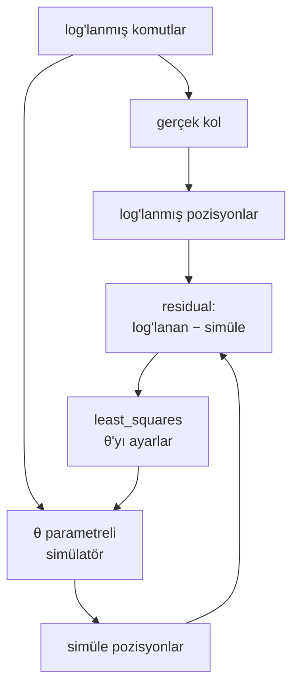

# 38 · System identification

<!-- meta -->
| | |
|---|---|
| **Bölüm** | [9 · Sim-to-real](README.md) |
| **Çalışma türü** | CPU · Mac ya da Colab CPU |
| **Önkoşul** | [11](../part-4-dynamics-and-control/11-rigid-body-dynamics.md), [37](37-latency.md) |
| **Önce öğren** | [Optimization](https://aiengineeringfromscratch.com/lesson?path=phases/01-math-foundations/08-optimization) |
| **Süre** | ~60 dk |
| **Kod** | [`experiments/38-system-identification/experiment.py`](../../experiments/38-system-identification/experiment.py) |
| **Durum** | ✅ tam |
<!-- /meta -->

> Simülatör robot hakkında bir hipotezdir; system identification bu hipotezi log'lanmış veriyle sınamanın ve sayılarını düzeltmenin yoludur.

## Problem

Menagerie SO-101 her STS3215 joint'ine aynı `damping="0.60" frictionloss="0.052" armature="0.028"` değerlerini ve `kp="998.22"` olan bir position actuator'ü veriyor; dosyanın kendi yorumu bu gain'lerin LeRobot'un kullandığı servo gain'lerinin "1-to-1" karşılığı olmadığını söylüyor ([`so101.xml`](https://github.com/google-deepmind/mujoco_menagerie/blob/f3b6013/robotstudio_so101/so101.xml)). Senin kolunun kendi baskısı, yükü, kablo sürtünmesi ve bus gecikmesi var; ders 37, eksik 30 ms'nin bir döngüyü bozabildiğini gösterdi. Modelin hangi sayıları senin kolun için yanlış ve bunları yalnızca log'lanmış trajectory'lerden düzeltebilir misin?

## Ana fikir

### Sade anlatımla

System identification, modeli simülatörün kendisi, ağırlıkları fiziksel sabitler olan bir regression'dır. Gerçek kola ne komut verdiğini ve ne yaptığını log'la, komutları simülatörde tekrar oynat ve tekrar oynatma log'a uyana kadar düğmeleri (kütle, sürtünme, servo stiffness'ı, gecikme) çevir. Sonucu fit etmediğin veride değerlendir.

Sıradan regression'dan iki farkı var. Girişleri sen seçersin: kolu, her düğme sensor noise'undan büyük bir iz bırakacak şekilde hareket ettir (*excitation*). Modelde bir mekanizma eksikse fit hata vermez; eksik olanı taklit etmek için diğer düğmeleri büker, omitted-variable bias gibi.



### Fit, kod olarak

```python
def residuals(theta):                                   # simulate: replay logged commands in MuJoCo
    return (simulate(theta, cmd_fit) - q_fit).ravel()   # one entry per joint per sample

theta_hat = levenberg_marquardt(residuals, theta_nominal, lb, ub)[0]   # Build it; or SciPy least_squares
val_rms = np.sqrt(np.mean((simulate(theta_hat, cmd_val) - q_val) ** 2))  # judge on a run the fit never saw
```

| Ne | Formül |
|---|---|
| Output-error fit'i | $\hat\theta = \arg\min_\theta \sum_k \big\| y_k - \hat y_k(\theta; u_{0:k}) \big\|^2$ |
| Validation hatası | ayrılmış bir koşuda $y_k - \hat y_k(\hat\theta; u_{0:k})$'nın RMS'i |
| Parametrelere göre doğrusal (tork ölçümlü kollar) | $\tau = Y(q,\dot q,\ddot q)\,\pi$ |

$\theta$ parametre vektörü, $u_k$ ve $y_k$ örnek $k$'daki log'lanmış komut ve log'lanmış joint pozisyonları, $\hat y_k(\theta; u_{0:k})$ simülatörün $k$'ya kadarki komutlardan ürettiği pozisyonlar, $\tau$ joint torkları, $Y$ ölçülen hareketten ($q$, $\dot q$, $\ddot q$) hesaplanan bir matris ve $\pi$ eylemsizlik parametreleridir.

Simüle edilmiş bütün trajectory'leri log'la karşılaştırmak *output-error* kriteridir; kara kutu bir modelde finite-difference Jacobian'larla nonlinear least squares ile çözülür (AIEFS: [Optimization](https://aiengineeringfromscratch.com/lesson?path=phases/01-math-foundations/08-optimization)). Tork ölçümlü kollar $\tau = Y\pi$ regressor'ü üzerinde sıradan least squares kullanabilir (Khalil & Dombre); hobi servo kalibre edilmiş tork raporlamaz, burada model simülatörün kendisi.

<details>
<summary>Matematik ayrıntısı: solver nasıl çalışır ve bazı parametreler neden sabitlenemez</summary>

**Tek satırda Gauss–Newton.** $r(\theta + \delta) \approx r(\theta) + J\delta$ diye doğrusallaştır; $\|r + J\delta\|^2$'yi küçültmek $\delta = -(J^\top J)^{-1} J^\top r$ verir. Levenberg-Marquardt (Sıfırdan yaz) ve SciPy'ın trust-region `trf`'i bu adımın korumalı sürümleridir.

**Parametreleme.** Deney nominal değerlere oranların logaritmasını fit ediyor: fiziksel ölçekler pozitif kalıyor ve belli bir yüzde değişim her parametre için aynı görünüyor.

**Identifiability.** Bir parametre ancak $J$'deki sütunu noise'a göre büyükse ve başka bir sütuna neredeyse paralel değilse identify edilebilir. İki parametre değişimi çıktıyı hemen hemen aynı şekilde oynatıyorsa $J^\top J$'nin bu kombinasyon yönünde çok küçük bir özdeğeri olur: noise tahmini bu *sloppy* yönde çok uzağa taşırken tahmin edilen çıktı neredeyse değişmez. Aşağıdaki B bölümü tam olarak bu.

**Excitation.** $J$'nin sütunlarının ne kadar büyük ve farklı olacağını giriş belirler. Çok büyük bir giriş servo'yu saturation'a sokar; torku artık `kp`'ye ya da damping'e bağlı olmaz (A bölümü, 0,4 rad).

**Noise modeli.** Least squares, her örnekte eşit büyüklükte beyaz Gaussian noise için maximum likelihood'dur; quantize ya da bias'lı encoder'larda işe yarar ama optimal değildir.

**Eksik mekanizma.** Gerçek sistemde modelin içermediği bir terim varsa least squares onun etkisini var olan parametrelerin üzerine yansıtır. Bütün parametreler aynı anda saptırılabilir (Boz).

Daha derine: [Optimization](https://aiengineeringfromscratch.com/lesson?path=phases/01-math-foundations/08-optimization) (AIEFS); L. Ljung, *System Identification: Theory for the User*; W. Khalil, E. Dombre, *Modeling, Identification and Control of Robots*; [SciPy `least_squares`](https://docs.scipy.org/doc/scipy/reference/generated/scipy.optimize.least_squares.html).

</details>

### Bir kolda ne önemli

MuJoCo adlarıyla:

| Parametre | MuJoCo alanı | Nasıl görünür |
|---|---|---|
| Link kütleleri / eylemsizlikleri | `body_mass`, `body_inertia` | yerçekimi sarkması, daha yavaş ivmelenme |
| Armature | `dof_armature` | dişli rotorun ek eylemsizliği |
| Viskoz damping | `dof_damping` | hızla orantılı sürüklenme |
| Friction loss | `dof_frictionloss` | ölü bant, stick-slip, yön değişiminde ofset |
| Actuator gain'i | `actuator_gainprm`, `actuator_biasprm` | servo'nun stiffness'ı |
| Tork limiti | `actuator_forcerange` | maksimum ivme |
| Gecikme | (modelin dışında) | komut ile hareket arasındaki faz kayması |

**Uygulamada excitation.** Bir parametre ancak ölçülen sinyali noise'tan daha fazla değiştiriyorsa identify edilebilir. Giriş *persistently exciting* olmalı (Ljung): frekansça zengin ve genliği yeterince büyük, ama modelin geçerli olduğu ve robotun güvende olduğu bölgenin içinde.

## Sıfırdan yaz

Şimdi solver'ı kendin yazacaksın: residual'ın finite-difference Jacobian'ı ve bir Levenberg-Marquardt döngüsü, yaklaşık 40 satır NumPy. Kara kutu Deney'in MuJoCo tekrar oynatması olarak kalıyor (`simulate`, `excitation`, log-oran parametreleri `to_theta`); böylece fit'in aynı residual üzerinde SciPy'ınkiyle karşılaştırılabiliyor. Bitmiş fonksiyonlar [`physai/sim2real.py`](../../physai/sim2real.py) içinde; `uv run python experiments/38-system-identification/build.py` adımları koşturur (çıktı [`build_output.txt`](../../experiments/38-system-identification/build_output.txt) dosyasında).

### Adım 1 · Parmak izleri

$J = \partial r/\partial x$'in $i$. sütunu, $i$. parametre oynadığında log'lanan trajectory'nin nasıl oynadığıdır. Kara kutuda her sütun bir simülasyon daha demek:

```python
def residual_jacobian(resid, x, r0=None, rel_step=1e-3):
    """Forward-difference Jacobian of a residual vector: one extra simulation per parameter."""
    r0 = resid(x) if r0 is None else r0
    J = np.empty((len(r0), len(x)))
    for i in range(len(x)):
        dx = np.zeros(len(x))
        dx[i] = rel_step * max(1.0, abs(x[i]))
        J[:, i] = (resid(x + dx) - r0) / dx[i]
    return J
```

```text
== Step 1. Fingerprints: |column| of the residual Jacobian at nominal (mrad per unit of x) ==
amplitude       mass  armature   damping  friction        kp     delay
0.02            11.6      32.0       6.3       2.5      26.9      48.1
0.10            37.3    1246.6     920.3      14.0     928.6     947.6
noise floor of the same log, 2 mrad x sqrt(2000 residuals) = 89.4 mrad
```

Excitation argümanı sayılarla bu. Damping'deki %10'luk bir değişim ($\Delta x = 0{,}1$) 0,02 rad'lık log'u toplamda 0,6 mrad oynatıyor, 89,4 mrad'lık noise vektörüne karşı: görünmez. 0,1 rad'da aynı değişim 92 mrad oynatıyor. 0,02 rad'da en büyük sütun gecikmeninki (gecikme her örneği kaydırır); sürtünme sütunu iki genlikte de en küçüğü.

### Adım 2 · Levenberg-Marquardt

Gauss–Newton $(J^\top J)\,\delta = -J^\top r$'yi çözer. Minimumdan uzakta bu adım fazla gidebilir; Levenberg-Marquardt bu yüzden $\lambda\,\mathrm{diag}(J^\top J)$ ekler: büyük $\lambda$ adımı kısa bir gradient adımına, küçük $\lambda$ Gauss–Newton'a çevirir. Maliyet düşene kadar $\lambda$'yı artır, başarıdan sonra azalt, sınırlara kırp:

```python
def levenberg_marquardt(resid, x0, lb, ub, iters=100, lam=1e-3, ftol=1e-10):
    """Minimize |resid(x)|^2 inside the box [lb, ub]: Gauss-Newton steps, damped by lam and clipped to the box.
    Returns the solution, its residual, the Jacobian at the last linearization and the number of evaluations."""
    x = np.clip(np.asarray(x0, float), lb, ub)
    r = resid(x)
    cost, nfev = r @ r, 1
    for _ in range(iters):
        J = residual_jacobian(resid, x, r)
        nfev += len(x)
        A, g = J.T @ J, J.T @ r
        while True:                                # raise the damping until the step lowers the cost
            x_new = np.clip(x + np.linalg.solve(A + lam * np.diag(np.diag(A)), -g), lb, ub)
            r_new = resid(x_new)
            nfev += 1
            if r_new @ r_new < cost or lam > 1e10:
                break
            lam *= 10
        if r_new @ r_new >= cost:                  # no step helps: we are at the minimum
            break
        done = cost - r_new @ r_new < ftol * cost
        x, r, cost, lam = x_new, r_new, r_new @ r_new, lam / 10
        if done:
            break
    return x, r, J, nfev
```

```text
== Step 2. Levenberg-Marquardt by hand, noise-free log at 0.1 rad ==
                          mass% armatur% damping% frictio%      kp%   dly ms  val mrad evals
ours                       -0.0     +0.0     -0.0     +0.0     -0.0     -0.0      0.00   108
final cost |r|^2 = 1.7e-16 mrad^2
```

Noise olmadan altı gizli parametre tam olarak geri geliyor (Deney'in B bölümü, σ = 0 satırı). "evals" Jacobian sütunları dahil her simülasyonu sayıyor.

### Adım 3 · Noise ile

```text
== Step 3. The same fit with 2 mrad of noise (the Experiment's part B draw) ==
                          mass% armatur% damping% frictio%      kp%   dly ms  val mrad evals
ours                       +8.5     -1.1     +0.9    -20.7     +3.3     +0.2      0.28    69
final cost |r|^2 = 7978.42 mrad^2 over 2000 residuals (2 mrad noise alone: 8000)
```

Son maliyet, 7978,42 mrad², yalnız noise'un katkısının ($2000 \times 2^2$ = 8000) hemen altında: fit noise dışındaki her şeyi açıklıyor ve noise'u biraz overfit ediyor. SciPy aynı residual'da (Kütüphaneyle kullan) +%6,9 kütle ve −%12,9 sürtünmede, biraz daha yüksek bir maliyetle (7982,43) duruyor; validation koşusundaki tahminler 0,03 mrad farklı.

### Adım 4 · Sloppy yön

$J$'nin singular value'ları parametre uzayındaki her yönün ne kadar iyi sabitlendiğini söyler. σ'lık beyaz noise'la parametre kovaryansı $\sigma^2 (J^\top J)^{-1}$'dir:

```python
U, s, Vt = np.linalg.svd(J, full_matrices=False)
sd = 2.0 * np.sqrt(np.diag(np.linalg.inv(J.T @ J)))   # 2 mrad noise -> 1-sigma spread of x
```

```text
== Step 4. The sloppy direction: singular values of J at the noisy solution ==
singular values: 685.6 277.3 79.2 62.4 29.0 3.9  (ratio 176)
weakest direction: mass -0.04 armature -0.00 damping -0.06 friction +1.00 kp -0.02 delay -0.02
predicted 1-sigma spread: mass 7.1% armature 0.4% damping 4.2% friction 51.2% kp 3.1% delay 0.20 ms
```

En zayıf yön neredeyse saf sürtünme: veri onu en iyi yönden 176 kat kötü sabitliyor, tahmin edilen 1σ yayılımı %51,2. Sürtünmenin burada −%20,7, SciPy'da −%12,9 ve Deney'in B bölümünde +%131,3'e kadar savrulmasının, armature (%0,4) ile gecikmenin (0,20 ms) ise yerinde kalmasının sebebi bu.

### Adım 5 · Eksik bir mekanizma

```text
== Step 5. A missing mechanism: no delay parameter, noise-free log ==
                          mass% armatur% damping% frictio%      kp%   dly ms  val mrad evals
ours, no delay            -45.0    +33.9    -28.7   +133.0    -68.1    -15.0      1.99   218
                       cost |r|^2 = 11230.1 mrad^2
fitted: mass 0.660, armature 0.054, damping 0.641, friction 0.233, kp 0.223
```

Senin döngün ve SciPy (Kütüphaneyle kullan) aynı yanlış modele iki farklı yanlış cevap buluyor: SciPy daha düşük fit maliyetine ulaşıyor (11230,1'e karşı 8162,84 mrad²) ama ayrılmış koşuyu daha kötü tahmin ediyor (1,99'a karşı 6,23 mrad). İkisi de her parametreyi saptırıyor; ikisi de 15 ms gecikmeyi daha yumuşak bir servo ile taklit ediyor (burada kp 0,223, Deney'de 0,226). Doğru yapı yoksa fit maliyeti modelleri tahmin başarısına göre sıralamıyor.

### Elinde kalan

`physai.sim2real` artık `residual_jacobian` ve `levenberg_marquardt` içeriyor. Ders 39 identify edilmiş değerlerin etrafında randomize ediyor; ders 43 aynı least-squares fikriyle bir dinamik modeli fit ediyor. [`tests/test_38_system_identification.py`](../../tests/test_38_system_identification.py) onları `np.linalg.lstsq` ve SciPy ile karşılaştırır: `uv run pytest tests/test_38_system_identification.py`.

## Kütüphaneyle kullan

Kütüphane çağrısı SciPy'ın [`least_squares`](https://docs.scipy.org/doc/scipy/reference/generated/scipy.optimize.least_squares.html)'idir; varsayılan `trf` yöntemi sınırları destekler, `diff_step` göreli finite-difference adımını belirler:

```python
s = least_squares(resid, x0, bounds=(lb, ub), diff_step=1e-3, xtol=1e-8, ftol=1e-10, gtol=1e-10)
theta_hat = to_theta(s.x)
```

```text
== Use it. scipy.optimize.least_squares on the same residuals ==
                          mass% armatur% damping% frictio%      kp%   dly ms  val mrad evals
SciPy, noise-free          -0.0     +0.0     -0.0     +0.0     -0.0     -0.0      0.00    77
                       cost |r|^2 = 0.00 mrad^2, nfev (without Jacobian calls) 11
SciPy, 2 mrad noise        +6.9     -1.3     +0.9    -12.9     +4.6     +0.2      0.25   125
                       cost |r|^2 = 7982.43 mrad^2, nfev (without Jacobian calls) 23
SciPy, no delay           -50.7    +35.4    +40.9    +46.0    -67.8    -15.0      6.23   104
                       cost |r|^2 = 8162.84 mrad^2, nfev (without Jacobian calls) 29
```

| Araç | Çağrı | Dikkat |
|---|---|---|
| physai | `levenberg_marquardt(resid, x0, lb, ub)` | maliyeti $\lvert r\rvert^2$ olarak döndürür ve her simülasyonu sayar |
| SciPy | `least_squares(fun, x0, bounds=...)` | `cost` $\tfrac12\lvert r\rvert^2$'dir; `nfev` finite-difference Jacobian çağrılarını saymaz (yukarıda `nfev` 11 için 77 simülasyon); `method='lm'` sınır kabul etmez |
| SciPy | `curve_fit(f, xdata, ydata, p0, bounds=...)` | sınır yoksa `'lm'`, varsa `'trf'` kullanır; `absolute_sigma=True` değilse `pcov` residual varyansıyla yeniden ölçeklenir |

Tuzaklar:

- **Parametreleri ölçekle.** 0,028'lik armature ile 15 ms'lik gecikme arasında büyüklük mertebeleri var; log-oranları ve 10 ms biriminde gecikmeyi fit et (burada olduğu gibi) ya da `x_scale` ver; yoksa bazı sütunlar için finite-difference adımları anlamsızlaşır.
- **Yakınsadı demek identify etti demek değil.** İki solver da düz sürtünme yönünde memnuniyetle duruyor; bir parametreye güvenmeden önce singular value'lara bak.
- **Daha düşük fit maliyeti daha iyi model demek değil**, bir mekanizma eksikse (Adım 5): fit'leri ayrılmış veride sırala.

## Deney

**Kurulum, sim-to-sim.** "Gerçek" bir SO-101, altı gizli parametresi değiştirilmiş Menagerie modeli (bu test için uyduruldu). Nominal bir model bunları log'lardan fit ediyor.

| | kütle ölçeği | armature | damping | frictionloss | kp ölçeği | gecikme |
|---|---|---|---|---|---|---|
| nominal | 1,000 | 0,028 | 0,600 | 0,052 | 1,000 | 0 ms |
| gizli "gerçek" | 1,200 | 0,040 | 0,900 | 0,100 | 0,700 | 15 ms |

Beş kol joint'i bir orta pozun etrafında 4 s boyunca bir multisine ile (sinüslerin toplamı, 0,5–3,5 Hz, her joint'e farklı fazlar) sürülüyor; pozisyonlar beyaz noise'la 100 Hz'de log'lanıyor; fizik 5 ms. SciPy'ın `least_squares`'i log üzerinde nominale göre log-oranları (gecikme 10 ms biriminde) fit ediyor; ayrılmış bir trajectory (yumuşatılmış rastgele hedefler) tahmini kontrol ediyor. Hiç fit yapmadan önce, onun üzerinde nominal ile gerçek arası: 9,54 mrad RMS.

Tam script: [`experiments/38-system-identification/experiment.py`](../../experiments/38-system-identification/experiment.py). MuJoCo 3.17.0, NumPy 2.5.4, SciPy 1.18.1, Python 3.14, Apple Silicon Mac (Apple M5), deterministik, bir dakikadan çok daha az CPU.

**A. Excitation genliğinin sweep'i** (noise σ = 2 mrad). Değerler: fit sonrası parametre hatası, gerçek değerin yüzdesi olarak (gecikme: ms cinsinden hata); validation RMS mrad cinsinden; `sat` = bir servo'nun 2,94 N·m limitinde olduğu adımların payı. *Tahmin et:* hangi genlik en iyi identify eder?

| genlik | kütle | armature | damping | sürtünme | kp | gecikme [ms] | fit sonrası val. [mrad] | sat |
|---|---|---|---|---|---|---|---|---|
| 0,005 rad | −%26,7 | +%5,3 | −%61,1 | +%21,5 | −%24,6 | −4,7 | 7,33 | %0,1 |
| 0,020 rad | +%18,1 | −%2,7 | −%41,2 | +%100,5 | +%6,8 | −0,1 | 4,32 | %1,0 |
| 0,050 rad | −%5,8 | +%1,7 | −%21,9 | −%25,6 | −%6,2 | −0,1 | 2,49 | %2,4 |
| **0,100 rad** | −%4,1 | −%0,5 | +%0,1 | +%16,5 | +%1,4 | −0,0 | **0,09** | %4,6 |
| 0,200 rad | −%0,2 | +%1,5 | +%2,1 | −%48,2 | −%8,1 | −0,5 | 0,13 | %41,0 |
| 0,400 rad | −%6,9 | −%23,4 | −%35,4 | −%68,3 | +%13,3 | −3,7 | 6,67 | %100,0 |


Çok küçükse noise baskın: 0,005 rad'da 2 mrad'lık noise genliğin %40'ı (Sıfırdan yaz, Adım 1 parmak izlerini ölçüyor). Çok büyükse bir servo hep tork limitinde, gain'i ve damping'i pek önemli olmayan bir tork kaynağı: validation 6,67 mrad, neredeyse nominal. Arada (0,1–0,2 rad) validation hatası 9,54'ten 0,09–0,13 mrad'a düşüyor. 0,02 ile 0,2 rad arasında gecikme 0,5 ms içinde bulunuyor; en kolay parametre o, çünkü her örneği kaydırıyor.

**B. Noise'un sweep'i**, 0,1 rad'da:

| σ | kütle | armature | damping | sürtünme | kp | gecikme [ms] | fit sonrası val. [mrad] |
|---|---|---|---|---|---|---|---|
| 0 | −%0,0 | +%0,0 | −%0,0 | +%0,0 | −%0,0 | −0,0 | 0,00 |
| 2 mrad | +%6,9 | −%1,3 | +%0,9 | −%12,9 | +%4,6 | +0,2 | 0,25 |
| 10 mrad | +%27,8 | −%4,3 | −%0,5 | +%120,4 | +%19,3 | +0,8 | 0,76 |
| 30 mrad | −%81,4 | −%6,1 | −%0,7 | +%131,3 | −%13,4 | +0,4 | 1,49 |

Noise'suz fit altı parametrenin hepsini tam olarak buluyor. Noise'la armature, damping ve gecikme %6,1 / 1 ms içinde kalıyor, kütle ve sürtünme ise −%81,4 ve +%131,3'e kadar savruluyor; buna rağmen validation hatası 1,49 mrad'da kalıyor, nominalden altı kat iyi. Parametre hatası tahmin hatası değil: "sloppy" bir yön (Sıfırdan yaz, Adım 4: neredeyse saf sürtünme) çıktıyı pek değiştirmiyor; veri onu sabitleyemiyor, tahmin de pek umursamıyor. A ve B'deki 2 mrad satırları yalnızca noise çekilişinde farklı (0,09 ve 0,25 mrad).

## Boz

0,1 rad'lık log'u yanlış model yapısıyla fit et: gecikme parametresi yok (gecikme 0'a sabit), noise yok.

| | kütle | armature | damping | sürtünme | kp | fit sonrası val. [mrad] |
|---|---|---|---|---|---|---|
| gecikme terimi yok | −%50,7 | +%35,4 | +%40,9 | +%46,0 | −%67,8 | 6,23 |

Fit değerleri: kp ölçeği 0,226 (gerçek 0,700), damping 1,268 (gerçek 0,900), kütle ölçeği 0,591 (gerçek 1,200). Optimizer 15 ms gecikmeyi temsil edemiyor, bu yüzden onu yumuşak, aşırı sönümlü, hafif bir servo ile taklit ediyor: validation'da 6,23 mrad, gecikmeli modelin 30 mrad noise'taki sonucundan kötü. Eksik bir mekanizma tek bir parametreyi değil hepsini bozar (Sıfırdan yaz, Adım 5 ikinci, farklı bir yanlış cevap buluyor). Gecikmeyi her zaman dahil et (ders 37) ve fit etmediğin veride kontrol et.

## Gerçek robotta

Gerçek SO-101 için prosedür (gerçek kolda henüz ölçülmedi):

1. **Calibrate et ve bağlan**, ders 40'taki gibi. LeRobot joint pozisyonlarını varsayılan olarak kalibre edilmiş aralığın ortasına göre derece cinsinden raporluyor (`use_degrees = True`; [`config_so_follower.py`](https://github.com/huggingface/lerobot/blob/main/src/lerobot/robots/so_follower/config_so_follower.py), [`motors_bus.py`](https://github.com/huggingface/lerobot/blob/main/src/lerobot/motors/motors_bus.py)). Bu dereceler ile Menagerie joint açıları arasındaki ofset ve işaret bilinmiyor: kolu bilinen iki poza koyup önce bunları fit et ya da $\theta$'ya ekle.
2. **Bir komut akışını log'la** (`robot.send_action`, `robot.get_observation`, [LeRobot rehberi](https://huggingface.co/docs/lerobot/il_robots)): sabit hızlı bir döngüde, her komut ve okuma için zaman damgasıyla.
3. **Önce her joint'i tek tek uyar**, sonra hepsini birlikte: büyüyen step'ler ve bir chirp (frekansı giderek artan bir sinüs) ya da multisine; birkaç dereceden başla, kalibre edilmiş aralığın içinde kal, masadan uzak dur, ders 15'in safety katmanları açık olsun. Noise'u görmek için her koşuyu tekrarla.
4. **Fit et**: aynı altı parametreyi (artı ofsetleri), log'lanmış komutları log'lanmış zaman damgalarıyla MuJoCo'da tekrar oynatarak, `experiment.py`'deki gibi. Menagerie gain'leri servo P gain'inin 16 olduğu varsayılarak türetilmiş (`so101.xml` içindeki yorum); bu, LeRobot'un varsayılan `position_p_coefficient = 16` değeriyle uyuşuyor.
5. **Doğrula**: ayrılmış bir koşuda ve gerçek bir görev hareketinde. Fit yalnızca kendi verisinde çalışıyorsa bir mekanizma eksiktir (Menagerie dosyasının tanımladığı ama kullanmadığı backlash; kablo kuvvetleri; sıcaklığa bağlı sürtünme).

## Kendini dene

1. **Kolay.** Gecikme 0,02 rad'da neden iyi identify ediliyor da damping edilmiyor?
2. **Orta.** B bölümünde σ = 30 mrad'da kütle ölçeği −%81,4 hatalı, ama validation hatası yalnızca 1,49 mrad. Kütle bu kolun joint pozisyonları için neden bu kadar az önemli?
3. **Zor.** Yedinci parametre olarak `forcerange`'i (tork limiti) ekle ve A bölümünü tekrarla. 0,4 rad satırının iyileşip iyileşmeyeceğini tahmin et.

### Cevaplar

1. Gecikme bütün tepkiyi kaydırır, bu yüzden hareket eden her örnek onun hakkında bilgi taşır; damping hızla orantılı bir kuvvet ekler, küçük genlikte bu noise'un altında kalır (Sıfırdan yaz, Adım 1: 0,02 rad'da birim başına 48,1'e karşı 6,3 mrad).
2. Sert servo kolu yerçekimine karşı çok küçük bir sarkmayla tutuyor: ders 12, çıplak kol için 0,033° omuz sarkması ölçtü. Kütle o zaman yalnızca hızlı hareketlerde eylemsizlik yoluyla, fit'in iyi identify ettiği armature ile birlikte etki ediyor. Kütleyi değiştirmek pozisyonları çok az değiştiriyor, bu yüzden noise onu gizliyor; aynı sebeple tahmini de pek etkilemiyor.
3. Validation hatası 6,67'den 0,82 mrad'a iyileşiyor, parametreler ise iyileşmiyor: fit edilen tork limiti ölçeği 0,820 (gerçek 1,000), kp hatası −%50,0. Saturation'lı veri limiti sabitler, servo gain'ini değil; ek parametre diğerlerinin hatasını emiyor. A bölümüyle aynı noise çekilişi; `output.txt`'de "Exercise 3" bölümü.

## Akılda kalanlar ve kaynaklar

- Simülatörü log'lanmış komutlara ve ölçümlere fit et (output error); iyi bir excitation ile validation hatası 9,54'ten 0,09 mrad'a düşüyor.
- Excitation'ın bir penceresi var: çok küçüğü noise'ta boğulur, çok büyüğü actuator'ü saturation'a sokar ve servo parametrelerini gizler.
- Parametre hatası tahmin hatası değildir ve eksik bir mekanizma (gecikme) diğer bütün parametreleri saptırır: ayrılmış veride doğrula.

Sonraki: [ders 39 · Domain randomization](39-domain-randomization.md).

Kaynaklar:
- L. Ljung, *System Identification: Theory for the User*, 2. baskı, Prentice Hall, 1999.
- W. Khalil, E. Dombre, *Modeling, Identification and Control of Robots*, Hermes Penton, 2002.
- [SciPy `least_squares`](https://docs.scipy.org/doc/scipy/reference/generated/scipy.optimize.least_squares.html); [MuJoCo XML reference · joint](https://mujoco.readthedocs.io/en/stable/XMLreference.html#body-joint) (armature, damping, frictionloss).
- [MuJoCo Menagerie · robotstudio_so101](https://github.com/google-deepmind/mujoco_menagerie/tree/f3b6013/robotstudio_so101) (Apache-2.0).
- LeRobot [`config_so_follower.py`](https://github.com/huggingface/lerobot/blob/main/src/lerobot/robots/so_follower/config_so_follower.py), [`motors_bus.py`](https://github.com/huggingface/lerobot/blob/main/src/lerobot/motors/motors_bus.py), [imitation learning rehberi](https://huggingface.co/docs/lerobot/il_robots) (2026-10-27'de okundu).
- J. Tan ve ark., [Sim-to-Real: Learning Agile Locomotion For Quadruped Robots](https://arxiv.org/abs/1804.10332), 2018 (aktarım için system identification, actuator modeli ve latency).
- Ölçülen bütün sayılar: [`experiments/38-system-identification/output.txt`](../../experiments/38-system-identification/output.txt).
