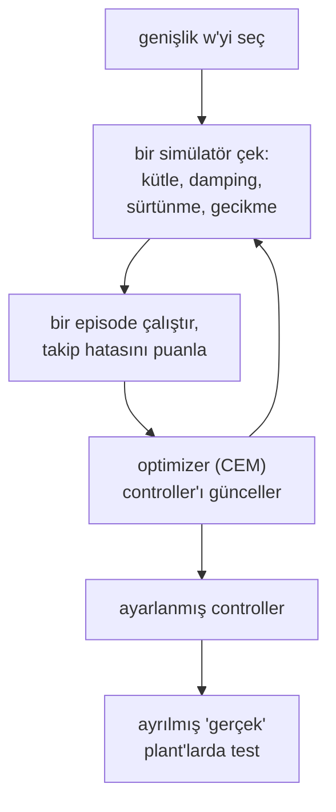

# 39 · Domain randomization

<!-- meta -->
| | |
|---|---|
| **Bölüm** | [9 · Sim-to-real](README.md) |
| **Çalışma türü** | CPU · Mac ya da Colab CPU |
| **Önkoşul** | [33](../part-8-rl-for-robots/33-ppo.md), [38](38-system-identification.md) |
| **Önce öğren** | [Sim-to-Real Transfer](https://aiengineeringfromscratch.com/lesson?path=phases/09-reinforcement-learning/11-sim-to-real-transfer) · [Bias-Variance Tradeoff](https://aiengineeringfromscratch.com/lesson?path=phases/02-ml-fundamentals/10-bias-variance) |
| **Süre** | ~60 dk |
| **Kod** | [`experiments/39-domain-randomization/experiment.py`](../../experiments/39-domain-randomization/experiment.py) |
| **Durum** | ✅ tam |
<!-- /meta -->

> Gerçek parametreleri tam bilemiyorsan, onları içeren bir aralıkta eğit; aralık çok darsa policy kırılgan, çok genişse çekingen olur.

## Problem

System identification (ders 38) simülatör ile robot arasındaki farkı daraltır ama hiçbir zaman kapatmaz: bazı parametreler belirsiz kalır, bazıları günden güne değişir (yük, aşınma, sıcaklık, farklı bir zemin). Tek bir nominal simülatörde optimize edilmiş bir controller ya da policy, tam olarak kendisine verilen sayıları sömürür. Unitree'nin bacaklı robotları için açık eğitim kodu bu yüzden her simüle robot için yeni bir zemin sürtünme katsayısı çekiyor, `randomize_friction = True`, `friction_range = [0.5, 1.25]`, ve robotları her 15 s'de rastgele itiyor ([`legged_robot_config.py`](https://github.com/unitreerobotics/unitree_rl_gym/blob/main/legged_gym/envs/base/legged_robot_config.py)); Go2 konfigürasyonu bu ayarları değiştirmeden devralıyor ([`go2_config.py`](https://github.com/unitreerobotics/unitree_rl_gym/blob/main/legged_gym/envs/go2/go2_config.py)). Böyle bir aralık ne kadar geniş olmalı ve genişliğin bedeli ne?

## Ana fikir

### Sade anlatımla

Bir sürücüyü yalnızca tek bir simülatörde eğitirsen onun bütün huylarını ezberler: nerede fren yapılacağını, yolun ne kadar tuttuğunu, arabanın ne kadar çabuk tepki verdiğini. Biraz farklı gerçek bir arabaya bindiğinde her virajı yanlış hesaplar. Onu bunun yerine her birinin tutuşu, ağırlığı ve tepki gecikmesi biraz farklı birçok simülatörde eğitirsen, bütün aileye uyan bir sürüş tarzı öğrenir. Gerçek araba da bu ailedeyse, Tobin ve arkadaşlarının ifadesiyle "just another variation" olur. Buna *domain randomization* (DR) denir.

Bedeli şu: buzdan kuru asfalta kadar her şeyle başa çıkması gereken bir sürücü, yalnızca kuru asfaltı bilen birinden daha temkinli sürer. Çok dar bir aralık kırılgan, çok geniş bir aralık çekingen bir policy verir. Bu, makine öğrenmesindeki regularization'la aynı ödünleşimdir: biraz olanı daha iyi genelleştirir, fazlası underfit eder.



### Domain randomization, kod olarak

Sıradan eğitimden tek farkı puanın nereden geldiği: tek bir sabit simülatör yerine rastgele çekilmiş simülatörler üzerinden bir ortalama. Bu derste optimizer *cross-entropy method* (CEM), türev kullanmayan basit bir arama: aday controller'lar örnekle, en iyilerini tut, örnekleme dağılımını onlara doğru kaydır, tekrarla.

```python
def expected_return(gains, w, n=10):
    plants = [sample_plant(w) for _ in range(n)]       # n random simulators of width w
    return mean(J(gains, p) for p in plants)           # J: return of one episode (here -RMS tracking error)

mu, sd = initial_mean, initial_spread                  # search distribution over (Kp, Kd, kg)
for it in range(12):                                   # CEM iterations
    cands = [normal(mu, sd) for _ in range(24)]        # candidate controllers
    elite = best(cands, key=lambda g: expected_return(g, w))
    mu, sd = mean(elite), std(elite)                   # move the search toward the best ones
```

| Ne | Formül |
|---|---|
| Nominal eğitim | $\pi^*_0 = \arg\max_\pi\ J(\pi;\xi_0)$ |
| Domain randomization | $\pi^*_w = \arg\max_\pi\ \mathbb{E}_{\xi \sim p_w}\big[J(\pi;\xi)\big]$ |
| Bu dersteki genişlik | ölçekler $\in [2^{-w}, 2^{w}]$ (log-uniform), gecikme $\in [5, 5+40w]$ ms |

$\pi$ policy (burada $K_p$, $K_d$, $k_g$ gain'leri), $\xi$ simülatör parametrelerinin vektörü (kütle, damping, sürtünme, gecikme), $\xi_0$ nominal değeri, $J(\pi;\xi)$ policy'nin $\xi$ parametreli simülatördeki return'ü ve $p_w$ genişliği $w$ olan simülatör dağılımıdır.

<details>
<summary>Matematik ayrıntısı: simülatörler üzerinden ortalama almak neden işe yarar ve ne zaman yaramaz</summary>

**Kapsama.** DR, $p_w$ üzerindeki ortalama return'ü optimize eder. Gerçek robotun $\xi_{\text{real}}$'i $p_w$'nin desteği (çekilebilecek simülatörlerin kümesi) içindeyse, policy ona benzer simülatörlerde puanlanmıştır; dışındaysa eğitimde hiçbir şey bu durumu kontrol etmemiştir.

**Ortalama ve en kötü durum.** $w$ büyüdükçe ortalamaya zor simülatörler (uzun gecikmeler, ağır link'ler) giderek daha çok hâkim olur; optimum temkinli, en kötü duruma göre ayarlanmış bir controller'a kayar. Limitte bu bir minimax problemine, $\max_\pi \min_\xi J(\pi;\xi)$, yaklaşır: garantiler için nominal performanstan vazgeçer.

**Bias-variance benzetmesi.** Tek bir $\xi_0$ üzerinde eğitmek tek bir veri setini tam fit etmek gibidir: orada hata düşük, yeni veride yüksek. Daha geniş bir $p_w$ regularization gibi davranır: bilinen plant'ta daha yüksek hata (bias), bilinmeyene daha az duyarlılık (variance) (bkz. AIEFS: [Bias-Variance Tradeoff](https://aiengineeringfromscratch.com/lesson?path=phases/02-ml-fundamentals/10-bias-variance)).

**Sabit bir controller'ın sınırları.** Sabit gain'li bir controller her $\xi$ için tek bir uzlaşma bulmak zorundadır. Gerçek değişim tek bir uzlaşmanın emebileceğinden büyükse hiçbir genişlik yardım etmez (Gözlem 4).

**Önceki çalışmalar.** Tobin ve ark. ([arXiv 1703.06907](https://arxiv.org/abs/1703.06907)) yalnızca simüle görüntülerle bir nesne dedektörü eğitmek için render'ı randomize etti. Tan ve ark. ([arXiv 1804.10332](https://arxiv.org/abs/1804.10332)) dört bacaklı yürüyüşleri simülasyondan gerçek robota taşımak için fiziksel parametreleri randomize etti, bozucular ekledi ve bir actuator modeli ile latency'yi identify etti.

Daha derine: [Sim-to-Real Transfer](https://aiengineeringfromscratch.com/lesson?path=phases/09-reinforcement-learning/11-sim-to-real-transfer), [Bias-Variance Tradeoff](https://aiengineeringfromscratch.com/lesson?path=phases/02-ml-fundamentals/10-bias-variance) (AIEFS); de Boer ve ark., "A Tutorial on the Cross-Entropy Method" (2005).

</details>

<!-- figure: 39-randomization-width -->

### Ödünleşim ve neyi randomize etmeli

| Genişlik | Nominal sim | Gerçek robot |
|---|---|---|
| 0 (yalnızca nominal) | en iyi | $\xi_{\text{real}} \ne \xi_0$ olunca başarısız |
| $\xi_{\text{real}}$'i ancak kapsıyor | biraz daha kötü | çalışıyor |
| çok daha geniş | daha kötü | yine daha kötü: policy en kötü duruma göre ayarlanmış |

Bir kolda ders 38'in parametrelerini (kütleler, damping, sürtünme, armature, actuator gain'i) ve ders 37'nin gecikmesini randomize et. Aralıkları identify edilmiş değerlere ortala ve genişliklerini identification'ın belirsizliğinden belirle.

## Sıfırdan yaz

Şimdi domain randomization'ın fizik olmayan kısmını yazacaksın: sampler, bir kapsama kontrolü, ortalama maliyet ve optimizer. Plant ve batch'lenmiş MuJoCo rollout'u Deney'inki olarak kalıyor (`Batch.rollout(gains, plants)` her satır için bir episode koşturup RMS takip hatasını döndürür). Bitmiş fonksiyonlar [`physai/sim2real.py`](../../physai/sim2real.py) içinde; `uv run python experiments/39-domain-randomization/build.py` adımları koşturur (çıktı [`build_output.txt`](../../experiments/39-domain-randomization/build_output.txt) dosyasında).

### Adım 1 · Sampler

Log-uniform bir ölçek $2^u$'dur, $u$ ise $[-w, w]$'de uniform: yarıya inmek ile iki katına çıkmak eşit olasılıklı, medyan 1.

```python
def dr_sample(rng, n, w, delay0=0.005, delay_per_w=0.040):
    """n random plants of width w: mass, damping and friction scales log-uniform in [2^-w, 2^w], delay uniform in
    [delay0, delay0 + delay_per_w * w] seconds. w = 0 returns n nominal plants and draws nothing from rng."""
    if w == 0:
        return dict(mass=np.ones(n), damping=np.ones(n), friction=np.ones(n), delay=np.full(n, delay0))
    s = lambda: 2.0 ** rng.uniform(-w, w, n)  # noqa: E731
    return dict(mass=s(), damping=s(), friction=s(), delay=rng.uniform(delay0, delay0 + delay_per_w * w, n))
```

```text
== Step 1. The sampler at w = 0.5, 100,000 draws ==
mass      min 0.7071 max 1.4142 (2^-0.5 = 0.7071, 2^0.5 = 1.4142), median 0.9993, share above 1: 0.499
damping   min 0.7071 max 1.4142 (2^-0.5 = 0.7071, 2^0.5 = 1.4142), median 0.9983, share above 1: 0.497
friction  min 0.7071 max 1.4142 (2^-0.5 = 0.7071, 2^0.5 = 1.4142), median 0.9994, share above 1: 0.499
delay     min 5.00 ms, max 25.00 ms (formula 5-25 ms)
same draws as the Experiment's sampler (seed 7): True
```

Çekilişler formüldeki iki sınıra da değiyor, yarısı 1'in üstünde ve aynı seed'le Deney'in sampler'ıyla çekiliş çekiliş aynı; Adım 4 buna dayanıyor.

### Adım 2 · Kapsama

Bir şey eğitmeden önce, bir genişliğin hangi gerçek plant'ları çekebildiğini sor:

```python
def inside_support(plants, w, delay0=0.005, delay_per_w=0.040):
    """For every plant and parameter: can the width-w training distribution draw this value?"""
    lo, hi, eps = 2.0 ** -w, 2.0 ** w, 1e-12
    out = {k: (plants[k] >= lo - eps) & (plants[k] <= hi + eps) for k in ("mass", "damping", "friction")}
    out["delay"] = (plants["delay"] >= delay0 - eps) & (plants["delay"] <= delay0 + delay_per_w * w + eps)
    return out
```

```text
== Step 2. Coverage: real plants inside the training support (of 32) ==
    w  mass  damping  friction  delay  all four
 0.00     0        0         0      0         0
 0.10     0        6         2      0         0
 0.25     7       13         4      0         0
 0.50    32       28         6     25         5
 0.75    32       32        11     32        11
 1.00    32       32        20     32        20
 1.50    32       32        32     32        32
 2.00    32       32        32     32        32
largest real friction scale 2.48, largest real delay 28.8 ms
```

$w$ = 0,5'te 32 gerçek plant'tan yalnızca 5'i eğitim dağılımının tamamen içinde; hepsini kapsamak için sürtünme yüzünden (×2,48'e kadar) $w$ = 1,5 gerekiyor. Yine de Deney'in en iyi genişlikleri 0,5–1,0 (27–28/32), $w$ = 1,5 ise yalnızca 23/32'ye ulaşıyor. Kapsama bir garanti için gerekli, iyi aktarım için yeterli değil: genişliğin bedeli her plant'ta ödeniyor.

### Adım 3 · Ortalama maliyet

Domain randomization "tek simülatördeki maliyet"i "örneklenmiş simülatörler üzerinden ortalama maliyet"le değiştirir. Her adayı *aynı* örneklenmiş plant'larda puanlamak (common random numbers) adaylar arasındaki karşılaştırmayı adil tutar:

```python
def expected_cost(rollout, gains, plants):
    """Mean cost of every controller (row of gains) over the same sampled plants (common random numbers).
    rollout(gain_rows, plant_rows) runs one episode per row and returns its cost."""
    n, k = len(gains), len(plants["delay"])
    tiled = {key: np.tile(v, n) for key, v in plants.items()}       # plants 0..k-1 for controller 0, then 1, ...
    return rollout(np.repeat(gains, k, axis=0), tiled).reshape(n, k).mean(axis=1)
```

```text
== Step 3. The averaged cost: the Experiment's tuned controllers, re-scored ==
tuned at       Kp     Kd     kg  nominal deg  real mean deg  real < 2 deg
w = 0.00   117.36  0.914  0.679        0.165          3.525          5/32
w = 0.50    55.43  3.244  0.563        0.475          1.307         28/32
```

Deney tablosunda yazan gain'lerle yeniden puanlanınca iki satır da geri geliyor: yalnızca nominalde ayarlanan controller için 0,165° nominal ve 5/32, $w$ = 0,5 için 0,475° ve 28/32. İlk satırın gerçek ortalaması, tablonun 3,526°'sine karşı 3,525°; fark, tablodaki gain'lerin iki ondalığa yuvarlanmış olmasından.

### Adım 4 · Cross-entropy method

CEM parametreler üzerinde bir Gaussian tutar, adaylar çeker, en ucuz çeyreği saklar ve Gaussian'ı onlara yeniden fit eder. Küçük `sd_extra`, arama yakınsamadan önce tek bir noktaya çökmesin diye var.

```python
def cem(cost, mu, sd, lo, hi, rng, iters=12, pop=24, n_elite=6, sd_extra=0.02):
    """Cross-entropy method: draw pop candidates from N(mu, sd) clipped to [lo, hi], keep the n_elite cheapest,
    refit mu and sd to them (plus sd_extra, so the search never collapses), repeat. cost(x, rng) -> one per row."""
    for _ in range(iters):
        x = np.clip(mu + sd * rng.standard_normal((pop, len(mu))), lo, hi)
        elite = x[np.argsort(cost(x, rng))[:n_elite]]
        mu, sd = elite.mean(axis=0), elite.std(axis=0) + sd_extra
    return mu
```

```text
== Step 4. CEM: a toy quadratic, then domain randomization at w = 0.5 ==
toy: minimum at [ 1.  -2.   0.5], CEM finds [0.980, -2.008, 0.503]
w = 0.5: Kp 55.43, Kd 3.244, kg 0.563; nominal 0.475 deg, real mean 1.307 deg, 28/32 below 2 deg
```

Oyuncak quadratic'te CEM minimumun 0,02 yakınına iniyor. Plant'ta Deney'in $w$ = 0,5 satırını birebir yeniden üretiyor (Kp 55,43, Kd 3,244, kg 0,563, 28/32), çünkü sampler random generator'ı aynı sırayla tüketiyor. Optimizer hiçbir gerçek plant görmüyor; onu gerçek plant'lara bağlayan tek şey `dr_sample`'ın genişliği.

### Elinde kalan

`physai.sim2real` artık `dr_sample`, `inside_support`, `expected_cost` ve `cem` içeriyor. Capstone (ders 44) aynı kapsama sorusunu kamera kalibrasyonu için düşünüyor. [`tests/test_39_domain_randomization.py`](../../tests/test_39_domain_randomization.py) dağılımları SciPy ile kontrol eder: `uv run pytest tests/test_39_domain_randomization.py`.

## Kütüphaneyle kullan

MuJoCo'da "randomize" diye bir çağrı yok: düğmeler, episode'lar arasında yeniden derlemeden yazılabilen model alanları (`m.body_mass`, `m.dof_damping`, `m.dof_frictionloss`, `m.geom_friction`, …; gecikme için ders 37'nin `delay` özelliği). Deney joint'in birçok kopyasını tek bir modele koyuyor, böylece tek bir `mj_step` bütün batch'i ilerletiyor, ve her rollout'tan önce kopya başına bir değer yazıyor. Dağılımın adını SciPy koyuyor:

```python
from scipy import stats
scales = stats.loguniform(2 ** -w, 2 ** w).rvs(size=n, random_state=rng)   # same law as dr_sample's 2**u
```

```text
== Use it. SciPy's log-uniform distribution; MuJoCo model fields as the knobs ==
Kolmogorov-Smirnov, our mass scales vs scipy.stats.loguniform(2^-0.5, 2^0.5): D = 0.0026, p = 0.50
randomized fields in the batched model: body_mass (32,), dof_damping (32,), dof_frictionloss (32,) (one entry per copy, written before each rollout)
```

| Araç | Aralık nerede | Ne çekiliyor |
|---|---|---|
| physai | `dr_sample(rng, n, w)` | kütle, damping, sürtünme ölçekleri ve gecikme, her episode'da |
| `unitree_rl_gym` | `randomize_friction`, `friction_range = [0.5, 1.25]`, `added_mass_range` ([config](https://github.com/unitreerobotics/unitree_rl_gym/blob/main/legged_gym/envs/base/legged_robot_config.py)) | zemin sürtünmesi ortam başına bir kez, 64 kovadan ([`legged_robot.py`](https://github.com/unitreerobotics/unitree_rl_gym/blob/main/legged_gym/envs/base/legged_robot.py)) |
| MuJoCo | model alanları (`body_mass`, `dof_damping`, …) | `mj_step`'ten önce ne yazarsan |

Tuzaklar:

- **Ölçek mi mutlak değer mi.** "Kütle ×2" ile "kütle + 1" farklı dağılımlardır: `unitree_rl_gym`'in `added_mass_range`'i taban gövdesinin kütlesine bir sayı ekler (`props[0].mass +=`).
- **Episode başına mı ortam başına mı.** Ortam başına bir kez çekmek (yukarıdaki sürtünme kovaları gibi) her robota bütün koşu boyunca tek bir sabit zemin verir; burada olduğu gibi episode başına çekmek onu her episode'da değiştirir.
- **Eylemsizlik kütleyle birlikte gider.** `body_mass`'ı `body_inertia` olmadan ölçeklemek fiziksel olarak tutarsız bir link verir; Deney ikisini birlikte ölçekliyor.

## Deney

**Kurulum.** Menagerie SO-101'in STS3215 joint parametrelerine sahip (armature 0,028, damping 0,6, frictionloss 0,052, tork limiti 2,94 N·m), kütle merkezi 15 cm'de olan 0,5 kg'lık bir link taşıyan tek bir kol joint'i (yerçekimi torku 0,736 N·m'ye kadar). Bir ölçüm gecikmesi üzerinden tork kontrolü. "Policy" üç parametreli bir controller: PD takip artı bir yerçekimi terimi $k_g\cos q_{\text{ref}}$,

$$\tau = \operatorname{clip}\big(K_p(q_{\text{ref}} - \tilde q) + K_d(\dot q_{\text{ref}} - \dot{\tilde q}) + k_g\cos q_{\text{ref}},\ \pm 2{,}94\big),$$

burada $\tilde q$ gecikmiş ölçümdür. CEM ile ayarlanıyor (Sıfırdan yaz, Adım 4: 12 iterasyon × 24 aday × her biri 10 örneklenmiş plant); amaç 3 s'lik bir referansın, $0{,}5\sin(2\pi\,0{,}4t) + 0{,}25\sin(2\pi\,1{,}1t+1)$ rad, 2 ms step'te RMS takip hatasını en aza indirmek. Genişlik $w$ ile her eğitim episode'u kütle, damping ve friction-loss ölçeklerini $[2^{-w}, 2^{w}]$ aralığında log-uniform, gecikmeyi $[5, 5+40w]$ ms aralığında uniform çekiyor (nominal: ölçekler 1, gecikme 5 ms).

**Test.** Nominal plant ve eğitimde hiç görülmemiş 32 ayrılmış "gerçek" plant (test için uyduruldu): kütle ×1,10–1,39, damping ×0,80–1,56, sürtünme ×1,02–2,48, gecikme 15,5–28,8 ms. Başarı: RMS hata 2°'nin altında. Joint'in birçok kopyası tek bir MuJoCo modelinde yaşıyor; böylece tek bir `mj_step` bütün bir batch'i ilerletiyor.

Tam script: [`experiments/39-domain-randomization/experiment.py`](../../experiments/39-domain-randomization/experiment.py). MuJoCo 3.17.0, NumPy 2.5.4, Python 3.14, Apple Silicon Mac (Apple M5), deterministik (sabit seed'ler), bir dakikanın çok altında CPU. *Tahmin et:* gerçek plant'larda hangi genişlik en iyi ve $w$ büyüdükçe nominal hataya ne olur?

| $w$ | gecikme aralığı [ms] | ölçek aralığı | $K_p$ | $K_d$ | $k_g$ | nominal RMS [°] | gerçek ort. [°] | gerçek en kötü [°] | gerçek başarı |
|---|---|---|---|---|---|---|---|---|---|
| 0 | 5 | 1,00 | 117,36 | 0,914 | 0,679 | **0,165** | 3,526 | 6,025 | 5/32 |
| 0,1 | 5–9 | 0,93–1,07 | 99,98 | 4,484 | 0,307 | 0,227 | 1,607 | 3,260 | 24/32 |
| 0,25 | 5–15 | 0,84–1,19 | 74,77 | 4,276 | 0,523 | 0,252 | 1,490 | 3,368 | 23/32 |
| 0,5 | 5–25 | 0,71–1,41 | 55,43 | 3,244 | 0,563 | 0,475 | 1,307 | 3,293 | **28/32** |
| 0,75 | 5–35 | 0,59–1,68 | 45,19 | 2,672 | 0,461 | 0,736 | **1,228** | 3,118 | 27/32 |
| 1,0 | 5–45 | 0,50–2,00 | 30,41 | 1,969 | 0,591 | 1,224 | 1,233 | 3,419 | 27/32 |


**Gözlem.**

1. Yalnızca nominal plant'ta ayarlanan controller o plant'ta en iyi (0,165°), gerçeklerde en kötü (5/32). Az damping'li $K_p$ = 117'yi seçmiş; gecikmenin 5 ms olduğunu bilmeye dayanan bir döngü. 15,5–28,8 ms ile hatası ortalamada 3,526° oluyor.
2. Dar bir aralık bile ($w$ = 0,1, gecikme 9 ms'ye kadar) gerçek başarıyı 24/32'ye çıkarıyor: kazancın çoğu gecikmenin tam değerine güvenmemekten geliyor. En iyi sonuçlar, gecikmesi gerçek 15,5–28,8 ms'ye uzanan aralıklardan geliyor ($w$ = 0,5 25 ms'ye kadar; 0,75 ve 1 tamamını kapsıyor): 27–28/32, ortalama 1,228–1,307°; oysa 32 plant'tan yalnızca 5–20'si bu aralıkların tamamen içinde (Sıfırdan yaz, Adım 2). Her satır tek seed'li tek bir CEM koşusu; birkaç plant'lık farkları noise say.
3. Nominal hata genişlikle düzenli olarak büyüyor (0,165 → 1,224°), $K_p$ düşerken (117 → 30): sağlamlığın bedeli bildiğin plant'taki takip performansıyla ödeniyor.
4. Hiçbir genişlik 32'nin hepsini çözmüyor: en kötü gerçek plant her satırda 3°'nin üstünde kalıyor. Bazı gerçek plant'larda sürtünme ×2,48, yani $w$ = 1 aralığının bile dışında (×2,00'ye kadar); sabit gain'li bir controller'ın da sınırları var.

## Boz

Aralığı gerçek değişimden çok daha geniş yap:

| $w$ | gecikme aralığı [ms] | ölçek aralığı | $K_p$ | nominal RMS [°] | gerçek ort. [°] | gerçek başarı |
|---|---|---|---|---|---|---|
| 1,5 | 5–65 | 0,35–2,83 | 38,01 | 1,190 | 1,788 | 23/32 |
| 2,0 | 5–85 | 0,25–4,00 | 19,59 | 2,201 | 2,345 | 13/32 |

$w$ = 2'de eğitim dağılımı 85 ms gecikme ve dört kat hafif ya da ağır link'ler içeriyor. Bütün bunlardan sağ çıkan controller yumuşak ($K_p$ = 19,59): nominal plant'ta 2,201° (yalnızca nominalde ayarlanan controller'ın 13 katı) ve gerçek plant'larda 13/32, en dar aralıktan kötü. Optimizer emeğini var olmayan plant'lara harcıyor. Genişlik bir tasarım parametresidir; "olabildiğince geniş" değil, identification (ders 38) ve ölçülen latency (ders 37) ile belirlenir.

## Gerçek robotta

- **Unitree'nin varsayılanları**, `unitree_rl_gym` içinde: her robot için `[0.5, 1.25]` aralığından zemin sürtünmesi (her environment için bir kez, 64 kovadan çekiliyor, [`legged_robot.py`](https://github.com/unitreerobotics/unitree_rl_gym/blob/main/legged_gym/envs/base/legged_robot.py)), `randomize_base_mass = False` ama `added_mass_range = [-1., 1.]` hazır, `push_robots = True`, her 15 s'de `max_push_vel_xy = 1.` ile ([`legged_robot_config.py`](https://github.com/unitreerobotics/unitree_rl_gym/blob/main/legged_gym/envs/base/legged_robot_config.py)). Bunlar eğitim simülasyonu ayarları; belirli bir policy'nin ne kadar iyi aktarıldığı hakkında bir şey söylemiyorlar ve biz bunu ölçmedik.
- **SO-101.** Gerçek gösterimlerle imitation ile eğitilen policy'ler (Bölüm 7, ders 40) gerçek dinamiği zaten görür; DR simülasyonda eğitilen policy'ler için önemlidir (Bölüm 8). Kol için identify ettiğin parametrelerin etrafında, tekrarlanan identification koşularındaki dağılımları kadar geniş aralıklarla ve ölçtüğün latency ile randomize et. Gerçek kolda henüz ölçülmedi.
- **Aralığı donanımda kontrol et.** Eğitilmiş policy'yi robotta ve ayrılmış simüle plant'larda çalıştır; gerçek sonuç en kötü simüle sonuçtan da kötüyse, gerçek robot aralığının dışındadır ya da bir mekanizma eksiktir (ders 38).

## Kendini dene

1. **Kolay.** $w$ = 0,5 ile gecikme aralığı ve ölçek aralığı nedir? 32 gerçek plant'ın hepsini kapsıyorlar mı?
2. **Orta.** Yalnızca nominalde ayarlanan controller neden düşük $K_d$ (0,914) seçiyor da randomize edilenlerin hepsi 1,916 ile 4,484 arasında $K_d$ seçiyor? Ders 37'yi kullan.
3. **Zor.** Yalnızca gecikmeyi randomize et (ölçekler 1'e sabit), $w$ = 0,75 ile, ve gerçek başarıyı tam $w$ = 0,75 satırıyla karşılaştır. Önce tahmin et.

### Cevaplar

1. Gecikme 5–25 ms, ölçekler 0,71–1,41. Hayır: gerçek gecikmeler 28,8 ms'ye, sürtünme ×2,48'e kadar çıkıyor.
2. 5 ms gecikmede döngünün phase margin'i büyük; optimizer damping'i daha hızlı takiple takas edebiliyor. Belirsiz ve daha büyük gecikmelerde $K_d$ crossover'daki phase margin'i geri kazandırır ($\mathrm{PM} = \arctan(K_d\omega_c/K_p)$) ve optimizer onu tutar.
3. 27/32, tam $w$ = 0,75 satırıyla aynı; ortalama hata biraz daha düşük (1,174° ve 1,228°), nominal hata daha yüksek (1,339° ve 0,736°, $K_p$ = 27,87). Bu gerçek plant'lar için önemli olan parametre gecikme; ölçek aralıkları az şey katıyor. `output.txt`'nin son satırı.

## Akılda kalanlar ve kaynaklar

- Nominal simülatörde optimize etmek en iyi nominal sonucu (0,165°) ve en kötü aktarımı (5/32) verir.
- Gerçek değişimin çoğunu kapsayan bir aralık en iyi aktarılır (27–28/32); dar bir aralık bile yardım eder (24/32).
- Çok geniş olan ikisine de mal olur: $w$ = 2'de nominal 2,201° ve gerçek 13/32. Aralığı identification'dan ve ölçülen latency'den belirle.

Sonraki: [ders 40 · Gerçek SO-101'e deploy etmek](40-real-so101.md).

Kaynaklar:
- J. Tobin ve ark., [Domain Randomization for Transferring Deep Neural Networks from Simulation to the Real World](https://arxiv.org/abs/1703.06907), 2017.
- J. Tan ve ark., [Sim-to-Real: Learning Agile Locomotion For Quadruped Robots](https://arxiv.org/abs/1804.10332), 2018.
- [`unitree_rl_gym`](https://github.com/unitreerobotics/unitree_rl_gym): [`legged_robot_config.py`](https://github.com/unitreerobotics/unitree_rl_gym/blob/main/legged_gym/envs/base/legged_robot_config.py), [`legged_robot.py`](https://github.com/unitreerobotics/unitree_rl_gym/blob/main/legged_gym/envs/base/legged_robot.py), [`go2_config.py`](https://github.com/unitreerobotics/unitree_rl_gym/blob/main/legged_gym/envs/go2/go2_config.py) (BSD-3-Clause, 2026-10-27'de okundu).
- P.-T. de Boer, D. P. Kroese, S. Mannor, R. Y. Rubinstein, "A Tutorial on the Cross-Entropy Method", *Annals of Operations Research*, 2005.
- [MuJoCo Menagerie · robotstudio_so101](https://github.com/google-deepmind/mujoco_menagerie/tree/f3b6013/robotstudio_so101) (Apache-2.0): STS3215 joint parametreleri.
- Ölçülen bütün sayılar: [`experiments/39-domain-randomization/output.txt`](../../experiments/39-domain-randomization/output.txt).
