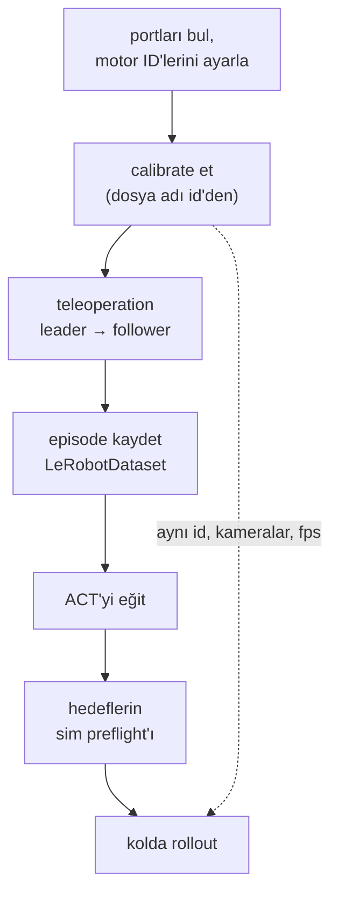

# 40 · Gerçek SO-101'e deploy etmek

<!-- meta -->
| | |
|---|---|
| **Bölüm** | [9 · Sim-to-real](README.md) |
| **Çalışma türü** | HW · gerçek SO-101 |
| **Önkoşul** | [15](../part-4-dynamics-and-control/15-safety.md), [28](../part-7-learning-from-demonstration/28-behavior-cloning.md), [38](38-system-identification.md) |
| **Önce öğren** | yok |
| **Süre** | ~120 dk |
| **Kod** | [`experiments/40-real-so101/experiment.py`](../../experiments/40-real-so101/experiment.py) |
| **Durum** | ✅ tam |
<!-- /meta -->

> Donanımda hataların çoğu kayıt işidir: yanlış port, yanlış id, yanlış kalibrasyon, yanlış birim. Kol hareket etmeden önce bunları simülasyonda ve yazılı olarak kontrol et.

## Problem

Şimdiye kadar her şey simülasyonda çalıştı. LeRobot'ta gerçek SO-101 iş akışını yazmak kısa, ince bir şekilde yanlış yapmak kolay: kalibrasyon robotun `id`'si altında saklanıyor ve LeRobot rehberi teleoperation, kayıt ve değerlendirmede aynı `id`'nin kullanılması gerektiği konusunda uyarıyor ([LeRobot imitation learning rehberi](https://huggingface.co/docs/lerobot/il_robots)). Bir kalibrasyonla kaydedilmiş veride eğitilip başka bir kalibrasyonla çalıştırılan bir policy, aradaki fark kadar kaymış hedefler gönderir ve yazılımda hiçbir şey şikâyet etmez. Bu ders bütün deploy sürecini bir prosedür olarak yazıyor ve komut verilen bir trajectory'yi motorlara ulaşmadan reddeden bir simülasyon preflight'ı ekliyor.

## Ana fikir

### Sade anlatımla

Öğrenilmiş bir policy'yi kola deploy etmek bir build pipeline'ıdır: donanım kurulumu, veri, model, yayın. Her aşama daha önceki bir aşamanın ürettiği konfigürasyonu kullanır; hepsinden önemlisi, ham motor okumalarını policy'nin gördüğü joint değerlerine çeviren *kalibrasyon* dosyası. Bir kalibrasyonla eğitip başka biriyle çalıştırırsan hiçbir şey çökmez; her hedef sessizce kayar. Bu, bir modeli bir feature normalizasyonuyla eğitip başka biriyle servis etmenin robot versiyonudur.

Veriyi *teleoperation* ile kaydedersin: elle tuttuğun *leader* kolu hareket ettirirsin, motorlu *follower* kol onu taklit eder. Bu kayıtlarla bir policy eğitilir; *rollout* da onu sen olmadan follower üzerinde çalıştırır. Yani işin çoğu kayıt tutmaktır: ilk teleoperation'dan son rollout'a kadar port, id, kalibrasyon, kameralar ve frame rate aynı kalsın; komutlar motorlara ulaşmadan önce bir modele karşı kontrol edilsin.



### Pipeline ve değişmezleri

| Aşama | Komut | Ürettiği | Korunacak değişmez |
|---|---|---|---|
| Portlar | `lerobot-find-port` | her kol için bir port | aynı kol için aynı USB cihazı |
| Motor kurulumu | `lerobot-setup-motors` | EEPROM'da ID 1–6, ortak baudrate | her motor için bir kez |
| Kalibrasyon | `lerobot-calibrate` | `HF_LEROBOT_CALIBRATION` altında `<id>.json` | sonraki her komutta aynı `id` |
| Teleoperation | `lerobot-teleoperate` | leader → follower | kayıttan önce follower düzgün davranıyor |
| Kayıt | `lerobot-record` | `LeRobotDataset`, 30 fps | sabit kameralar, tutarlı görev |
| Eğitim | `lerobot-train` | ACT checkpoint'i | tam olarak o dataset üzerinde eğitilmiş |
| Rollout | `lerobot-rollout` | otonom episode'lar | kayıttakiyle aynı kameralar, fps, kalibrasyon |

(Baudrate seri bus'ın hızıdır; EEPROM, servo'nun güç kesilince silinmeyen kendi belleğidir.)

**Birimler.** Varsayılan `use_degrees = True` ile LeRobot beş kol joint'ini kalibrasyonda kaydedilen aralığın ortasına göre derece cinsinden, gripper'ı 0'dan 100'e raporluyor ([`config_so_follower.py`](https://github.com/huggingface/lerobot/blob/main/src/lerobot/robots/so_follower/config_so_follower.py), [`motors_bus.py`](https://github.com/huggingface/lerobot/blob/main/src/lerobot/motors/motors_bus.py)). Menagerie modeli kendi sıfırından radyan kullanıyor. Bir sim kontrolü ancak ikisi arasındaki ofseti ve işareti ölçtükten sonra anlamlıdır (ders 38).

## Sıfırdan yaz

Ders 40'ın riskleri muhasebe, muhasebenin de kol hareket etmeden kontrol edebileceğin bir matematiği var: encoder tick'lerinin policy'nin gördüğü derecelere nasıl dönüştüğü, o derecelerin modelin radyanlarına nasıl eşlendiği ve bir trajectory boyunca yerçekiminin ve bir yükün ne kadar tork istediği. Fonksiyonlar [`physai/sim2real.py`](../../physai/sim2real.py) içinde; `uv run python experiments/40-real-so101/build.py` adımları koşturur (çıktı [`build_output.txt`](../../experiments/40-real-so101/build_output.txt) dosyasında). Aşağıdaki her sayı Menagerie modelinden ya da uydurulmuş test değerlerinden, gerçek bir koldan değil.

### Adım 1 · Tick'ler ve dereceler

LeRobot'un derece modu 0'ı kalibre edilmiş aralığın ortasına koyar ve 360°'yi `resolution - 1` tick'e yayar; geri dönerken `int()` ile keser ([`motors_bus.py`](https://github.com/huggingface/lerobot/blob/main/src/lerobot/motors/motors_bus.py), `_normalize` / `_unnormalize`). Docstring'i 12-bit bir encoder için tur başına 4096 adım veriyor; burada varsayılan bu.

```python
def ticks_to_deg(raw, range_min, range_max, resolution=4096):
    """LeRobot's degrees mode: 0 at the middle of the calibrated range, 360 deg per resolution - 1 ticks."""
    return (raw - (range_min + range_max) / 2) * 360 / (resolution - 1)
```

```python
def deg_to_ticks(deg, range_min, range_max, resolution=4096):
    """Back to an encoder position; int() truncates toward zero, as LeRobot's _unnormalize does."""
    return int(deg * (resolution - 1) / 360 + (range_min + range_max) / 2)
```

```text
== Step 1. Encoder ticks <-> degrees (12-bit encoder, calibrated range 1000-3000) ==
middle of the range 0.000 deg, ends -87.91 / 87.91 deg, one tick = 0.0879 deg
ticks -> deg -> ticks: 2001 of 2001 positions come back exactly
deg -> ticks -> deg for 16,001 goals: error from -0.0878 to 0.0000 deg (int() of a positive tick count rounds down: up to one tick, always low)
```

Okumalar gidiş-dönüşte birebir korunuyor; komut edilen hedefler korunmuyor. Her hedef tam bir tick'e *aşağı* yuvarlanıyor, 0,088°'ye kadar: ortalamada yarım tick'lik sistematik bir ofset, sıfır ortalamalı bir noise değil.

### Adım 2 · Derecelerden model radyanlarına

Policy'nin dereceleri ile modelin radyanları her joint'te bir işaret ve bir ofset kadar farklı (aşağıdaki Boz 10°'lik ofsetin ne yaptığını gösteriyor). Model açıları bilinen iki poz ikisini de sabitler:

```python
def fit_calibration(deg, q_model):
    """Sign / scale and offset with q_model = a * radians(deg) + b, least squares over poses where both are known."""
    a, b = np.polyfit(np.radians(deg), q_model, 1)
    return a, b
```

```text
== Step 2. Degrees -> model radians: sign and offset from two known poses ==
readings [ 24.176 -44.571] deg -> fitted a = -1.0001 (true -1.0), b = 6.990 deg (true 7.000)
9 test poses: max error 0.067 deg (one tick is 0.088 deg)
```

Uydurulmuş bir montajla (ters yön, 7° ofset) ve tam tick'lere quantize edilmiş okumalarla, iki poz işareti ve ofseti 0,01° içinde buluyor; yeni pozlar bir tick içinde eşleniyor.

### Adım 3 · Elle yerçekimi torku

Dururken hinge $i$, ötesindeki gövdeler üzerinden $\tau_i = \sum_b (\hat a_i \times (c_b - o_i)) \cdot m_b g$ taşır; gövde pozları ders 07'nin `frame_tree`'sinden:

```python
def gravity_torques(m, qpos, frames, g=(0.0, 0.0, -9.81)):
    """Joint torques gravity puts on a hinge chain at rest: for hinge i, the sum over the bodies it carries of
    (a_i x (c_b - o_i)) . (m_b g). frames: world 4x4 pose of every body (lesson 07's frame_tree)."""
    tau = np.zeros(m.njnt)
    for j in range(m.njnt):
        if m.jnt_type[j] != 3:                     # hinges only
            continue
        T = frames[m.jnt_bodyid[j]]
        a, o = T[:3, :3] @ m.jnt_axis[j], T[:3, :3] @ m.jnt_pos[j] + T[:3, 3]   # axis and anchor in the world
        for b in range(1, m.nbody):
            p = b
            while p not in (0, m.jnt_bodyid[j]):   # is body b on the far side of joint j?
                p = m.body_parentid[p]
            if p == m.jnt_bodyid[j]:
                c = frames[b][:3, :3] @ m.body_ipos[b] + frames[b][:3, 3]          # centre of mass
                tau[j] += np.cross(a, c - o) @ (m.body_mass[b] * np.asarray(g))
    return tau
```

```text
== Step 3. Gravity torque by hand along the 303 goals vs qfrc_bias ==
goals 303, max |ours + qfrc_bias| = 6.7e-16 N m
largest static gravity torque 0.446 N m at elbow_flex (Experiment: 0.446 N m)
```

Deney'in gravity sütunundaki 0,446 N·m, kendi toplamından, dururken MuJoCo'nun `qfrc_bias`'ına yuvarlama hatası düzeyinde eşit.

### Adım 4 · Yük bütçesi

Gripper frame'deki $p$ kütleli bir nokta $p\,J_p^\top g$ ekler (ders 09'un Jacobian'ı), $p$'de doğrusal; en büyük güvenli yük, ilk joint'in ilk pozda limite ulaştığı yerdir:

```python
def max_payload(tau0, per_kg, limit):
    """Smallest payload (kg) at which some |tau0 + p * per_kg| reaches `limit`; rows are poses, columns joints."""
    p = np.inf
    for t, k in zip(np.ravel(tau0), np.ravel(per_kg)):
        if k != 0:
            for target in (limit, -limit):
                root = (target - t) / k
                if root >= 0:
                    p = min(p, root)
    return p
```

```text
== Step 4. The payload budget at the gripper frame ==
payload kg  ours N m  MuJoCo model with payload N m
       0.2     0.945                          0.945
       0.4     1.445                          1.445
       0.6     1.944                          1.944
       0.8     2.443                          2.443
largest payload with static torque <= 80% of 2.94 N m: 0.764 kg
largest payload with static torque <= 100% of 2.94 N m: 0.999 kg
```

Jacobian sütunu ile MuJoCo her yükte uyuşuyor ve bütçe bir sweep yerine bir sayı: %80 kuralıyla 0,764 kg, tam 2,94 N·m'de 0,999 kg. Bu adımı yazmak `experiment.py`'nin ilk sürümünde bir hata buldu: yük gövdesi inertial konumu boş bırakıyordu, bu yüzden MuJoCo 0,2–0,8 kg'lık kütleyi gripper frame'in 9,8 cm ötesine koyuyordu ve B tablosu torkları olduğundan büyük gösteriyordu (0,2 kg'da 0,945 yerine 1,096 N·m). Script artık `ipos`'u ayarlıyor ve B tablosu düzeltilmiş koşuyu gösteriyor.

### Adım 5 · Statik kontroller

```text
== Step 5. Static preflight: range margin and goal step per 30 fps tick ==
x0.5  goals 591, range margin 10.00 deg, largest step 0.026 rad/tick -> PASS
x1    goals 303, range margin 10.00 deg, largest step 0.052 rad/tick -> PASS
x2    goals 159, range margin 10.00 deg, largest step 0.103 rad/tick -> FAIL
x4    goals  87, range margin 10.00 deg, largest step 0.207 rad/tick -> FAIL
```

Deney'in A bölümüyle aynı kararlar, tek bir servo adımı simüle etmeden: step kontrolü hedef listesi üzerinde saf aritmetik.

### Elinde kalan

`physai.sim2real` artık `ticks_to_deg`, `deg_to_ticks`, `fit_calibration`, `gravity_torques` ve `max_payload` içeriyor. Capstone (ders 44) prosedürü için aynı dereceden radyana eşlemeye ihtiyaç duyuyor. [`tests/test_40_real_so101.py`](../../tests/test_40_real_so101.py) onları MuJoCo ile kontrol eder: `uv run pytest tests/test_40_real_so101.py`.

## Kütüphaneyle kullan

Kolda dönüşüm LeRobot'un içinde oluyor: `robot.get_observation()` normalize edilmiş değerleri döndürür, `robot.send_action()` onları alır; mod follower config'inin seçtiği moddur. MuJoCo'da dururken yerçekimi torku, `qvel = 0` ile `mj_forward`'dan sonra `-qfrc_bias`'tır; Deney onu böyle kullanıyor.

```python
d.qpos[:6], d.qvel[:] = goal, 0
mujoco.mj_forward(m, d)
tau_gravity = -d.qfrc_bias[:5]          # equals gravity_torques(m, d.qpos, frame_tree(m, d.qpos))[:5]
```

| LeRobot `MotorNormMode` | Değer | Ham tick'ten ([`motors_bus.py`](https://github.com/huggingface/lerobot/blob/main/src/lerobot/motors/motors_bus.py)) |
|---|---|---|
| `DEGREES` (`use_degrees = True` ile kol joint'leri) | kalibre edilmiş aralığın ortasından derece | `(val - mid) * 360 / max_res`, `max_res = resolution - 1` |
| `RANGE_M100_100` | kalibre edilmiş aralık üzerinde −100 … 100 | `(val - min) / (max - min) * 200 - 100`, `drive_mode` ise eksi işaretli |
| `RANGE_0_100` (gripper) | 0 … 100 | `(val - min) / (max - min) * 100`, `drive_mode` ise `100 - …` |

Tuzaklar:

- **Dereceler encoder'la, aralıklar kalibrasyonla ölçeklenir.** Bir derece her kolda aynı açıdır; `RANGE_M100_100`'deki "50" kalibrasyon sırasında joint'i nerede durdurduğuna bağlıdır.
- **`drive_mode` işareti çevirir** aralık modlarında; yukarıdaki derece formülünde böyle bir terim yok, bu yüzden model tarafındaki işaret fit'ten (Adım 2) gelmeli.
- **Kesme sapmalıdır.** `int()` her pozitif tick sayısını aşağı yuvarlar; komut edilen ve ölçülen açıları 0,1° düzeyinde karşılaştırırken bunu akılda tut.

## Deney

### Bölüm 1 · Donanım prosedürü (gerçek kolda henüz ölçülmedi)

Komutlar ve bilgiler [SO-101 sayfası](https://huggingface.co/docs/lerobot/so101), [imitation learning rehberi](https://huggingface.co/docs/lerobot/il_robots), [ACT sayfası](https://huggingface.co/docs/lerobot/act) ve [hesaplama donanımı rehberinden](https://huggingface.co/docs/lerobot/hardware_guide), 2026-10-27'de okundu.

1. **Kur:** LeRobot (kurulum rehberi) ve Feetech SDK'sı: `pip install -e ".[feetech]"`.
2. **Monte et.** Follower 1/345 dişli oranlı altı STS3215 servo kullanıyor; leader ise kendini taşıyabilsin ama elle kolayca hareket etsin diye 1/191 (pan, elbow), 1/345 (shoulder lift) ve 1/147 (wrist flex, wrist roll, gripper) karıştırıyor.
3. **Portları bul.** `lerobot-find-port`'u çalıştır ve istendiğinde kolun kablosunu çıkar; Linux'ta erişimi `sudo chmod 666 /dev/ttyACM0` ile ver.
4. **Motor ID'lerini ve baudrate'i ayarla**, her seferinde tek motor bağlıyken, gripper'dan (ID 6) başlayıp shoulder pan ile (ID 1) bitirerek; Waveshare kartında iki jumper da B kanalında:
   ```bash
   lerobot-setup-motors --robot.type=so101_follower --robot.port=/dev/ttyACM0
   lerobot-setup-motors --teleop.type=so101_leader --teleop.port=/dev/ttyACM1
   ```
5. **İki kolu da calibrate et:** her joint'i aralığının ortasına getir, Enter'a bas, sonra her joint'i tüm aralığı boyunca hareket ettir. `wrist_roll` tam tur dönen bir motor ve bütün encoder'ı kapsıyor ([`so_follower.py`](https://github.com/huggingface/lerobot/blob/main/src/lerobot/robots/so_follower/so_follower.py)).
   ```bash
   lerobot-calibrate --robot.type=so101_follower --robot.port=/dev/ttyACM0 --robot.id=my_follower
   lerobot-calibrate --teleop.type=so101_leader --teleop.port=/dev/ttyACM1 --teleop.id=my_leader
   ```
6. **Teleoperation yap**, follower çalışacağın her yerde leader'ı izleyene kadar:
   ```bash
   lerobot-teleoperate --robot.type=so101_follower --robot.port=/dev/ttyACM0 --robot.id=my_follower \
     --teleop.type=so101_leader --teleop.port=/dev/ttyACM1 --teleop.id=my_leader
   ```
7. **Kaydet**, `hf auth login`'den sonra. Varsayılanlar: 60 s episode, 60 s reset, 50 episode (`--dataset.episode_time_s`, `--dataset.reset_time_s`, `--dataset.num_episodes`). Tuşlar: → sonraki, ← yeniden kaydet, Esc dur. Rehber en az 50 episode, nesne konumu başına 10, sabit kameralar ve yalnızca kamera görüntülerine bakarak kendinin yapabileceği bir görev öneriyor.
   ```bash
   lerobot-record --robot.type=so101_follower --robot.port=/dev/ttyACM0 --robot.id=my_follower \
     --robot.cameras="{ front: {type: opencv, index_or_path: 0, width: 640, height: 480, fps: 30}}" \
     --teleop.type=so101_leader --teleop.port=/dev/ttyACM1 --teleop.id=my_leader \
     --display_data=true --dataset.repo_id=${HF_USER}/so101_pick --dataset.num_episodes=50 \
     --dataset.single_task="Pick the cube and place it in the bin"
   ```
   Eğitimden önce bir episode'u `lerobot-replay ... --dataset.episode=0` ile kontrol et.
8. **ACT'yi eğit** ([ders 31](../part-7-learning-from-demonstration/31-act.md)), bir GPU'da (`--policy.device=cuda`; Apple silicon'da `mps`):
   ```bash
   lerobot-train --dataset.repo_id=${HF_USER}/so101_pick --policy.type=act \
     --output_dir=outputs/train/act_so101_pick --job_name=act_so101_pick \
     --policy.device=cuda --wandb.enable=true --policy.repo_id=${HF_USER}/act_so101_pick
   ```
   LeRobot'un kendi rakamları (ACT sayfası; rakamlarını "indicative" olarak etiketleyen donanım rehberi): ACT'nin yaklaşık 80M parametresi var ve batch size 8'de yaklaşık 2–6 GB VRAM istiyor; ~45k frame'lik bir dataset üzerinde 5 epoch, RTX 4090 / 3090'da yaklaşık 30–60 dk, MPS ile bir M1/M2/M3 Max'te (batch size 4) yaklaşık 6–14 sa sürüyor; yalnızca CPU ile eğitim önerilmiyor.
9. **Rollout yap**, aynı port, id ve kameralarla:
   ```bash
   lerobot-rollout --strategy.type=base --policy.path=${HF_USER}/act_so101_pick \
     --robot.type=so101_follower --robot.port=/dev/ttyACM0 --robot.id=my_follower \
     --robot.cameras="{ front: {type: opencv, index_or_path: 0, width: 640, height: 480, fps: 30}}" \
     --task="Pick the cube and place it in the bin" --duration=60
   ```
   Kayıtlı değerlendirme için eval verisine bir `--dataset.repo_id` vererek `--strategy.type=sentry` ya da `episodic` kullan. Başarıyı bir güven aralığıyla $k/n$ olarak raporla ([ders 25](../part-7-learning-from-demonstration/25-evaluating-policies.md)).

### Bölüm 2 · Simülasyon preflight'ı

*Preflight*, herhangi bir şey hareket etmeden önce çalışan bir kontroldür. 9. adımdan önce ve kaydedilmiş ya da üretilmiş herhangi bir trajectory'yi tekrar oynatmadan önce onu modelden geçir. Burada: bir pick-and-place hedef dizisi (9 waypoint, 1,2 s'lik min-jerk segmentleri, yani yumuşak kalkış ve duruş; 30 fps'de 303 hedef, 10,1 s) Menagerie SO-101'in servo'larından oynatılıyor. Altı kontrol, eşikler bizim:

| kontrol | kural |
|---|---|
| range | her hedef model joint aralığının ≥ 5° içinde |
| step | 30 fps'lik tick başına hedef değişimi ≤ 0,10 rad (bkz. `max_relative_target`, ders 15) |
| track | kol joint'leri her tick'in sonunda hedeflerinin 5° yakınında |
| gravity | statik yerçekimi torku 2,94 N·m'lik servo limitinin ≤ %80'i |
| contact | oynatma sırasında kol–zemin ya da kol–kol contact'ı yok |
| sat (bilgi) | bir servo'nun tork limitinde olduğu adımların payı |

```python
for g in goals:                       # static gravity torque at every goal
    d.qpos[:6] = g; d.qvel[:] = 0
    mujoco.mj_forward(m, d)
    grav = max(grav, np.abs(d.qfrc_bias[:5]).max())
```

Tam script: [`experiments/40-real-so101/experiment.py`](../../experiments/40-real-so101/experiment.py). MuJoCo 3.17.0, NumPy 2.5.4, Python 3.14, Apple Silicon Mac (Apple M5), deterministik, birkaç saniye CPU. *Tahmin et:* trajectory ne kadar hızlı oynatılabilir ve hangi yük fazla?

**A. Oynatma hızı** (yük yok):

| hız | margin [°] | step [rad] | track [°] | sat % | gravity [N·m] | contact | sonuç |
|---|---|---|---|---|---|---|---|
| ×0,5 | 10,00 | 0,026 | 0,32 | 37,2 | 0,446 | 0 | PASS |
| ×1 | 10,00 | 0,052 | 0,62 | 52,9 | 0,446 | 0 | PASS |
| ×2 | 10,00 | 0,103 | 1,00 | 63,8 | 0,446 | 0 | FAIL: step |
| ×3 | 10,00 | 0,153 | 1,56 | 65,4 | 0,446 | 0 | FAIL: step |
| ×4 | 10,00 | 0,207 | 5,38 | 74,8 | 0,446 | 0 | FAIL: step, track |

**B. Gripper frame'inde yük** (hız ×1):

| yük [kg] | 0,0 | 0,2 | 0,4 | 0,6 | 0,8 |
|---|---|---|---|---|---|
| gravity [N·m] | 0,446 | 0,945 | 1,445 | 1,944 | 2,443 |
| track [°] | 0,62 | 0,65 | 0,68 | 0,70 | 0,71 |
| sonuç | PASS | PASS | PASS | PASS | FAIL: gravity |

**Gözlem.** Step kontrolü ×2'de devreye giriyor, takip çok daha sonra (×4) bozuluyor: robotta da uygulayabileceğin ucuz ve muhafazakâr bir vekil. Modeldeki servo her hızda adımların %37,2–74,8'inde tork limitinde; $k_p$ = 998 N·m/rad ile doğrusal bandı yalnızca 2,94/998 ≈ 2,9 mrad, bu yüzden saturation tek başına burada pek bir şey söylemiyor. 0,8 kg'da statik tork (2,443 N·m) limitin %80'ini geçiyor, kol ise hâlâ 0,71° ile takip ediyor: gravity kontrolü eksik margin'i kol bunu kanıtlamak zorunda kalmadan işaretliyor (Sıfırdan yaz, Adım 4 %80 çizgisini 0,764 kg'a koyuyor).

## Boz

Her shoulder_lift hedefini, gerçek kolun sıfırı modelinkinden farklıymış gibi bir kalibrasyon ofsetiyle kaydır:

| ofset [°] | 0 | 5 | 10 | 20 | 30 |
|---|---|---|---|---|---|
| range margin [°] | 10,00 | 10,00 | 10,00 | 10,00 | 10,00 |
| track [°] | 0,62 | 0,62 | 21,28 | 45,43 | 39,53 |
| zemin contact'lı adım | 0 | 0 | 1521 | 4190 | 4927 |
| sonuç | PASS | PASS | FAIL: track, contact | FAIL | FAIL |

Range kontrolü her satırda geçiyor (10,00°'lik margin, gripper'ın kapalı hedefinin −10°'lik limitine uzaklığı); 10°'lik ofsetten itibaren gripper "aşağı" pozlarında zemine giriyor. Joint limitleri çalışma alanının bir modeli değildir. Preflight ancak LeRobot'un kalibre edilmiş dereceleri ile modelin açıları arasındaki eşleme kadar iyidir: onu ölç.

## Gerçek robotta

İlk rollout'tan önce **safety kontrol listesi** (ders 15):

- Güç anahtarı ya da fiş el altında: yazılıma bağlı olmayan bir e-stop.
- Varsayılan `disable_torque_on_disconnect = True`: bir çökme ya da kablo çıkması kolu düşürür. Yumuşak bir yüzeyin üstünde, alçakta başla.
- `max_relative_target` (varsayılan `None`) follower config'inin bir alanı, hedeflerle aynı birimde (varsayılan olarak derece). İlk rollout'larda ayarla; komut satırından verilmesini test etmedik.
- Bağlanırken LeRobot yalnızca gripper için %50'lik bir tork limiti yazıyor ([`so_follower.py`](https://github.com/huggingface/lerobot/blob/main/src/lerobot/robots/so_follower/so_follower.py)); beş kol joint'i için yazmıyor.
- Boş çalışma alanı, eller dışarıda, önce kısa `--duration`, kameralar tam kayıttaki gibi.

Her oturum için **ne log'lanmalı**: LeRobot sürümü, iki kalibrasyon dosyası (`<id>.json`), dataset repo id'si, episode sayısı ve fps, kamera konfigürasyonu, policy checkpoint'i (push edilen checkpoint'ler step'e göre etiketleniyor, örn. `--policy.pretrained_revision=010000`) ve her deneme için: sonuç, hata türü, bir video. Bus ve kamera okuma süreleri debug log'unda görünüyor (ders 37).

**Gerçek kolda henüz ölçülmedi:** bu dersin tablolarındaki her sayı Menagerie modelinden geliyor.

## Kendini dene

1. **Kolay.** Kalibrasyonu hangi komut yazıyor ve nerede saklanacağını hangi argüman belirliyor?
2. **Orta.** ×2'de step kontrolü başarısız ama takip 1,00°. Daha katı kontrolü yine de tutmak için iki sebep say.
3. **Zor.** `preflight()`'ı zeminin üstünde minimum bir gripper frame yüksekliğiyle genişlet. 2 cm'lik açıklık ilk olarak hangi shoulder_lift ofsetinde başarısız olur? Tahmin et, sonra çalıştır.

### Cevaplar

1. `lerobot-calibrate`; `id` (`--robot.id` / `--teleop.id`) dosyaya `<id>.json` adını verir.
2. Model servo'su gerçek servo değil (gain'leri 1-to-1 bir eşleme değil, ders 38) ve büyük bir hedef sıçraması, yanlış bir hedef nereyi gösteriyorsa kolun oraya servo'nun hız limitinde gitmesi demek (ders 15).
3. 6°'de: gripper frame'in en düşük yüksekliği 1,75 cm'ye iniyor. Ana preflight'ın geçirdiği 5°'lik ofset bile yalnızca 2,05 cm bırakıyor (0°: 3,57 cm). `output.txt`'de "Exercise 3" bölümü.

## Akılda kalanlar ve kaynaklar

- Deploy değişmezleri olan bir pipeline'dır: teleoperation'dan rollout'a kadar aynı port, `id`, kalibrasyon, kameralar ve fps.
- Ucuz bir preflight güvensiz komutları yakalar: ×2'den itibaren 0,10 rad/tick'in üstündeki step'ler, 0,8 kg'dan itibaren limitin %80'ini geçen statik tork (bütçe 0,764 kg).
- Joint aralığı kontrolleri bir kalibrasyon ofsetini yakalamaz; simülasyonda 10°'lik bir omuz ofseti gripper'ı zemine sokuyor.

Sonraki: [ders 41 · Vision-language-action model'leri](../part-10-foundation-models-and-agents/41-vla.md).

Kaynaklar:
- LeRobot dokümanları, 2026-10-27'de okundu: [SO-101](https://huggingface.co/docs/lerobot/so101), [gerçek robotlarda imitation learning](https://huggingface.co/docs/lerobot/il_robots), [ACT](https://huggingface.co/docs/lerobot/act), [hesaplama donanımı rehberi](https://huggingface.co/docs/lerobot/hardware_guide).
- LeRobot kodu (Apache-2.0): [`so_follower.py`](https://github.com/huggingface/lerobot/blob/main/src/lerobot/robots/so_follower/so_follower.py), [`config_so_follower.py`](https://github.com/huggingface/lerobot/blob/main/src/lerobot/robots/so_follower/config_so_follower.py), [`motors_bus.py`](https://github.com/huggingface/lerobot/blob/main/src/lerobot/motors/motors_bus.py).
- [SO-ARM100 deposu](https://github.com/TheRobotStudio/SO-ARM100) (malzeme listesi, 3D baskı dosyaları).
- [MuJoCo Menagerie · robotstudio_so101](https://github.com/google-deepmind/mujoco_menagerie/tree/f3b6013/robotstudio_so101) (Apache-2.0).
- Ölçülen bütün sayılar: [`experiments/40-real-so101/output.txt`](../../experiments/40-real-so101/output.txt).
